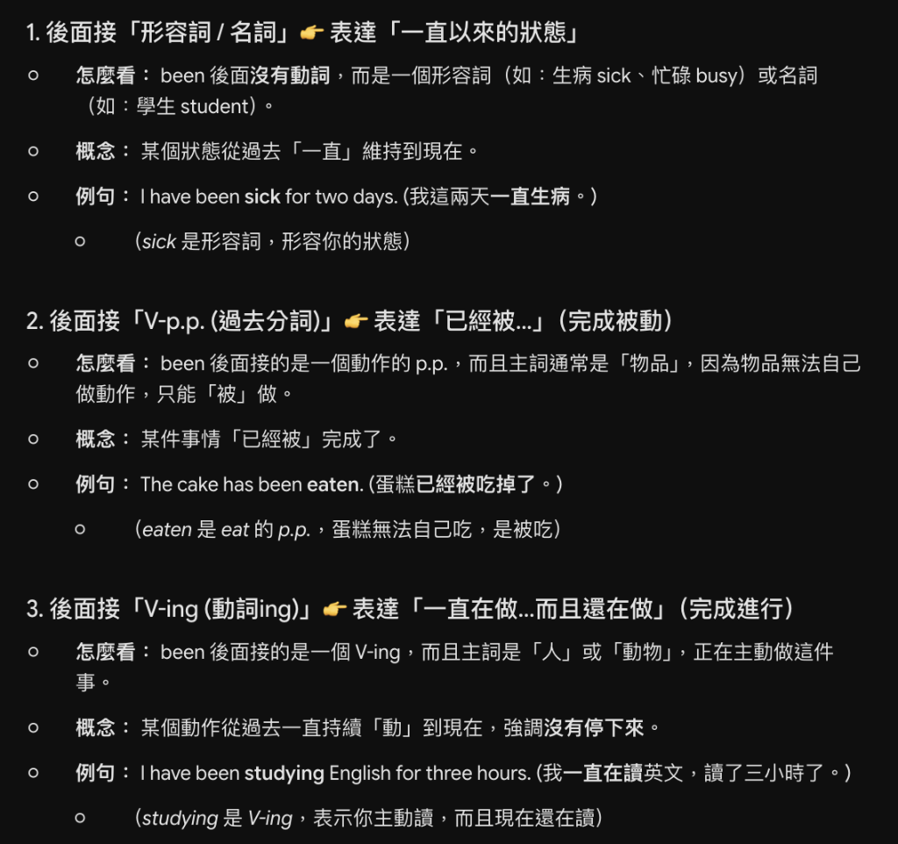

# 英文科重點筆記 (English Notes)

* **教科書版本**：南一／翰林／康軒版通用（國中七～九年級英語）
* **收錄原則**：核心時態句型、易混淆文法、完成式結構速查大表與破題口訣，**不記錄日期**。每頁精簡於 500 字內（最高上限 700 字）。

---

## 📌 重點 1：現在完成式 been 後面三種接法大對決（狀態 vs. 被動 vs. 進行）

### 🏷️ 分類資訊
* **筆記本分類**：進度筆記本（第 5 冊開始）
* **冊數進度**：第 5 冊（九年級上學期）
* **科目**：英文（南一／翰林／康軒版通用）
* **單元章節**：現在完成式核心文法
* **核心知識點**：been 後接「形容詞/名詞」表示一直以來的狀態；接「V-p.p.」表示完成被動；接「V-ing」表示完成進行

### 💡 核心觀念精華
1. **接形容詞 / 名詞（表一直以來的狀態）**：been 後無動詞，接形容詞（如 sick, busy）或名詞（如 student），表示某狀態從過去一直維持到現在。
2. **接 V-p.p.（表完成被動：已經被...）**：主詞通常為「物品」（物品無法自己做動作只能被做），表示事情已經「被」完成。
3. **接 V-ing（表完成進行：一直在做而且還在做）**：主詞通常為「人或動物」（主動作動作），強調動作從過去持續進行到現在沒有停下來。

### 📊 been 後面三種接法全比較速查表

| 接法結構 | 文法意義 | 判斷關鍵 (怎麼看) | 核心概念 | 代表例句與說明 |
|---|---|---|---|---|
| **been ＋ 形容詞 / 名詞** | 一直以來的狀態 | 後無動詞，接 Adj (sick) 或 N (student) | 狀態從過去「一直」維持到現在 | `I have been sick for two days.` (我這兩天一直生病，sick 為形容詞表狀態) |
| **been ＋ V-p.p. (過去分詞)** | 完成被動 (已經被...) | 接動作 p.p.，主詞通常為「物品」（無法自主動作） | 某件事情「已經被」完成了 | `The cake has been eaten.` (蛋糕已經被吃掉了，蛋糕無法自主吃只能被吃) |
| **been ＋ V-ing (現在分詞)** | 完成進行 (一直在做且還在做) | 接 V-ing，主詞通常為「人或動物」（主動做動作） | 動作從過去持續「動」到現在沒停 | `I have been studying English for three hours.` (我一直在讀英文讀了三小時，表示主動且現在還在讀) |

🔍 <b>[核心文法教學重點圖解]（點擊可展開/收合，點擊下方圖片可原地放大）</b>

<input type="checkbox" id="zoom-english-1" class="zoom-toggle">
<label for="zoom-english-1" class="zoom-label">
  
</label>

### 🧠 記憶口訣與秒殺密碼
> 💡 **【been 接法秒殺口訣】**
> - 「接形名是『狀態』，物加被動『被幹掉 (p.p.)』，人動進行『ing 還在衝』！」

### 🎯 隨堂觀念自我檢測
* **題目**：請選出下列現在完成式句子中，文法結構與語意完全正確的選項：『這間教室已經被學生們打掃乾淨了。』
  * (A) The classroom has been cleaned by the students. ★（正解：教室為物品只能被動，使用 been + V-p.p. (cleaned)）
  * (B) The classroom has been cleaning by the students.
  * (C) The classroom have been cleaned by the students.
  * (D) The classroom has cleaned by the students.

---

## 📌 重點 2：比較級特殊片語句型（越來越……）

### 🏷️ 分類資訊
* **筆記本分類**：複習手帳（第 1～4 冊）
* **冊數進度**：第 4 冊（八年級下學期）
* **科目**：英文（南一／翰林／康軒版通用）
* **單元章節**：形容詞與副詞比較級
* **核心知識點**：比較級特殊片語三大句型（get/become ＋ 比較級 ＋ and ＋ 比較級、more and more ＋ 原級、less and less ＋ 原級）

### 💡 核心觀念精華
1. **單音節 / 雙音節形容詞（字尾加 -er）**：使用「`get / become ＋ 比較級 ＋ and ＋ 比較級`」，表示「越來越……」。
   - 例句：**The sky is getting brighter and brighter.**（天空變得越來越亮了。）
2. **多音節形容詞（字前加 more）**：使用「`more and more ＋ 原級`」，表示「越來越……」。
   - 例句：**Ivan becomes more and more handsome.**（Ivan 變得越來越帥了。）
   - ⚠️ **核心規則**：more and more 後方接「**原級**」，不可重複加 -er 或 more！
3. **程度遞減（越來越不……）**：使用「`less and less ＋ 原級`」，表示「越來越不……」。
   - 例句：**The old man is less and less happy.**（這位老先生變得越來越不快樂了。）
   - ⚠️ **核心規則**：less and less 後方同樣接「**原級**」形容詞。

### 📊 比較級特殊片語速查大表

| 片語類型 | 句型結構 | 代表例句與中譯 (翻牌背誦) |
|---|---|---|
| **單音節 / 雙音節形容詞** | `get / become` ＋ **比較級 ＋ and ＋ 比較級** | **The sky is getting brighter and brighter.** （天空變得越來越亮了。） |
| **多音節形容詞** | `get / become` ＋ **more and more ＋ 原級** | **Ivan becomes more and more handsome.** （Ivan 變得越來越帥了。） |
| **程度遞減（越來越不……）** | `get / become` ＋ **less and less ＋ 原級** | **The old man is less and less happy.** （老先生變得越來越不快樂了。） |

### 🧠 記憶口訣與秒殺密碼
> 💡 **【比較級特殊片語秒殺口訣】**
> - **三大句型訣**：短字疊加 `er and er`；長字前置 `more and more ＋ 原級`；程度遞減 `less and less ＋ 原級`！
> - **避坑提醒**：`more and more` 與 `less and less` 後方**固定接原級**，千萬別重複變形！

### 🎯 隨堂觀念自我檢測
* **題目**：選出文法完全正確的填空：Ivan becomes ________ handsome year after year.
  * (A) handsomer and handsomer
  * (B) more and more handsome ★（正解：handsome 為多音節形容詞，搭配 more and more ＋ 原級）
  * (C) more handsome and handsome
  * (D) more and more handsomer

---

## 📌 重點 3：最高級與比較級互換句型（用比較級表達最高級）

### 🏷️ 分類資訊
* **筆記本分類**：複習手帳（第 1～4 冊）
* **冊數進度**：第 4 冊（八年級下學期）
* **科目**：英文（南一／翰林／康軒版通用）
* **單元章節**：形容詞與副詞比較級與最高級
* **核心知識點**：最高級與比較級互換、同範圍比較（排除自己：any other ＋ 單數名詞、all the other ＋ 複數名詞、anyone/everyone else）、否定句型（No other 比較級 / as 原級 as）、跨範圍比較（不加 other/else）

### 💡 核心觀念精華
1. **最高級基本句型**：`S ＋ be 動詞 ＋ the ＋ 最高級形容詞 ＋ in ＋ 地點/範圍...`（例：Tom is the tallest in his class.）。
2. **同範圍比較必「排除自己」**：主詞也是該群體的一員，自己不能與自己比，必須排除主詞自身：
   - 句型 ①：`比較級 ＋ than any other ＋ 單數名詞 ＋ 範圍`（配單數）
   - 句型 ②：`比較級 ＋ than all the other ＋ 複數名詞 ＋ 範圍`（配複數）
   - 句型 ③：`比較級 ＋ than anyone else / everyone else ＋ 範圍`（else 站後方）
3. **否定詞 No other 開頭互換句型**：
   - 比較級：`No other ＋ 名詞 ＋ be 動詞 ＋ 比較級 ＋ than ＋ A`
   - 原級：`No other ＋ 名詞 ＋ be 動詞 ＋ as ＋ 原級 ＋ as ＋ A`
4. **【會考大陷阱】跨範圍比較**：
   - **若與不同範圍物件做比較，絕對不加 other 和 else！**
   - 同範圍（玉山在台灣）：Mt. Jade is taller than **any other** mountain in Taiwan.（加 other 排除自己）
   - 不同範圍（玉山不在日本）：Mt. Jade is taller than **any** mountain in Japan.（**不加** other）

### 📊 最高級與比較級互換速查大表

| 句型角度 / 種類 | 句型結構 | 經典例句與重點提示 |
|---|---|---|
| **① 標準最高級** | S ＋ be 動詞 ＋ **the ＋ 最高級** ＋ in ＋ 地點/範圍 | **Tom is the tallest in the class.** （Tom 是班上最高的。） |
| **② 比較級（any other）** | S ＋ be 動詞 ＋ **比較級 ＋ than any other ＋ 單數名詞** ＋ 範圍 | **Tom is taller than any other boy in the class.** ⚠️ any other 後接「單數名詞」（排除自己） |
| **③ 比較級（all the other）** | S ＋ be 動詞 ＋ **比較級 ＋ than all the other ＋ 複數名詞** ＋ 範圍 | **Tom is taller than all the other boys in the class.** ⚠️ all the other 後接「複數名詞」（排除自己） |
| **④ 比較級（代名詞 else）** | S ＋ be 動詞 ＋ **比較級 ＋ than anyone else / everyone else** ＋ 範圍 | **Tom is taller than anyone else in the class.** ⚠️ else 放在代名詞後面（排除自己） |
| **⑤ 否定比較級（No other）** | **No other ＋ 名詞** ＋ be 動詞 ＋ **比較級 ＋ than ＋ A** | **No other boy is taller than Tom.** （沒有其他男生比 Tom 更高。） |
| **⑥ 否定原級（No other）** | **No other ＋ 名詞** ＋ be 動詞 ＋ **as ＋ 原級 ＋ as ＋ A** | **No other boy is as tall as Tom.** （沒有其他男生像 Tom 一樣高。） |
| **⚡ 跨範圍比較（必考陷阱）** | S ＋ be 動詞 ＋ **比較級 ＋ than any ＋ 名詞**（**不加 other / else**） | **Mt. Jade is taller than any mountain in Japan.** ⚠️ 玉山不在日本境內，屬於不同範圍比較，**絕不能加 other！** |

### 🧠 記憶口訣與秒殺密碼
> 💡 **【最高級與比較級互換黃金口訣】**
> - **同組排除訣**：any other 配單數；all the other 領複數；anyone else，else 站後面！
> - **否定雙雄**：No other 開頭立大功，比 than 原 as...as 意思通！
> - **跨界避坑金律**：同一國的要排除（加 other）；不同國的直接比（不加 other）！

### 🎯 隨堂觀念自我檢測
* **題目**：選出文法完全正確的句子表達「Leo 是班上最高的男生」：
  * (A) Leo is taller than any other boys in his class.
  * (B) Leo is taller than any other boy in his class. ★（正解：同班範圍排除自己，any other ＋ 單數名詞 boy）
  * (C) Leo is taller than all the other boy in his class.
  * (D) Leo is taller than any boy in his class.
---

## 📌 重點 4：需接動名詞（V-ing）當受詞的動詞及片語

### 🏷️ 分類資訊
* **筆記本分類**：複習手帳（第 1～4 冊）
* **冊數進度**：第 3 冊（八年級上學期）
* **科目**：英文（南一／翰林／康軒版通用）
* **單元章節**：動名詞核心文法（Gerunds）
* **核心知識點**：需接動名詞（V-ing）當受詞的特定動詞、常見介系詞片語與慣用句型

### 💡 核心觀念精華
1. **動名詞當受詞特性**：英文中某些特定動詞與片語後方若要接動作，**只能接動名詞（V-ing）**，絕不可接不定詞（to V）。
2. **必接 V-ing 的核心動詞**：
   - `enjoy`（享受 / 喜愛）
   - `practice`（練習）
   - `finish`（完成）
   - `quit`（戒除 / 放棄）
   - `keep`（保持 / 持續）
   - `mind`（介意）
   - `spend`（花費時間/金錢）
   - `miss`（想念 / 錯過）
   - `avoid`（避免）
3. **必接 V-ing 的常見核心片語與慣用語**：
   - `be busy (in) ＋ V-ing`（忙於……）
   - `feel like ＋ V-ing`（想要……）
   - `look forward to ＋ V-ing`（期待……，to 為介系詞）
   - `be used to ＋ V-ing`（習慣於……，to 為介系詞）
   - `be good at ＋ V-ing`（擅長於……，at 為介系詞）
   - `there / it is no use ＋ V-ing`（做……是無用的 / 徒勞無功）
   - `have a good time / have fun ＋ V-ing`（玩得開心）
   - `have a hard time / have difficulty ＋ (in) V-ing`（做……有困難）

### 📊 需接動名詞（V-ing）當受詞的動詞及片語速查大表

| 分類類別 | 動詞 / 片語 | 搭配結構與中文意涵 (翻牌背誦) |
|---|---|---|
| **核心動詞** | enjoy | **enjoy ＋ V-ing**（喜愛 / 享受做某事） |
| **核心動詞** | practice | **practice ＋ V-ing**（練習做某事） |
| **核心動詞** | finish | **finish ＋ V-ing**（完成做某事） |
| **核心動詞** | quit | **quit ＋ V-ing**（戒除 / 放棄做某事） |
| **核心動詞** | keep | **keep ＋ V-ing**（持續 / 一直做某事） |
| **核心動詞** | mind | **mind ＋ V-ing**（介意做某事，常用於 Would/Do you mind...?） |
| **核心動詞** | spend | **spend ＋ 時間/金錢 ＋ (in) V-ing**（花時間/金錢做某事） |
| **核心動詞** | miss | **miss ＋ V-ing**（錯過做某事 / 想念做某事） |
| **核心動詞** | avoid | **avoid ＋ V-ing**（避免做某事） |
| **常見片語** | be busy | **be busy (in) ＋ V-ing**（忙著做某事） |
| **常見片語** | feel like | **feel like ＋ V-ing**（想要做某事） |
| **常見片語** | look forward to | **look forward to ＋ V-ing**（期待做某事，⚠️ to 是介系詞） |
| **常見片語** | be used to | **be used to ＋ V-ing**（習慣於做某事，⚠️ to 是介系詞） |
| **常見片語** | be good at | **be good at ＋ V-ing**（擅長於做某事，⚠️ at 是介系詞） |
| **慣用句型** | there / it is no use | **There / It is no use ＋ V-ing**（做……是沒用的 / 徒勞無功） |
| **慣用片語** | have a good time / have fun | **have a good time / have fun ＋ (in) V-ing**（做某事玩得很開心） |
| **慣用片語** | have a hard time / have difficulty | **have a hard time / have difficulty ＋ (in) V-ing**（做某事有困難 / 費力） |

### 🧠 記憶口訣與秒殺密碼
> 💡 **【接動名詞 V-ing 秒殺記憶法】**
> - **九大動詞口訣**：「享受（enjoy）練習（practice）完（finish），放棄（quit）持續（keep）不介意（mind），花錢（spend）錯過（miss）能避免（avoid）！」
> - **四大介系詞 to 大陷阱**：`look forward to`（期待）、`be used to`（習慣於），這裡的 `to` 都是**介系詞**，後面通通要抓 `V-ing`！

### 🎯 隨堂觀念自我檢測
* **題目**：選出文法完全正確的填空：We are really looking forward to ________ you at the party tonight.
  * (A) see
  * (B) seeing ★（正解：look forward to 中的 to 為介系詞，後方固定接動名詞 V-ing）
  * (C) to see
  * (D) saw
