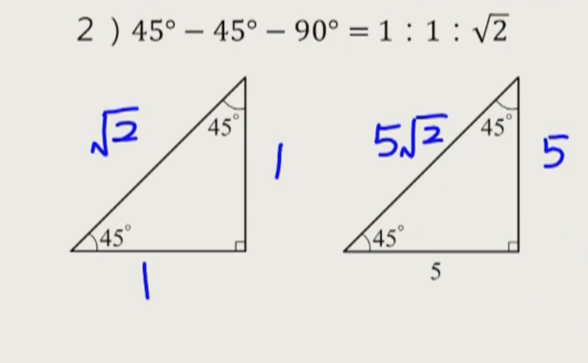

# 數學科重點筆記 (Mathematics Notes)

* **教科書版本**：翰林版（七～九年級國中數學）
* **收錄原則**：提煉核心精華概念、破題口訣、關鍵公式、速查表與隨堂檢測題，**不記錄日期**。

---

## 📌 重點 1：特殊直角三角形三邊長比（45°-45°-90° 與 30°-60°-90°）

### 🏷️ 分類資訊
* **筆記本分類**：複習筆記本（第 1～4 冊）
* **冊數進度**：第 3 冊（八年級上學期）
* **科目**：數學（翰林版）
* **單元章節**：第 3 章 畢氏定理
* **核心知識點**：45°-45°-90° 邊長比 1:1:√2 與 30°-60°-90° 邊長比 1:√3:2 特殊直角三角形三邊長比

### 💡 核心觀念精華
1. **45°-45°-90° 等腰直角三角形**：兩底角相等 $\implies$ 兩股等長。依畢氏定理：$1^2 + 1^2 = 2 \implies$ 邊長比為 $1 : 1 : \sqrt{2}$。
2. **30°-60°-90° 特殊直角三角形**：正三角形切半而來。短股（$30^\circ$ 對邊）: 長股（$60^\circ$ 對邊）: 斜邊（$90^\circ$ 對邊）$= 1 : \sqrt{3} : 2$。

### 📐 關鍵公式與速查比較表

| 三角形類型 | 內角度數 | 三邊長比例 (短股 : 長股 : 斜邊) | 速算解題技巧 |
|---|---|---|---|
| **等腰直角三角形** | $45^\circ - 45^\circ - 90^\circ$ | $1 : 1 : \sqrt{2}$ | 知股求斜乘 $\sqrt{2}$；知斜求股除 $\sqrt{2}$（例：股 5 $\implies$ 斜 $5\sqrt{2}$） |
| **特殊直角三角形** | $30^\circ - 60^\circ - 90^\circ$ | $1 : \sqrt{3} : 2$ | $30^\circ$ 對邊為 $a \implies$ 斜邊為 $2a$、長股（高）為 $\sqrt{3}a$ |

🔍 <b>[教學重點截圖]（點擊可展開/收合，點擊下方圖片可原地放大）</b>

<input type="checkbox" id="zoom-math-1" class="zoom-toggle">
<label for="zoom-math-1" class="zoom-label">
  
</label>

### 🧠 記憶口訣與破題訣竅
> 💡 **【特殊角秒殺口訣】**
> - **45°-45°-90°**：「一股、二股、根號二斜邊！」（知股求斜 $\times\sqrt{2}$，知斜求股 $\div\sqrt{2}$）
> - **30°-60°-90°**：「三十對 1，六十對 $\sqrt{3}$，九十對 2！」

### 🎯 隨堂觀念自我檢測
* **題目**：若一個等腰直角三角形的兩股長皆為 7 公分，請問其斜邊長為多少公分？
  * (A) $7\sqrt{2}$ 公分 ★（正解：45°-45°-90° 邊長比 1:1:$\sqrt{2}$，斜邊為 $7 \times \sqrt{2} = 7\sqrt{2}$ 公分）
  * (B) 14 公分
  * (C) $7\sqrt{3}$ 公分
  * (D) 49 公分

---

## 📌 重點 2：正三角形的高與面積公式

### 🏷️ 分類資訊
* **筆記本分類**：複習筆記本（第 1～4 冊）
* **冊數進度**：第 3 冊（八年級上學期）
* **科目**：數學（翰林版）
* **單元章節**：第 3 章 畢氏定理
* **核心知識點**：正三角形邊長 $a$，高 $h = \frac{\sqrt{3}}{2}a$，面積 $A = \frac{\sqrt{3}}{4}a^2$

### 💡 核心觀念精華
1. **高 ($h$) 公式**：$h = \frac{\sqrt{3}}{2} a$（利用畢氏定理：從頂點作垂線平分底邊，切成兩個 $30^\circ-60^\circ-90^\circ$ 直角三角形，高為邊長的 $\frac{\sqrt{3}}{2}$ 倍）。
2. **面積 ($A$) 公式**：$A = \frac{\sqrt{3}}{4} a^2$（由「底 $\times$ 高 $\div 2$」計算得出：$a \times \frac{\sqrt{3}}{2}a \div 2 = \frac{\sqrt{3}}{4} a^2$）。

### 📐 關鍵公式與速查表

| 幾何項目 | 符號 | 計算公式 | 推導依據與幾何原理 |
|---|---|---|---|
| **正三角形的高** | $h$ | $h = \frac{\sqrt{3}}{2} a$ | 作垂線切成兩個 $30^\circ-60^\circ-90^\circ$ 直角三角形，高為邊長之 $\frac{\sqrt{3}}{2}$ 倍 |
| **正三角形面積** | $A$ | $A = \frac{\sqrt{3}}{4} a^2$ | 由「底 $\times$ 高 $\div 2$」計算：$a \times \frac{\sqrt{3}}{2}a \div 2 = \frac{\sqrt{3}}{4} a^2$ |

### 🧠 記憶口訣與破題訣竅
> 💡 **【正三角形雙公式秒殺口訣】**
> - 高記「二分之根號三 $a$」！
> - 面積記「四分之根號三 $a^2$」！

### 🎯 隨堂觀念自我檢測
* **題目**：已知一個正三角形的邊長為 6 公分，請問其面積為多少平方公分？
  * (A) $9\sqrt{3}$ 平方公分 ★（正解：面積公式為 $\frac{\sqrt{3}}{4}a^2 = \frac{\sqrt{3}}{4} \times 36 = 9\sqrt{3}$ 平方公分）
  * (B) $3\sqrt{3}$ 平方公分
  * (C) $18\sqrt{3}$ 平方公分
  * (D) 36 平方公分
