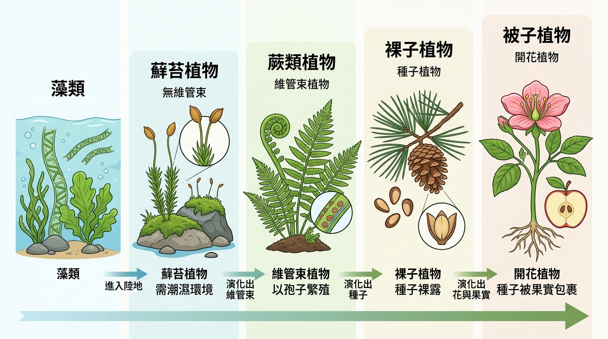
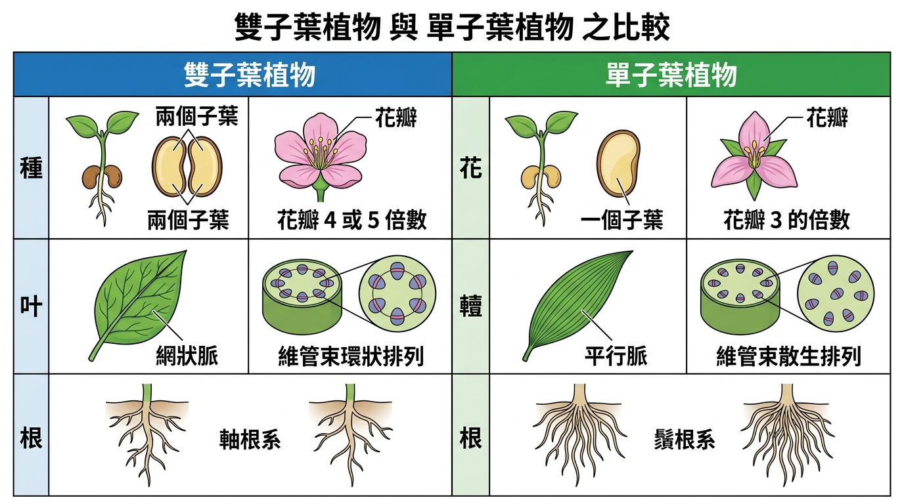
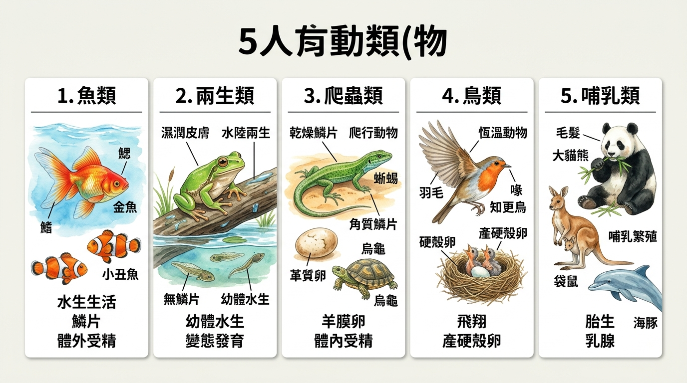
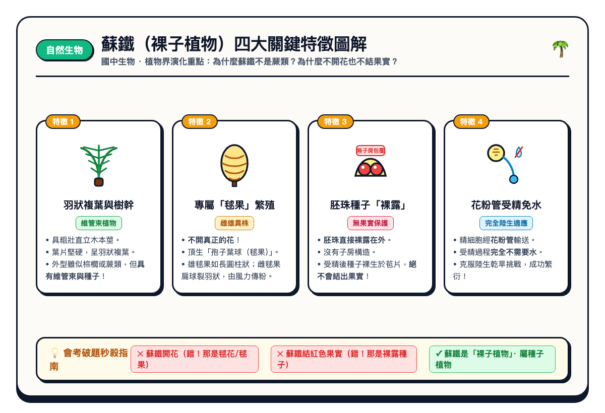

# 自然科重點筆記 (Science Notes)

* **教科書版本**：翰林版（七～九年級國中自然：生物 / 理化 / 地科）
* **收錄原則**：圖表化歸納自然科學核心實驗、觀念機轉與動植物演化分類，**不記錄日期**。

---

## 📌 重點 1：植物界五大族群演化與構造特徵全比較

### 🏷️ 分類資訊
* **筆記本分類**：複習筆記本（第 1～4 冊）
* **冊數進度**：第 2 冊（七年級下學期）
* **科目**：自然/生物（翰林版）
* **單元章節**：七年級下學期 第 2 章 生物的分類與植物界
* **核心知識點**：藻類、蘚苔、蕨類、裸子植物、被子植物五大族群器官構造與演化適應

### 💡 核心觀念精粹
1. **角質層**：蘚苔植物開始演化出角質層防止水分蒸散；生活於水中的藻類無。
2. **維管束**：蕨類植物首度演化出維管束與真根、莖、葉，植物體開始能向上長高。
3. **花粉管與種子**：裸子與被子植物演化出花粉管輸送精細胞，受精**免水**。
4. **花與果實**：被子植物獨具子房保護胚珠，受精後結成果實保護種子，為陸地最優勢族群。

### 📊 植物界五大族群特徵速查比較表

| 構造 / 特徵項目 | 藻類 | 蘚苔植物 | 蕨類植物 | 裸子植物 | 被子植物 (開花植物) |
|---|:---:|:---:|:---:|:---:|:---:|
| **細胞壁 / 葉綠體** | ○ | ○ | ○ | ○ | ○ |
| **角質層 (登陸適應)** | × | ○ | ○ | ○ | ○ |
| **維管束 (長高關鍵)** | × | × (無真根莖葉) | ○ (首度演化出) | ○ | ○ |
| **繁殖方式** | 孢子 | 孢子 | 孢子 | 種子 | 種子 |
| **胚珠** | × | × | × | ○ (裸露無子房) | ○ (包於子房內) |
| **花** | × | × | × | × (無真正的花) | ○ (唯一開花植物) |
| **果實 / 子房** | × / × | × / × | × / × | × / × | ○ / ○ (果實保護種子) |
| **毬果** | × | × | × | ○ (專屬毬果) | × |
| **花粉管 (受精免水)** | × (精子游水) | × (精子游水) | × (精子游水) | ○ (免水受精) | ○ (免水受精) |

🔍 <b>[核心觀念教學圖解]（點擊可展開/收合，點擊下方圖片可原地放大）</b>

<input type="checkbox" id="zoom-science-1" class="zoom-toggle">
<label for="zoom-science-1" class="zoom-label">
  
</label>

### 🧠 記憶口訣與破題密碼
> 💡 **【黃金演化階梯口訣】**
> - **四步演化訣**：「蘚苔長角質，蕨類有血管；裸被通水管（花粉管），被子抱子房！」
> - **秒殺金律**：題目只要看到「花」、「果實」、「子房」，必定是**被子植物**；看到「毬果」秒選**裸子植物**！

### 🎯 隨堂觀念自我檢測
* **題目**：在野外發現一種綠色植物，具有維管束，以孢子繁殖，生活史中受精過程仍需要水分為媒介。請問此植物最可能屬於下列哪一類？
  * (A) 藻類
  * (B) 蘚苔植物
  * (C) 蕨類植物 ★（正解：具維管束且孢子繁殖受精需水，必定為蕨類植物）
  * (D) 裸子植物

---

## 📌 重點 2：被子植物（開花植物）雙子葉 vs. 單子葉大對決

### 🏷️ 分類資訊
* **筆記本分類**：複習筆記本（第 1～4 冊）
* **冊數進度**：第 2 冊（七年級下學期）
* **科目**：自然/生物（翰林版）
* **單元章節**：七年級下學期 第 2 章 生物的分類與植物界
* **核心知識點**：被子植物分類、雙子葉植物與單子葉植物五大形態特徵對比

### 💡 核心觀念精粹
1. **雙子葉植物**：子葉 2 片、花瓣 4 或 5 的倍數、網狀脈、莖維管束**環狀排列**（有形成層能加粗）、**軸根系**（主根明顯）。
2. **單子葉植物**：子葉 1 片、花瓣 3 的倍數、平行脈、莖維管束**散生排列**（無形成層不能加粗）、**鬚根系**（叢生細根）。

### 📊 雙子葉植物 vs. 單子葉植物特徵全對照表

| 比較項目 | 雙子葉植物 | 單子葉植物 | 常見植物代表 |
|---|---|---|---|
| **子葉數目** | **2 片** | **1 片** | 花生、大豆 / 玉米、水稻 |
| **花瓣數目** | **4 或 5 的倍數** | **3 的倍數** | 梅花 (5瓣) / 百合 (6瓣) |
| **葉脈型態** | **網狀脈** | **平行脈** | 菩提、楓葉 / 竹、蔥、韭菜 |
| **莖維管束** | **環狀排列** (有形成層，能加粗) | **散生排列** (無形成層，不能加粗) | 多木本樹木 / 多草本竹稻 |
| **根系型態** | **軸根系** (有主根深扎) | **鬚根系** (叢生細根) | 拔蔥看根是一把鬚！ |

🔍 <b>[核心觀念教學圖解]（點擊可展開/收合，點擊下方圖片可原地放大）</b>

<input type="checkbox" id="zoom-science-2" class="zoom-toggle">
<label for="zoom-science-2" class="zoom-label">
  
</label>

### 🧠 記憶口訣與破題密碼
> 💡 **【單雙子葉秒殺口訣】**
> - **單子葉口訣**：「一葉三花平行脈，散生鬚根無層次！」
> - **雙子葉口訣**：「雙葉四五網狀脈，環狀軸根有層次！」

### 🎯 隨堂觀念自我檢測
* **題目**：小麥在校園中撿到一片具有平行脈的落葉，請推測該植物的莖與根最可能具有下列何種特徵？
  * (A) 莖維管束散生排列，根為鬚根系 ★（正解：平行脈為單子葉植物，維管束散生無形成層，根為鬚根系）
  * (B) 莖維管束環狀排列，根為軸根系
  * (C) 莖具發達形成層能年年加粗
  * (D) 種子具有兩片子葉

---

## 📌 重點 3：動物界 — 脊椎動物五大類比較表

### 🏷️ 分類資訊
* **筆記本分類**：複習筆記本（第 1～4 冊）
* **冊數進度**：第 2 冊（七年級下學期）
* **科目**：自然/生物（翰林版）
* **單元章節**：七年級下學期 第 3 章 動物界的分類
* **核心知識點**：脊椎動物五大類呼吸構造、受精方式、生殖方式、體溫調節與體表特徵

### 💡 核心觀念精粹
1. **體溫調節**：魚類、兩生類、爬蟲類為「外溫（變溫）動物」；鳥類、哺乳類為「內溫（定溫）動物」。
2. **呼吸器官演化**：鰓（魚類、兩生幼體）$\to$ 肺與皮膚（兩生成體）$\to$ 肺（爬蟲、鳥、哺乳）；鳥類具氣囊輔助飛行。
3. **受精與繁衍**：魚與兩生多體外受精、無卵殼；爬蟲、鳥、哺乳為體內受精，具卵殼或胎生適應陸生。

### 📊 脊椎動物五大類全比較表

| 比較項目 | 魚類 | 兩生類 | 爬蟲類 | 鳥類 | 哺乳類 |
|---|---|---|---|---|---|
| **呼吸構造** | 鰓 | 幼體鰓 / 成體肺與皮膚 | 肺 | 肺 (具氣囊) | 肺 |
| **受精方式** | 多數體外受精 | 體外受精 | 體內受精 | 體內受精 | 體內受精 |
| **生殖方式** | 卵生 (無卵殼) | 卵生 (無卵殼) | 卵生 (具革質卵殼) | 卵生 (具硬鈣質卵殼) | 多數胎生 (鴨嘴獸卵生) |
| **體溫調節** | 外溫 (變溫) | 外溫 (變溫) | 外溫 (變溫) | 內溫 (定溫) | 內溫 (定溫) |
| **體表構造** | 鱗片 / 黏液 | 濕潤裸露皮膚 | 乾燥鱗片或骨板 | 羽毛 | 毛髮 |

🔍 <b>[核心觀念教學圖解]（點擊可展開/收合，點擊下方圖片可原地放大）</b>

<input type="checkbox" id="zoom-science-3" class="zoom-toggle">
<label for="zoom-science-3" class="zoom-label">
  
</label>

### 🧠 記憶口訣與破題密碼
> 💡 **【脊椎動物五大類秒殺口訣】**
> - **體溫與受精**：「外溫魚兩爬，內溫鳥哺乳；兩生皮膚輔呼吸，羊膜卵殼登陸齊！」

### 🎯 隨堂觀念自我檢測
* **題目**：下列有關脊椎動物五大類群特徵的敘述，何者完全正確？
  * (A) 爬蟲類、鳥類與哺乳類皆為體內受精，並具有防止水分散失的卵殼或胎生構造 ★（正解：體內受精與羊膜卵/胎生成功克服陸地乾旱）
  * (B) 兩生類成體已完全適應陸生乾燥環境，繁殖受精不需水分
  * (C) 魚類與爬蟲類皆為內溫（定溫）動物
  * (D) 鳥類與哺乳類皆為卵生且體表覆蓋鱗片

---

## 📌 重點 4：裸子植物核心代表 — 蘇鐵（鐵樹）特徵全剖析

### 🏷️ 分類資訊
* **筆記本分類**：複習筆記本（第 1～4 冊）
* **冊數進度**：第 2 冊（七年級下學期）
* **科目**：自然/生物（翰林版）
* **單元章節**：七年級下學期 第 2 章 生物的分類與植物界
* **核心知識點**：蘇鐵羽狀複葉、毬果生殖、胚珠種子裸露不具子房、花粉管受精免水

### 💡 核心觀念精粹
1. **分類定位**：蘇鐵（鐵樹）屬於**裸子植物**、種子植物、維管束植物，不是蕨類，亦非被子植物。
2. **生殖器官**：**不開真正的花**！生殖器官為「毬果（孢子葉球）」，雌雄異株，風力傳粉。
3. **胚珠種子裸露**：胚珠直接著生於苞片邊緣，完全裸露在外，**沒有子房構造，絕不結出果實**。
4. **花粉管受精**：具有花粉管輸送精細胞，受精過程**完全不需要水為媒介**。

### 📊 蘇鐵（裸子植物）vs. 被子植物特徵速查比較表

| 比較項目 | 蘇鐵（裸子植物代表） | 被子植物（開花植物） | 考試秒殺關鍵判斷 |
|---|---|---|---|
| **維管束 (木質部/韌皮部)** | ○ | ○ | 兩者皆具維管束，能向上直立長高 |
| **花粉管 (受精免水)** | ○ | ○ | 兩者精細胞皆由花粉管輸送，免水受精 |
| **生殖器官** | 毬果 (孢子葉球) | 花 | 看到「毬果」秒選裸子植物！ |
| **胚珠位置** | 裸露在外 (無子房) | 包於子房內 | 裸子植物因無子房，故絕無果實！ |
| **果實構造** | × (無果實) | ○ (果實保護種子) | 蘇鐵紅色的不是果實，是裸露種子！ |
| **繁殖方式** | 種子 (種子裸露) | 種子 (種子在果實內) | 兩者皆為「種子植物」 |
| **常見家族代表** | 蘇鐵、二葉松、紅檜、側柏、銀杏 | 百合、梅花、向日葵、水稻 | 口訣「蘇鐵松杉柏銀杏」一秒記！ |

🔍 <b>[核心觀念教學圖解]（點擊可展開/收合，點擊下方圖片可原地放大）</b>

<input type="checkbox" id="zoom-science-4" class="zoom-toggle">
<label for="zoom-science-4" class="zoom-label">
  
</label>

### 🧠 記憶口訣與破題密碼
> 💡 **【蘇鐵裸子植物秒殺密碼】**
> - 「蘇鐵松杉柏銀杏，毬果裸露不結果；羽葉雖似蕨與棕，通水免水管中游！」

### 🎯 隨堂觀念自我檢測
* **題目**：俗話說「鐵樹開花」比喻極為罕見。就現代生物分類觀點來看，下列敘述何者最精確？
  * (A) 蘇鐵屬於裸子植物，俗稱的開花其實是長出毬果（孢子葉球），並非被子植物的花 ★（正解：蘇鐵為裸子植物，胚珠裸生無子房，無真正的花）
  * (B) 蘇鐵秋天結出紅色肉質的果實，藉由鳥類取食傳播種子
  * (C) 蘇鐵具有大型羽狀複葉，以孢子囊群繁殖，屬於蕨類植物
  * (D) 蘇鐵精卵結合時仍需要雨水為媒介才能完成受精

---

## 📌 重點 5：原岩經變質作用形成變質岩與用途對照表

### 🏷️ 分類資訊
* **筆記本分類**：進度筆記本（第 5 冊開始）
* **冊數進度**：第 5 冊（國三上學期）
* **科目**：自然/地科（翰林版）
* **單元章節**：九年級上學期 第 2 章 地球的歷史與岩石
* **核心知識點**：沉積岩與火成岩經高溫高壓變質後形成的變質岩種類及其生活應用用途

### 💡 核心觀念精粹
1. **變質作用**：在地底高溫高壓環境下，礦物重新結晶排列，形成新變質岩。
2. **常見對照**：砂岩 $\to$ 石英岩；頁岩 $\to$ 板岩與片岩；石灰岩 $\to$ 大理岩；花崗岩 $\to$ 片麻岩。

### 📊 原岩與變質岩對照表

| 原岩類別 | 原岩 | 經變質作用形成變質岩 | 用途 |
|---|---|---|---|
| **沉積岩** | 砂岩 | 石英岩 | 玻璃原料、建築飾材 |
| **沉積岩** | 頁岩 | 板岩與片岩 | 冬暖夏涼的石板屋 |
| **沉積岩** | 石灰岩 | 大理岩 | 藝術石雕、建築飾材 |
| **火成岩** | 花崗岩 | 片麻岩 | 堅硬鋪路石、建築基石 |

### 🧠 記憶口訣與破題密碼
> 💡 **【變質岩秒殺口訣】**
> - 「砂變石英頁面板，石灰大理花片麻；高溫高壓葉理出！」

### 🎯 隨堂觀念自我檢測
* **題目**：台灣東部著名的太魯閣峽谷壯麗雄偉，其岩壁主要由石灰岩經高溫高壓變質而形成。請問此種變質岩名稱為何？
  * (A) 大理岩 ★（正解：石灰岩經高溫高壓變質後形成大理岩）
  * (B) 板岩
  * (C) 石英岩
  * (D) 片麻岩

---

## 📌 重點 6：地表三大岩石分類全攻略（沉積岩、火成岩、變質岩）

### 🏷️ 分類資訊
* **筆記本分類**：複習筆記本（第 1～4 冊）
* **冊數進度**：第 4 冊（八年級下學期）
* **科目**：自然/地科（翰林版）
* **單元章節**：八年級下學期 第 4 章 地層與地表地質
* **核心知識點**：沉積岩、火成岩、變質岩三大岩石成因、構造特徵、化石有無與代表岩石

### 💡 核心觀念精粹
1. **沉積岩**：地表最常見，具層理，是唯一**能保存化石**的岩石（石灰岩、砂岩、頁岩）。
2. **火成岩**：岩漿冷卻形成。地表噴發冷卻快結晶細（安山岩、玄武岩）；地下深處冷卻慢結晶粗（花崗岩）。
3. **變質岩**：地下高溫高壓下再結晶，常具葉理（片麻岩、大理岩、板岩）。

### 📊 三大岩石分類比較表

| 岩石類別 | 形成方式與成因 | 外觀構造關鍵 | 常見代表岩石 | 有無化石可能 |
|---|---|---|---|---|
| **沉積岩** | 沉積物堆積經壓密、膠結 | 層理構造、顆粒分明 | 石灰岩、砂岩、頁岩、礫岩 | ○ 唯一可能含化石！ |
| **火成岩** | 地底岩漿或地表熔岩冷卻結晶 | 塊狀構造、結晶顆粒 | 花崗岩 (深成) / 玄武岩、安山岩 (噴出) | × 熔融高溫化石已燒毀 |
| **變質岩** | 地下深處經高溫高壓變質 | 葉理構造、礦物重新排列 | 片麻岩、大理岩、板岩、片岩 | × 絕大多數化石已變形破壞 |

### 🧠 記憶口訣與破題密碼
> 💡 **【三大岩石秒殺口訣】**
> - 「有層有化石選沉積；火山岩漿選火成；高溫高壓葉理變質！」

### 🎯 隨堂觀念自我檢測
* **題目**：地質學家在野外地層中採集到三葉蟲化石，請問該地層最可能由下列哪一種岩石構成？
  * (A) 沉積岩（如頁岩、砂岩、石灰岩）★（正解：只有沉積岩堆積才能保存生物遺骸與化石）
  * (B) 火成岩（如花崗岩、玄武岩）
  * (C) 變質岩（如片麻岩）
  * (D) 岩漿岩

---

## 📌 重點 7：食物鏈中的「能量流動」vs.「生物累積（生物放大作用）」

### 🏷️ 分類資訊
* **筆記本分類**：複習筆記本（第 1～4 冊）
* **冊數進度**：第 2 冊（七年級下學期）
* **科目**：自然/生物（翰林版）
* **單元章節**：七年級下學期 第 5 章 生態系
* **核心知識點**：較高級的消費者累積的毒素濃度會越高、較高級的消費者獲得的能量會越少

### 💡 核心觀念精粹
1. **較高級的消費者累積的毒素濃度會越高**：環境中不易被生物分解與代謝排出的毒素（如重金屬汞與鉛、DDT、戴奧辛等），隨食物鏈由低階傳遞至高階時會逐級濃縮累積（稱為**生物放大作用**或**生物累積**），因此最高階消費者體內毒素濃度最高。
2. **較高級的消費者獲得的能量會越少**：能量在食物鏈各營養階層流動時，每一階層約僅有 **10%** 的能量能傳遞給下一階層（其餘 90% 以呼吸作用與熱能散失消耗），因此**階層越高獲得的能量越少**，導致食物鏈長度通常受限於 4～5 個階層。

### 📊 能量流動 vs. 生物累積階層全對照表

| 營養階層 (由下至上) | 生態角色範例 | 累積毒素濃度 (生物放大) | 獲得能量多寡 (能量流動) | 總生物量金字塔 |
|---|---|:---:|:---:|:---:|
| **生產者** | 綠色植物、浮游藻類 | **最低** | **最多 (100% 原始太陽能)** | 最大 (金字塔底部) |
| **初級消費者** | 草食動物 (如磷蝦、昆蟲、牛羊) | 較低 | 次多 (約 10%) | 次大 |
| **次級消費者** | 小型肉食動物 (如小魚、青蛙) | 較高 | 較少 (約 1%) | 較小 |
| **最高級消費者** | 頂級掠食者 (如老鷹、虎鯨、人類) | **最高 ★ (極度濃縮)** | **最少 ★ (約 0.1% 或更低)** | 最小 (金字塔頂部) |
| **規律變化總結** | **沿食物鏈階層由低到高** | **越高級 ➡️ 累積毒素濃度越高** | **越高級 ➡️ 獲得能量越少** | **越高級 ➡️ 總生物量越少** |

### 🧠 記憶口訣與破題密碼
> 💡 **【能量與毒素雙向秒殺口訣】**
> - **黃金口訣**：「**能量往上越少，毒素往上越高！**」
> - **秒殺重點**：
>   - 能量流動是「**單向流動、逐級遞減**」（無法循環，散失成熱能）。
>   - 不易代謝毒素是「**逆向濃縮、逐級爆表**」（生物放大作用）。

### 🎯 隨堂觀念自我檢測
* **題目**：某重金屬污染的水域中有一食物鏈：矽藻 $\to$ 劍水蚤 $\to$ 小魚 $\to$ 大魚 $\to$ 魚鷹。請問下列何者體內累積的重金屬濃度最高？且哪一生物所獲得的總能量最少？
  * (A) 魚鷹累積重金屬濃度最高；魚鷹獲得的總能量最少 ★（正解：較高級的消費者累積的毒素濃度越高，獲得的能量越少）
  * (B) 矽藻累積重金屬濃度最高；魚鷹獲得的總能量最少
  * (C) 魚鷹累積重金屬濃度最高；矽藻獲得的總能量最少
  * (D) 矽藻累積重金屬濃度最低；矽藻獲得的總能量最多

---

## 📌 重點 8：族群與群集（定義、三大要素與夢幻湖實例）

### 🏷️ 分類資訊
* **筆記本分類**：複習筆記本（第 1～4 冊）
* **冊數進度**：第 2 冊（七年級下學期）
* **科目**：自然/生物（翰林版）
* **單元章節**：七年級下學期 第 5 章 生態系
* **核心知識點**：族群（同一時間、特定地域自然棲地、同物種）與群集（同一時期、相同棲地、多於一個族群）

### 💡 核心觀念精粹
1. **族群 (Population)**：同一時間、由特定地域**同物種**的個體組成的群體。通常以**自然棲地**當成區分單位，而不是以人為劃界為單位。
2. **群集 (Community)**：在同一時期、相同棲地上，**多於一個族群**結合而成群集（即生活在該環境的所有生物）。
3. **原稿經典實例**：2009 年陽明山夢幻湖的「面天樹蛙 ＋ 山紅頭 ＋ 臺灣水韭 ＝ **夢幻湖群集**」。

### 📊 族群 vs. 群集 特徵速查比較表

| 比較項目 | 族群 (Population) | 群集 (Community) |
|---|---|---|
| **時間條件** | 同一時間 | 同一時期 |
| **空間範圍** | 特定地域（以**自然棲地**為單位，非人為行政區） | 相同棲地 |
| **物種組成** | **同物種**（單一物種個體組成的群體） | **多於一個族群**（生活於該地的所有生物） |
| **原稿代表實例** | 夢幻湖的「面天樹蛙」族群、「臺灣水韭」族群 | 2009 年陽明山夢幻湖的「面天樹蛙 ＋ 山紅頭 ＋ 臺灣水韭 ＝ 夢幻湖群集」 |
| **常見考試陷阱** | ❌「池塘裡的所有魚」不是族群（包含多種魚類） | ❌「夢幻湖群集 ＋ 湖水土壤」不是群集（加無生物環境是**生態系**） |

### 🧠 記憶口訣與破題密碼
> 💡 **【族群三要素口訣】**
> - **黃金口訣**：「**同時、同地、同物種，自然棲地非人為！**」
> - **字音特別標記**：臺灣水「**韭**」（注音：ㄐㄧㄡˇ），為台灣陽明山夢幻湖特有種沉水/挺水珍稀蕨類。

### 🎯 隨堂觀念自我檢測
* **題目**：下列關於「族群」與「群集」的敘述，何者完全正確？
  * (A) 「台北市的麻雀」與「新北市的麻雀」因行政區劃分不同，屬於兩個不同族群
  * (B) 「學校生態池裡所有的魚」是由同一物種組成，屬於一個族群
  * (C) 「陽明山夢幻湖中的面天樹蛙、山紅頭與臺灣水韭」共同生活於同一棲地，屬於夢幻湖群集的一部分 ★（正解：群集包含生活在同棲地中多個不同物種族群的總和）
  * (D) 群集加上陽光、空氣與水之後，稱為生物圈

---

## 📌 重點 9：族群個體數調查三大法（樣區法、捉放法、直接計數法）

### 🏷️ 分類資訊
* **筆記本分類**：複習筆記本（第 1～4 冊）
* **冊數進度**：第 2 冊（七年級下學期）
* **科目**：自然/生物（翰林版）
* **單元章節**：七年級下學期 第 5 章 生態系
* **核心知識點**：樣區法、捉放法、直接計數法之適用對象、計算原理與偏大偏小陷阱分析

### 💡 核心觀念精粹
1. **樣區法**：將大樣區劃分為若干面積相同的小樣區，**隨機選取**數個小樣區，計算每區中個體的數目求其平均值，依比例推估大樣區中族群個體數。適合估計難以直接計數、分布在較大區域中的族群個體數（如植物或不會快速移動的生物）。
2. **捉放法**：先捕捉並標記族群中的部分個體，釋回原族群一段時間後，再捕捉同一族群中的部分個體，計算其中有標記的個體數，再依比例推估原族群個體數。適合調查不易直接計數且**會移動的動物**。
3. **直接計數法**：直接計算族群的個體數。適合調查分布於較小區域且不會快速移動的生物（或個體巨大、數量極稀少瀕危生物）。

### 📊 三大族群調查方法比較表

| 調查方法 | 適用對象與特徵 | 調查原理與作法 | 經典實例 |
|---|---|---|---|
| **樣區法** | 難以直接計數、分布於大區域（**固定不動或移動緩慢**） | 劃分等大小樣區，**隨機抽樣**取平均後依比例推估 | 草原蒲公英、岩礁藤壺、樹木 |
| **捉放法** | 不易直接計數且**會移動的動物** | 初次捕獲標記後釋回，**充分混勻**後二次捕獲，依標記比例回推 | 水庫魚類、森林野兔、鳥類 |
| **直接計數法** | 分布於較小區域且**不會快速移動**（或極度瀕危） | 逐一清點全部數量，最準確但耗時費力 | 教室學生、夢幻湖殘存的臺灣水韭 |

### 🧠 記憶口訣與破題密碼
> 💡 **【捉放法偏大偏小黃金心法】**
> - **交叉相乘計算公式**：$$\frac{\text{第一次標記數 } (M)}{\text{族群總個體數 } (N)} = \frac{\text{第二次捕獲中「有標記」數 } (m)}{\text{第二次捕獲「總數」 } (n)} \implies N = \frac{M \times n}{m}$$
> - **秒殺心法（看分母 $m$！）**：
>   - $m$（二次抓到的標記數）**變少** $\implies$ 估計值 $N$ **偏大**（例：標記脫落、標記太顯眼被天敵吃掉、標記有毒受傷死亡）。
>   - $m$（二次抓到的標記數）**變多** $\implies$ 估計值 $N$ **偏小**（例：放回後未混勻立刻在原地重抓、動物有偏愛陷阱貪吃的習性）。

### 🎯 隨堂觀念自我檢測
* **題目**：小麥調查池塘中的吳郭魚數量，第一次捕捉 40 隻並在其魚鰭做記號後放回。一週後再隨機捕獲 50 隻，發現其中有 5 隻帶有標記。若調查期間標記有部分脫落，請問此估算出來的魚群數量與實際數量相比會如何？
  * (A) 估計值約為 400 隻，且因標記脫落會導致估計值偏大 ★（正解：正常計算為 40 × 50 ÷ 5 = 400 隻；標記脫落使二次捕獲標記數變少，估計值偏大）
  * (B) 估計值約為 400 隻，且因標記脫落會導致估計值偏小
  * (C) 估計值約為 200 隻，估計值不受影響
  * (D) 估計值約為 500 隻，且因標記脫落會導致估計值偏小

---

## 📌 重點 10：生物間的交互作用全攻略（共生、競爭、捕食、寄生）

### 🏷️ 分類資訊
* **筆記本分類**：複習筆記本（第 1～4 冊）
* **冊數進度**：第 2 冊（七年級下學期）
* **科目**：自然/生物（翰林版）
* **單元章節**：七年級下學期 第 5 章 生態系
* **核心知識點**：互利共生、片利共生、競爭、捕食、寄生、片害共生符號代碼與經典範例

### 💡 核心觀念精粹
1. **互利共生 ($+/+$)**：共生的生物體成員彼此都得到好處（如螞蟻和蚜蟲、小丑魚和海葵）。
2. **片利共生 ($+/\bigcirc$)**：對其中一方生物體有益，卻對另一方沒有影響（如鳥巢蕨依附樹幹）。
3. **競爭 ($-/-$)**：雙方都受損，為爭奪生活資源互相排斥（如牛、羊、馬爭草）。
4. **捕食或掠食 ($+/-$)**：捕食者族群變大、被捕食者族群變小，獵物通常短時間內死亡（如蛇吃青蛙）。
5. **寄生 ($+/-$)**：一種生物寄附在另一生物上，且利用其體內養分生存（如寄生蟲蛔蟲、蟯蟲等）。
6. **片害共生 ($-/\bigcirc$)**：對其中一方生物體有害，對其他共生成員則沒有影響（如青黴菌分泌青黴素抑制其他細菌）。

### 📊 生物間交互作用速查大表

| 關係名稱 | 符號 | 敘述特徵 | 原稿經典例子 | 考試解題關鍵 |
|---|:---:|---|---|---|
| **互利共生** | **$+ \; / \; +$** | 共生的生物體成員彼此都得到好處 | 螞蟻和蚜蟲、小丑魚和海葵 | 兩者同甘共苦，分開後生長皆受限 |
| **片利共生** | **$+ \; / \; \bigcirc$** | 對其中一方有益，卻對另一方沒有影響 | 鳥巢蕨依附樹幹 | 附生植物借位爭光，不吸宿主養分 |
| **競爭** | **$-\; / \; -$** | 雙方都受損 | 牛、羊、馬 | 雙方耗能受損，分開生活長得更好 |
| **捕食或掠食** | **$+ \; / \; -$** | 捕食者族群變大、被捕食者族群變小 | 蛇吃青蛙 | 捕食者體型較大，獵物迅速致死 |
| **寄生** | **$+ \; / \; -$** | 寄附在另一生物上，且利用他體養分生存 | 寄生蟲如蛔蟲、蟯蟲等 | 寄生者體型小，通常不讓宿主立即死亡 |
| **片害共生** | **$-\; / \; \bigcirc$** | 對其中一方有害，對其他成員沒有影響 | 青黴菌分泌青黴素抑制其他細菌 | 分泌物非特異性抑制周遭菌群 |

### 🧠 記憶口訣與破題密碼
> 💡 **【互動關係秒殺心法】**
> - **競爭雙負號**：「爭食爭地兩敗俱傷（$-/-$）！」
> - **捕食 vs 寄生**：「同為正負，吃掉立死為捕食；吸血慢性為寄生！」

### 🎯 隨堂觀念自我檢測
* **題目**：下列哪一組生物之間的交互作用關係，其代號屬於「雙方皆受損 ($-/-$)」的競爭關係？
  * (A) 稻田中的水稻與雜草 ★（正解：競爭陽光、水分與土壤養分，雙方皆受損，符號為 $-/-$）
  * (B) 附生在樟樹上的鳥巢蕨與樟樹
  * (C) 寄居在小丑魚身上的海葵與小丑魚
  * (D) 寄生在人體小腸中的蛔蟲與人

---

## 📌 重點 11：生態系中的生物角色 — 分解者 vs. 清除者（消費者）

### 🏷️ 分類資訊
* **筆記本分類**：複習筆記本（第 1～4 冊）
* **冊數進度**：第 2 冊（七年級下學期）
* **科目**：自然/生物（翰林版）
* **單元章節**：七年級下學期 第 5 章 生態系
* **核心知識點**：細菌為分解者、消費者也可以是清除者（清除者屬於消費者的一種）

### 💡 核心觀念精粹
1. **細菌為分解者**：
   * 生態系中的分解者主要由**腐生細菌（原核生物）**與**真菌（如黴菌、蕈類）**組成。
   * 特徵是**體外消化**：分泌酵素到體外分解動植物遺體與排泄物，再吸收小分子養分，並將有機物徹底分解為無機物（如水、二氧化碳、含氮物質等）回歸環境，供生產者重新利用。
2. **消費者也可以是清除者（清除者屬於消費者）**：
   * 清除者（Scavengers，又稱腐食動物）專以**動植物遺體、腐肉或排泄物**為食。
   * **本質是動物**：具有攝食、吞嚥與消化道器官，在生態系中**屬於消費者的一種**，絕不是分解者！
   * 典型代表：**禿鷹**（吃腐肉）、**鬣狗**、**螃蟹**（水底清道夫）、**馬陸**、**蚯蚓**、**糞金龜**。

### 📊 生態系角色全解析速查大表

| 角色類別 | 生物歸屬與典型代表 | 獲取養分方式與機制 | 在生態系中的功能與角色 | 會考超級易錯陷阱 |
|---|---|---|---|---|
| **生產者** | 綠色植物、浮游藻類、藍綠菌 | 自營（行光合作用製造有機養分） | 固定太陽能，為食物鏈的起點 | 藍綠菌是原核生物但也是生產者 |
| **消費者**（一般） | 草食動物、肉食動物、雜食動物 | 異營（捕食活體動植物，體內消化） | 驅動群集中的能量流動與傳遞 | 具有消化管攝食的動物皆為消費者 |
| **清除者**（★ 屬於消費者） | **禿鷹、鬣狗、螃蟹、馬陸、蚯蚓** | **異營（攝食吞嚥動植物遺體或腐肉）** | **清除環境中的生物殘骸，加速物質循環** | **❌ 禿鷹、蚯蚓絕不是分解者！牠們具有消化器官攝食，本質是消費者！** |
| **分解者** | **腐生細菌（原核生物）、真菌（黴菌/蕈類）** | **異營（體外分泌酵素分解後吸收小分子）** | 將有機物徹底分解為無機物，回歸環境供生產者再利用 | **只有腐生細菌與真菌才是分解者！**（無消化管攝食行為） |

### 🧠 記憶口訣與破題密碼
> 💡 **【分解者 vs 清除者秒殺密碼】**
> - **黃金口訣**：「**細菌真菌分解者（體外分解）；吃屍腐肉清除者，本質依舊消費者！**」
> - **陷阱警示**：
>   - 看到「蚯蚓、馬陸、禿鷹」$\implies$ 秒選**消費者（清除者）**！
>   - 看到「細菌、黴菌、蕈菇」$\implies$ 秒選**分解者**！

### 🎯 隨堂觀念自我檢測
* **題目**：下列關於生態系中各生物角色的敘述，何者完全正確？
  * (A) 細菌為分解者，而禿鷹與馬陸等清除者在生態系中本質屬於消費者 ★（正解：細菌與真菌行體外分解為分解者；清除者為具消化攝食行為的動物，屬於消費者）
  * (B) 禿鷹以動物屍體為食，因此在生態系中扮演分解者角色
  * (C) 蚯蚓以土壤中的腐植質為食，屬於分解者
  * (D) 腐生細菌具有消化道能吞食有機碎屑，因此屬於清除者

---

## 📌 重點 12：水域生態系三大分類全攻略（海洋、淡水、河口生態系）

### 🏷️ 分類資訊
* **筆記本分類**：複習筆記本（第 1～4 冊）
* **冊數進度**：第 2 冊（七年級下學期）
* **科目**：自然/生物（翰林版）
* **單元章節**：七年級下學期 第 5 章 生態系
* **核心知識點**：海洋生態系（潮間帶、淺海區、大洋區透光/不透光）、淡水生態系（靜止與流動水域）、河口生態系特徵與生物組成

### 💡 核心觀念精粹
1. **海洋生態系（鹽度高，平均約 3.5%）**：
   * **潮間帶**：位於海陸交界，漲退潮水份與鹽度變化劇烈，陽光充足、營養豐富。生產者以石蓴、馬尾藻等大型藻類為主；消費者有藤壺、螺類、蝦蟹。
   * **淺海區**：潮間帶延伸至**水深 200 公尺內**的大陸棚。陽光充足，浮游藻類與大型藻類（如海草、珊瑚礁共生藻）種類數量繁多，魚類資源最豐富。
   * **大洋區**：水深**大於 200 公尺**。
     * **透光區（0～200m）**：主要生產者只有**浮游藻類**（漂浮水中，無大型固定藻類），消費者為魚類、小型節肢動物（蝦子）。
     * **不透光區（> 200m）**：無陽光，**無綠色植物與生產者**！消費者以沉降的生物屍體（海雪）或互相捕食為生（如深海魚、鮟鱇魚）。
2. **淡水生態系（鹽度低，< 1%）**：
   * **靜止水域（湖泊、池塘、水潭）**：水流停滯，**溶氧量少**。生產者為浮游藻類與大型水生植物；消費者種類數量較流動水域豐富（如貝類、青蛙、水鳥）。
   * **流動水域（河川、溪流）**：水流湍急，**溶氧量高**。主要生產者為附著性藻類與水生植物；**上游消費者主要以岸邊落葉、枯枝等外來有機碎屑為食**。
3. **河口生態系（鹽度與水溫變化大）**：
   * 位於**淡水和海水交界處**。
   * **環境特性**：**土壤缺氧但富含營養鹽**（沉積淤泥厚），**鹽度與水溫隨潮汐日夜劇烈變化**。
   * **生物特色**：環境嚴苛使**生產者種類少、但個體數量極多**（如紅樹林植物、蘆葦、浮游藻類）。
   * **食物鏈特徵**：紅樹林等植物落葉枯枝需**先經微生物分解成有機碎屑，才被消費者（彈塗魚、招潮蟹、貝類）攝食**，食物網極為複雜，為黑面琵鷺等度冬候鳥的重要覓食棲地。

### 📊 水域生態系三大類全景速查大表

| 生態系分類 | 次分區 / 類型 | 範圍與環境特色 | 主要生產者 | 主要消費者 |
|---|---|---|---|---|
| **海洋生態系** (鹽度高) | **潮間帶** | 位於**海陸交界**，陽光充足、營養豐富，受潮汐拍打乾濕劇變 | 石蓴、馬尾藻等**大型藻類** | 藤壺、螺、蝦蟹等（具固著或耐乾構造） |
| **海洋生態系** (鹽度高) | **淺海區** | 潮間帶至海底**深度 200 公尺內**（大陸棚），陽光透底、養分豐沛 | 浮游藻類與大型藻類，**種類與數量最多** | 珊瑚、各類魚類、蝦蟹（海洋生物最繁盛區） |
| **海洋生態系** (鹽度高) | **大洋區 (透光區)** | 水深大於 200 公尺之**表面透光層 (0～200m)** | **浮游藻類**（無固定底質，故無大型藻類） | 魚類、小型節肢動物（如蝦子、磷蝦） |
| **海洋生態系** (鹽度高) | **大洋區 (不透光區)** | 水深大於 200 公尺之**深層深海區**，高壓、低溫、終年黑暗 | **無綠色植物**（完全無生產者！） | 以**生物屍體/碎屑**為食的深海動物（如鮟鱇魚） |
| **淡水生態系** (鹽度低) | **靜止水域** | 湖泊、池塘、水潭；水流慢、**溶氧量少** | 浮游藻類、大型水生植物（挺水/浮葉/沉水） | 貝類、青蛙、水鳥等（種類數量多於流動水域） |
| **淡水生態系** (鹽度低) | **流動水域** | 河川、溪流；水流湍急、**溶氧量高** | 附著性藻類、水生植物 | **上游以岸邊落葉、枯枝為食**；種類數量較靜止水域少 |
| **河口生態系** (鹽度變化大) | **海陸/鹹淡交界** | • **土壤缺氧但富含養分** • **鹽度與水溫變化大** • **生產者種類少、數量多** • 度冬候鳥的天然棲息地 | 浮游藻類、耐鹽植物（如**紅樹林**：水筆仔、海茄苳） | 軟體動物、節肢動物及魚類（如**彈塗魚、招潮蟹、黑面琵鷺**等）。 ★ **植物先被微生物分解，才被消費者攝食（碎屑食物鏈）** |

### 🧠 記憶口訣與破題密碼
> 💡 **【水域生態系秒殺三金律】**
> - **200 公尺分界線**：
>   - 深度 200 公尺內大陸棚 = **淺海區**（大型藻類＋浮游藻類繁盛）。
>   - 水深超過 200 公尺 = **大洋區**。大洋透光區「**只有浮游藻類，無大型藻類**」；深海不透光區「**完全無生產者**」！
> - **河口四字秒殺訣**：「**缺氧多肥、種少量多、碎屑入胃、候鳥度冬！**」
> - **流動水域上游**：食物主要來自「**岸邊枯枝落葉等外來有機物**」！

### 🎯 隨堂觀念自我檢測
* **題目**：下列關於海洋生態系與河口生態系的敘述，何者完全正確？
  * (A) 大洋區的透光區與不透光區皆具有豐富的大型藻類行光合作用
  * (B) 河口生態系因環境鹽度劇烈波動且土壤缺氧，故生產者呈現「種類少、數量多」的特徵 ★（正解：河口環境嚴苛僅少數耐鹽特化植物能適應，但養分充足故個體數量極大）
  * (C) 河川流動水域的水流湍急，因此水中溶氧量通常遠低於靜止湖泊
  * (D) 河口生態系中的消費者主要是直接咬食新鮮紅樹林綠葉維生

---

## 📌 重點 13：有關保育的國際規約比較表

### 🏷️ 分類資訊
* **筆記本分類**：複習筆記本（第 1～4 冊）
* **冊數進度**：第 2 冊（七年級下學期）
* **科目**：自然/生物（翰林版）
* **單元章節**：七年級下學期 第 6 章 生物多樣性與環境保育
* **核心知識點**：有關保育的五大國際規約立法目的（生物多樣性公約、華盛頓公約、蒙特婁公約、拉姆薩公約、京都議定書）

### 💡 核心觀念精粹
1. **立法核心主旨**：針對各種珍貴的動植物立法加以保護，維護全球生態平衡與地球環境。
2. **五大國際規約規範重點**：
   * **生物多樣性公約**（西元 1992 年簽署）：生物多樣性的維護。
   * **華盛頓公約**（西元 1973 年簽署）：限制野生動植物的不當交易。
   * **蒙特婁公約**：規範氟氯碳化物的使用。
   * **拉姆薩公約**（西元 1971 年簽署）：溼地的保育。
   * **京都議定書**：規範二氧化碳的排放量。

### 📊 有關保育的國際規約與制訂目的對照表

| 公約名稱 | 制訂目的 |
|---|---|
| **生物多樣性公約**（西元 1992 年簽署） | 生物多樣性的維護 |
| **華盛頓公約**（西元 1973 年簽署） | 限制野生動植物的不當交易 |
| **蒙特婁公約** | 規範氟氯碳化物的使用 |
| **拉姆薩公約**（西元 1971 年簽署） | 溼地的保育 |
| **京都議定書** | 規範二氧化碳的排放量 |

### 🧠 記憶口訣與破題密碼
> 💡 **【五大國際規約秒殺口訣】**
> - **黃金口訣**：「**多樣性護多樣，華盛頓防交易；蒙特婁禁氟氯，拉姆薩保溼地，京都議定碳排量！**」
> - **秒殺連線**：
>   - 「野生動植物不當交易」 $\implies$ **華盛頓公約**
>   - 「溼地保育」 $\implies$ **拉姆薩公約**
>   - 「氟氯碳化物」 $\implies$ **蒙特婁公約**
>   - 「二氧化碳排放量」 $\implies$ **京都議定書**
>   - 「生物多樣性維護」 $\implies$ **生物多樣性公約**

### 🎯 隨堂觀念自我檢測
* **題目**：為了避免珍貴野生動植物因國際貿易與不當交易而面臨滅絕危機，各國簽署了下列哪一項國際公約？
  * (A) 生物多樣性公約
  * (B) 華盛頓公約 ★（正解：華盛頓公約主要目的為限制野生動植物的不當交易）
  * (C) 蒙特婁公約
  * (D) 拉姆薩公約
