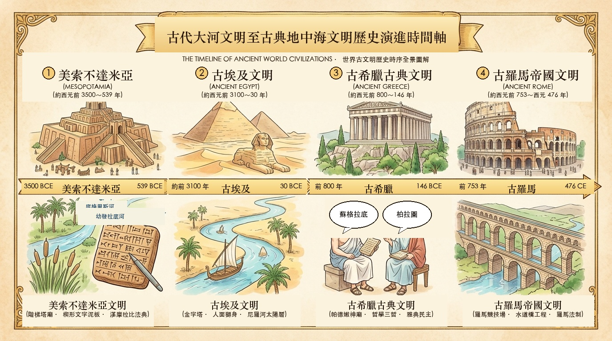
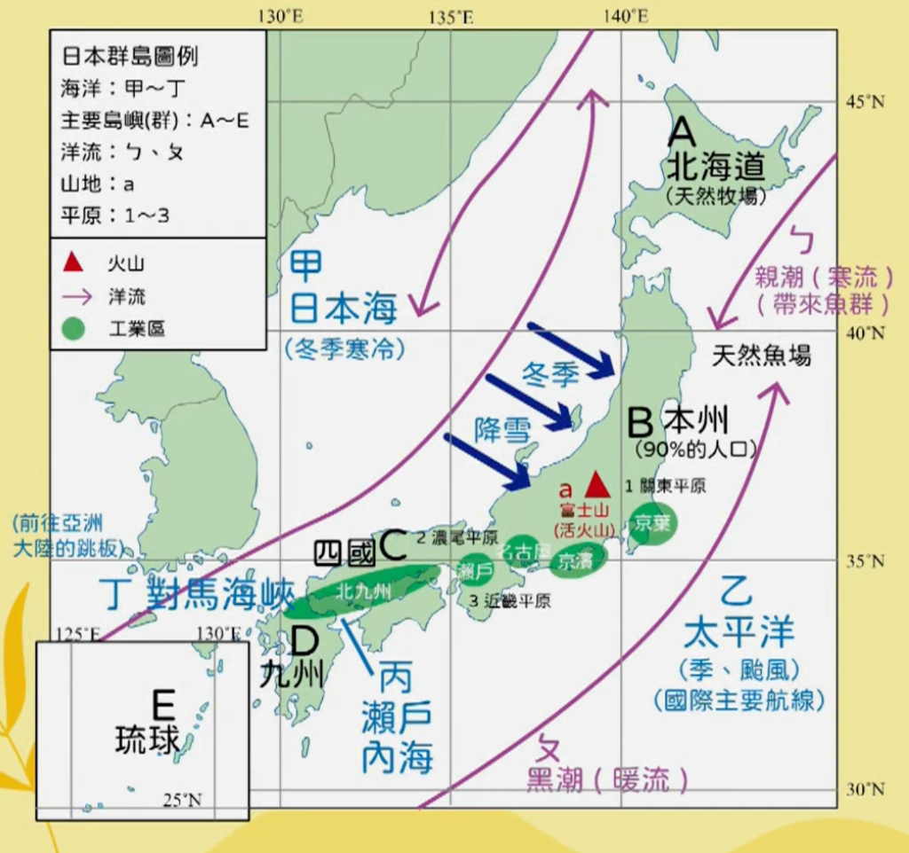
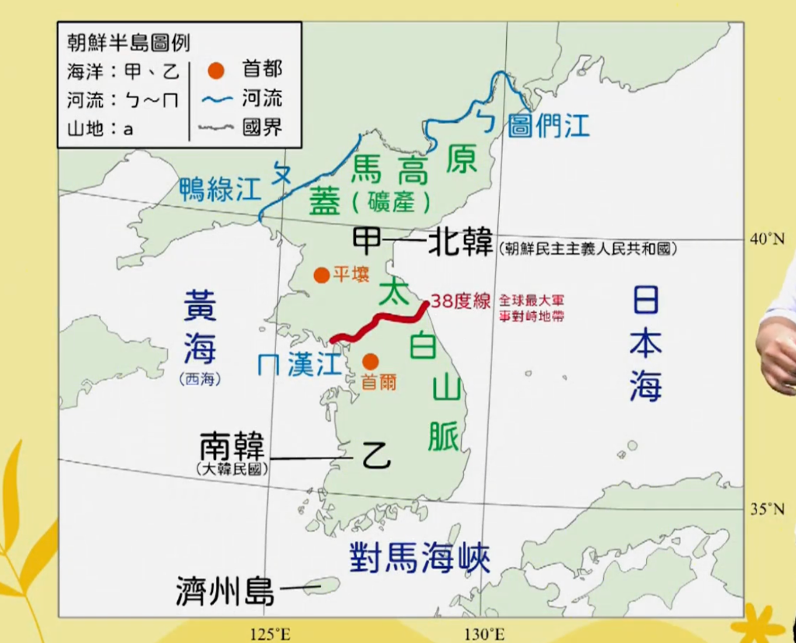
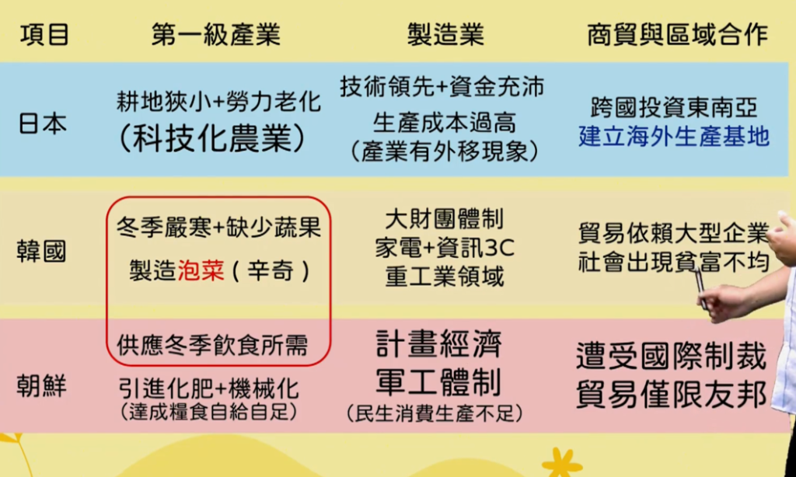

# 社會科重點筆記 (Social Studies Notes)

* **教科書版本**：康軒／翰林／南一版通用（國中八～九年級歷史、地理、公民）
* **收錄原則**：提煉核心知識架構、全景時間線、地圖講義速查表與秒殺口訣，**不記錄日期**。

---

## 📌 重點 1：古代大河文明至古典地中海 — 縱貫時序時間線

### 🏷️ 分類資訊
* **筆記本分類**：進度筆記本（第 5 冊開始）
* **冊數進度**：第 5 冊（九年級上學期）
* **科目**：社會（歷史）
* **單元章節**：第 1～2 章 古代大河文明至古典地中海文明
* **核心知識點**：一條時間線掌握大河文明、希臘城邦、亞歷山大希臘化、羅馬帝國與基督教演進

### 💡 核心觀念精華
一條時序貫穿四大階段：
1. **大河文明**：兩河（悲觀/楔形文字/漢摩拉比法典同態復仇）；埃及（樂觀重來世/木乃伊/太陽曆）；古印度（種姓制度/佛教興起）。
2. **希臘城邦**：雅典民主哲學 vs. 斯巴達軍國教育；波希戰爭勝、伯羅奔尼撒內戰兩敗俱傷由盛轉衰。
3. **希臘化時代**：亞歷山大大帝東征融匯歐亞非，埃及亞歷山卓成為實用科學（幾何/浮力）中心。
4. **羅馬與基督教**：共和法制（十二表法）轉帝制（屋大維羅馬和平）；313 年合法化基督教，392 年定國教；476 年西羅馬亡入中古。

### 📊 古典時代三大文明核心對照表

| 核心指標 | 古希臘古典時代 | 希臘化時代 | 古羅馬時代 |
|---|---|---|---|
| **政治體制** | 城邦獨立 (雅典民主 / 斯巴達軍國) | 專制大帝國 (歐亞非東西大融合) | 共和轉帝制 (屋大維奧古斯都) |
| **文化重心** | 希臘半島雅典城邦 | 埃及「亞歷山卓城」 | 義大利羅馬城 |
| **核心成就** | 民主政治、哲學三哲 (蘇/柏/亞) | 實用科學 (幾何 / 槓桿浮力) | 實用法學 (羅馬法)、圓頂拱券工程 |
| **宗教演進** | 奧林帕斯多神教、奧運祭神 | 希臘神話與東方宗教融合 | 基督教合法化(313)至立為國教(392) |
| **時代終局** | 內戰衰微，亡於北方馬其頓 | 各王國相繼亡於羅馬 | 西元 476 年西羅馬滅亡，步入中古 |

🔍 <b>[歷史演進圖解]（點擊可展開/收合，點擊下方圖片可原地放大）</b>

<input type="checkbox" id="zoom-social-1" class="zoom-toggle">
<label for="zoom-social-1" class="zoom-label">
  
</label>

### 🧠 記憶口訣與秒殺密碼
> 💡 **【時序秒殺口訣】**
> - 「蘇美造字埃及曆，雅典民主斯巴軍；亞歷山大融東西，屋大維創羅馬平；三一三合法信基督，四七六西羅入中古！」

### 🎯 隨堂觀念自我檢測
* **題目**：古代西方歷史上，西元 313 年君士坦丁大帝頒布《米蘭詔令》，對基督教發展造成何種劃時代影響？
  * (A) 承認基督教具有合法地位，停止迫害教徒 ★（正解：西元 313 年《米蘭詔令》使基督教「合法化」；西元 392 年狄奧多西才「定為國教」）
  * (B) 正式將基督教定為羅馬帝國唯一的官方國教
  * (C) 基督教分裂為羅馬天主教與希臘正教
  * (D) 創立基督教並確立舊約聖經一神信仰

---

## 📌 重點 2：機會成本計算全攻略（外顯成本＋隱藏成本）與非成本項目辨析

### 🏷️ 分類資訊
* **筆記本分類**：進度筆記本（第 5 冊開始）
* **冊數進度**：第 5 冊（九年級上學期）
* **科目**：社會（公民）
* **單元章節**：第 3 章 選擇與機會成本
* **核心知識點**：機會成本＝外顯成本（金錢支出）＋隱藏成本（放棄的收入/代價）；贈品利益絕非成本！

### 💡 核心觀念精華
1. **計算公式**：**機會成本 ＝ 外顯成本（實際支付之金錢）＋ 隱藏成本（因選擇而少賺的時間薪資）**。
2. **贈品利益非成本**：商家附贈的禮品屬於「利益」，**絕不能計入機會成本，亦不可當作折扣扣除**！
3. **沉沒成本不計**：已經發生且無法收回的支出，決策時不予考慮。

### 📊 機會成本項目判定速查表

| 項目類別 | 定義與說明 | 實例對照（以參加 4 萬元日本賞櫻團請假 5 天少賺 8,800 元為例） | 是否計入機會成本 |
|---|---|---|---|
| **外顯成本** | 看得見、實際支付的金錢費用 | 團費支出 40,000 元（自掏腰包） | ○ 必須計入！ |
| **隱藏成本** | 看不見、因選擇而放棄的最高報酬 | 請假 5 天少賺的薪資 8,800 元（因旅遊而放棄） | ○ 必須計入！ |
| **利益 / 贈品** | 店家給予的額外獎勵或附贈價值 | 隨團贈送價值 4,000 元保溫杯與體驗券 | × 絕不計入！（是利益非代價） |
| **總機會成本** | 外顯成本 ＋ 隱藏成本 | 40,000 ＋ 8,800 ＝ 48,800 元 | ★ 唯一標準正解！ |

### 🧠 記憶口訣與秒殺密碼
> 💡 **【機會成本秒殺金律】**
> - 「外顯花錢＋隱藏少賺＝總機會成本！贈品是好康利益莫加它！」

### 🎯 隨堂觀念自我檢測
* **題目**：小麥決定在週末參加兩天一夜的露營活動，繳交報名費 3,000 元，因此放棄了原本打工可賺得的 2,000 元薪資。營隊主辦單位貼心贈送價值 500 元的露營專用杯。請問小麥參加此次露營的「總機會成本」為多少？
  * (A) 5,000 元 ★（正解：外顯成本 3,000 ＋ 隱藏成本 2,000 ＝ 5,000 元。贈品 500 元屬於利益非成本，絕不計入！）
  * (B) 4,500 元
  * (C) 5,500 元
  * (D) 3,000 元

---

## 📌 重點 3：日本群島地理地圖全解（島嶼、海洋、洋流、工業區與降雪）

### 🏷️ 分類資訊
* **筆記本分類**：複習筆記本（第 1～4 冊）
* **冊數進度**：第 4 冊（八年級下學期）
* **科目**：社會（地理）
* **單元章節**：第 1 章 東北亞（日本群島）
* **核心知識點**：四大主要島嶼、周圍海洋海峽、寒暖洋流交會漁場、三大平原工業區、冬季降雪成因

### 💡 核心觀念精華
* 日本西臨日本海、東臨太平洋；親潮（寒）與黑潮（暖）交會於北海道及東北外海形成天然漁場；冬季西北季風越日本海迎風面多雪。

### 📊 日本群島地圖代號對照表

| 代號 / 項目 | 地理實體名稱 | 類別屬性 | 核心特徵與講義註解 |
|---|---|---|---|
| **A** | 北海道 | 主要島嶼 | 緯度最高、地廣人稀，為「天然牧場」 |
| **B** | 本州 | 主要島嶼 | 面積最大、政治經濟心臟，居住「90% 的人口」 |
| **C** | 四國 | 主要島嶼 | 本州南側、瀨戶內海以南之島嶼 |
| **D** | 九州 | 主要島嶼 | 日本西南端島嶼，鄰近對馬海峽，北部有北九州工業區 |
| **E** | 琉球群島 | 附屬島嶼 | 西南側呈弧狀延伸 |
| **甲** | 日本海 | 海洋海峽 | 西側邊緣海，「冬季寒冷」，西北季風掠過海面帶來豐沛水氣 |
| **乙** | 太平洋 | 海洋海峽 | 東側大洋，夏秋季受「季風、颱風」影響，為「國際主要航線」 |
| **丙** | 瀨戶內海 | 海洋海峽 | 三大島環抱之內海，沿岸有瀨戶內工業區 |
| **丁** | 對馬海峽 | 海洋海峽 | 位於九州與朝鮮半島之間，為「前往亞洲大陸的跳板」 |
| **ㄅ** | 親潮 (寒流) | 洋流系統 | 高緯向南流經北海道外海，「帶來寒帶魚群」 |
| **ㄆ** | 黑潮 (暖流) | 洋流系統 | 低緯向北流經太平洋側；寒暖交會湧升流形成世界著名漁場 |

🔍 <b>[地圖講義截圖]（點擊可展開/收合，點擊下方圖片可原地放大）</b>

<input type="checkbox" id="zoom-social-3" class="zoom-toggle">
<label for="zoom-social-3" class="zoom-label">
  
</label>

### 🧠 記憶口訣與秒殺密碼
> 💡 **【日本地理口訣】**
> - 「北海牧場本州心，寒暖洋流漁場興；冬迎西北海側雪，太平洋側夏雨淋！」

### 🎯 隨堂觀念自我檢測
* **題目**：日本本州面向日本海的地區（如新潟、北陸），冬季降雪量居世界前列。請問造成此氣候現象的最主要原因為何？
  * (A) 冬季西北季風掠過日本海吸收豐沛水氣，在迎風面的山地抬升致雪 ★（正解：西北季風越過日本海受山脈阻擋，迎風面強烈降雪）
  * (B) 夏季東南季風帶來的對流雨在低溫下凝結成雪
  * (C) 黑潮暖流直接流入日本海造成強烈蒸發降雪
  * (D) 終年受西風帶與副熱帶高壓交替籠罩

---

## 📌 重點 4：朝鮮半島地理地圖全解（南北韓、太白山脈、蓋馬高原與三大河流）

### 🏷️ 分類資訊
* **筆記本分類**：複習筆記本（第 1～4 冊）
* **冊數進度**：第 4 冊（八年級下學期）
* **科目**：社會（地理）
* **單元章節**：第 1 章 東北亞（朝鮮半島）
* **核心知識點**：北韓 vs. 南韓政權、三大河流流向、蓋馬高原礦產、太白山脈脊梁、東陡西緩地形

### 💡 核心觀念精華
* 半島東北高西南低，太白山脈東陡西緩；河流西流注入黃海；北韓多山林礦水力，南韓多平原人口工商發達。

### 📊 朝鮮半島地圖代號對照表

| 代號 / 標籤 | 名稱 / 地理實體 | 類別屬性 | 核心特徵與講義註解 |
|---|---|---|---|
| **甲** | 北韓 (朝鮮民主主義人民共和國) | 國家政權 | 首都「平壤」，境內蓋馬高原蘊藏豐富「礦產」 |
| **乙** | 南韓 (大韓民國) | 國家政權 | 首都「首爾」，農業平原開闊、經濟發達 |
| **ㄅ** | 太白山脈 | 地形脊梁 | 偏東側縱貫半島之脊梁山脈，東陡西緩 |
| **ㄆ** | 蓋馬高原 | 地形高原 | 北韓境內主要高原，氣候嚴寒，富含「林礦與水力」 |
| **A** | 漢江 | 主要河流 | 流經首爾，自東向西注入「黃海」 |
| **B** | 洛東江 | 主要河流 | 流經東南部釜山，注入「朝鮮海峽」 |
| **C** | 錦江 | 主要河流 | 流經西南部，注入「黃海」 |

🔍 <b>[地圖講義截圖]（點擊可展開/收合，點擊下方圖片可原地放大）</b>

<input type="checkbox" id="zoom-social-4" class="zoom-toggle">
<label for="zoom-social-4" class="zoom-label">
  
</label>

### 🧠 記憶口訣與秒殺密碼
> 💡 **【朝鮮半島口訣】**
> - 「東北山嶺西南平，東陡西緩河流西；北韓礦水南平商，太白縱貫脊梁立！」

### 🎯 隨堂觀念自我檢測
* **題目**：有關朝鮮半島的地形與水系特徵，下列敘述何者完全正確？
  * (A) 地勢「東北高、西南低」，太白山脈偏東縱貫，漢江、錦江等主要河流多自東向西注入黃海 ★（正解：太白山脈脊梁東陡西緩，河流多西注入黃海）
  * (B) 地勢「西高東低」，主要河流皆向東流入日本海
  * (C) 南韓境內蓋馬高原蘊藏豐富礦產與水力資源
  * (D) 漢江流經平壤，洛東江流經首爾

---

## 📌 重點 5：東北亞三國產業全比較（日本、韓國、朝鮮：農業、製造業、商貿發展）

### 🏷️ 分類資訊
* **筆記本分類**：複習筆記本（第 1～4 冊）
* **冊數進度**：第 4 冊（八年級下學期）
* **科目**：社會（地理）
* **單元章節**：第 1 章 東北亞（產業與經濟）
* **核心知識點**：日本、韓國、朝鮮三國農業特色、製造業定位、商貿模式與跨國合作完整比較

### 💡 核心觀念精華
1. **農業**：日本精緻科技農業；南韓平原米倉、泡菜自給；北韓嚴寒糧食不足。
2. **製造與商貿**：日韓外向型貿易大國，原料仰賴進口、工業品銷全球；日本高科技汽車精密領先；南韓半導體財閥主導；北韓重工軍工閉關自守。

### 📊 東北亞三國產業比較表

| 項目 / 國家 | 第一級產業 | 製造業 | 商貿與區域合作 |
|---|---|---|---|
| **日本** | 耕地狹小＋勞力老化（科技化農業） | 技術領先＋資金充沛，生產成本過高（產業有外移現象） | 跨國投資東南亞，建立海外生產基地 |
| **韓國** | 冬季嚴寒＋缺少蔬果，製造泡菜（辛奇），供應冬季飲食所需 | 原料缺乏＋市場狹小（以出口為導向，大財閥主導） | 積極簽署自由貿易協定 (FTA)，拓展海外市場 |
| **朝鮮 (北韓)** | 多山區、氣候寒冷，糧食產量不足（依賴國際援助） | 礦產豐富，發展重工業與軍工武器 | 實行鎖國政策，主要貿易夥伴為中國 |

🔍 <b>[講義圖表截圖]（點擊可展開/收合，點擊下方圖片可原地放大）</b>

<input type="checkbox" id="zoom-social-5" class="zoom-toggle">
<label for="zoom-social-5" class="zoom-label">
  
</label>

### 🧠 記憶口訣與秒殺密碼
> 💡 **【東北亞產業口訣】**
> - 「日韓外向原料進口產品銷全球；日本精密科技，南韓財閥半導體，北韓軍工缺糧食！」

### 🎯 隨堂觀念自我檢測
* **題目**：日本與南韓兩國在工業與經貿發展型態上，具有下列哪一項最顯著的「共同特徵」？
  * (A) 國內礦產資源匱乏，均採「進口原料、加工出口」的外向型貿易經濟 ★（正解：日韓缺乏能源礦產，均仰賴原料進口並加工出口行銷全球）
  * (B) 國內勞動力充足低廉，以低成本組裝成衣與鞋類製造為主
  * (C) 糧食作物完全自給自足，不需仰賴國外農產進口
  * (D) 實行嚴格鎖國保護政策，極少進行對外投資
