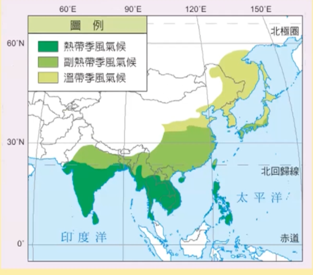
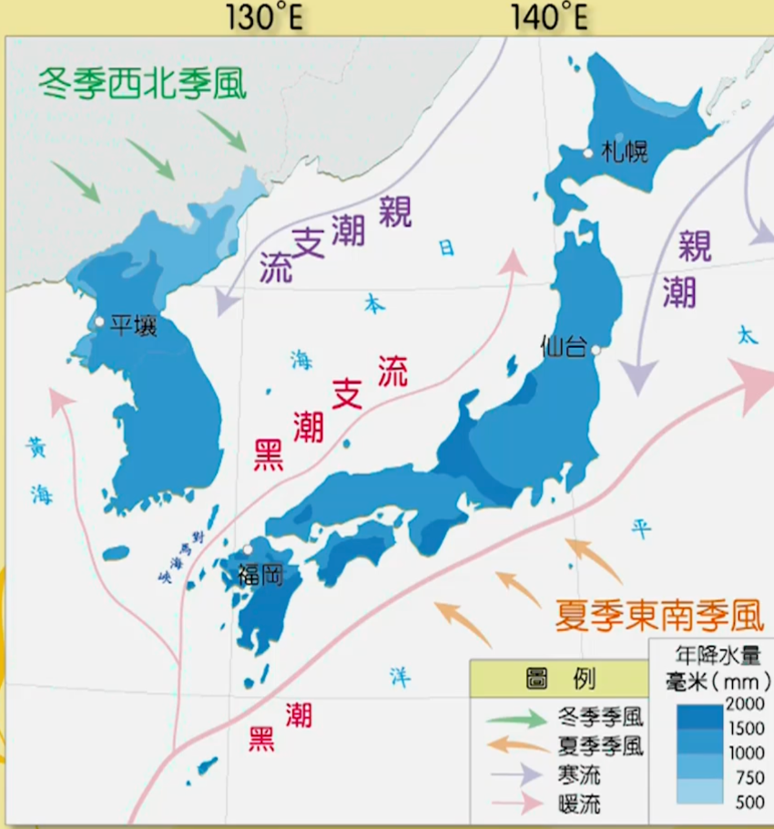
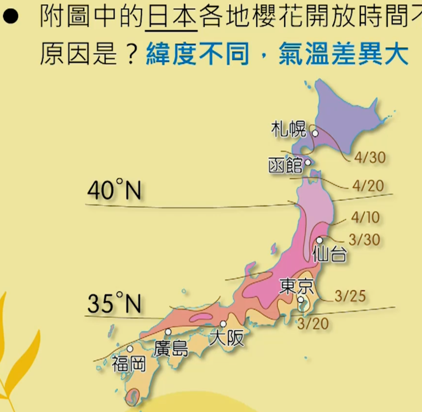
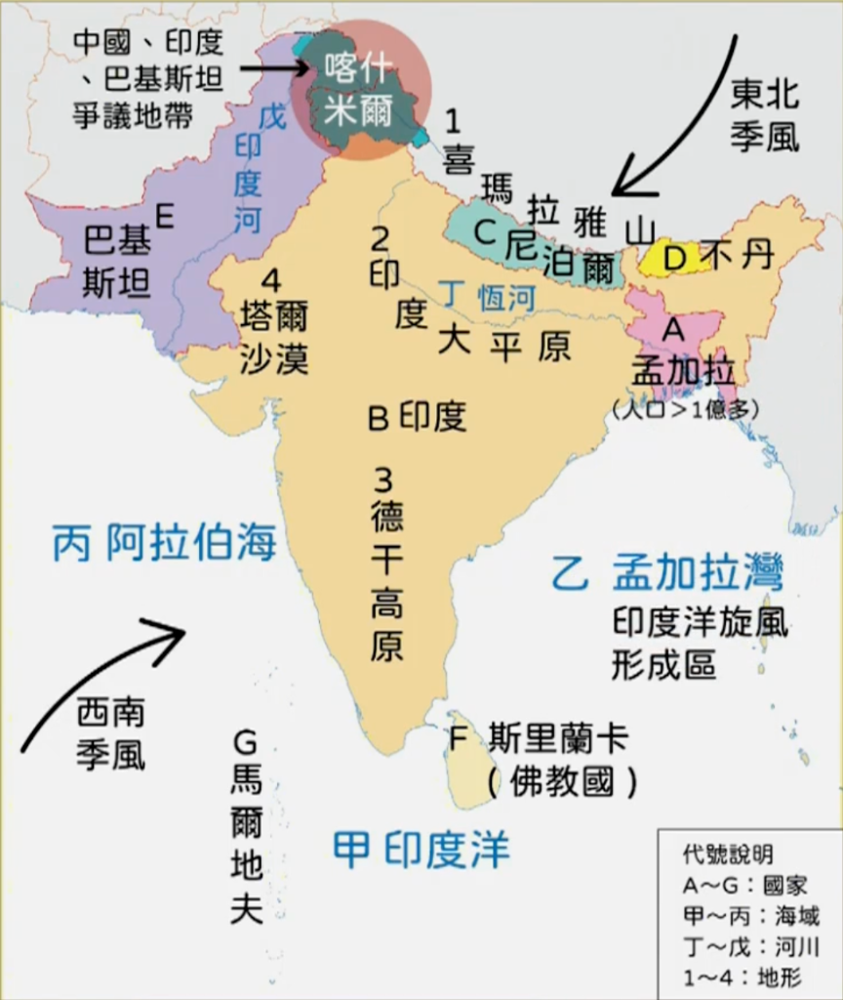
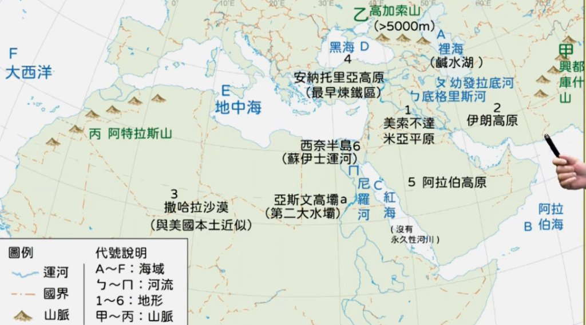

# 社會科重點筆記 (Social Studies Notes)

* **教科書版本**：康軒／翰林／南一版通用（國中八～九年級歷史、地理、公民）
* **收錄原則**：提煉核心知識架構、全景時間線、地圖講義速查表與秒殺口訣，**不記錄日期**。

---

## 📌 重點 1：古代大河文明至古典地中海 — 縱貫時序時間線

### 🏷️ 分類資訊
* **筆記本分類**：進度筆記本（第 5 冊開始）
* **冊數進度**：第 5 冊（九年級上學期）
* **科目**：社會（歷史）
* **單元章節**：第 1～2 章 古代大河文明至古典地中海文明
* **核心知識點**：一條時間線掌握大河文明、希臘城邦、亞歷山大希臘化、羅馬帝國與基督教演進

### 💡 核心觀念精華
一條時序貫穿四大階段：
1. **大河文明**：兩河（悲觀/楔形文字/漢摩拉比法典同態復仇）；埃及（樂觀重來世/木乃伊/太陽曆）；古印度（種姓制度/佛教興起）。
2. **希臘城邦**：雅典民主哲學 vs. 斯巴達軍國教育；波希戰爭勝、伯羅奔尼撒內戰兩敗俱傷由盛轉衰。
3. **希臘化時代**：亞歷山大大帝東征融匯歐亞非，埃及亞歷山卓成為實用科學（幾何/浮力）中心。
4. **羅馬與基督教**：共和法制（十二表法）轉帝制（屋大維羅馬和平）；313 年合法化基督教，392 年定國教；476 年西羅馬亡入中古。

### 📊 古典時代三大文明核心對照表

| 核心指標 | 古希臘古典時代 | 希臘化時代 | 古羅馬時代 |
|---|---|---|---|
| **政治體制** | 城邦獨立 (雅典民主 / 斯巴達軍國) | 專制大帝國 (歐亞非東西大融合) | 共和轉帝制 (屋大維奧古斯都) |
| **文化重心** | 希臘半島雅典城邦 | 埃及「亞歷山卓城」 | 義大利羅馬城 |
| **核心成就** | 民主政治、哲學三哲 (蘇/柏/亞) | 實用科學 (幾何 / 槓桿浮力) | 實用法學 (羅馬法)、圓頂拱券工程 |
| **宗教演進** | 奧林帕斯多神教、奧運祭神 | 希臘神話與東方宗教融合 | 基督教合法化(313)至立為國教(392) |
| **時代終局** | 內戰衰微，亡於北方馬其頓 | 各王國相繼亡於羅馬 | 西元 476 年西羅馬滅亡，步入中古 |

🔍 <b>[歷史演進圖解]（點擊可展開/收合，點擊下方圖片可原地放大）</b>

<input type="checkbox" id="zoom-social-1" class="zoom-toggle">
<label for="zoom-social-1" class="zoom-label">
  
</label>

### 🧠 記憶口訣與秒殺密碼
> 💡 **【時序秒殺口訣】**
> - 「蘇美造字埃及曆，雅典民主斯巴軍；亞歷山大融東西，屋大維創羅馬平；三一三合法信基督，四七六西羅入中古！」

### 🎯 隨堂觀念自我檢測
* **題目**：古代西方歷史上，西元 313 年君士坦丁大帝頒布《米蘭詔令》，對基督教發展造成何種劃時代影響？
  * (A) 承認基督教具有合法地位，停止迫害教徒 ★（正解：西元 313 年《米蘭詔令》使基督教「合法化」；西元 392 年狄奧多西才「定為國教」）
  * (B) 正式將基督教定為羅馬帝國唯一的官方國教
  * (C) 基督教分裂為羅馬天主教與希臘正教
  * (D) 創立基督教並確立舊約聖經一神信仰

---

## 📌 重點 2：機會成本計算全攻略（外顯成本＋隱藏成本）與非成本項目辨析

### 🏷️ 分類資訊
* **筆記本分類**：進度筆記本（第 5 冊開始）
* **冊數進度**：第 5 冊（九年級上學期）
* **科目**：社會（公民）
* **單元章節**：第 3 章 選擇與機會成本
* **核心知識點**：機會成本＝外顯成本（金錢支出）＋隱藏成本（放棄的收入/代價）；贈品利益絕非成本！

### 💡 核心觀念精華
1. **計算公式**：**機會成本 ＝ 外顯成本（實際支付之金錢）＋ 隱藏成本（因選擇而少賺的時間薪資）**。
2. **贈品利益非成本**：商家附贈的禮品屬於「利益」，**絕不能計入機會成本，亦不可當作折扣扣除**！
3. **沉沒成本不計**：已經發生且無法收回的支出，決策時不予考慮。

### 📊 機會成本項目判定速查表

| 項目類別 | 定義與說明 | 實例對照（以參加 4 萬元日本賞櫻團請假 5 天少賺 8,800 元為例） | 是否計入機會成本 |
|---|---|---|---|
| **外顯成本** | 看得見、實際支付的金錢費用 | 團費支出 40,000 元（自掏腰包） | ○ 必須計入！ |
| **隱藏成本** | 看不見、因選擇而放棄的最高報酬 | 請假 5 天少賺的薪資 8,800 元（因旅遊而放棄） | ○ 必須計入！ |
| **利益 / 贈品** | 店家給予的額外獎勵或附贈價值 | 隨團贈送價值 4,000 元保溫杯與體驗券 | × 絕不計入！（是利益非代價） |
| **總機會成本** | 外顯成本 ＋ 隱藏成本 | 40,000 ＋ 8,800 ＝ 48,800 元 | ★ 唯一標準正解！ |

### 🧠 記憶口訣與秒殺密碼
> 💡 **【機會成本秒殺金律】**
> - 「外顯花錢＋隱藏少賺＝總機會成本！贈品是好康利益莫加它！」

### 🎯 隨堂觀念自我檢測
* **題目**：小麥決定在週末參加兩天一夜的露營活動，繳交報名費 3,000 元，因此放棄了原本打工可賺得的 2,000 元薪資。營隊主辦單位貼心贈送價值 500 元的露營專用杯。請問小麥參加此次露營的「總機會成本」為多少？
  * (A) 5,000 元 ★（正解：外顯成本 3,000 ＋ 隱藏成本 2,000 ＝ 5,000 元。贈品 500 元屬於利益非成本，絕不計入！）
  * (B) 4,500 元
  * (C) 5,500 元
  * (D) 3,000 元

---

## 📌 重點 3：日本群島地理地圖全解（島嶼、海洋、洋流、工業區與降雪）

### 🏷️ 分類資訊
* **筆記本分類**：複習筆記本（第 1～4 冊）
* **冊數進度**：第 4 冊（八年級下學期）
* **科目**：社會（地理）
* **單元章節**：第 1 章 東北亞（日本群島）
* **核心知識點**：四大主要島嶼、周圍海洋海峽、寒暖洋流交會漁場、三大平原工業區、冬季降雪成因

### 💡 核心觀念精華
* 日本西臨日本海、東臨太平洋；親潮（寒）與黑潮（暖）交會於北海道及東北外海形成天然漁場；冬季西北季風越日本海迎風面多雪。

### 📊 日本群島地圖代號對照表

| 代號 / 項目 | 地理實體名稱 | 類別屬性 | 核心特徵與講義註解 |
|---|---|---|---|
| **A** | 北海道 | 主要島嶼 | 緯度最高、地廣人稀，為「天然牧場」 |
| **B** | 本州 | 主要島嶼 | 面積最大、政治經濟心臟，居住「90% 的人口」 |
| **C** | 四國 | 主要島嶼 | 本州南側、瀨戶內海以南之島嶼 |
| **D** | 九州 | 主要島嶼 | 日本西南端島嶼，鄰近對馬海峽，北部有北九州工業區 |
| **E** | 琉球群島 | 附屬島嶼 | 西南側呈弧狀延伸 |
| **甲** | 日本海 | 海洋海峽 | 西側邊緣海，「冬季寒冷」，西北季風掠過海面帶來豐沛水氣 |
| **乙** | 太平洋 | 海洋海峽 | 東側大洋，夏秋季受「季風、颱風」影響，為「國際主要航線」 |
| **丙** | 瀨戶內海 | 海洋海峽 | 三大島環抱之內海，沿岸有瀨戶內工業區 |
| **丁** | 對馬海峽 | 海洋海峽 | 位於九州與朝鮮半島之間，為「前往亞洲大陸的跳板」 |
| **ㄅ** | 親潮 (寒流) | 洋流系統 | 高緯向南流經北海道外海，「帶來寒帶魚群」 |
| **ㄆ** | 黑潮 (暖流) | 洋流系統 | 低緯向北流經太平洋側；寒暖交會湧升流形成世界著名漁場 |

🔍 <b>[地圖講義截圖]（點擊可展開/收合，點擊下方圖片可原地放大）</b>

<input type="checkbox" id="zoom-social-3" class="zoom-toggle">
<label for="zoom-social-3" class="zoom-label">
  
</label>

### 🧠 記憶口訣與秒殺密碼
> 💡 **【日本地理口訣】**
> - 「北海牧場本州心，寒暖洋流漁場興；冬迎西北海側雪，太平洋側夏雨淋！」

### 🎯 隨堂觀念自我檢測
* **題目**：日本本州面向日本海的地區（如新潟、北陸），冬季降雪量居世界前列。請問造成此氣候現象的最主要原因為何？
  * (A) 冬季西北季風掠過日本海吸收豐沛水氣，在迎風面的山地抬升致雪 ★（正解：西北季風越過日本海受山脈阻擋，迎風面強烈降雪）
  * (B) 夏季東南季風帶來的對流雨在低溫下凝結成雪
  * (C) 黑潮暖流直接流入日本海造成強烈蒸發降雪
  * (D) 終年受西風帶與副熱帶高壓交替籠罩

---

## 📌 重點 4：朝鮮半島地理地圖全解（南北韓、太白山脈、蓋馬高原與三大河流）

### 🏷️ 分類資訊
* **筆記本分類**：複習筆記本（第 1～4 冊）
* **冊數進度**：第 4 冊（八年級下學期）
* **科目**：社會（地理）
* **單元章節**：第 1 章 東北亞（朝鮮半島）
* **核心知識點**：北韓 vs. 南韓政權、三大河流流向、蓋馬高原礦產、太白山脈脊梁、東陡西緩地形

### 💡 核心觀念精華
* 半島東北高西南低，太白山脈東陡西緩；河流西流注入黃海；北韓多山林礦水力，南韓多平原人口工商發達。

### 📊 朝鮮半島地圖代號對照表

| 代號 / 標籤 | 名稱 / 地理實體 | 類別屬性 | 核心特徵與講義註解 |
|---|---|---|---|
| **甲** | 北韓 (朝鮮民主主義人民共和國) | 國家政權 | 首都「平壤」，境內蓋馬高原蘊藏豐富「礦產」 |
| **乙** | 南韓 (大韓民國) | 國家政權 | 首都「首爾」，農業平原開闊、經濟發達 |
| **ㄅ** | 太白山脈 | 地形脊梁 | 偏東側縱貫半島之脊梁山脈，東陡西緩 |
| **ㄆ** | 蓋馬高原 | 地形高原 | 北韓境內主要高原，氣候嚴寒，富含「林礦與水力」 |
| **A** | 漢江 | 主要河流 | 流經首爾，自東向西注入「黃海」 |
| **B** | 洛東江 | 主要河流 | 流經東南部釜山，注入「朝鮮海峽」 |
| **C** | 錦江 | 主要河流 | 流經西南部，注入「黃海」 |

🔍 <b>[地圖講義截圖]（點擊可展開/收合，點擊下方圖片可原地放大）</b>

<input type="checkbox" id="zoom-social-4" class="zoom-toggle">
<label for="zoom-social-4" class="zoom-label">
  
</label>

### 🧠 記憶口訣與秒殺密碼
> 💡 **【朝鮮半島口訣】**
> - 「東北山嶺西南平，東陡西緩河流西；北韓礦水南平商，太白縱貫脊梁立！」

### 🎯 隨堂觀念自我檢測
* **題目**：有關朝鮮半島的地形與水系特徵，下列敘述何者完全正確？
  * (A) 地勢「東北高、西南低」，太白山脈偏東縱貫，漢江、錦江等主要河流多自東向西注入黃海 ★（正解：太白山脈脊梁東陡西緩，河流多西注入黃海）
  * (B) 地勢「西高東低」，主要河流皆向東流入日本海
  * (C) 南韓境內蓋馬高原蘊藏豐富礦產與水力資源
  * (D) 漢江流經平壤，洛東江流經首爾

---

## 📌 重點 5：東北亞三國產業全比較（日本、韓國、朝鮮：農業、製造業、商貿發展）

### 🏷️ 分類資訊
* **筆記本分類**：複習筆記本（第 1～4 冊）
* **冊數進度**：第 4 冊（八年級下學期）
* **科目**：社會（地理）
* **單元章節**：第 1 章 東北亞（產業與經濟）
* **核心知識點**：日本、韓國、朝鮮三國農業特色、製造業定位、商貿模式與跨國合作完整比較

### 💡 核心觀念精華
1. **農業**：日本精緻科技農業；南韓平原米倉、泡菜自給；北韓嚴寒糧食不足。
2. **製造與商貿**：日韓外向型貿易大國，原料仰賴進口、工業品銷全球；日本高科技汽車精密領先；南韓半導體財閥主導；北韓重工軍工閉關自守。

### 📊 東北亞三國產業比較表

| 項目 / 國家 | 第一級產業 | 製造業 | 商貿與區域合作 |
|---|---|---|---|
| **日本** | 耕地狹小＋勞力老化（科技化農業） | 技術領先＋資金充沛，生產成本過高（產業有外移現象） | 跨國投資東南亞，建立海外生產基地 |
| **韓國** | 冬季嚴寒＋缺少蔬果，製造泡菜（辛奇），供應冬季飲食所需 | 原料缺乏＋市場狹小（以出口為導向，大財閥主導） | 積極簽署自由貿易協定 (FTA)，拓展海外市場 |
| **朝鮮 (北韓)** | 多山區、氣候寒冷，糧食產量不足（依賴國際援助） | 礦產豐富，發展重工業與軍工武器 | 實行鎖國政策，主要貿易夥伴為中國 |

🔍 <b>[講義圖表截圖]（點擊可展開/收合，點擊下方圖片可原地放大）</b>

<input type="checkbox" id="zoom-social-5" class="zoom-toggle">
<label for="zoom-social-5" class="zoom-label">
  
</label>

### 🧠 記憶口訣與秒殺密碼
> 💡 **【東北亞產業口訣】**
> - 「日韓外向原料進口產品銷全球；日本精密科技，南韓財閥半導體，北韓軍工缺糧食！」

### 🎯 隨堂觀念自我檢測
* **題目**：日本與南韓兩國在工業與經貿發展型態上，具有下列哪一項最顯著的「共同特徵」？
  * (A) 國內礦產資源匱乏，均採「進口原料、加工出口」的外向型貿易經濟 ★（正解：日韓缺乏能源礦產，均仰賴原料進口並加工出口行銷全球）
  * (B) 國內勞動力充足低廉，以低成本組裝成衣與鞋類製造為主
  * (C) 糧食作物完全自給自足，不需仰賴國外農產進口
  * (D) 實行嚴格鎖國保護政策，極少進行對外投資

---

## 📌 重點 6：中國四大核心都市地理與經濟轉型全比較（北京、上海、廣州、深圳）

### 🏷️ 分類資訊
* **筆記本分類**：複習筆記本（第 1～4 冊）
* **冊數進度**：第 3 冊（八年級上學期）
* **科目**：社會（地理）
* **單元章節**：中國地理篇（區域發展與核心都會）
* **核心知識點**：四大核心都市（深圳、上海、北京、廣州）之地理區位、歷史背景與產業轉型方向完整比較

### 💡 核心觀念精粹
1. **深圳**：
   * 原是珠江口東側的鄉村。
   * 已轉型成新創企業與人才集中的都市。
2. **上海**：
   * 位於中國海岸線與長江水運的交會點。
   * 交通便利且腹地廣大，是中國工商業金融中心。
3. **北京**：
   * 中國政治中心，有眾多頂尖大學培養人才。
   * 近年來，脫離重工業，朝資訊科技業發展。
4. **廣州**：
   * 位居珠江三角洲，自古以來是南方最大商港。
   * 近年來，成為中國南部的水陸交通樞紐都市。

### 📊 中國四大核心都市速查比較大表

| 都市名稱 | 地理區位與空間特徵 | 歷史淵源與起點 | 產業演進與轉型方向 | 現代都市定位與核心優勢 |
|---|---|---|---|---|
| **深圳** | 位於**珠江口東側**，緊鄰香港 | 原是珠江口東側的**鄉村**（改革開放最早經濟特區） | 傳統組裝代工 $\rightarrow$ 「**轉型成新創企業與人才集中的都市**」 | 國際創新科技都會、新創企業研發重鎮 |
| **上海** | 位於**中國海岸線與長江水運的交會點** | 長江出海口門戶，開埠甚早 | 傳統沿海商港 $\rightarrow$ 「**交通便利且腹地廣大，是工商業金融中心**」 | 中國經濟第一大城、長江流域龍頭與金融核心 |
| **北京** | 位於**華北平原西北部**，背靠燕山 | 歷代帝都，**中國政治中心** | 傳統重工業 $\rightarrow$ 「**脫離重工業，朝資訊科技業發展**」 | 政治文化中心、眾多頂尖大學培養人才、高科技研發核心 |
| **廣州** | 位居**珠江三角洲**核心北緣 | 「**自古以來是南方最大商港**」（海上絲路起點） | 傳統貿易海港 $\rightarrow$ 「**中國南部的水陸交通樞紐都市**」 | 嶺南文化中心、華南綜合水陸交通與商貿樞紐 |

### 🧠 記憶口訣與秒殺密碼
> 💡 **【四大名城秒殺金律】**
> - **黃金定位口訣**：「**北京政治大學聚，脫離重工奔資訊；上海江海交會點，金融商貿腹地闊；廣州珠三角老港，南方水陸大樞紐；深圳昔日小漁村，創新人才聚寶盆！**」
> - **考題特徵對照**：
>   - 「脫離重工業朝資訊科技、頂尖大學人才」$\rightarrow$ 秒選**北京**！
>   - 「海岸線與長江水運交會點、金融中心」$\rightarrow$ 秒選**上海**！
>   - 「自古南方最大商港、水陸交通樞紐」$\rightarrow$ 秒選**廣州**！
>   - 「珠江口東側鄉村、新創企業人才集中」$\rightarrow$ 秒選**深圳**！

### 🎯 隨堂觀念自我檢測
* **題目**：這座都市原先只是珠江口東側的純樸鄉村，藉由政策開放與緊鄰香港的區位優勢，近年來已迅速轉型為新創企業與各領域高科技人才匯聚的現代化創新大都會。請問上述描述的是下列哪一座都市？
  * (A) 北京
  * (B) 上海
  * (C) 廣州
  * (D) 深圳 ★（正解：深圳原為珠江口東側鄉村，如今已轉型為新創企業與人才高度集中的現代都市）

---

## 📌 重點 7：亞洲季風氣候分佈與日本氣候全解（季風、洋流、降水與櫻花前線）

### 🏷️ 分類資訊
* **筆記本分類**：複習筆記本（第 1～4 冊）
* **冊數進度**：第 4 冊（八年級下學期）
* **科目**：社會（地理）
* **單元章節**：東北亞篇（亞洲季風氣候與日本自然環境）
* **核心知識點**：三大季風氣候分佈界線、日本冬夏兩季季風與洋流影響、櫻花前線由南向北開放之緯度氣溫成因

### 💡 核心觀念精粹
1. **亞洲三大季風氣候分佈**：
   * **溫帶季風氣候**：東北亞、東亞北部（以「秦嶺—淮河」為界以北）。
   * **副熱帶季風氣候**：東亞南部、臺灣北部（「秦嶺—淮河」以南、「北回歸線」以北）。
   * **熱帶季風氣候**：臺灣南部（「北回歸線」以南）、東南亞、南亞。
2. **日本氣候四大關鍵要素（季風、洋流、降水、緯度）**：
   * **冬季西北季風**：來自歐亞大陸冷高壓，掠過日本海吸收豐沛水氣，在**日本海側（迎風面）**降大雪。
   * **夏季東南季風**：來自太平洋副熱帶高壓，為**太平洋側（迎風面）**帶來高溫與豐沛季風雨。
   * **洋流交會**：親潮（寒流，高緯南下帶來寒帶魚群）與黑潮（暖流，低緯北上增溫增濕），於本州東北外海與北海道交會，湧升流帶來豐富浮游生物，形成世界天然漁場。
   * **櫻花前線**：開花時間由南向北依序綻放（福岡 3/20 → 東京 3/25 → 仙台 3/30 → 札幌 4/30），破題唯一核心關鍵為「**緯度不同，氣溫差異大**」。

### 📊 亞洲季風與日本氣候速查大表

| 氣候類型 / 關鍵要素 | 核心分佈區域 / 迎風受影響側 | 關鍵特徵與判斷依據 | 代表現象與會考必考重點 |
|---|---|---|---|
| **溫帶季風氣候** | 東北亞、東亞北部 | 秦嶺—淮河以北、朝鮮半島、日本中北部 | 冬季寒冷乾燥、夏季溫暖多雨，四季分明 |
| **副熱帶季風氣候** | 東亞南部、臺灣北部 | 秦嶺—淮河以南、北回歸線以北、日本南部 | 冬季溫和少雨、夏季炎熱多雨 |
| **熱帶季風氣候** | 臺灣南部、東南亞、南亞 | 北回歸線以南、中南半島、印度半島 | 終年高溫，年分乾濕兩季（雨季／乾季） |
| **日本冬季西北季風** | 日本海側（新潟、北陸地區） | 西北季風掠過日本海吸飽水氣，遇山地抬升 | 迎風面冬季強烈降雪，為世界著名多雪區 |
| **日本夏季東南季風** | 太平洋側（東京、大阪、關東關西） | 夏季東南季風由太平洋吹拂迎風面 | 夏季高溫多雨、夏秋季易受颱風侵襲 |
| **親潮 (寒) ＋ 黑潮 (暖)** | 本州東北外海、北海道沿海 | 高緯親潮寒流與低緯黑潮暖流交會 | 寒暖交會產生湧升流，形成世界著名天然漁場 |
| **日本櫻花前線** | 由南向北（九州 3/20 → 北海道 4/30） | 緯度越低氣溫回暖越早，緯度越高回暖越遲 | ★ 核心破題點：「緯度不同，氣溫差異大」 |

🔍 <b>[亞洲季風氣候分佈地圖]（點擊可展開/收合，點擊下方圖片可原地放大）</b>

<input type="checkbox" id="zoom-social-7-1" class="zoom-toggle">
<label for="zoom-social-7-1" class="zoom-label">
  
</label>

🔍 <b>[日本季風、洋流與降水量分佈地圖]（點擊可展開/收合，點擊下方圖片可原地放大）</b>

<input type="checkbox" id="zoom-social-7-2" class="zoom-toggle">
<label for="zoom-social-7-2" class="zoom-label">
  
</label>

🔍 <b>[日本櫻花前線開花時間與緯度分佈地圖]（點擊可展開/收合，點擊下方圖片可原地放大）</b>

<input type="checkbox" id="zoom-social-7-3" class="zoom-toggle">
<label for="zoom-social-7-3" class="zoom-label">
  
</label>

### 🧠 記憶口訣與秒殺密碼
> 💡 **【季風與櫻花秒殺金律】**
> - 「**秦淮以北溫季風，北回以南熱季風；臺灣南北各一派，冬吹西北海側雪；夏迎東南洋側雨，親寒黑暖漁場豐；櫻花北開緯度定！**」
> - **考題特徵對照**：
>   - 「臺灣北部氣候類型」$\rightarrow$ 秒選**副熱帶季風**！
>   - 「臺灣南部、東南亞、南亞」$\rightarrow$ 秒選**熱帶季風**！
>   - 「東北亞、東亞北部」$\rightarrow$ 秒選**溫帶季風**！
>   - 「日本冬季多雪迎風面」$\rightarrow$ 秒選**日本海側**（西北季風吸水汽遇山阻）！
>   - 「日本各地櫻花開花時間由南向北延後之原因」$\rightarrow$ 秒選**緯度不同，氣溫差異大**！

### 🎯 隨堂觀念自我檢測
* **題目**：附圖為日本各地櫻花平均開放時間示意圖（櫻花前線），開花日期由九州福岡（3/20）逐漸往北推遲至北海道札幌（4/30）。請問造成日本各地櫻花開放時間具有此種規律差異的最主要原因為何？
  * (A) 各地緯度不同，氣溫回暖時間差異大 ★（正解：低緯度南方春季先回暖先開花，高緯度北方回暖晚後開花。核心原因為「緯度不同，氣溫差異大」！）
  * (B) 地形高低起伏，迎風坡與背風坡雨量懸殊
  * (C) 親潮與黑潮交會位置隨季節自南向北移動
  * (D) 夏季東南季風自南方登陸帶來的降水多寡

---

## 📌 重點 8：南亞地理全景圖解 — 國家分佈、三大地形、主要水系與季風氣候

### 🏷️ 分類資訊
* **筆記本分類**：複習筆記本（第 1～4 冊）
* **冊數進度**：第 4 冊（八年級下學期）
* **科目**：社會（地理）
* **單元章節**：南亞篇（南亞自然環境、地形水系與地緣政治）
* **核心知識點**：南亞七國分佈、北中南三大地形區、三大海域與主要河流（印度河、恆河）、喀什米爾爭端與季風氣候

### 💡 核心觀念精粹
1. **南亞三大地形區（由北向南縱列）**：
   * **北部高山（1 喜馬拉雅山）**：板塊擠壓形成之年輕褶曲山脈，阻擋冬季東北季風南下，使南亞冬季氣溫較同緯度地區溫暖。
   * **中部平原（2 印度大平原）**：由**印度河（戊）**與**恆河（丁）**沖積而成，土壤肥沃、灌溉便利，為南亞人口密集精華區。
   * **南部高原（3 德干高原）**：古老熔岩高原，地勢西高東低，為重要棉花產地。
   * **西北沙漠（4 塔爾沙漠）**：位於印度河下游東側、印巴交界處，受副熱帶高壓與乾燥信風籠罩，降水稀少。
2. **海域與水系（海陸位置）**：
   * **海域**：西鄰**丙 阿拉伯海**、東瀕**乙 孟加拉灣**（印度洋旋風主要形成區與襲擊區）、南濱**甲 印度洋**。
   * **河川**：**印度河（戊）**流經巴基斯坦注入阿拉伯海（古印度文明發源地）；**恆河（丁）**流經印度北部與孟加拉注入孟加拉灣（印度教聖河）。
3. **南亞主要國家與宗教文化特性**：
   * **B 印度**：南亞面積最大、人口最多國家（人口超過 14 億），信奉印度教為主。
   * **E 巴基斯坦**：位於印度河西北側，主要信奉伊斯蘭教。
   * **A 孟加拉**：恆河三角洲低窪平原，人口突破 1 億多，主要信奉伊斯蘭教，常受夏季暴雨、融雪及旋風暴潮引起的水患。
   * **C 尼泊爾 / D 不丹**：位於喜馬拉雅山南麓之內陸山國，深受山地阻隔。
   * **F 斯里蘭卡**：印度洋上的島國，主要信奉佛教。
   * **G 馬爾地夫**：印度洋上的珊瑚礁島國，以觀光聞名。
   * **喀什米爾地區**：位於印、巴、中三國交界處之高山爭議地帶，主權長年爭議衝突。
4. **季風氣候特徵（熱帶季風）**：
   * **夏季（6～9月）**：吹**西南季風**，由印度洋吹向陸地，帶來豐沛水氣形成「雨季」。
   * **冬季（10～次年2月）**：吹**東北季風**，來自乾燥大陸，受喜馬拉雅山阻擋，乾燥涼爽形成「涼季/乾季」。

### 📊 南亞地理代號與關鍵特徵速查大表

| 代號 / 地理要素 | 地理名稱 | 核心特徵與地理定位 | 會考與模考必考解題關鍵 |
|---|---|---|---|
| **A**（國家） | **孟加拉** | 恆河三角洲，人口超過 1 億多，伊斯蘭教國 | 地勢低平＋夏季西南季風＋熱帶旋風侵襲，易氾濫成災 |
| **B**（國家） | **印度** | 南亞面積最大、人口最多之軸心大國 | 印度教為主，資訊科技(IT)與軟體代工重鎮 |
| **C**（國家） | **尼泊爾** | 喜馬拉雅山南麓內陸山國，聖母峰所在地 | 山地地形阻隔，經濟以農業與高山健行觀光為主 |
| **D**（國家） | **不丹** | 喜馬拉雅山南麓內陸山國，以幸福指數聞名 | 藏傳佛教為主，森林資源豐富，重視生態保育 |
| **E**（國家） | **巴基斯坦** | 位於印度河流域，主要信奉伊斯蘭教 | 印度河為主要灌溉水源，長年與印度爭奪喀什米爾 |
| **F**（國家） | **斯里蘭卡** | 印度東南方印度洋島國 | 佛教國家，世界著名錫蘭紅茶產地 |
| **G**（國家） | **馬爾地夫** | 印度洋群島國家，地勢極低之珊瑚礁島國 | 觀光度假勝地，面臨全球暖化海平面上升威脅 |
| **喀什米爾** | **喀什米爾** | 中國、印度、巴基斯坦爭議地帶（高山區） | 印巴多次爆發衝突核心熱點（宗教與領土紛爭） |
| **甲**（海域） | **印度洋** | 南亞南方之世界第三大洋 | 連接歐、非、亞之重要海上航道 |
| **乙**（海域） | **孟加拉灣** | 印度半島東側海灣 | 印度洋熱帶旋風主要發源地，孟加拉易受風暴潮襲擊 |
| **丙**（海域） | **阿拉伯海** | 印度半島西側海面 | 印度與中東、西亞海上交通咽喉 |
| **丁**（河流） | **恆河** | 發源於喜馬拉雅山，流經北印度注入孟加拉灣 | 印度教聖河，沖積出肥沃平原，人口密度極高 |
| **戊**（河流） | **印度河** | 發源於青藏高原，流經巴基斯坦注入阿拉伯海 | 古印度文明發祥地，巴基斯坦重要灌溉水脈 |
| **1**（地形） | **喜馬拉雅山** | 北部年輕褶曲山脈，世界最高山脈 | 阻擋冬季大陸冷空氣南下，使南亞冬季相對溫暖 |
| **2**（地形） | **印度大平原** | 中部由印度河與恆河沖積形成之平原 | 地勢平坦、土壤肥沃，為南亞農業精華區與人口稠密區 |
| **3**（地形） | **德干高原** | 南部古老熔岩高原，地勢西高東低 | 降水相對平原少，為印度主要棉花產地 |
| **4**（地形） | **塔爾沙漠** | 位於印度大平原西側、印巴邊境 | 受副熱帶高壓及乾燥信風影響，降水稀少形成沙漠 |
| **西南季風** | **夏季季風** | 來自印度洋（西南方），溫暖潮濕 | 南亞夏季主要雨水來源（雨季，6～9月） |
| **東北季風** | **冬季季風** | 來自陸地（東北方），乾燥涼爽 | 受喜馬拉雅山阻擋，南亞冬季氣溫較同緯度溫暖（涼季/乾季） |

🔍 <b>[南亞國家分佈、三大地形與水系氣候全景地圖]（點擊可展開/收合，點擊下方圖片可原地放大）</b>

<input type="checkbox" id="zoom-social-8" class="zoom-toggle">
<label for="zoom-social-8" class="zoom-label">
  
</label>

### 🧠 記憶口訣與秒殺密碼
> 💡 **【南亞地理秒殺金律】**
> - 「**北喜馬南德干，中間印度大平原；西印度東恆河，塔爾沙漠西邊乾；夏吹西南風多雨，孟加拉灣旋風翻；斯里蘭卡信佛教，喀什米爾爭不完！**」
> - **考題特徵對照**：
>   - 「南亞冬季氣溫比同緯度溫暖」$\rightarrow$ 秒選**喜馬拉雅山阻擋冷空氣**！
>   - 「孟加拉水患頻繁成因」$\rightarrow$ 秒選**地勢低平＋夏季西南季風＋熱帶旋風（風暴潮）＋上游融雪降雨**！
>   - 「南亞佛教國家」$\rightarrow$ 秒選**斯里蘭卡**（或不丹）！
>   - 「南亞信奉伊斯蘭教國家」$\rightarrow$ 秒選**巴基斯坦、孟加拉、馬爾地夫**！
>   - 「中印巴三方爭議熱點」$\rightarrow$ 秒選**喀什米爾**！

### 🎯 隨堂觀念自我檢測
* **題目**：南亞地區每逢夏季（6～9月）常受到來自海洋的季風吹拂而降下豐沛雨量，若逢熱帶旋風侵襲，地勢低平的孟加拉（代號 A）更極易發生嚴重的暴潮與水患。請問圖中吹拂南亞帶來雨季的夏季季風，其風向為何？
  * (A) 西南季風 ★（正解：南亞夏季受西南季風吹拂，自印度洋帶來大量水氣，形成雨季！）
  * (B) 東北季風（此為冬季季風，帶來乾燥涼爽天氣）
  * (C) 東南季風（此為東亞、日本一帶夏季季風）
  * (D) 西北季風（此為東亞冬季季風）

---

## 📌 重點 9：東南亞兩大地形區深度對照 — 中南半島 vs. 南洋群島

### 🏷️ 分類資訊
* **筆記本分類**：複習筆記本（第 1～4 冊）
* **冊數進度**：第 4 冊（八年級下學期）
* **科目**：社會（地理）
* **單元章節**：東南亞篇（中南半島與南洋群島之自然環境、產業型態與氣候特性）
* **核心知識點**：中南半島山河相間南北縱走與三角洲稻作、南洋群島板塊交界多火山良港與熱帶栽培業，熱帶季風 vs. 熱帶雨林氣候對照

### 💡 核心觀念精粹
1. **中南半島（大陸型東南亞）**：
   * **地理特徵**：源自橫斷山脈，山地與河川「**南北縱走、山河相間**」；河流下游沖積形成廣大**三角洲**（如湄公河三角洲、紅河三角洲、昭披耶河三角洲），地勢低平平坦。
   * **產業型態**：以**傳統稻作農業**為主（盛產水稻，泰國、越南為世界稻米主要出口國）；現代利用充沛廉價勞動力發展**勞力密集型加工出口區**。
   * **氣候特性**：**熱帶季風氣候**，年溫高且具明顯「**夏雨冬乾**」特徵（夏季西南季風多雨、冬季東北季風乾燥）。
2. **南洋群島（海洋/島嶼型東南亞）**：
   * **地理特徵**：位處環太平洋火山地震帶與歐亞板塊交界，**板塊交界地帶（多火山島、地震頻繁）**，火山灰帶來肥沃土壤；曲折海岸線形成**沿岸多天然良港**，掌控麻六甲海峽等海運樞紐。
   * **產業型態**：發展大規模**熱帶栽培業（熱帶經濟作物）**，多由西方殖民引進企業化經營，如**甘蔗、香蕉、棕櫚油、橡膠、咖啡**；沿海港口發展轉口貿易與商業。
   * **氣候特性**：**熱帶雨林氣候**（赤道橫貫），終年高溫多雨、**全年有雨**，對流旺盛（午後多對流雨/雷陣雨）。

### 📊 中南半島 vs. 南洋群島核心速查大表

| 地形區 | 地理特徵 | 產業形態 | 氣候特性 | 會考與模考解題秒殺密碼 |
|---|---|---|---|---|
| **中南半島** | 山地南北縱走 河川沖積形成 **三角洲** | **稻作農業** 勞力密集型加工出口區 | **熱帶季風** （夏雨冬乾、年分乾濕季） | 「山河相間南北走、下游三角洲種水稻、夏雨冬乾」➜ **中南半島** |
| **南洋群島** | 板塊交界地帶（多火山島） 沿岸多 **天然良港** | **熱帶栽培業** （甘蔗、香蕉、棕櫚油、橡膠） | **熱帶雨林** （終年高溫、全年有雨） | 「火山土壤肥沃、天然良港、殖民經濟作物、全年有雨」➜ **南洋群島** |

### 🧠 記憶口訣與秒殺密碼
> 💡 **【東南亞兩區速記金律】**
> - 「**中南半島山河走，三角洲上稻作稠；夏雨冬乾季風吹，勞力代工出口遊。**」
> - 「**南洋群島火山構，天然良港航運優；熱帶栽培甘蔗棕，全年多雨雨林厚！**」
> - **考題特徵對照**：
>   - 「地表特徵為山河相間、南北縱走」➜ 秒選**中南半島**！
>   - 「主要糧食作物為水稻，下游三角洲土壤肥沃」➜ 秒選**中南半島稻作農業**！
>   - 「板塊交界、多火山地震、海運良港」➜ 秒選**南洋群島**！
>   - 「甘蔗、香蕉、棕櫚油、橡膠等企業化出口作物」➜ 秒選**南洋群島熱帶栽培業**！
>   - 「氣候終年高溫、全年有雨、無明顯乾季」➜ 秒選**南洋群島熱帶雨林氣候**！
>   - 「夏季西南季風多雨、冬季東北季風乾燥、夏雨冬乾」➜ 秒選**中南半島熱帶季風氣候**！

### 🎯 隨堂觀念自我檢測
* **題目**：東南亞某地區因地處板塊交界處，地表多火山分布，火山灰覆蓋形成肥沃土壤，沿岸多天然良港，農業以企業化經營大規模種植油棕、橡膠與香蕉等外銷經濟作物。請問該地區屬於下列何者？
  * (A) 南洋群島 ★（正解：南洋群島位於板塊交界多火山島，沿岸多良港，以種植甘蔗、棕櫚油等熱帶栽培業聞名！）
  * (B) 中南半島（中南半島為山河南北縱走、下游沖積三角洲以稻作農業為主）
  * (C) 印度大平原（印度大平原為恆河、印度河沖積平原，並非火山島）
  * (D) 朝鮮半島（朝鮮半島位於東北亞溫帶季風氣候區）

---

## 📌 重點 10：南亞三大地形區農產分佈 vs. 一年僅三季氣候深度對照

### 🏷️ 分類資訊
* **筆記本分類**：複習筆記本（第 1～4 冊）
* **冊數進度**：第 4 冊（八年級下學期）
* **科目**：社會（地理）
* **單元章節**：南亞篇（南亞三大地形區、主要農作物分佈與熱帶季風一年三季特徵）
* **核心知識點**：印度高山區、印度大平原（印度河、恆河、阿薩姆紅茶）、德干高原黑色土壤棉花產區；印度一年僅三季（涼季、熱季、雨季）成因與特色

### 💡 核心觀念精粹
1. **南亞三大地形區與產業農作分佈**：
   * **印度高山區（北部）**：板塊擠壓形成（喜馬拉雅山／世界屋脊），擁有世界最高峰；主要扮演**氣候分界線**與天然屏障，阻擋北方寒風南下，幾乎**無農業生產**。
   * **印度大平原（中部）**：由兩條大河沖積而成——**印度河**（西流注入阿拉伯海）與**恆河**（東流沖積形成廣大三角洲注入孟加拉灣）。
     * **恆河平原及三角洲（濕潤多雨）**：主要種植**水稻**與**黃麻**。
     * **印度河平原及恆河上游（較乾燥）**：主要種植**小麥**。
     * **東北部丘陵區（阿薩姆 Assam）**：排水良好的迎風坡丘陵，為世界著名**茶葉**產區。
   * **德干高原（南部）**：古老地塊，因**火山熔岩風化**形成肥沃的「**黑色土壤區**」；位於西高止山背風坡，氣候較乾燥，為**世界主要棉花產區**。
2. **南亞獨特季風氣候——「一年僅三季」**：
   * **涼季（11～2月）**：印度「沒有冬天」！成因為**喜馬拉雅高山阻擋北方北風與大陸寒流**；氣候乾燥涼爽，是一年當中**最為舒適**的季節。
   * **熱季（3～5月）**：此時太陽直射北移，**北回歸線上日照強烈**，加上缺少冷風調節且西南季風尚未吹抵；天氣極度**乾熱少雨、最為艱困**，氣溫常飆破 40°C 以上。
   * **雨季（6～10月）**：西南季風盛行，**進入海上季風季節**，將印度洋豐沛水氣源源不絕吹向陸地；遇到喜馬拉雅山南麓與西高止山等地形強烈抬升，降下大量**地形雨**，其中阿薩姆丘陵附近的乞拉朋吉更創下「世界雨量第一」的紀錄！

### 📊 南亞三大地形區特徵與農作速查大表

| 地形區 | 地理特徵 | 產業形態 / 代表農作 | 氣候特性與關鍵考點 |
|---|---|---|---|
| **印度高山區** | 板塊擠壓（世界屋脊） 世界最高峰（阻擋北方寒風） | **無**（地勢陡峻高寒） | **成為氣候分界線** 阻擋冬季北方冷氣團南下，使南亞冬季較同緯度溫暖 |
| **印度大平原** | 兩條河川沖積形成： ・**印度河**（西流，古印度文明） ・**恆河**（東流，沖積成廣大三角洲） | ・**水稻、黃麻**（下游多雨三角洲） ・**小麥**（上游乾燥平原） ・**茶葉**（阿薩姆丘陵區，排水良好） | **一年僅三季** 平原土壤深厚肥沃、水源充足，為全南亞人口最稠密精華區 |
| **德干高原** | **火山熔岩風化**形成 形成肥沃的**黑色土壤區** | **世界棉花主要產區** | **背風坡較乾燥**，日照充足且具耐旱黑色土，最適合棉花生長 |

### 📊 南亞「一年僅三季」氣候時序對照表

| 季節項目 | 涼季 | 熱季 | 雨季 |
|---|---|---|---|
| **時間月份** | **11 ～ 2 月** （★ 印度沒有冬天） | **3 ～ 5 月** | **6 ～ 10 月** |
| **關鍵成因** | **高山擋北風** （喜馬拉雅山屏障冷氣團） | **北回歸線上日照強烈** 缺少寒風且西南季風未至 | **進入海上季風季節** 西南季風自印度洋帶來水氣 |
| **氣候特色** | **一年當中最為舒適** 氣候溫涼、乾燥少雨 | **乾熱少雨、最為艱困** 極端高溫乾旱，常達 40°C 以上 | **地形雨旺盛，雨量世界第一** （迎風坡乞拉朋吉世界雨極） |

### 🧠 記憶口訣與秒殺密碼
> 💡 **【南亞地形農產與三季秒殺金律】**
> - 「**高山擋寒無冬天，十一到二涼季恬；三到五月烈日曬，乾熱少雨最艱難；六到十月西南風，地形雨下世第一！**」
> - 「**恆河三角種水稻，阿薩姆坡飄茶香；德干熔岩黑土壤，乾燥背風產棉花！**」
> - **考題特徵對照**：
>   - 「德干高原主要農作物與土壤成因」➜ 秒選**火山熔岩風化黑色土、背風乾燥種棉花**！
>   - 「阿薩姆地區主要經濟作物」➜ 秒選**茶葉**（丘陵排水佳、雨量充沛）！
>   - 「恆河下游三角洲主要作物」➜ 秒選**水稻、黃麻**！
>   - 「印度一年當中最艱困、乾熱少雨季節」➜ 秒選**熱季（3～5月）**！
>   - 「印度一年當中最舒適季節」➜ 秒選**涼季（11～2月）**！
>   - 「印度降下地形雨、世界雨極（乞拉朋吉）之成因」➜ 秒選**西南季風遇喜馬拉雅山南麓抬升降雨**！

### 🎯 隨堂觀念自我檢測
* **題目**：印度半島南部德干高原的玄武岩熔岩經長期風化後，形成了保水力佳且極為肥沃的「黑色土壤」，加上位於西高止山的背風坡側，氣候相對乾燥少雨。請問此地最適合發展下列哪一種世界級代表經濟作物？
  * (A) 棉花 ★（正解：德干高原熔岩風化形成肥沃黑土，加上背風坡乾燥日照充足，為世界著名棉花產區！）
  * (B) 水稻（水稻主要分佈於地勢低平、水源豐沛的恆河平原及三角洲）
  * (C) 茶葉（茶葉主要分佈於東北部阿薩姆山地丘陵排水良好處）
  * (D) 黃麻（黃麻主要分佈於恆河三角洲低窪多水地區）

---

## 📌 重點 11：東南亞氣候類型深度對照 vs. 殖民熱帶栽培業特色與隱憂

### 🏷️ 分類資訊
* **筆記本分類**：複習筆記本（第 1～4 冊）
* **冊數進度**：第 4 冊（八年級下學期）
* **科目**：社會（地理）
* **單元章節**：東南亞篇（東南亞氣候成因與特徵、稻作農業與殖民熱帶栽培業之產業隱憂）
* **核心知識點**：熱帶季風氣候（中南半島、菲律賓群島）vs. 熱帶雨林氣候（東印度群島/南洋群島）；東南亞稻米充足背景、熱帶栽培業之殖民歷史、商業化經營特色與單一作物價格波動隱憂

### 💡 核心觀念精粹
1. **東南亞兩大熱帶氣候深度對照**：
   * **熱帶季風氣候**：
     * **分布區域**：**中南半島**與**菲律賓群島**（位於海陸交界地帶）。
     * **氣候成因**：海陸比熱差異造成「**季風風向轉換**」影響，各地迎風、背風降水量差異大。
     * **氣候特徵**：終年高溫，具有鮮明的「**夏雨冬乾**」（年分乾濕兩季，夏季西南季風多雨、冬季東北季風乾燥）。
   * **熱帶雨林氣候**：
     * **分布區域**：**東印度群島**（南洋群島、印尼、馬來群島）。
     * **氣候成因**：地跨**赤道兩側**，終年受赤道低壓帶籠罩，日照強烈、**對流旺盛**。
     * **氣候特徵**：**全年高溫多雨**，幾乎每天都有**午後雷陣雨（對流雨）**，無乾季。
2. **東南亞農業形態與產業發展**：
   * **稻作農業（糧食保障）**：地勢低平平原三角洲土壤肥沃、水熱充足，東南亞稻米生產量居世界前列（如泰國、越南為稻米主要出口國），**糧食充足**。
   * **熱帶栽培業（殖民背景與三大代表作物）**：
     * **殖民背景**：受西方列強（荷、英、法、西等）殖民統治影響，各國的經濟作物皆有數百年悠久歷史。
     * **經營特色**：以**商業化、企業化經營**為主，投入大筆資金與勞力採取**大規模大量生產**，純粹以**外銷出口為導向**。
     * **三大核心經濟作物與主要產地（會考秒殺連連看）**：
       1. **橡膠** ➜ 主要產地：**泰國**
       2. **咖啡** ➜ 主要產地：**越南**（世界第二大咖啡出口國，以羅布斯塔豆聞名）
       3. **油棕（棕櫚油）** ➜ 主要產地：**印尼**（世界第一大棕櫚油生產與出口國，次為馬來西亞）
     * **產業隱憂（會考極高頻考點）**：各國往往長期高度依賴**生產單一作物**，一旦遇上國際市場供需失衡或**國際價格大幅波動**，甚至發生病蟲害或氣候異常時，國家經濟遭受嚴重虧損與衝擊的機率極高。

### 📊 東南亞氣候類型對照大表

| 氣候類型 | 分布區域 | 氣候成因 | 氣候特徵 | 降水原因與關鍵考點 |
|---|---|---|---|---|
| **熱帶季風氣候** | **中南半島** 與**菲律賓群島** | 位於**海陸交界地帶** | **夏雨冬乾** （年分乾季與雨季） | **季風風向轉換影響** （夏季西南季風迎風面多雨、冬季東北季風乾燥，各地降水量不一） |
| **熱帶雨林氣候** | **東印度群島** （南洋群島、印尼） | 地跨**赤道兩側** （赤道低壓帶壟罩） | **全年高溫多雨** （無明顯乾季） | **日照強烈、對流旺盛** （每天午後幾乎都有對流性**午後雷陣雨**） |

### 📊 東南亞農業與熱帶栽培業發展脈絡表

| 發展面向 | 核心特徵與內容說明 | 會考必考關鍵字與隱憂破題點 |
|---|---|---|
| **糧食背景** | 東南亞稻米生產量居世界前列，下游三角洲水源充足土壤肥沃 | **糧食充足**，盛產水稻（傳統稻作農業） |
| **殖民背景** | 受西方列強殖民統治影響，發展大規模熱帶經濟作物 | 具備**數百年歷史**的殖民經濟烙印 |
| **經營特色** | 外國資本＋現代管理，企業化、大規模生產 | **商業化經營**、採取**大量生產**、以**出口為導向** |
| **三大經濟作物** | **橡膠**（泰國）、**咖啡**（越南）、**油棕**（印尼） | 會考秒殺配對：**泰國橡膠、越南咖啡、印尼油棕** |
| **產業隱憂** | 農業結構僵化，高度依賴少數作物外銷 | 陷於**生產單一作物**，遇**國際市場價格波動**時，虧損機率極高 |

### 🧠 記憶口訣與秒殺密碼
> 💡 **【東南亞氣候與殖民農業秒殺金律】**
> - 「**中南菲島季風吹，海陸交界夏雨冬乾回；東印度群島跨赤道，日烈對流雷陣雨飛！**」
> - 「**稻米生產足糧倉，殖民栽培百年長；商業出口單一產，市價暴跌隱憂狂！**」
> - 「**泰國橡膠越咖啡，印尼油棕大豐收；作物配對要記熟，單一外銷風險多！**」
> - **考題特徵對照**：
>   - 「地跨赤道兩側、每天午後對流雷陣雨」➜ 秒選**熱帶雨林氣候（東印度群島）**！
>   - 「位於海陸交界、風向季節轉換、夏雨冬乾」➜ 秒選**熱帶季風氣候（中南半島、菲律賓）**！
>   - 「熱帶栽培業三大代表國與作物」➜ **泰國＝橡膠、越南＝咖啡、印尼＝油棕**！
>   - 「熱帶栽培業的經營特徵」➜ 秒選**商業化經營、大量生產、出口導向**！
>   - 「熱帶栽培業面臨的最主要產業危機」➜ 秒選**生產單一作物，易受國際市場價格波動造成巨額虧損**！

### 🎯 隨堂觀念自我檢測
* **題目**：東南亞許多島嶼國家自近代以來由歐洲殖民者引進資金與技術，大規模開闢農莊種植天然橡膠、油棕或甘蔗等經濟作物並全數外銷。然而，這種農業經營型態往往伴隨著極大的經濟脆弱性，其最主要的產業隱憂為何？
  * (A) 本地勞工短缺，造成工資成本過度高昂
  * (B) 氣候終年乾旱少雨，缺乏灌溉水源
  * (C) 長期依賴生產單一作物外銷，易受國際市場價格劇烈波動而蒙受巨大虧損 ★（正解：單一作物經濟最怕國際原物料價格暴跌，經濟抗風險能力極低！）
  * (D) 各國國內市場過度飽和，外銷通路遭全面封鎖

---

## 📌 重點 12：東南亞區域結盟 — 東南亞國家協會 (ASEAN) 之發展與擴展

### 🏷️ 分類資訊
* **筆記本分類**：複習筆記本（第 1～4 冊）
* **冊數進度**：第 4 冊（八年級下學期）
* **科目**：社會（地理／公民）
* **單元章節**：東南亞篇（區域組織、東協結盟發展、關稅互惠與東協+5經濟圈）
* **核心知識點**：東南亞國家協會（ASEAN / 東協）成立背景、11個成員國規模與內部關稅優惠、東協+5（中日韓紐澳）跨國經貿合作架構

### 💡 核心觀念精粹
1. **背景（東協成立）**：
   * 為促進區域和平、經濟成長與社會文化合作，東南亞各國結盟成立「**東南亞國家協會**」（Association of Southeast Asian Nations，簡稱 **東協 / ASEAN**）。
2. **發展（組織規模與關稅互惠）**：
   * **成員國規模**：東協共有 **11 個會員國**（東南亞十國：印尼、馬來西亞、新加坡、菲律賓、泰國、汶萊、越南、寮國、緬甸、柬埔寨，以及原則接納之第 11 國**東帝汶**）。
   * **關稅優惠機制**：會員國**彼此間享有廣泛的關稅優惠**（自由貿易區協議），大幅降低貿易障礙，促進東南亞境內商品、資金與勞動力之高度流動。
3. **擴展（東協+5 跨區域合作）**：
   * 東協以自身為核心樞紐，積極跟鄰近主要經濟體分別簽署自由貿易合作協議，擴展為「**東協 + 5**」（包含：**中國、日本、韓國、澳洲、紐西蘭**）。
   * 此架構進一步促成了全球規模最大的自由貿易協定之一（**RCEP 區域全面經濟夥伴協定**），使東南亞躍升為亞洲乃至全球最具活力與影響力的經貿整合板塊。

### 📊 東南亞國家協會 (ASEAN) 核心發展速查大表

| 發展階段 | 核心名稱 / 規模指標 | 關鍵運作機制與夥伴 (點擊翻牌揭曉) | 會考與模考解題秒殺密碼 |
|---|---|---|---|
| **背景** | **東南亞國家協會** （ASEAN / 東協） | 東南亞各國為促進經濟成長與區域穩定而結盟成立 | 成立目的在於加強區域合作、強化國際談判籌碼 |
| **發展** | **東協 11 個會員國** （含原則接納之東帝汶） | 會員國**彼此間享有「關稅優惠」** 降低貿易壁壘，建立共同市場體系 | 會員國互惠最核心優勢：**享有跨國關稅優惠** |
| **擴展** | **東協 ＋ 5** （跨區域自由貿易圈） | 與鄰近 5 大經濟體簽署合作協議： ・**東亞 3 國**：中國、日本、韓國 ・**大洋洲 2 國**：澳洲、紐西蘭 | 跨區域經貿結盟：**東協+5（中、日、韓、澳、紐）** ★ 臺灣未加入，傳統代工外銷面臨關稅壁壘考驗 |

### 🧠 記憶口訣與秒殺密碼
> 💡 **【東協結盟發展秒殺金律】**
> - 「**東南亞國結同盟，東協十一關稅通；鄰國簽署擴大合，東協加五經貿宏！**」
> - **考題特徵對照**：
>   - 「東南亞各國結盟成立之區域組織」➜ 秒選**東南亞國家協會（東協 / ASEAN）**！
>   - 「東協會員國之間在經貿上的最大優勢」➜ 秒選**彼此間享有廣泛的關稅優惠**！
>   - 「東協+5 所包含的鄰近 5 個合作國家」➜ 秒選**中國、日本、韓國、澳洲、紐西蘭**（東亞三強＋紐澳雙雄）！

### 🎯 隨堂觀念自我檢測
* **題目**：東南亞各國為強化區域經濟整合與提高全球競爭力，結盟成立了東南亞國家協會（ASEAN）。近年來東協更進一步擴展與鄰近周邊大國分別簽署自由貿易協議，形成了「東協 + 5」的龐大經貿合作圈。請問下列哪一個國家**屬於**「東協 + 5」合作協議架構內的夥伴國？
  * (A) 紐西蘭 ★（正解：東協+5 為「中國、日本、韓國、澳洲、紐西蘭」，紐西蘭為大洋洲成員國之一！）
  * (B) 美國（美國並非東協+5 的成員）
  * (C) 英國（英國為歐洲國家）
  * (D) 印度（印度早先退出 RCEP 談判，目前東協+5 為中、日、韓、澳、紐）

---

## 📌 重點 13：南亞多元宗教分佈 vs. 印巴衝突地緣政治深度解析

### 🏷️ 分類資訊
* **筆記本分類**：複習筆記本（第 1～4 冊）
* **冊數進度**：第 4 冊（八年級下學期）
* **科目**：社會（地理／歷史）
* **單元章節**：南亞篇（南亞宗教文化多元性、伊斯蘭教傳播歷史與印巴衝突核心）
* **核心知識點**：印度為佛教與印度教發源地、8世紀阿拉伯人傳入伊斯蘭教、三大宗教信仰國家分佈（佛教：不丹/斯里蘭卡；印度教：印度；伊斯蘭教：巴基斯坦/孟加拉）、印巴宗教與領土衝突（喀什米爾）

### 💡 核心觀念精粹
1. **背景（南亞三大宗教源流與傳播）**：
   * **發源地**：古印度是世界兩大重要宗教——**佛教**與**印度教**（源自婆羅門教）的發源地。
   * **伊斯蘭教傳播**：西元 **8 世紀時**，由**阿拉伯人**（經由貿易與征服）將**伊斯蘭教**傳入南亞，深深重塑了南亞西北部與東北部的信仰版圖。
2. **南亞三大宗教核心信仰國分佈（會考絕對必考）**：
   * **佛教**：主要分佈於**不丹**（藏傳佛教）與**斯里蘭卡**（南傳上座部佛教）。
   * **印度教**：主要分佈於**印度**（約八成人口信奉，種姓制度觀念深植民俗）與尼泊爾。
   * **伊斯蘭教**：主要分佈於**巴基斯坦**（印度河西北側）與**孟加拉**（恆河三角洲低窪區）。
3. **宗教衝突與印巴地緣政治**：
   * **印巴分治遺毒**：二戰後英國結束殖民統治，採取「印巴分治」（以宗教信仰畫分）：印度教徒留在印度，伊斯蘭教徒建立巴基斯坦（後東巴基斯坦獨立為孟加拉）。
   * **衝突爆發熱點**：宗教分歧引發大規模人口遷徙與流血衝突，衝突核心始終圍繞在**印度與巴基斯坦之間**，尤以**喀什米爾地區**（穆斯林人口居多，但統治者曾選擇歸屬印度）的主權歸屬引發多次印巴戰爭與軍事對峙。

### 📊 南亞三大宗教源流與國家分佈速查大表

| 發展面向 / 宗教類型 | 歷史背景與傳播脈絡 (點擊翻牌揭曉) | 主要信仰代表國家 (點擊翻牌揭曉) | 會考與模考解題秒殺密碼 |
|---|---|---|---|
| **背景：宗教發源地** | 印度是**佛教與印度教**的發源地 | 古印度恆河流域文明孕育兩大宗教 | 兩大世界宗教發源於印度，但佛教後來在印度本土衰微 |
| **傳播：伊斯蘭教傳入** | **8 世紀時，阿拉伯人**將伊斯蘭教傳入南亞 | 阿拉伯商人與後續德里蘇丹國、蒙兀兒帝國拓展 | 阿拉伯人經印度洋貿易與西北陸路傳入南亞 |
| **信仰：佛教** | 主張眾生平等、緣起性空 | **不丹、斯里蘭卡** | 南亞兩大佛教國：**不丹**（喜馬拉雅山國）＋ **斯里蘭卡**（印度洋島國） |
| **信仰：印度教** | 崇拜梵天、濕婆、毗濕奴三大神，重視輪迴業報 | **印度** | 南亞最大主體信仰：**印度**（人口超過 10 億為印度教徒） |
| **信仰：伊斯蘭教** | 信仰真主阿拉，崇尚《古蘭經》，眾穆斯林皆平等 | **巴基斯坦、孟加拉**（及馬爾地夫） | 南亞兩大穆斯林人口大國：**巴基斯坦（西）**、**孟加拉（東）** |
| **衝突：地緣地帶** | 印巴分治後長年因宗教分歧與領土爭議衝突 | 爆發在**印度與巴基斯坦**之間 （爭議核心：**喀什米爾**） | 南亞最激烈地緣衝突雙雄：**印度 vs. 巴基斯坦** |

### 🧠 記憶口訣與秒殺密碼
> 💡 **【南亞宗教與印巴衝突秒殺金律】**
> - 「**印度佛印發源地，八世阿拉回教入；不丹斯里蘭卡佛，巴基孟加回教築；印度本邦印教盛，印巴對抗喀什突！**」
> - **考題特徵對照**：
>   - 「南亞佛教信仰國家」➜ 秒選**不丹、斯里蘭卡**！
>   - 「南亞主要伊斯蘭教信仰國家」➜ 秒選**巴基斯坦、孟加拉**！
>   - 「南亞印度教信仰最大國」➜ 秒選**印度**！
>   - 「將伊斯蘭教傳入南亞之民族與時期」➜ 秒選**8世紀、阿拉伯人**！
>   - 「南亞因宗教信仰與喀什米爾主權爆發激烈衝突的兩國」➜ 秒選**印度與巴基斯坦**！

### 🎯 隨堂觀念自我檢測
* **題目**：南亞自古以來為多種世界級宗教匯聚之地，文化風貌極為多元。在二次大戰後英國結束殖民統治時，曾依宗教信仰畫分成立不同國家，但隨後卻在邊界交界處爆發激烈的軍事衝突與長年對峙。請問長年爆發此一宗教與領土衝突的兩大核心國家為何？
  * (A) 印度與巴基斯坦 ★（正解：印巴分治後，因印度教與伊斯蘭教的信仰衝突及喀什米爾主權歸屬，多次爆發印巴戰爭！）
  * (B) 印度與斯里蘭卡（斯里蘭卡主要信奉佛教，曾有泰米爾猛虎組織內戰，非印巴大國對抗）
  * (C) 巴基斯坦與孟加拉（兩國皆主要信奉伊斯蘭教，孟加拉於1971年自巴基斯坦獨立）
  * (D) 不丹與尼泊爾（兩者皆為喜馬拉雅山麓內陸國）

---

## 📌 重點 14：南亞熱帶季風氣候三大季節（涼季、熱季、雨季）特徵全比較

### 🏷️ 分類資訊
* **筆記本分類**：複習筆記本（第 1～4 冊）
* **冊數進度**：第 4 冊（八年級下學期）
* **科目**：社會（地理）
* **單元章節**：南亞篇（南亞熱帶季風氣候與三大季節特徵）
* **核心知識點**：南亞熱帶季風氣候分期（涼季 11～2 月、熱季 3～5 月、雨季 6～10 月）、風向成因與氣候特徵（乾燥涼爽、乾熱無風、溼熱多雨）

### 💡 核心觀念精粹
1. **南亞氣候特殊性（一年分三季）**：
   * 南亞受**喜馬拉雅山脈**阻擋北方亞洲大陸冷氣團，冬季不若同緯度地區嚴寒；再加上受**季風交替**影響，一年明顯分為「**涼季**」、「**熱季**」與「**雨季**」三大季節。
2. **三大季節核心特徵與月份**：
   * **涼季（11 ～ 2 月）**：
     * **風向成因**：吹**東北季風**（由亞洲大陸吹向印度洋，屬陸風性質）。
     * **天氣特徵**：**乾燥而涼爽**，為南亞全年最舒適宜人的季節。
   * **熱季（3 ～ 5 月）**：
     * **風向成因**：太陽直射點北移，陸地急劇增溫，此時**東北季風減弱、西南季風尚未盛行（風向交替轉換期）**。
     * **天氣特徵**：**乾熱卻無風**，氣溫常飆破 40℃ 以上，乾旱炎熱。
   * **雨季（6 ～ 10 月）**：
     * **風向成因**：盛行**西南季風**（自印度洋挾帶豐沛水氣吹向陸地）。
     * **天氣特徵**：**溼熱多雨**，降水量佔全年的八成以上，常有水患或季風雨。

### 📊 南亞三大季節月份、特徵與季風成因速查大表

| 季節名稱 | 月份區間 (點擊翻牌揭曉) | 天氣氣候特徵 (點擊翻牌揭曉) | 季風風向與成因解析 | 會考與模考秒殺破題密碼 |
|---|---|---|---|---|
| **涼季** | **11 ～ 2 月** | **乾燥而涼爽** | 吹**東北季風**（大陸冷高壓吹出，陸風乾燥；北有喜馬拉雅山阻擋冷空氣，僅涼不凍） | 「冬半年乾燥涼爽」$\implies$ **涼季（東北季風）** |
| **熱季** | **3 ～ 5 月** | **乾熱卻無風** | 太陽直射北移直曬陸地，東北季風已弱、西南季風未至，氣流滯留 | 「夏前乾熱無風高溫」$\implies$ **熱季（季風交替期）** |
| **雨季** | **6 ～ 10 月** | **溼熱多雨** | 盛行**西南季風**（自印度洋帶來大量水氣，迎風面降雨劇烈） | 「夏秋溼熱多雨水患」$\implies$ **雨季（西南季風）** |

### 🧠 記憶口訣與秒殺密碼
> 💡 **【南亞三季秒殺口訣】**
> - **月份口訣**：「**十一至二涼爽過，三至五月熱乾渴，六至十月大雨落！**」
> - **特徵口訣**：「**涼季乾燥涼爽、熱季乾熱無風、雨季溼熱多雨！**」
> - **考題特徵對照**：
>   - 題目出現「3～5 月氣溫極高、乾燥無風」➜ 秒選**熱季**！
>   - 題目出現「11～2 月舒適涼爽」➜ 秒選**涼季**！
>   - 題目出現「6～10 月降水集中、西南季風」➜ 秒選**雨季**！

### 🎯 隨堂觀念自我檢測
* **題目**：南亞地區受緯度、地形與季風交替影響，一年明顯分為涼季、熱季與雨季。請問每年「3～5 月」期間，南亞地區的天氣特徵主要為何？
  * (A) 溼熱多雨（此為 6～10 月西南季風帶來的「雨季」）
  * (B) 乾熱卻無風 ★（正解：3～5 月為熱季，因太陽直射北移且季風處於交替無風期，氣候乾熱無風）
  * (C) 乾燥而涼爽（此為 11～2 月東北季風盛行的「涼季」）
  * (D) 寒冷而多雪（南亞受喜馬拉雅山阻擋冷空氣，平原盆地冬季乾燥涼爽，不寒冷亦無大雪）

---

## 📌 重點 15：南亞農作分佈（小麥、稻米、黃麻、茶葉）與代表性產業重鎮全解

### 🏷️ 分類資訊
* **筆記本分類**：複習筆記本（第 1～4 冊）
* **冊數進度**：第 4 冊（八年級下學期）
* **科目**：社會（地理）
* **單元章節**：南亞篇（南亞農業分佈成因與重要產業都市重鎮）
* **核心知識點**：地形與降水量對作物種植的決定性影響（雨量由西向東遞增：小麥 ➔ 稻米 ➔ 黃麻 ➔ 茶葉）；重要產業都市（大吉嶺紅茶、加爾各答黃麻、邦加羅爾科技園區、旁遮普小麥田）

### 💡 核心觀念精粹
1. **背景核心規律（地形與降水量決定作物分佈）**：
   * 南亞大平原（印度河－恆河平原）的降水量呈現「**由西向東遞增**」趨勢（西南季風吹入孟加拉灣向西北推進減弱）。
   * **雨量最少（平原西部旱田）**：主要種植耐旱的**小麥**（如西北部旁遮普邦）。
   * **雨量更少（平原中部水田）**：降水增加，主要種植需水較多的**稻米**。
   * **雨量較少（平原東部三角洲低窪）**：恆河三角洲低窪排水較慢，主要種植喜濕熱的**黃麻**。
   * **雨量最多（東北部迎風坡丘陵）**：阿薩姆與喜馬拉雅山南麓迎風坡，排水良好且降雨極豐，大量種植**茶葉**。
2. **代表性產業與都市重鎮（會考必背考點）**：
   * **茶葉（大吉嶺）**：南亞曾被英國殖民，大量引進種植茶樹；大吉嶺面迎夏季西南季風，氣候溼潤、山坡排水佳，茶園遍布，以「**大吉嶺紅茶**」聞名全球。
   * **黃麻與手工藝品（加爾各答）**：位於恆河三角洲，為全球最大的**黃麻加工中心**，生產麻繩、麻袋、布料等日用品。
   * **科技園區（邦加羅爾）**：位於德干高原南部，有「印度矽谷」之稱，為印度**資訊與高科技軟體重鎮**。
   * **小麥田（旁遮普）**：位於印度河上游五河平原，氣候乾燥，農作以**旱作的小麥**為主，為印度主要糧倉之一。

### 📊 南亞作物分佈（依雨量梯次）與產業都市對照速查大表

| 雨量層級與梯度 | 地理分佈區域 | 主要農作物 / 產業 | 代表都市 / 地區 | 產業發展情況與會考秒殺特徵 |
|---|---|---|---|---|
| **雨量最少** | 平原西部旱田區域 | **小麥** | **旁遮普** | 氣候乾旱，農作以**旱作的小麥**為主，依賴灌溉水利 |
| **雨量增加** | 平原中部水田區域 | **稻米** | 恆河平原中游 | 水熱條件充足，發展為密集的水田稻作區 |
| **雨量較多** | 平原東部三角洲地帶 | **黃麻**（手工藝品） | **加爾各答** | 恆河三角洲低窪濕潤；加爾各答為**黃麻加工中心**，產麻繩、麻袋、布料 |
| **雨量最多** | 東北部迎風坡丘陵 | **茶葉** | **大吉嶺** | 英國殖民引進；大吉嶺迎夏季西南季風，坡地排水好，**大吉嶺紅茶**世界聞名 |
| — | 德干高原南部 | **科技園區**（軟體資訊） | **邦加羅爾** | 印度資訊與高科技研發重鎮（**印度矽谷**） |

### 🧠 記憶口訣與破題密碼
> 💡 **【南亞作物與都市秒殺金律】**
> - **雨量由西向東四階梯**：
>   「**西旱小麥、中游稻米、三角黃麻、丘陵大吉茶！**」
> - **四大重鎮秒殺對應**：
>   - 「大吉嶺」 ➜ **茶葉（紅茶）、英國殖民、迎風坡丘陵**
>   - 「加爾各答」 ➜ **黃麻加工中心、麻繩麻袋、三角洲**
>   - 「邦加羅爾」 ➜ **科技園區、資訊軟體、印度矽谷**
>   - 「旁遮普」 ➜ **小麥田、旱作、印度河五河流域**

### 🎯 隨堂觀念自我檢測
* **題目**：南亞農作物種植受到地形與降水量的顯著影響。關於南亞各地區的自然環境、農作物與代表性產業都市的配對，下列敘述何者完全正確？
  * (A) 恆河三角洲排水良好且氣候乾旱，加爾各答成為重要的小麥交易中心
  * (B) 印度東北部迎風坡丘陵雨量最豐沛且排水良好，大吉嶺以生產高品質茶葉聞名世 ★（正解：迎風坡丘陵雨量最多且坡地排水佳，大吉嶺紅茶聞名世）
  * (C) 邦加羅爾位於恆河出海口，是著名的黃麻加工與麻袋出口大港
  * (D) 平原西部的旁遮普地區因全年多雨水患嚴重，主要種植水稻與黃麻

---

## 📌 重點 16：西亞與北非地圖代號全解（海域、河流、地形高原與山脈）

### 🏷️ 分類資訊
* **筆記本分類**：複習筆記本（第 1～4 冊）
* **冊數進度**：第 4 冊（八年級下學期）
* **科目**：社會（地理）
* **單元章節**：西亞與北非篇（乾燥氣候區之自然地理架構）
* **核心知識點**：六大海域（裏海、阿拉伯海、紅海、黑海、地中海、大西洋）、三大河流（底格里斯河、幼發拉底河、尼羅河）、六大地形區（美索不達米亞、伊朗高原、撒哈拉沙漠、安納托利亞高原、阿拉伯高原、西奈半島）與三大山脈（興都庫什山、高加索山、阿特拉斯山）

### 💡 核心觀念精粹
1. **六大海域（A～F）**：
   * **A 裏海**：世界最大的**鹹水湖**（內陸湖泊），富藏石油。
   * **B 阿拉伯海**：位於阿拉伯半島東南方，連接印度洋。
   * **C 紅海**：位於非洲東北與阿拉伯半島之間，**兩岸無永久性河流**流入，蒸發旺盛鹽度高；北通蘇伊士運河。
   * **D 黑海**：位於安納托利亞高原北側，由土耳其海峽連接地中海。
   * **E 地中海**：歐洲、非洲與亞洲間的陸間海，沿岸為夏乾冬雨的地中海型氣候。
   * **F 大西洋**：非洲西北端與歐洲西側之大洋。
2. **三大河流（ㄅ～ㄇ）與水利設施**：
   * **ㄅ 底格里斯河** ＆ **ㄆ 幼發拉底河**：兩河發源自土耳其山區，注入波斯灣，下游沖積形成「美索不達米亞平原（兩河流域肥沃月彎）」。
   * **ㄇ 尼羅河**：世界最長河流，流經埃及注入地中海；建有 **a 亞斯文高壩**（全球第二大水壩，攔截洪患與發電，但造成下游土壤鹽鹼化與三角洲退縮）。
3. **六大地形高原與沙漠（1～6）**：
   * **1 美索不達米亞平原**：兩河流域農業精華區。
   * **2 伊朗高原**：地勢高聳乾燥，古波斯文明發源地。
   * **3 撒哈拉沙漠**：世界最大沙漠，**面積與美國本土面積近似**。
   * **4 安納托利亞高原**：土耳其本土所在地，為**歷史上最早煉鐵區**（西台帝國）。
   * **5 阿拉伯高原**：阿拉伯半島主體，乾燥少雨，石油資源極豐。
   * **6 西奈半島**：連接亞非兩洲的陸橋，開闢有**蘇伊士運河**連接紅海與地中海。
4. **三大山脈（甲～丙）**：
   * **甲 興都庫什山**：西亞東北邊界，高聳屏障。
   * **乙 高加索山**：黑海與裏海之間，海拔 **>5000 公尺**，歐亞地理分界。
   * **丙 阿特拉斯山**：北非西北端，阻擋撒哈拉沙漠熱氣，北坡面迎地中海西風冬雨。

🔍 <b>[西亞與北非自然地圖]（點擊可展開/收合，點擊下方圖片可原地放大）</b>

<input type="checkbox" id="zoom-social-16" class="zoom-toggle">
<label for="zoom-social-16" class="zoom-label">
  
</label>

### 📊 西亞與北非地圖代號速查大表

| 代號類別 | 代號 | 地理名稱 | 核心特徵與解題秒殺密碼 |
|---|:---:|---|---|
| **海域 (A～F)** | **A** | **裏海** | 世界最大**鹹水湖**（內陸湖），周邊蘊藏豐沛石油天然氣 |
| **海域 (A～F)** | **B** | **阿拉伯海** | 阿拉伯半島南方大洋，為印度洋西北海域 |
| **海域 (A～F)** | **C** | **紅海** | 蒸發旺盛，**兩岸完全沒有永久性河流**流入；北接蘇伊士運河 |
| **海域 (A～F)** | **D** | **黑海** | 內海，經博斯普魯斯海峽、達達尼爾海峽通地中海 |
| **海域 (A～F)** | **E** | **地中海** | 歐亞非交界，夏季炎熱乾燥、冬季溫和多雨 |
| **海域 (A～F)** | **F** | **大西洋** | 非洲西側廣大海洋，經直布羅陀海峽通地中海 |
| **河流 (ㄅ～ㄇ)** | **ㄅ** | **底格里斯河** | 兩河流域東側河流，流速較快，與幼發拉底河匯流注入波斯灣 |
| **河流 (ㄅ～ㄇ)** | **ㄆ** | **幼發拉底河** | 兩河流域西側河流，孕育美索不達米亞古文明 |
| **河流 (ㄅ～ㄇ)** | **ㄇ** | **尼羅河** | 世界第一長河，孕育古埃及文明；建有 **a 亞斯文高壩**（全球第二大水壩） |
| **地形 (1～6)** | **1** | **美索不達米亞平原** | 兩河沖積平原（肥沃月彎），早期灌溉農業興盛 |
| **地形 (1～6)** | **2** | **伊朗高原** | 氣候乾旱多盆地，傳統利用「坎井」引高山雪水灌溉 |
| **地形 (1～6)** | **3** | **撒哈拉沙漠** | 世界面積最大熱帶沙漠，**面積大小與美國本土面積近似** |
| **地形 (1～6)** | **4** | **安納托利亞高原** | 土耳其所在地，為**歷史上最早發明煉鐵技術之區域**（西台帝國） |
| **地形 (1～6)** | **5** | **阿拉伯高原** | 乾燥沙漠與礫漠覆蓋，世界最大石油產區（波斯灣沿岸） |
| **地形 (1～6)** | **6** | **西奈半島** | 埃及亞洲部分，建有連接紅海與地中海之**蘇伊士運河** |
| **山脈 (甲～丙)** | **甲** | **興都庫什山** | 位於阿富汗境內高峻山脈，西亞東側天然界山 |
| **山脈 (甲～丙)** | **乙** | **高加索山** | 介於黑海與裏海之間，海拔 **>5000 公尺**，歐亞天然界山 |
| **山脈 (甲～丙)** | **丙** | **阿特拉斯山** | 非洲西北端新褶曲山脈，北坡面迎西風為地中海型氣候 |

### 🧠 記憶口訣與秒殺密碼
> 💡 **【西亞北非地圖秒殺金律】**
> - **考題必抓四大地圖密碼**：
>   1. **「沒有永久性河流流入的海」** ➜ 秒選 **紅海 (C)**！
>   2. **「世界最大鹹水湖、產石油」** ➜ 秒選 **裏海 (A)**！
>   3. **「最早煉鐵的高原」** ➜ 秒選 **安納托利亞高原 (4)**！
>   4. **「面積大小與美國本土近似的沙漠」** ➜ 秒選 **撒哈拉沙漠 (3)**！
>   5. **「全球第二大水壩」** ➜ 秒選 **亞斯文高壩 (a)**（位於尼羅河上）！
>   6. **「蘇伊士運河所在地」** ➜ 秒選 **西奈半島 (6)**！

### 🎯 隨堂觀念自我檢測
* **題目**：小麥在研讀西亞與北非地理地圖時，整理了數個重要地理特徵代號。下列關於代號與地理實體的配對，何者完全正確？
  * (A) 代號 A 為紅海，是世界最大淡水湖
  * (B) 代號 C 為紅海，其顯著地理特徵為「兩岸周圍沒有永久性河流流入」 ★（正解：紅海周圍為乾燥沙漠，無常流河注入）
  * (C) 代號 4 為伊朗高原，是世界面積最大的熱帶沙漠
  * (D) 代號 a 為三峽大壩，建於幼發拉底河上

---

## 📌 重點 17：東南亞、南亞與西亞北非四大區域產業發展與經貿組織全比較

### 🏷️ 分類資訊
* **筆記本分類**：複習筆記本（第 1～4 冊）
* **冊數進度**：第 4 冊（八年級下學期）
* **科目**：社會（地理）
* **單元章節**：亞洲地理篇（東南亞、南亞、西亞與北非之產業型態與區域整合）
* **核心知識點**：中南半島、南洋群島、南亞次大陸、西亞北非之第一級產業、製造業、經貿與區域合作組織（東協十國、RCEP、OPEC）及四大特色灌溉方式

### 💡 核心觀念精粹
1. **四大區域第一級產業與製造業特徵**：
   * **中南半島**：
     * **第一級產業**：稻作＋熱帶栽培業（出口糧食與農產原料）。
     * **製造業**：加工出口（**勞力密集**，利用豐沛廉價勞動力）。
   * **南洋群島**：
     * **第一級產業**：熱帶栽培業（如馬來西亞的橡膠、油棕）。
     * **製造業**：**新加坡的石化工業**（具備「勞力密集」與麻六甲海峽「航運樞紐優勢」）。
   * **南亞次大陸**：
     * **第一級產業**：黃麻、稻米、小麥、茶葉、棉花（依雨量梯次分佈）。
     * **製造業**：輕重工業皆具備，但因國內人口龐大、內需市場大，**缺乏外銷競爭力**（以內銷為主）。
   * **西亞北非**：
     * **第一級產業**：**灌溉農業**（小麥、棉花、椰棗）。
     * **製造業**：**石油開採＋出口**（全球石油心臟）。
2. **四大區域經貿與國際合作組織**：
   * **東南亞（中南半島＋南洋群島）**：
     * **東協十國 (ASEAN)**：區域免關稅，為全球第三大免稅區。
     * **RCEP（區域全面經濟夥伴協定）**：**東協十國 ＋ 5 國（中、韓、日、澳、紐）**，為全球最大自由貿易協定。
   * **南亞次大陸**：**未加入其他主要經貿整合組織**（經濟相對獨立且受地緣衝突牽制）。
   * **西亞北非**：**石油輸出國組織 (OPEC)**，協調石油產量與油價定價。
3. **西亞與北非四大特色灌溉型態**：
   * **河水灌溉**：依賴外流河（如尼羅河、底格里斯河、幼發拉底河沖積平原）。
   * **坎井灌溉**：伊朗高原傳統利用地下暗渠引高山雪水，防日曬蒸發。
   * **滴灌技術**：**以色列**研發之高科技節水灌溉，水分直達作物根部，省水率極高。
   * **深水井（化石水）**：**沙烏地阿拉伯**抽取地底萬年非再生深層地下水進行圓形農田灌溉。

### 📊 四大區域產業結構、經貿組織與灌溉方式速查大表

| 地理區域 | 第一級產業 (點擊翻牌揭曉) | 製造業特徵 (點擊翻牌揭曉) | 經貿與區域合作組織 (點擊翻牌揭曉) | 會考與模考解題秒殺密碼 |
|---|---|---|---|---|
| **中南半島** | **稻作 ＋ 熱帶栽培業** (出口糧食＋原料) | **加工出口** (勞力密集型) | **東協十國** (區域免關稅，第三大免稅區) ＋ **RCEP** (東協＋中、韓、日、澳、紐) | 勞力密集加工出口、東協主要成員 |
| **南洋群島** | **熱帶栽培業** (如馬來西亞橡膠、油棕) | **新加坡石化工業** (勞力密集＋航運優勢) | **東協十國** ＋ **RCEP** | 新加坡麻六甲航道樞紐發展石化 |
| **南亞次大陸** | **黃麻、稻米、小麥、茶葉、棉花** | **輕重工業都有** (但★**沒有外銷能力**，內銷為主) | ★ **沒有加入其他組織** | 工業產出多內銷人口、無加入區域自貿盟 |
| **西亞北非** | **灌溉農業** (小麥、棉花、椰棗) | **石油開採 ＋ 出口** | **石油輸出國組織 (OPEC)** | 依賴黑金石油出口、OPEC 控油價 |

#### 💧 西亞與北非四大灌溉技術速查
* **河水**：尼羅河、兩河流域古文明灌溉農業
* **坎井**：伊朗高原（地下暗渠引高山融雪，防蒸發）
* **滴灌**：**以色列**（節水精準農業先驅）
* **深水井**：**沙烏地阿拉伯**（抽取深層地底地下水）

### 🧠 記憶口訣與破題密碼
> 💡 **【亞洲經貿與產業秒殺金律】**
> - **經貿組織口訣**：
>   - 「**東南亞抱東協與 RCEP（東協＋中韓日澳紐），西亞北非靠 OPEC，南亞次大陸沒加入！**」
> - **工業外銷陷阱**：
>   - 題目問「輕重工業皆具，但缺乏外銷能力（內銷為主）」 ➜ 秒選 **南亞次大陸（印度）**！
> - **四大灌溉技術國度秒殺**：
>   - 「滴灌」 ➜ 秒選 **以色列**！
>   - 「深水井」 ➜ 秒選 **沙烏地阿拉伯**！
>   - 「坎井」 ➜ 秒選 **伊朗高原**！

### 🎯 隨堂觀念自我檢測
* **題目**：關於東南亞、南亞與西亞北非的產業發展與區域經貿組織特徵，下列敘述何者完全正確？
  * (A) 西亞與北非多數國家加入東協十國，藉此享有區域免關稅優惠
  * (B) 南亞次大陸各國積極主導 RCEP 自由貿易區，其輕重工業產品大量外銷全球
  * (C) 南亞次大陸具備輕重工業基礎，但受制於龐大國內人口需求，工業品多以內銷為主，缺乏外銷能力 ★（正解：南亞輕重工業俱全，但沒有外銷能力，以內需為主且未加入其他大型自貿組織）
  * (D) 新加坡因缺乏航運優勢，農業以種植馬來西亞橡膠與椰棗為主

