# 社會科重點筆記 (Social Studies Notes)

* **教科書版本**：康軒／翰林／南一版通用（國中八～九年級歷史、地理、公民）
* **收錄原則**：提煉核心知識架構、全景時間線、地圖講義速查表與秒殺口訣，**不記錄日期**。

---

## 📌 重點 1：古代大河文明至古典地中海 — 縱貫時序時間線

### 🏷️ 分類資訊
* **筆記本分類**：進度筆記本（第 5 冊開始）
* **冊數進度**：第 5 冊（九年級上學期）
* **科目**：社會（歷史）
* **單元章節**：第 1～2 章 古代大河文明至古典地中海文明
* **核心知識點**：一條時間線掌握大河文明、希臘城邦、亞歷山大希臘化、羅馬帝國與基督教演進

### 💡 核心觀念精華
一條時序貫穿四大階段：
1. **大河文明**：兩河（悲觀/楔形文字/漢摩拉比法典同態復仇）；埃及（樂觀重來世/木乃伊/太陽曆）；古印度（種姓制度/佛教興起）。
2. **希臘城邦**：雅典民主哲學 vs. 斯巴達軍國教育；波希戰爭勝、伯羅奔尼撒內戰兩敗俱傷由盛轉衰。
3. **希臘化時代**：亞歷山大大帝東征融匯歐亞非，埃及亞歷山卓成為實用科學（幾何/浮力）中心。
4. **羅馬與基督教**：共和法制（十二表法）轉帝制（屋大維羅馬和平）；313 年合法化基督教，392 年定國教；476 年西羅馬亡入中古。

### 📊 古典時代三大文明核心對照表

| 核心指標 | 古希臘古典時代 | 希臘化時代 | 古羅馬時代 |
|---|---|---|---|
| **政治體制** | 城邦獨立 (雅典民主 / 斯巴達軍國) | 專制大帝國 (歐亞非東西大融合) | 共和轉帝制 (屋大維奧古斯都) |
| **文化重心** | 希臘半島雅典城邦 | 埃及「亞歷山卓城」 | 義大利羅馬城 |
| **核心成就** | 民主政治、哲學三哲 (蘇/柏/亞) | 實用科學 (幾何 / 槓桿浮力) | 實用法學 (羅馬法)、圓頂拱券工程 |
| **宗教演進** | 奧林帕斯多神教、奧運祭神 | 希臘神話與東方宗教融合 | 基督教合法化(313)至立為國教(392) |
| **時代終局** | 內戰衰微，亡於北方馬其頓 | 各王國相繼亡於羅馬 | 西元 476 年西羅馬滅亡，步入中古 |

🔍 <b>[歷史演進圖解]（點擊可展開/收合，點擊下方圖片可原地放大）</b>

<input type="checkbox" id="zoom-social-1" class="zoom-toggle">
<label for="zoom-social-1" class="zoom-label">
  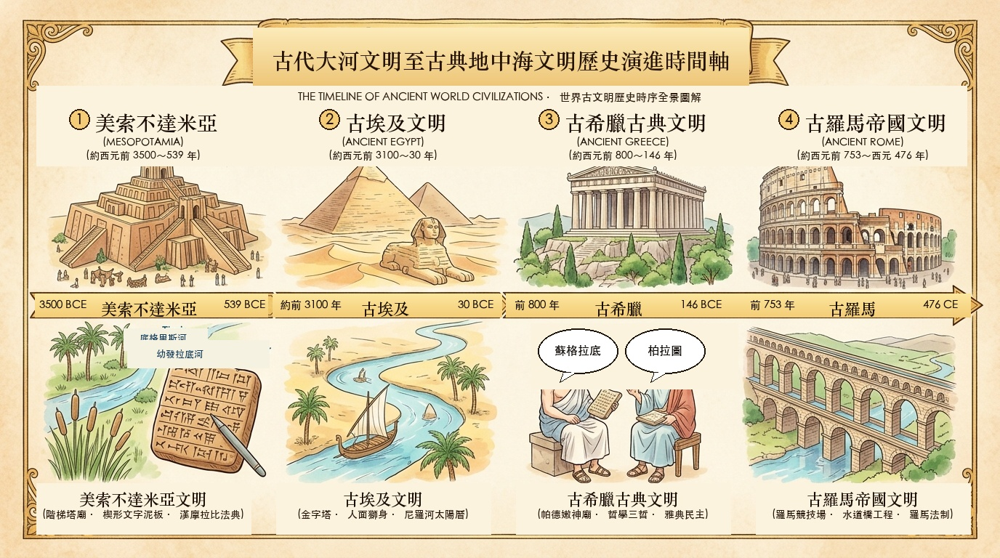
</label>

### 🧠 記憶口訣與秒殺密碼
> 💡 **【時序秒殺口訣】**
> - 「蘇美造字埃及曆，雅典民主斯巴軍；亞歷山大融東西，屋大維創羅馬平；三一三合法信基督，四七六西羅入中古！」

### 🎯 隨堂觀念自我檢測
* **題目**：古代西方歷史上，西元 313 年君士坦丁大帝頒布《米蘭詔令》，對基督教發展造成何種劃時代影響？
  * (A) 承認基督教具有合法地位，停止迫害教徒 ★（正解：西元 313 年《米蘭詔令》使基督教「合法化」；西元 392 年狄奧多西才「定為國教」）
  * (B) 正式將基督教定為羅馬帝國唯一的官方國教
  * (C) 基督教分裂為羅馬天主教與希臘正教
  * (D) 創立基督教並確立舊約聖經一神信仰

---

## 📌 重點 2：機會成本計算全攻略（外顯成本＋隱藏成本）與非成本項目辨析

### 🏷️ 分類資訊
* **筆記本分類**：進度筆記本（第 5 冊開始）
* **冊數進度**：第 5 冊（九年級上學期）
* **科目**：社會（公民）
* **單元章節**：第 3 章 選擇與機會成本
* **核心知識點**：機會成本＝外顯成本（金錢支出）＋隱藏成本（放棄的收入/代價）；贈品利益絕非成本！

### 💡 核心觀念精華
1. **計算公式**：**機會成本 ＝ 外顯成本（實際支付之金錢）＋ 隱藏成本（因選擇而少賺的時間薪資）**。
2. **贈品利益非成本**：商家附贈的禮品屬於「利益」，**絕不能計入機會成本，亦不可當作折扣扣除**！
3. **沉沒成本不計**：已經發生且無法收回的支出，決策時不予考慮。

### 📊 機會成本項目判定速查表

| 項目類別 | 定義與說明 | 實例對照（以參加 4 萬元日本賞櫻團請假 5 天少賺 8,800 元為例） | 是否計入機會成本 |
|---|---|---|---|
| **外顯成本** | 看得見、實際支付的金錢費用 | 團費支出 40,000 元（自掏腰包） | ○ 必須計入！ |
| **隱藏成本** | 看不見、因選擇而放棄的最高報酬 | 請假 5 天少賺的薪資 8,800 元（因旅遊而放棄） | ○ 必須計入！ |
| **利益 / 贈品** | 店家給予的額外獎勵或附贈價值 | 隨團贈送價值 4,000 元保溫杯與體驗券 | × 絕不計入！（是利益非代價） |
| **總機會成本** | 外顯成本 ＋ 隱藏成本 | 40,000 ＋ 8,800 ＝ 48,800 元 | ★ 唯一標準正解！ |

### 🧠 記憶口訣與秒殺密碼
> 💡 **【機會成本秒殺金律】**
> - 「外顯花錢＋隱藏少賺＝總機會成本！贈品是好康利益莫加它！」

### 🎯 隨堂觀念自我檢測
* **題目**：小麥決定在週末參加兩天一夜的露營活動，繳交報名費 3,000 元，因此放棄了原本打工可賺得的 2,000 元薪資。營隊主辦單位貼心贈送價值 500 元的露營專用杯。請問小麥參加此次露營的「總機會成本」為多少？
  * (A) 5,000 元 ★（正解：外顯成本 3,000 ＋ 隱藏成本 2,000 ＝ 5,000 元。贈品 500 元屬於利益非成本，絕不計入！）
  * (B) 4,500 元
  * (C) 5,500 元
  * (D) 3,000 元

---

## 📌 重點 3：日本群島地理地圖全解（島嶼、海洋、洋流、工業區與降雪）

### 🏷️ 分類資訊
* **筆記本分類**：複習筆記本（第 1～4 冊）
* **冊數進度**：第 4 冊（八年級下學期）
* **科目**：社會（地理）
* **單元章節**：第 1 章 東北亞（日本群島）
* **核心知識點**：四大主要島嶼、周圍海洋海峽、寒暖洋流交會漁場、三大平原工業區、冬季降雪成因

### 💡 核心觀念精華
* 日本西臨日本海、東臨太平洋；親潮（寒）與黑潮（暖）交會於北海道及東北外海形成天然漁場；冬季西北季風越日本海迎風面多雪。

### 📊 日本群島地圖代號對照表

| 代號 / 項目 | 地理實體名稱 | 類別屬性 | 核心特徵與講義註解 |
|---|---|---|---|
| **A** | 北海道 | 主要島嶼 | 緯度最高、地廣人稀，為「天然牧場」 |
| **B** | 本州 | 主要島嶼 | 面積最大、政治經濟心臟，居住「90% 的人口」 |
| **C** | 四國 | 主要島嶼 | 本州南側、瀨戶內海以南之島嶼 |
| **D** | 九州 | 主要島嶼 | 日本西南端島嶼，鄰近對馬海峽，北部有北九州工業區 |
| **E** | 琉球群島 | 附屬島嶼 | 西南側呈弧狀延伸 |
| **甲** | 日本海 | 海洋海峽 | 西側邊緣海，「冬季寒冷」，西北季風掠過海面帶來豐沛水氣 |
| **乙** | 太平洋 | 海洋海峽 | 東側大洋，夏秋季受「季風、颱風」影響，為「國際主要航線」 |
| **丙** | 瀨戶內海 | 海洋海峽 | 三大島環抱之內海，沿岸有瀨戶內工業區 |
| **丁** | 對馬海峽 | 海洋海峽 | 位於九州與朝鮮半島之間，為「前往亞洲大陸的跳板」 |
| **ㄅ** | 親潮 (寒流) | 洋流系統 | 高緯向南流經北海道外海，「帶來寒帶魚群」 |
| **ㄆ** | 黑潮 (暖流) | 洋流系統 | 低緯向北流經太平洋側；寒暖交會湧升流形成世界著名漁場 |

🔍 <b>[地圖講義截圖]（點擊可展開/收合，點擊下方圖片可原地放大）</b>

<input type="checkbox" id="zoom-social-3" class="zoom-toggle">
<label for="zoom-social-3" class="zoom-label">
  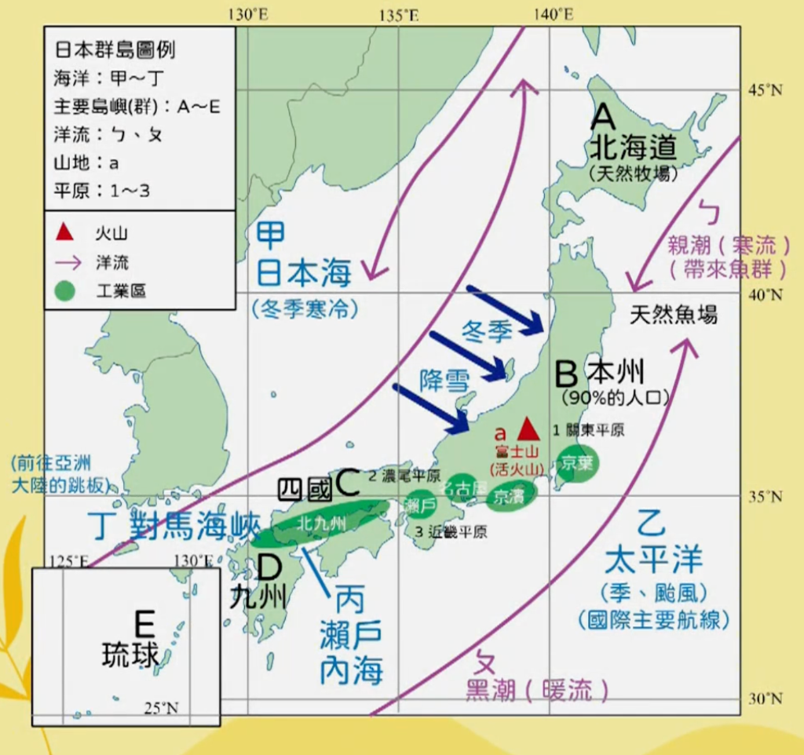
</label>

### 🧠 記憶口訣與秒殺密碼
> 💡 **【日本地理口訣】**
> - 「北海牧場本州心，寒暖洋流漁場興；冬迎西北海側雪，太平洋側夏雨淋！」

### 🎯 隨堂觀念自我檢測
* **題目**：日本本州面向日本海的地區（如新潟、北陸），冬季降雪量居世界前列。請問造成此氣候現象的最主要原因為何？
  * (A) 冬季西北季風掠過日本海吸收豐沛水氣，在迎風面的山地抬升致雪 ★（正解：西北季風越過日本海受山脈阻擋，迎風面強烈降雪）
  * (B) 夏季東南季風帶來的對流雨在低溫下凝結成雪
  * (C) 黑潮暖流直接流入日本海造成強烈蒸發降雪
  * (D) 終年受西風帶與副熱帶高壓交替籠罩

---

## 📌 重點 4：朝鮮半島地理地圖全解（南北韓、太白山脈、蓋馬高原與三大河流）

### 🏷️ 分類資訊
* **筆記本分類**：複習筆記本（第 1～4 冊）
* **冊數進度**：第 4 冊（八年級下學期）
* **科目**：社會（地理）
* **單元章節**：第 1 章 東北亞（朝鮮半島）
* **核心知識點**：北韓 vs. 南韓政權、三大河流流向、蓋馬高原礦產、太白山脈脊梁、東陡西緩地形

### 💡 核心觀念精華
* 半島東北高西南低，太白山脈東陡西緩；河流西流注入黃海；北韓多山林礦水力，南韓多平原人口工商發達。

### 📊 朝鮮半島地圖代號對照表

| 代號 / 標籤 | 名稱 / 地理實體 | 類別屬性 | 核心特徵與講義註解 |
|---|---|---|---|
| **甲** | 北韓 (朝鮮民主主義人民共和國) | 國家政權 | 首都「平壤」，境內蓋馬高原蘊藏豐富「礦產」 |
| **乙** | 南韓 (大韓民國) | 國家政權 | 首都「首爾」，農業平原開闊、經濟發達 |
| **ㄅ** | 太白山脈 | 地形脊梁 | 偏東側縱貫半島之脊梁山脈，東陡西緩 |
| **ㄆ** | 蓋馬高原 | 地形高原 | 北韓境內主要高原，氣候嚴寒，富含「林礦與水力」 |
| **A** | 漢江 | 主要河流 | 流經首爾，自東向西注入「黃海」 |
| **B** | 洛東江 | 主要河流 | 流經東南部釜山，注入「朝鮮海峽」 |
| **C** | 錦江 | 主要河流 | 流經西南部，注入「黃海」 |

🔍 <b>[地圖講義截圖]（點擊可展開/收合，點擊下方圖片可原地放大）</b>

<input type="checkbox" id="zoom-social-4" class="zoom-toggle">
<label for="zoom-social-4" class="zoom-label">
  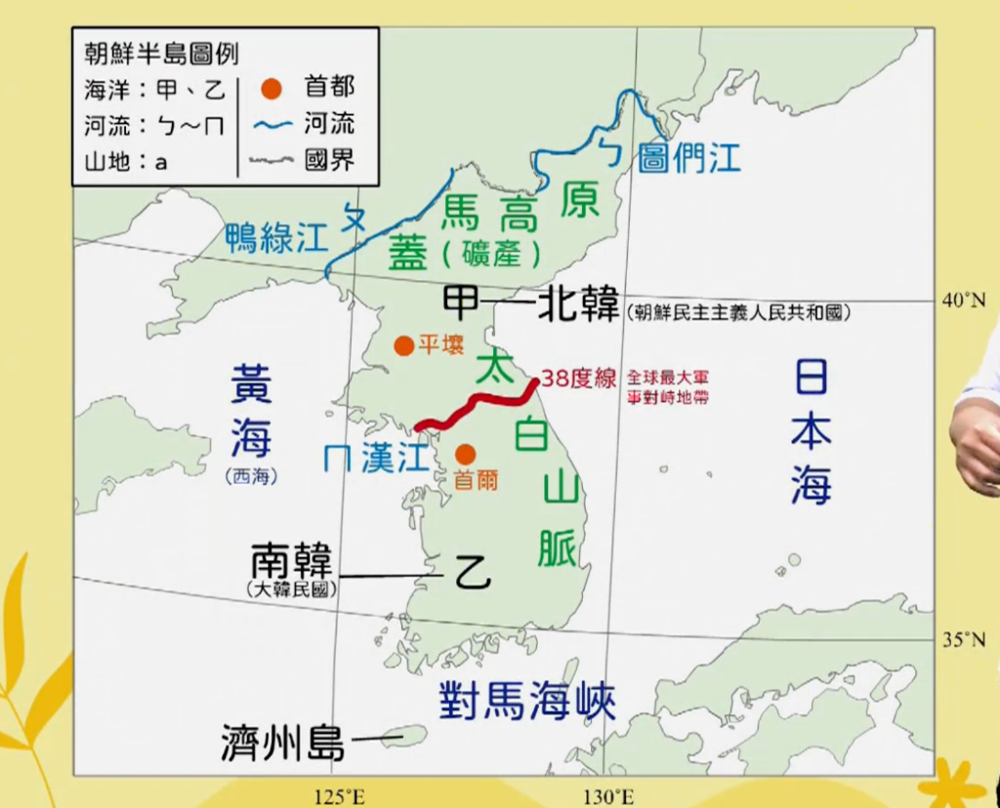
</label>

### 🧠 記憶口訣與秒殺密碼
> 💡 **【朝鮮半島口訣】**
> - 「東北山嶺西南平，東陡西緩河流西；北韓礦水南平商，太白縱貫脊梁立！」

### 🎯 隨堂觀念自我檢測
* **題目**：有關朝鮮半島的地形與水系特徵，下列敘述何者完全正確？
  * (A) 地勢「東北高、西南低」，太白山脈偏東縱貫，漢江、錦江等主要河流多自東向西注入黃海 ★（正解：太白山脈脊梁東陡西緩，河流多西注入黃海）
  * (B) 地勢「西高東低」，主要河流皆向東流入日本海
  * (C) 南韓境內蓋馬高原蘊藏豐富礦產與水力資源
  * (D) 漢江流經平壤，洛東江流經首爾

---

## 📌 重點 5：東北亞三國產業全比較（日本、韓國、朝鮮：農業、製造業、商貿發展）

### 🏷️ 分類資訊
* **筆記本分類**：複習筆記本（第 1～4 冊）
* **冊數進度**：第 4 冊（八年級下學期）
* **科目**：社會（地理）
* **單元章節**：第 1 章 東北亞（產業與經濟）
* **核心知識點**：日本、韓國、朝鮮三國農業特色、製造業定位、商貿模式與跨國合作完整比較

### 💡 核心觀念精華
1. **農業**：日本精緻科技農業；南韓平原米倉、泡菜自給；北韓嚴寒糧食不足。
2. **製造與商貿**：日韓外向型貿易大國，原料仰賴進口、工業品銷全球；日本高科技汽車精密領先；南韓半導體財閥主導；北韓重工軍工閉關自守。

### 📊 東北亞三國產業比較表

| 項目 / 國家 | 第一級產業 | 製造業 | 商貿與區域合作 |
|---|---|---|---|
| **日本** | 耕地狹小＋勞力老化（科技化農業） | 技術領先＋資金充沛，生產成本過高（產業有外移現象） | 跨國投資東南亞，建立海外生產基地 |
| **韓國** | 冬季嚴寒＋缺少蔬果，製造泡菜（辛奇），供應冬季飲食所需 | 原料缺乏＋市場狹小（以出口為導向，大財閥主導） | 積極簽署自由貿易協定 (FTA)，拓展海外市場 |
| **朝鮮 (北韓)** | 多山區、氣候寒冷，糧食產量不足（依賴國際援助） | 礦產豐富，發展重工業與軍工武器 | 實行鎖國政策，主要貿易夥伴為中國 |

🔍 <b>[講義圖表截圖]（點擊可展開/收合，點擊下方圖片可原地放大）</b>

<input type="checkbox" id="zoom-social-5" class="zoom-toggle">
<label for="zoom-social-5" class="zoom-label">
  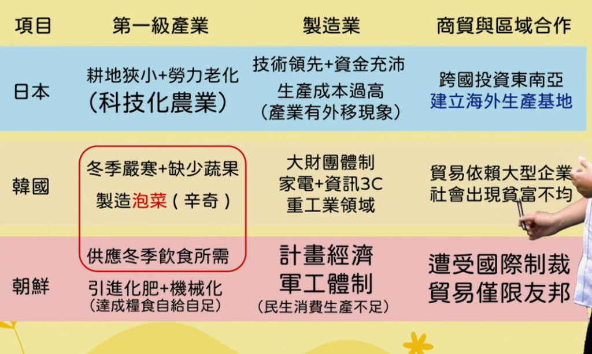
</label>

### 🧠 記憶口訣與秒殺密碼
> 💡 **【東北亞產業口訣】**
> - 「日韓外向原料進口產品銷全球；日本精密科技，南韓財閥半導體，北韓軍工缺糧食！」

### 🎯 隨堂觀念自我檢測
* **題目**：日本與南韓兩國在工業與經貿發展型態上，具有下列哪一項最顯著的「共同特徵」？
  * (A) 國內礦產資源匱乏，均採「進口原料、加工出口」的外向型貿易經濟 ★（正解：日韓缺乏能源礦產，均仰賴原料進口並加工出口行銷全球）
  * (B) 國內勞動力充足低廉，以低成本組裝成衣與鞋類製造為主
  * (C) 糧食作物完全自給自足，不需仰賴國外農產進口
  * (D) 實行嚴格鎖國保護政策，極少進行對外投資

---

## 📌 重點 6：中國四大核心都市地理與經濟轉型全比較（北京、上海、廣州、深圳）

### 🏷️ 分類資訊
* **筆記本分類**：複習筆記本（第 1～4 冊）
* **冊數進度**：第 3 冊（八年級上學期）
* **科目**：社會（地理）
* **單元章節**：中國地理篇（區域發展與核心都會）
* **核心知識點**：四大核心都市（深圳、上海、北京、廣州）之地理區位、歷史背景與產業轉型方向完整比較

### 💡 核心觀念精粹
1. **深圳**：
   * 原是珠江口東側的鄉村。
   * 已轉型成新創企業與人才集中的都市。
2. **上海**：
   * 位於中國海岸線與長江水運的交會點。
   * 交通便利且腹地廣大，是中國工商業金融中心。
3. **北京**：
   * 中國政治中心，有眾多頂尖大學培養人才。
   * 近年來，脫離重工業，朝資訊科技業發展。
4. **廣州**：
   * 位居珠江三角洲，自古以來是南方最大商港。
   * 近年來，成為中國南部的水陸交通樞紐都市。

### 📊 中國四大核心都市速查比較大表

| 都市名稱 | 地理區位與空間特徵 | 歷史淵源與起點 | 產業演進與轉型方向 | 現代都市定位與核心優勢 |
|---|---|---|---|---|
| **深圳** | 位於**珠江口東側**，緊鄰香港 | 原是珠江口東側的**鄉村**（改革開放最早經濟特區） | 傳統組裝代工 $\rightarrow$ 「**轉型成新創企業與人才集中的都市**」 | 國際創新科技都會、新創企業研發重鎮 |
| **上海** | 位於**中國海岸線與長江水運的交會點** | 長江出海口門戶，開埠甚早 | 傳統沿海商港 $\rightarrow$ 「**交通便利且腹地廣大，是工商業金融中心**」 | 中國經濟第一大城、長江流域龍頭與金融核心 |
| **北京** | 位於**華北平原西北部**，背靠燕山 | 歷代帝都，**中國政治中心** | 傳統重工業 $\rightarrow$ 「**脫離重工業，朝資訊科技業發展**」 | 政治文化中心、眾多頂尖大學培養人才、高科技研發核心 |
| **廣州** | 位居**珠江三角洲**核心北緣 | 「**自古以來是南方最大商港**」（海上絲路起點） | 傳統貿易海港 $\rightarrow$ 「**中國南部的水陸交通樞紐都市**」 | 嶺南文化中心、華南綜合水陸交通與商貿樞紐 |

### 🧠 記憶口訣與秒殺密碼
> 💡 **【四大名城秒殺金律】**
> - **黃金定位口訣**：「**北京政治大學聚，脫離重工奔資訊；上海江海交會點，金融商貿腹地闊；廣州珠三角老港，南方水陸大樞紐；深圳昔日小漁村，創新人才聚寶盆！**」
> - **考題特徵對照**：
>   - 「脫離重工業朝資訊科技、頂尖大學人才」$\rightarrow$ 秒選**北京**！
>   - 「海岸線與長江水運交會點、金融中心」$\rightarrow$ 秒選**上海**！
>   - 「自古南方最大商港、水陸交通樞紐」$\rightarrow$ 秒選**廣州**！
>   - 「珠江口東側鄉村、新創企業人才集中」$\rightarrow$ 秒選**深圳**！

### 🎯 隨堂觀念自我檢測
* **題目**：這座都市原先只是珠江口東側的純樸鄉村，藉由政策開放與緊鄰香港的區位優勢，近年來已迅速轉型為新創企業與各領域高科技人才匯聚的現代化創新大都會。請問上述描述的是下列哪一座都市？
  * (A) 北京
  * (B) 上海
  * (C) 廣州
  * (D) 深圳 ★（正解：深圳原為珠江口東側鄉村，如今已轉型為新創企業與人才高度集中的現代都市）

---

## 📌 重點 7：亞洲季風氣候分佈與日本氣候全解（季風、洋流、降水與櫻花前線）

### 🏷️ 分類資訊
* **筆記本分類**：複習筆記本（第 1～4 冊）
* **冊數進度**：第 4 冊（八年級下學期）
* **科目**：社會（地理）
* **單元章節**：東北亞篇（亞洲季風氣候與日本自然環境）
* **核心知識點**：三大季風氣候分佈界線、日本冬夏兩季季風與洋流影響、櫻花前線由南向北開放之緯度氣溫成因

### 💡 核心觀念精粹
1. **亞洲三大季風氣候分佈**：
   * **溫帶季風氣候**：東北亞、東亞北部（以「秦嶺—淮河」為界以北）。
   * **副熱帶季風氣候**：東亞南部、臺灣北部（「秦嶺—淮河」以南、「北回歸線」以北）。
   * **熱帶季風氣候**：臺灣南部（「北回歸線」以南）、東南亞、南亞。
2. **日本氣候四大關鍵要素（季風、洋流、降水、緯度）**：
   * **冬季西北季風**：來自歐亞大陸冷高壓，掠過日本海吸收豐沛水氣，在**日本海側（迎風面）**降大雪。
   * **夏季東南季風**：來自太平洋副熱帶高壓，為**太平洋側（迎風面）**帶來高溫與豐沛季風雨。
   * **洋流交會**：親潮（寒流，高緯南下帶來寒帶魚群）與黑潮（暖流，低緯北上增溫增濕），於本州東北外海與北海道交會，湧升流帶來豐富浮游生物，形成世界天然漁場。
   * **櫻花前線**：開花時間由南向北依序綻放（福岡 3/20 → 東京 3/25 → 仙台 3/30 → 札幌 4/30），破題唯一核心關鍵為「**緯度不同，氣溫差異大**」。

### 📊 亞洲季風與日本氣候速查大表

| 氣候類型 / 關鍵要素 | 核心分佈區域 / 迎風受影響側 | 關鍵特徵與判斷依據 | 代表現象與會考必考重點 |
|---|---|---|---|
| **溫帶季風氣候** | 東北亞、東亞北部 | 秦嶺—淮河以北、朝鮮半島、日本中北部 | 冬季寒冷乾燥、夏季溫暖多雨，四季分明 |
| **副熱帶季風氣候** | 東亞南部、臺灣北部 | 秦嶺—淮河以南、北回歸線以北、日本南部 | 冬季溫和少雨、夏季炎熱多雨 |
| **熱帶季風氣候** | 臺灣南部、東南亞、南亞 | 北回歸線以南、中南半島、印度半島 | 終年高溫，年分乾濕兩季（雨季／乾季） |
| **日本冬季西北季風** | 日本海側（新潟、北陸地區） | 西北季風掠過日本海吸飽水氣，遇山地抬升 | 迎風面冬季強烈降雪，為世界著名多雪區 |
| **日本夏季東南季風** | 太平洋側（東京、大阪、關東關西） | 夏季東南季風由太平洋吹拂迎風面 | 夏季高溫多雨、夏秋季易受颱風侵襲 |
| **親潮 (寒) ＋ 黑潮 (暖)** | 本州東北外海、北海道沿海 | 高緯親潮寒流與低緯黑潮暖流交會 | 寒暖交會產生湧升流，形成世界著名天然漁場 |
| **日本櫻花前線** | 由南向北（九州 3/20 → 北海道 4/30） | 緯度越低氣溫回暖越早，緯度越高回暖越遲 | ★ 核心破題點：「緯度不同，氣溫差異大」 |

🔍 <b>[亞洲季風氣候分佈地圖]（點擊可展開/收合，點擊下方圖片可原地放大）</b>

<input type="checkbox" id="zoom-social-7-1" class="zoom-toggle">
<label for="zoom-social-7-1" class="zoom-label">
  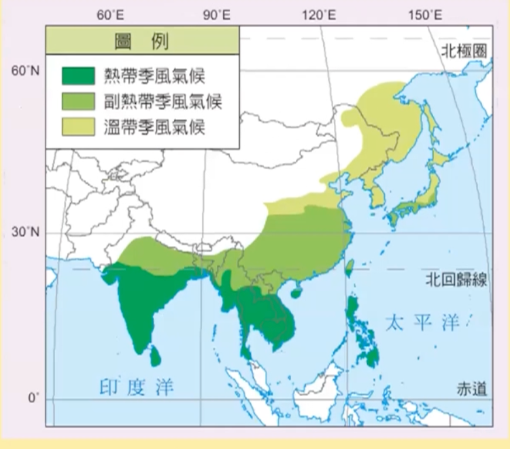
</label>

🔍 <b>[日本季風、洋流與降水量分佈地圖]（點擊可展開/收合，點擊下方圖片可原地放大）</b>

<input type="checkbox" id="zoom-social-7-2" class="zoom-toggle">
<label for="zoom-social-7-2" class="zoom-label">
  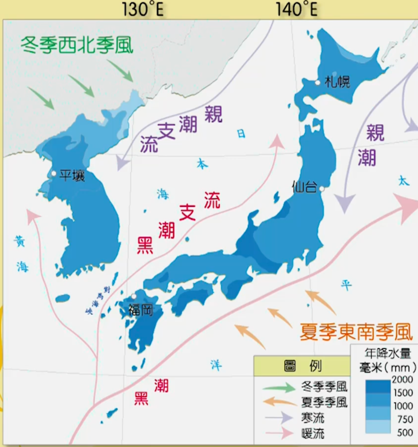
</label>

🔍 <b>[日本櫻花前線開花時間與緯度分佈地圖]（點擊可展開/收合，點擊下方圖片可原地放大）</b>

<input type="checkbox" id="zoom-social-7-3" class="zoom-toggle">
<label for="zoom-social-7-3" class="zoom-label">
  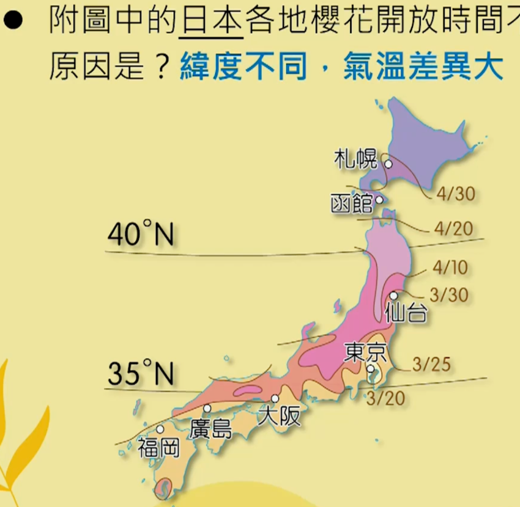
</label>

### 🧠 記憶口訣與秒殺密碼
> 💡 **【季風與櫻花秒殺金律】**
> - 「**秦淮以北溫季風，北回以南熱季風；臺灣南北各一派，冬吹西北海側雪；夏迎東南洋側雨，親寒黑暖漁場豐；櫻花北開緯度定！**」
> - **考題特徵對照**：
>   - 「臺灣北部氣候類型」$\rightarrow$ 秒選**副熱帶季風**！
>   - 「臺灣南部、東南亞、南亞」$\rightarrow$ 秒選**熱帶季風**！
>   - 「東北亞、東亞北部」$\rightarrow$ 秒選**溫帶季風**！
>   - 「日本冬季多雪迎風面」$\rightarrow$ 秒選**日本海側**（西北季風吸水汽遇山阻）！
>   - 「日本各地櫻花開花時間由南向北延後之原因」$\rightarrow$ 秒選**緯度不同，氣溫差異大**！

### 🎯 隨堂觀念自我檢測
* **題目**：附圖為日本各地櫻花平均開放時間示意圖（櫻花前線），開花日期由九州福岡（3/20）逐漸往北推遲至北海道札幌（4/30）。請問造成日本各地櫻花開放時間具有此種規律差異的最主要原因為何？
  * (A) 各地緯度不同，氣溫回暖時間差異大 ★（正解：低緯度南方春季先回暖先開花，高緯度北方回暖晚後開花。核心原因為「緯度不同，氣溫差異大」！）
  * (B) 地形高低起伏，迎風坡與背風坡雨量懸殊
  * (C) 親潮與黑潮交會位置隨季節自南向北移動
  * (D) 夏季東南季風自南方登陸帶來的降水多寡

---

## 📌 重點 8：南亞地理全景圖解 — 國家分佈、三大地形、主要水系與季風氣候

### 🏷️ 分類資訊
* **筆記本分類**：複習筆記本（第 1～4 冊）
* **冊數進度**：第 4 冊（八年級下學期）
* **科目**：社會（地理）
* **單元章節**：南亞篇（南亞自然環境、地形水系與地緣政治）
* **核心知識點**：南亞七國分佈、北中南三大地形區、三大海域與主要河流（印度河、恆河）、喀什米爾爭端與季風氣候

### 💡 核心觀念精粹
1. **南亞三大地形區（由北向南縱列）**：
   * **北部高山（1 喜馬拉雅山）**：板塊擠壓形成之年輕褶曲山脈，阻擋冬季東北季風南下，使南亞冬季氣溫較同緯度地區溫暖。
   * **中部平原（2 印度大平原）**：由**印度河（戊）**與**恆河（丁）**沖積而成，土壤肥沃、灌溉便利，為南亞人口密集精華區。
   * **南部高原（3 德干高原）**：古老熔岩高原，地勢西高東低，為重要棉花產地。
   * **西北沙漠（4 塔爾沙漠）**：位於印度河下游東側、印巴交界處，受副熱帶高壓與乾燥信風籠罩，降水稀少。
2. **海域與水系（海陸位置）**：
   * **海域**：西鄰**丙 阿拉伯海**、東瀕**乙 孟加拉灣**（印度洋旋風主要形成區與襲擊區）、南濱**甲 印度洋**。
   * **河川**：**印度河（戊）**流經巴基斯坦注入阿拉伯海（古印度文明發源地）；**恆河（丁）**流經印度北部與孟加拉注入孟加拉灣（印度教聖河）。
3. **南亞主要國家與宗教文化特性**：
   * **B 印度**：南亞面積最大、人口最多國家（人口超過 14 億），信奉印度教為主。
   * **E 巴基斯坦**：位於印度河西北側，主要信奉伊斯蘭教。
   * **A 孟加拉**：恆河三角洲低窪平原，人口突破 1 億多，主要信奉伊斯蘭教，常受夏季暴雨、融雪及旋風暴潮引起的水患。
   * **C 尼泊爾 / D 不丹**：位於喜馬拉雅山南麓之內陸山國，深受山地阻隔。
   * **F 斯里蘭卡**：印度洋上的島國，主要信奉佛教。
   * **G 馬爾地夫**：印度洋上的珊瑚礁島國，以觀光聞名。
   * **喀什米爾地區**：位於印、巴、中三國交界處之高山爭議地帶，主權長年爭議衝突。
4. **季風氣候特徵（熱帶季風）**：
   * **夏季（6～9月）**：吹**西南季風**，由印度洋吹向陸地，帶來豐沛水氣形成「雨季」。
   * **冬季（10～次年2月）**：吹**東北季風**，來自乾燥大陸，受喜馬拉雅山阻擋，乾燥涼爽形成「涼季/乾季」。

### 📊 南亞地理代號與關鍵特徵速查大表

| 代號 / 地理要素 | 地理名稱 | 核心特徵與地理定位 | 會考與模考必考解題關鍵 |
|---|---|---|---|
| **A**（國家） | **孟加拉** | 恆河三角洲，人口超過 1 億多，伊斯蘭教國 | 地勢低平＋夏季西南季風＋熱帶旋風侵襲，易氾濫成災 |
| **B**（國家） | **印度** | 南亞面積最大、人口最多之軸心大國 | 印度教為主，資訊科技(IT)與軟體代工重鎮 |
| **C**（國家） | **尼泊爾** | 喜馬拉雅山南麓內陸山國，聖母峰所在地 | 山地地形阻隔，經濟以農業與高山健行觀光為主 |
| **D**（國家） | **不丹** | 喜馬拉雅山南麓內陸山國，以幸福指數聞名 | 藏傳佛教為主，森林資源豐富，重視生態保育 |
| **E**（國家） | **巴基斯坦** | 位於印度河流域，主要信奉伊斯蘭教 | 印度河為主要灌溉水源，長年與印度爭奪喀什米爾 |
| **F**（國家） | **斯里蘭卡** | 印度東南方印度洋島國 | 佛教國家，世界著名錫蘭紅茶產地 |
| **G**（國家） | **馬爾地夫** | 印度洋群島國家，地勢極低之珊瑚礁島國 | 觀光度假勝地，面臨全球暖化海平面上升威脅 |
| **喀什米爾** | **喀什米爾** | 中國、印度、巴基斯坦爭議地帶（高山區） | 印巴多次爆發衝突核心熱點（宗教與領土紛爭） |
| **甲**（海域） | **印度洋** | 南亞南方之世界第三大洋 | 連接歐、非、亞之重要海上航道 |
| **乙**（海域） | **孟加拉灣** | 印度半島東側海灣 | 印度洋熱帶旋風主要發源地，孟加拉易受風暴潮襲擊 |
| **丙**（海域） | **阿拉伯海** | 印度半島西側海面 | 印度與中東、西亞海上交通咽喉 |
| **丁**（河流） | **恆河** | 發源於喜馬拉雅山，流經北印度注入孟加拉灣 | 印度教聖河，沖積出肥沃平原，人口密度極高 |
| **戊**（河流） | **印度河** | 發源於青藏高原，流經巴基斯坦注入阿拉伯海 | 古印度文明發祥地，巴基斯坦重要灌溉水脈 |
| **1**（地形） | **喜馬拉雅山** | 北部年輕褶曲山脈，世界最高山脈 | 阻擋冬季大陸冷空氣南下，使南亞冬季相對溫暖 |
| **2**（地形） | **印度大平原** | 中部由印度河與恆河沖積形成之平原 | 地勢平坦、土壤肥沃，為南亞農業精華區與人口稠密區 |
| **3**（地形） | **德干高原** | 南部古老熔岩高原，地勢西高東低 | 降水相對平原少，為印度主要棉花產地 |
| **4**（地形） | **塔爾沙漠** | 位於印度大平原西側、印巴邊境 | 受副熱帶高壓及乾燥信風影響，降水稀少形成沙漠 |
| **西南季風** | **夏季季風** | 來自印度洋（西南方），溫暖潮濕 | 南亞夏季主要雨水來源（雨季，6～9月） |
| **東北季風** | **冬季季風** | 來自陸地（東北方），乾燥涼爽 | 受喜馬拉雅山阻擋，南亞冬季氣溫較同緯度溫暖（涼季/乾季） |

🔍 <b>[南亞國家分佈、三大地形與水系氣候全景地圖]（點擊可展開/收合，點擊下方圖片可原地放大）</b>

<input type="checkbox" id="zoom-social-8" class="zoom-toggle">
<label for="zoom-social-8" class="zoom-label">
  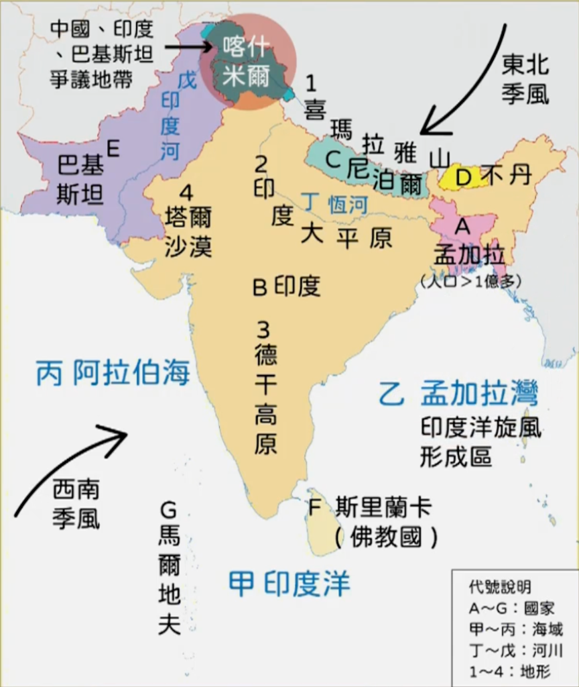
</label>

### 🧠 記憶口訣與秒殺密碼
> 💡 **【南亞地理秒殺金律】**
> - 「**北喜馬南德干，中間印度大平原；西印度東恆河，塔爾沙漠西邊乾；夏吹西南風多雨，孟加拉灣旋風翻；斯里蘭卡信佛教，喀什米爾爭不完！**」
> - **考題特徵對照**：
>   - 「南亞冬季氣溫比同緯度溫暖」$\rightarrow$ 秒選**喜馬拉雅山阻擋冷空氣**！
>   - 「孟加拉水患頻繁成因」$\rightarrow$ 秒選**地勢低平＋夏季西南季風＋熱帶旋風（風暴潮）＋上游融雪降雨**！
>   - 「南亞佛教國家」$\rightarrow$ 秒選**斯里蘭卡**（或不丹）！
>   - 「南亞信奉伊斯蘭教國家」$\rightarrow$ 秒選**巴基斯坦、孟加拉、馬爾地夫**！
>   - 「中印巴三方爭議熱點」$\rightarrow$ 秒選**喀什米爾**！

### 🎯 隨堂觀念自我檢測
* **題目**：南亞地區每逢夏季（6～9月）常受到來自海洋的季風吹拂而降下豐沛雨量，若逢熱帶旋風侵襲，地勢低平的孟加拉（代號 A）更極易發生嚴重的暴潮與水患。請問圖中吹拂南亞帶來雨季的夏季季風，其風向為何？
  * (A) 西南季風 ★（正解：南亞夏季受西南季風吹拂，自印度洋帶來大量水氣，形成雨季！）
  * (B) 東北季風（此為冬季季風，帶來乾燥涼爽天氣）
  * (C) 東南季風（此為東亞、日本一帶夏季季風）
  * (D) 西北季風（此為東亞冬季季風）

---

## 📌 重點 9：東南亞兩大地形區深度對照 — 中南半島 vs. 南洋群島

### 🏷️ 分類資訊
* **筆記本分類**：複習筆記本（第 1～4 冊）
* **冊數進度**：第 4 冊（八年級下學期）
* **科目**：社會（地理）
* **單元章節**：東南亞篇（中南半島與南洋群島之自然環境、產業型態與氣候特性）
* **核心知識點**：中南半島山河相間南北縱走與三角洲稻作、南洋群島板塊交界多火山良港與熱帶栽培業，熱帶季風 vs. 熱帶雨林氣候對照

### 💡 核心觀念精粹
1. **中南半島（大陸型東南亞）**：
   * **地理特徵**：源自橫斷山脈，山地與河川「**南北縱走、山河相間**」；河流下游沖積形成廣大**三角洲**（如湄公河三角洲、紅河三角洲、昭披耶河三角洲），地勢低平平坦。
   * **產業型態**：以**傳統稻作農業**為主（盛產水稻，泰國、越南為世界稻米主要出口國）；現代利用充沛廉價勞動力發展**勞力密集型加工出口區**。
   * **氣候特性**：**熱帶季風氣候**，年溫高且具明顯「**夏雨冬乾**」特徵（夏季西南季風多雨、冬季東北季風乾燥）。
2. **南洋群島（海洋/島嶼型東南亞）**：
   * **地理特徵**：位處環太平洋火山地震帶與歐亞板塊交界，**板塊交界地帶（多火山島、地震頻繁）**，火山灰帶來肥沃土壤；曲折海岸線形成**沿岸多天然良港**，掌控麻六甲海峽等海運樞紐。
   * **產業型態**：發展大規模**熱帶栽培業（熱帶經濟作物）**，多由西方殖民引進企業化經營，如**甘蔗、香蕉、棕櫚油、橡膠、咖啡**；沿海港口發展轉口貿易與商業。
   * **氣候特性**：**熱帶雨林氣候**（赤道橫貫），終年高溫多雨、**全年有雨**，對流旺盛（午後多對流雨/雷陣雨）。

### 📊 中南半島 vs. 南洋群島核心速查大表

| 地形區 | 地理特徵 | 產業形態 | 氣候特性 | 會考與模考解題秒殺密碼 |
|---|---|---|---|---|
| **中南半島** | 山地南北縱走 河川沖積形成 **三角洲** | **稻作農業** 勞力密集型加工出口區 | **熱帶季風** （夏雨冬乾、年分乾濕季） | 「山河相間南北走、下游三角洲種水稻、夏雨冬乾」➜ **中南半島** |
| **南洋群島** | 板塊交界地帶（多火山島） 沿岸多 **天然良港** | **熱帶栽培業** （甘蔗、香蕉、棕櫚油、橡膠） | **熱帶雨林** （終年高溫、全年有雨） | 「火山土壤肥沃、天然良港、殖民經濟作物、全年有雨」➜ **南洋群島** |

### 🧠 記憶口訣與秒殺密碼
> 💡 **【東南亞兩區速記金律】**
> - 「**中南半島山河走，三角洲上稻作稠；夏雨冬乾季風吹，勞力代工出口遊。**」
> - 「**南洋群島火山構，天然良港航運優；熱帶栽培甘蔗棕，全年多雨雨林厚！**」
> - **考題特徵對照**：
>   - 「地表特徵為山河相間、南北縱走」➜ 秒選**中南半島**！
>   - 「主要糧食作物為水稻，下游三角洲土壤肥沃」➜ 秒選**中南半島稻作農業**！
>   - 「板塊交界、多火山地震、海運良港」➜ 秒選**南洋群島**！
>   - 「甘蔗、香蕉、棕櫚油、橡膠等企業化出口作物」➜ 秒選**南洋群島熱帶栽培業**！
>   - 「氣候終年高溫、全年有雨、無明顯乾季」➜ 秒選**南洋群島熱帶雨林氣候**！
>   - 「夏季西南季風多雨、冬季東北季風乾燥、夏雨冬乾」➜ 秒選**中南半島熱帶季風氣候**！

### 🎯 隨堂觀念自我檢測
* **題目**：東南亞某地區因地處板塊交界處，地表多火山分布，火山灰覆蓋形成肥沃土壤，沿岸多天然良港，農業以企業化經營大規模種植油棕、橡膠與香蕉等外銷經濟作物。請問該地區屬於下列何者？
  * (A) 南洋群島 ★（正解：南洋群島位於板塊交界多火山島，沿岸多良港，以種植甘蔗、棕櫚油等熱帶栽培業聞名！）
  * (B) 中南半島（中南半島為山河南北縱走、下游沖積三角洲以稻作農業為主）
  * (C) 印度大平原（印度大平原為恆河、印度河沖積平原，並非火山島）
  * (D) 朝鮮半島（朝鮮半島位於東北亞溫帶季風氣候區）

---

## 📌 重點 10：南亞三大地形區農產分佈 vs. 一年僅三季氣候深度對照

### 🏷️ 分類資訊
* **筆記本分類**：複習筆記本（第 1～4 冊）
* **冊數進度**：第 4 冊（八年級下學期）
* **科目**：社會（地理）
* **單元章節**：南亞篇（南亞三大地形區、主要農作物分佈與熱帶季風一年三季特徵）
* **核心知識點**：印度高山區、印度大平原（印度河、恆河、阿薩姆紅茶）、德干高原黑色土壤棉花產區；印度一年僅三季（涼季、熱季、雨季）成因與特色

### 💡 核心觀念精粹
1. **南亞三大地形區與產業農作分佈**：
   * **印度高山區（北部）**：板塊擠壓形成（喜馬拉雅山／世界屋脊），擁有世界最高峰；主要扮演**氣候分界線**與天然屏障，阻擋北方寒風南下，幾乎**無農業生產**。
   * **印度大平原（中部）**：由兩條大河沖積而成——**印度河**（西流注入阿拉伯海）與**恆河**（東流沖積形成廣大三角洲注入孟加拉灣）。
     * **恆河平原及三角洲（濕潤多雨）**：主要種植**水稻**與**黃麻**。
     * **印度河平原及恆河上游（較乾燥）**：主要種植**小麥**。
     * **東北部丘陵區（阿薩姆 Assam）**：排水良好的迎風坡丘陵，為世界著名**茶葉**產區。
   * **德干高原（南部）**：古老地塊，因**火山熔岩風化**形成肥沃的「**黑色土壤區**」；位於西高止山背風坡，氣候較乾燥，為**世界主要棉花產區**。
2. **南亞獨特季風氣候——「一年僅三季」**：
   * **涼季（11～2月）**：印度「沒有冬天」！成因為**喜馬拉雅高山阻擋北方北風與大陸寒流**；氣候乾燥涼爽，是一年當中**最為舒適**的季節。
   * **熱季（3～5月）**：此時太陽直射北移，**北回歸線上日照強烈**，加上缺少冷風調節且西南季風尚未吹抵；天氣極度**乾熱少雨、最為艱困**，氣溫常飆破 40°C 以上。
   * **雨季（6～10月）**：西南季風盛行，**進入海上季風季節**，將印度洋豐沛水氣源源不絕吹向陸地；遇到喜馬拉雅山南麓與西高止山等地形強烈抬升，降下大量**地形雨**，其中阿薩姆丘陵附近的乞拉朋吉更創下「世界雨量第一」的紀錄！

### 📊 南亞三大地形區特徵與農作速查大表

| 地形區 | 地理特徵 | 產業形態 / 代表農作 | 氣候特性與關鍵考點 |
|---|---|---|---|
| **印度高山區** | 板塊擠壓（世界屋脊） 世界最高峰（阻擋北方寒風） | **無**（地勢陡峻高寒） | **成為氣候分界線** 阻擋冬季北方冷氣團南下，使南亞冬季較同緯度溫暖 |
| **印度大平原** | 兩條河川沖積形成： ・**印度河**（西流，古印度文明） ・**恆河**（東流，沖積成廣大三角洲） | ・**水稻、黃麻**（下游多雨三角洲） ・**小麥**（上游乾燥平原） ・**茶葉**（阿薩姆丘陵區，排水良好） | **一年僅三季** 平原土壤深厚肥沃、水源充足，為全南亞人口最稠密精華區 |
| **德干高原** | **火山熔岩風化**形成 形成肥沃的**黑色土壤區** | **世界棉花主要產區** | **背風坡較乾燥**，日照充足且具耐旱黑色土，最適合棉花生長 |

### 📊 南亞「一年僅三季」氣候時序對照表

| 季節項目 | 涼季 | 熱季 | 雨季 |
|---|---|---|---|
| **時間月份** | **11 ～ 2 月** （★ 印度沒有冬天） | **3 ～ 5 月** | **6 ～ 10 月** |
| **關鍵成因** | **高山擋北風** （喜馬拉雅山屏障冷氣團） | **北回歸線上日照強烈** 缺少寒風且西南季風未至 | **進入海上季風季節** 西南季風自印度洋帶來水氣 |
| **氣候特色** | **一年當中最為舒適** 氣候溫涼、乾燥少雨 | **乾熱少雨、最為艱困** 極端高溫乾旱，常達 40°C 以上 | **地形雨旺盛，雨量世界第一** （迎風坡乞拉朋吉世界雨極） |

### 🧠 記憶口訣與秒殺密碼
> 💡 **【南亞地形農產與三季秒殺金律】**
> - 「**高山擋寒無冬天，十一到二涼季恬；三到五月烈日曬，乾熱少雨最艱難；六到十月西南風，地形雨下世第一！**」
> - 「**恆河三角種水稻，阿薩姆坡飄茶香；德干熔岩黑土壤，乾燥背風產棉花！**」
> - **考題特徵對照**：
>   - 「德干高原主要農作物與土壤成因」➜ 秒選**火山熔岩風化黑色土、背風乾燥種棉花**！
>   - 「阿薩姆地區主要經濟作物」➜ 秒選**茶葉**（丘陵排水佳、雨量充沛）！
>   - 「恆河下游三角洲主要作物」➜ 秒選**水稻、黃麻**！
>   - 「印度一年當中最艱困、乾熱少雨季節」➜ 秒選**熱季（3～5月）**！
>   - 「印度一年當中最舒適季節」➜ 秒選**涼季（11～2月）**！
>   - 「印度降下地形雨、世界雨極（乞拉朋吉）之成因」➜ 秒選**西南季風遇喜馬拉雅山南麓抬升降雨**！

### 🎯 隨堂觀念自我檢測
* **題目**：印度半島南部德干高原的玄武岩熔岩經長期風化後，形成了保水力佳且極為肥沃的「黑色土壤」，加上位於西高止山的背風坡側，氣候相對乾燥少雨。請問此地最適合發展下列哪一種世界級代表經濟作物？
  * (A) 棉花 ★（正解：德干高原熔岩風化形成肥沃黑土，加上背風坡乾燥日照充足，為世界著名棉花產區！）
  * (B) 水稻（水稻主要分佈於地勢低平、水源豐沛的恆河平原及三角洲）
  * (C) 茶葉（茶葉主要分佈於東北部阿薩姆山地丘陵排水良好處）
  * (D) 黃麻（黃麻主要分佈於恆河三角洲低窪多水地區）

---

## 📌 重點 11：東南亞氣候類型深度對照 vs. 殖民熱帶栽培業特色與隱憂

### 🏷️ 分類資訊
* **筆記本分類**：複習筆記本（第 1～4 冊）
* **冊數進度**：第 4 冊（八年級下學期）
* **科目**：社會（地理）
* **單元章節**：東南亞篇（東南亞氣候成因與特徵、稻作農業與殖民熱帶栽培業之產業隱憂）
* **核心知識點**：熱帶季風氣候（中南半島、菲律賓群島）vs. 熱帶雨林氣候（東印度群島/南洋群島）；東南亞稻米充足背景、熱帶栽培業之殖民歷史、商業化經營特色與單一作物價格波動隱憂

### 💡 核心觀念精粹
1. **東南亞兩大熱帶氣候深度對照**：
   * **熱帶季風氣候**：
     * **分布區域**：**中南半島**與**菲律賓群島**（位於海陸交界地帶）。
     * **氣候成因**：海陸比熱差異造成「**季風風向轉換**」影響，各地迎風、背風降水量差異大。
     * **氣候特徵**：終年高溫，具有鮮明的「**夏雨冬乾**」（年分乾濕兩季，夏季西南季風多雨、冬季東北季風乾燥）。
   * **熱帶雨林氣候**：
     * **分布區域**：**東印度群島**（南洋群島、印尼、馬來群島）。
     * **氣候成因**：地跨**赤道兩側**，終年受赤道低壓帶籠罩，日照強烈、**對流旺盛**。
     * **氣候特徵**：**全年高溫多雨**，幾乎每天都有**午後雷陣雨（對流雨）**，無乾季。
2. **東南亞農業形態與產業發展**：
   * **稻作農業（糧食保障）**：地勢低平平原三角洲土壤肥沃、水熱充足，東南亞稻米生產量居世界前列（如泰國、越南為稻米主要出口國），**糧食充足**。
   * **熱帶栽培業（殖民背景與三大代表作物）**：
     * **殖民背景**：受西方列強（荷、英、法、西等）殖民統治影響，各國的經濟作物皆有數百年悠久歷史。
     * **經營特色**：以**商業化、企業化經營**為主，投入大筆資金與勞力採取**大規模大量生產**，純粹以**外銷出口為導向**。
     * **三大核心經濟作物與主要產地（會考秒殺連連看）**：
       1. **橡膠** ➜ 主要產地：**泰國**
       2. **咖啡** ➜ 主要產地：**越南**（世界第二大咖啡出口國，以羅布斯塔豆聞名）
       3. **油棕（棕櫚油）** ➜ 主要產地：**印尼**（世界第一大棕櫚油生產與出口國，次為馬來西亞）
     * **產業隱憂（會考極高頻考點）**：各國往往長期高度依賴**生產單一作物**，一旦遇上國際市場供需失衡或**國際價格大幅波動**，甚至發生病蟲害或氣候異常時，國家經濟遭受嚴重虧損與衝擊的機率極高。

### 📊 東南亞氣候類型對照大表

| 氣候類型 | 分布區域 | 氣候成因 | 氣候特徵 | 降水原因與關鍵考點 |
|---|---|---|---|---|
| **熱帶季風氣候** | **中南半島** 與**菲律賓群島** | 位於**海陸交界地帶** | **夏雨冬乾** （年分乾季與雨季） | **季風風向轉換影響** （夏季西南季風迎風面多雨、冬季東北季風乾燥，各地降水量不一） |
| **熱帶雨林氣候** | **東印度群島** （南洋群島、印尼） | 地跨**赤道兩側** （赤道低壓帶壟罩） | **全年高溫多雨** （無明顯乾季） | **日照強烈、對流旺盛** （每天午後幾乎都有對流性**午後雷陣雨**） |

### 📊 東南亞農業與熱帶栽培業發展脈絡表

| 發展面向 | 核心特徵與內容說明 | 會考必考關鍵字與隱憂破題點 |
|---|---|---|
| **糧食背景** | 東南亞稻米生產量居世界前列，下游三角洲水源充足土壤肥沃 | **糧食充足**，盛產水稻（傳統稻作農業） |
| **殖民背景** | 受西方列強殖民統治影響，發展大規模熱帶經濟作物 | 具備**數百年歷史**的殖民經濟烙印 |
| **經營特色** | 外國資本＋現代管理，企業化、大規模生產 | **商業化經營**、採取**大量生產**、以**出口為導向** |
| **三大經濟作物** | **橡膠**（泰國）、**咖啡**（越南）、**油棕**（印尼） | 會考秒殺配對：**泰國橡膠、越南咖啡、印尼油棕** |
| **產業隱憂** | 農業結構僵化，高度依賴少數作物外銷 | 陷於**生產單一作物**，遇**國際市場價格波動**時，虧損機率極高 |

### 🧠 記憶口訣與秒殺密碼
> 💡 **【東南亞氣候與殖民農業秒殺金律】**
> - 「**中南菲島季風吹，海陸交界夏雨冬乾回；東印度群島跨赤道，日烈對流雷陣雨飛！**」
> - 「**稻米生產足糧倉，殖民栽培百年長；商業出口單一產，市價暴跌隱憂狂！**」
> - 「**泰國橡膠越咖啡，印尼油棕大豐收；作物配對要記熟，單一外銷風險多！**」
> - **考題特徵對照**：
>   - 「地跨赤道兩側、每天午後對流雷陣雨」➜ 秒選**熱帶雨林氣候（東印度群島）**！
>   - 「位於海陸交界、風向季節轉換、夏雨冬乾」➜ 秒選**熱帶季風氣候（中南半島、菲律賓）**！
>   - 「熱帶栽培業三大代表國與作物」➜ **泰國＝橡膠、越南＝咖啡、印尼＝油棕**！
>   - 「熱帶栽培業的經營特徵」➜ 秒選**商業化經營、大量生產、出口導向**！
>   - 「熱帶栽培業面臨的最主要產業危機」➜ 秒選**生產單一作物，易受國際市場價格波動造成巨額虧損**！

### 🎯 隨堂觀念自我檢測
* **題目**：東南亞許多島嶼國家自近代以來由歐洲殖民者引進資金與技術，大規模開闢農莊種植天然橡膠、油棕或甘蔗等經濟作物並全數外銷。然而，這種農業經營型態往往伴隨著極大的經濟脆弱性，其最主要的產業隱憂為何？
  * (A) 本地勞工短缺，造成工資成本過度高昂
  * (B) 氣候終年乾旱少雨，缺乏灌溉水源
  * (C) 長期依賴生產單一作物外銷，易受國際市場價格劇烈波動而蒙受巨大虧損 ★（正解：單一作物經濟最怕國際原物料價格暴跌，經濟抗風險能力極低！）
  * (D) 各國國內市場過度飽和，外銷通路遭全面封鎖

---

## 📌 重點 12：東南亞區域結盟 — 東南亞國家協會 (ASEAN) 之發展與擴展

### 🏷️ 分類資訊
* **筆記本分類**：複習筆記本（第 1～4 冊）
* **冊數進度**：第 4 冊（八年級下學期）
* **科目**：社會（地理／公民）
* **單元章節**：東南亞篇（區域組織、東協結盟發展、關稅互惠與東協+5經濟圈）
* **核心知識點**：東南亞國家協會（ASEAN / 東協）成立背景、11個成員國規模與內部關稅優惠、東協+5（中日韓紐澳）跨國經貿合作架構

### 💡 核心觀念精粹
1. **背景（東協成立）**：
   * 為促進區域和平、經濟成長與社會文化合作，東南亞各國結盟成立「**東南亞國家協會**」（Association of Southeast Asian Nations，簡稱 **東協 / ASEAN**）。
2. **發展（組織規模與關稅互惠）**：
   * **成員國規模**：東協共有 **11 個會員國**（東南亞十國：印尼、馬來西亞、新加坡、菲律賓、泰國、汶萊、越南、寮國、緬甸、柬埔寨，以及原則接納之第 11 國**東帝汶**）。
   * **關稅優惠機制**：會員國**彼此間享有廣泛的關稅優惠**（自由貿易區協議），大幅降低貿易障礙，促進東南亞境內商品、資金與勞動力之高度流動。
3. **擴展（東協+5 跨區域合作）**：
   * 東協以自身為核心樞紐，積極跟鄰近主要經濟體分別簽署自由貿易合作協議，擴展為「**東協 + 5**」（包含：**中國、日本、韓國、澳洲、紐西蘭**）。
   * 此架構進一步促成了全球規模最大的自由貿易協定之一（**RCEP 區域全面經濟夥伴協定**），使東南亞躍升為亞洲乃至全球最具活力與影響力的經貿整合板塊。

### 📊 東南亞國家協會 (ASEAN) 核心發展速查大表

| 發展階段 | 核心名稱 / 規模指標 | 關鍵運作機制與夥伴 (點擊翻牌揭曉) | 會考與模考解題秒殺密碼 |
|---|---|---|---|
| **背景** | **東南亞國家協會** （ASEAN / 東協） | 東南亞各國為促進經濟成長與區域穩定而結盟成立 | 成立目的在於加強區域合作、強化國際談判籌碼 |
| **發展** | **東協 11 個會員國** （含原則接納之東帝汶） | 會員國**彼此間享有「關稅優惠」** 降低貿易壁壘，建立共同市場體系 | 會員國互惠最核心優勢：**享有跨國關稅優惠** |
| **擴展** | **東協 ＋ 5** （跨區域自由貿易圈） | 與鄰近 5 大經濟體簽署合作協議： ・**東亞 3 國**：中國、日本、韓國 ・**大洋洲 2 國**：澳洲、紐西蘭 | 跨區域經貿結盟：**東協+5（中、日、韓、澳、紐）** ★ 臺灣未加入，傳統代工外銷面臨關稅壁壘考驗 |

### 🧠 記憶口訣與秒殺密碼
> 💡 **【東協結盟發展秒殺金律】**
> - 「**東南亞國結同盟，東協十一關稅通；鄰國簽署擴大合，東協加五經貿宏！**」
> - **考題特徵對照**：
>   - 「東南亞各國結盟成立之區域組織」➜ 秒選**東南亞國家協會（東協 / ASEAN）**！
>   - 「東協會員國之間在經貿上的最大優勢」➜ 秒選**彼此間享有廣泛的關稅優惠**！
>   - 「東協+5 所包含的鄰近 5 個合作國家」➜ 秒選**中國、日本、韓國、澳洲、紐西蘭**（東亞三強＋紐澳雙雄）！

### 🎯 隨堂觀念自我檢測
* **題目**：東南亞各國為強化區域經濟整合與提高全球競爭力，結盟成立了東南亞國家協會（ASEAN）。近年來東協更進一步擴展與鄰近周邊大國分別簽署自由貿易協議，形成了「東協 + 5」的龐大經貿合作圈。請問下列哪一個國家**屬於**「東協 + 5」合作協議架構內的夥伴國？
  * (A) 紐西蘭 ★（正解：東協+5 為「中國、日本、韓國、澳洲、紐西蘭」，紐西蘭為大洋洲成員國之一！）
  * (B) 美國（美國並非東協+5 的成員）
  * (C) 英國（英國為歐洲國家）
  * (D) 印度（印度早先退出 RCEP 談判，目前東協+5 為中、日、韓、澳、紐）

---

## 📌 重點 13：南亞多元宗教分佈 vs. 印巴衝突地緣政治深度解析

### 🏷️ 分類資訊
* **筆記本分類**：複習筆記本（第 1～4 冊）
* **冊數進度**：第 4 冊（八年級下學期）
* **科目**：社會（地理／歷史）
* **單元章節**：南亞篇（南亞宗教文化多元性、伊斯蘭教傳播歷史與印巴衝突核心）
* **核心知識點**：印度為佛教與印度教發源地、8世紀阿拉伯人傳入伊斯蘭教、三大宗教信仰國家分佈（佛教：不丹/斯里蘭卡；印度教：印度；伊斯蘭教：巴基斯坦/孟加拉）、印巴宗教與領土衝突（喀什米爾）

### 💡 核心觀念精粹
1. **背景（南亞三大宗教源流與傳播）**：
   * **發源地**：古印度是世界兩大重要宗教——**佛教**與**印度教**（源自婆羅門教）的發源地。
   * **伊斯蘭教傳播**：西元 **8 世紀時**，由**阿拉伯人**（經由貿易與征服）將**伊斯蘭教**傳入南亞，深深重塑了南亞西北部與東北部的信仰版圖。
2. **南亞三大宗教核心信仰國分佈（會考絕對必考）**：
   * **佛教**：主要分佈於**不丹**（藏傳佛教）與**斯里蘭卡**（南傳上座部佛教）。
   * **印度教**：主要分佈於**印度**（約八成人口信奉，種姓制度觀念深植民俗）與尼泊爾。
   * **伊斯蘭教**：主要分佈於**巴基斯坦**（印度河西北側）與**孟加拉**（恆河三角洲低窪區）。
3. **宗教衝突與印巴地緣政治**：
   * **印巴分治遺毒**：二戰後英國結束殖民統治，採取「印巴分治」（以宗教信仰畫分）：印度教徒留在印度，伊斯蘭教徒建立巴基斯坦（後東巴基斯坦獨立為孟加拉）。
   * **衝突爆發熱點**：宗教分歧引發大規模人口遷徙與流血衝突，衝突核心始終圍繞在**印度與巴基斯坦之間**，尤以**喀什米爾地區**（穆斯林人口居多，但統治者曾選擇歸屬印度）的主權歸屬引發多次印巴戰爭與軍事對峙。

### 📊 南亞三大宗教源流與國家分佈速查大表

| 發展面向 / 宗教類型 | 歷史背景與傳播脈絡 (點擊翻牌揭曉) | 主要信仰代表國家 (點擊翻牌揭曉) | 會考與模考解題秒殺密碼 |
|---|---|---|---|
| **背景：宗教發源地** | 印度是**佛教與印度教**的發源地 | 古印度恆河流域文明孕育兩大宗教 | 兩大世界宗教發源於印度，但佛教後來在印度本土衰微 |
| **傳播：伊斯蘭教傳入** | **8 世紀時，阿拉伯人**將伊斯蘭教傳入南亞 | 阿拉伯商人與後續德里蘇丹國、蒙兀兒帝國拓展 | 阿拉伯人經印度洋貿易與西北陸路傳入南亞 |
| **信仰：佛教** | 主張眾生平等、緣起性空 | **不丹、斯里蘭卡** | 南亞兩大佛教國：**不丹**（喜馬拉雅山國）＋ **斯里蘭卡**（印度洋島國） |
| **信仰：印度教** | 崇拜梵天、濕婆、毗濕奴三大神，重視輪迴業報 | **印度** | 南亞最大主體信仰：**印度**（人口超過 10 億為印度教徒） |
| **信仰：伊斯蘭教** | 信仰真主阿拉，崇尚《古蘭經》，眾穆斯林皆平等 | **巴基斯坦、孟加拉**（及馬爾地夫） | 南亞兩大穆斯林人口大國：**巴基斯坦（西）**、**孟加拉（東）** |
| **衝突：地緣地帶** | 印巴分治後長年因宗教分歧與領土爭議衝突 | 爆發在**印度與巴基斯坦**之間 （爭議核心：**喀什米爾**） | 南亞最激烈地緣衝突雙雄：**印度 vs. 巴基斯坦** |

### 🧠 記憶口訣與秒殺密碼
> 💡 **【南亞宗教與印巴衝突秒殺金律】**
> - 「**印度佛印發源地，八世阿拉回教入；不丹斯里蘭卡佛，巴基孟加回教築；印度本邦印教盛，印巴對抗喀什突！**」
> - **考題特徵對照**：
>   - 「南亞佛教信仰國家」➜ 秒選**不丹、斯里蘭卡**！
>   - 「南亞主要伊斯蘭教信仰國家」➜ 秒選**巴基斯坦、孟加拉**！
>   - 「南亞印度教信仰最大國」➜ 秒選**印度**！
>   - 「將伊斯蘭教傳入南亞之民族與時期」➜ 秒選**8世紀、阿拉伯人**！
>   - 「南亞因宗教信仰與喀什米爾主權爆發激烈衝突的兩國」➜ 秒選**印度與巴基斯坦**！

### 🎯 隨堂觀念自我檢測
* **題目**：南亞自古以來為多種世界級宗教匯聚之地，文化風貌極為多元。在二次大戰後英國結束殖民統治時，曾依宗教信仰畫分成立不同國家，但隨後卻在邊界交界處爆發激烈的軍事衝突與長年對峙。請問長年爆發此一宗教與領土衝突的兩大核心國家為何？
  * (A) 印度與巴基斯坦 ★（正解：印巴分治後，因印度教與伊斯蘭教的信仰衝突及喀什米爾主權歸屬，多次爆發印巴戰爭！）
  * (B) 印度與斯里蘭卡（斯里蘭卡主要信奉佛教，曾有泰米爾猛虎組織內戰，非印巴大國對抗）
  * (C) 巴基斯坦與孟加拉（兩國皆主要信奉伊斯蘭教，孟加拉於1971年自巴基斯坦獨立）
  * (D) 不丹與尼泊爾（兩者皆為喜馬拉雅山麓內陸國）

---

## 📌 重點 14：南亞熱帶季風氣候三大季節（涼季、熱季、雨季）特徵全比較

### 🏷️ 分類資訊
* **筆記本分類**：複習筆記本（第 1～4 冊）
* **冊數進度**：第 4 冊（八年級下學期）
* **科目**：社會（地理）
* **單元章節**：南亞篇（南亞熱帶季風氣候與三大季節特徵）
* **核心知識點**：南亞熱帶季風氣候分期（涼季 11～2 月、熱季 3～5 月、雨季 6～10 月）、風向成因與氣候特徵（乾燥涼爽、乾熱無風、溼熱多雨）

### 💡 核心觀念精粹
1. **南亞氣候特殊性（一年分三季）**：
   * 南亞受**喜馬拉雅山脈**阻擋北方亞洲大陸冷氣團，冬季不若同緯度地區嚴寒；再加上受**季風交替**影響，一年明顯分為「**涼季**」、「**熱季**」與「**雨季**」三大季節。
2. **三大季節核心特徵與月份**：
   * **涼季（11 ～ 2 月）**：
     * **風向成因**：吹**東北季風**（由亞洲大陸吹向印度洋，屬陸風性質）。
     * **天氣特徵**：**乾燥而涼爽**，為南亞全年最舒適宜人的季節。
   * **熱季（3 ～ 5 月）**：
     * **風向成因**：太陽直射點北移，陸地急劇增溫，此時**東北季風減弱、西南季風尚未盛行（風向交替轉換期）**。
     * **天氣特徵**：**乾熱卻無風**，氣溫常飆破 40℃ 以上，乾旱炎熱。
   * **雨季（6 ～ 10 月）**：
     * **風向成因**：盛行**西南季風**（自印度洋挾帶豐沛水氣吹向陸地）。
     * **天氣特徵**：**溼熱多雨**，降水量佔全年的八成以上，常有水患或季風雨。

### 📊 南亞三大季節月份、特徵與季風成因速查大表

| 季節名稱 | 月份區間 (點擊翻牌揭曉) | 天氣氣候特徵 (點擊翻牌揭曉) | 季風風向與成因解析 | 會考與模考秒殺破題密碼 |
|---|---|---|---|---|
| **涼季** | **11 ～ 2 月** | **乾燥而涼爽** | 吹**東北季風**（大陸冷高壓吹出，陸風乾燥；北有喜馬拉雅山阻擋冷空氣，僅涼不凍） | 「冬半年乾燥涼爽」$\implies$ **涼季（東北季風）** |
| **熱季** | **3 ～ 5 月** | **乾熱卻無風** | 太陽直射北移直曬陸地，東北季風已弱、西南季風未至，氣流滯留 | 「夏前乾熱無風高溫」$\implies$ **熱季（季風交替期）** |
| **雨季** | **6 ～ 10 月** | **溼熱多雨** | 盛行**西南季風**（自印度洋帶來大量水氣，迎風面降雨劇烈） | 「夏秋溼熱多雨水患」$\implies$ **雨季（西南季風）** |

### 🧠 記憶口訣與秒殺密碼
> 💡 **【南亞三季秒殺口訣】**
> - **月份口訣**：「**十一至二涼爽過，三至五月熱乾渴，六至十月大雨落！**」
> - **特徵口訣**：「**涼季乾燥涼爽、熱季乾熱無風、雨季溼熱多雨！**」
> - **考題特徵對照**：
>   - 題目出現「3～5 月氣溫極高、乾燥無風」➜ 秒選**熱季**！
>   - 題目出現「11～2 月舒適涼爽」➜ 秒選**涼季**！
>   - 題目出現「6～10 月降水集中、西南季風」➜ 秒選**雨季**！

### 🎯 隨堂觀念自我檢測
* **題目**：南亞地區受緯度、地形與季風交替影響，一年明顯分為涼季、熱季與雨季。請問每年「3～5 月」期間，南亞地區的天氣特徵主要為何？
  * (A) 溼熱多雨（此為 6～10 月西南季風帶來的「雨季」）
  * (B) 乾熱卻無風 ★（正解：3～5 月為熱季，因太陽直射北移且季風處於交替無風期，氣候乾熱無風）
  * (C) 乾燥而涼爽（此為 11～2 月東北季風盛行的「涼季」）
  * (D) 寒冷而多雪（南亞受喜馬拉雅山阻擋冷空氣，平原盆地冬季乾燥涼爽，不寒冷亦無大雪）

---

## 📌 重點 15：南亞農作分佈（小麥、稻米、黃麻、茶葉）與代表性產業重鎮全解

### 🏷️ 分類資訊
* **筆記本分類**：複習筆記本（第 1～4 冊）
* **冊數進度**：第 4 冊（八年級下學期）
* **科目**：社會（地理）
* **單元章節**：南亞篇（南亞農業分佈成因與重要產業都市重鎮）
* **核心知識點**：地形與降水量對作物種植的決定性影響（雨量由西向東遞增：小麥 ➔ 稻米 ➔ 黃麻 ➔ 茶葉）；重要產業都市（大吉嶺紅茶、加爾各答黃麻、邦加羅爾科技園區、旁遮普小麥田）

### 💡 核心觀念精粹
1. **背景核心規律（地形與降水量決定作物分佈）**：
   * 南亞大平原（印度河－恆河平原）的降水量呈現「**由西向東遞增**」趨勢（西南季風吹入孟加拉灣向西北推進減弱）。
   * **雨量最少（平原西部旱田）**：主要種植耐旱的**小麥**（如西北部旁遮普邦）。
   * **雨量更少（平原中部水田）**：降水增加，主要種植需水較多的**稻米**。
   * **雨量較少（平原東部三角洲低窪）**：恆河三角洲低窪排水較慢，主要種植喜濕熱的**黃麻**。
   * **雨量最多（東北部迎風坡丘陵）**：阿薩姆與喜馬拉雅山南麓迎風坡，排水良好且降雨極豐，大量種植**茶葉**。
2. **代表性產業與都市重鎮（會考必背考點）**：
   * **茶葉（大吉嶺）**：南亞曾被英國殖民，大量引進種植茶樹；大吉嶺面迎夏季西南季風，氣候溼潤、山坡排水佳，茶園遍布，以「**大吉嶺紅茶**」聞名全球。
   * **黃麻與手工藝品（加爾各答）**：位於恆河三角洲，為全球最大的**黃麻加工中心**，生產麻繩、麻袋、布料等日用品。
   * **科技園區（邦加羅爾）**：位於德干高原南部，有「印度矽谷」之稱，為印度**資訊與高科技軟體重鎮**。
   * **小麥田（旁遮普）**：位於印度河上游五河平原，氣候乾燥，農作以**旱作的小麥**為主，為印度主要糧倉之一。

### 📊 南亞作物分佈（依雨量梯次）與產業都市對照速查大表

| 雨量層級與梯度 | 地理分佈區域 | 主要農作物 / 產業 | 代表都市 / 地區 | 產業發展情況與會考秒殺特徵 |
|---|---|---|---|---|
| **雨量最少** | 平原西部旱田區域 | **小麥** | **旁遮普** | 氣候乾旱，農作以**旱作的小麥**為主，依賴灌溉水利 |
| **雨量增加** | 平原中部水田區域 | **稻米** | 恆河平原中游 | 水熱條件充足，發展為密集的水田稻作區 |
| **雨量較多** | 平原東部三角洲地帶 | **黃麻**（手工藝品） | **加爾各答** | 恆河三角洲低窪濕潤；加爾各答為**黃麻加工中心**，產麻繩、麻袋、布料 |
| **雨量最多** | 東北部迎風坡丘陵 | **茶葉** | **大吉嶺** | 英國殖民引進；大吉嶺迎夏季西南季風，坡地排水好，**大吉嶺紅茶**世界聞名 |
| — | 德干高原南部 | **科技園區**（軟體資訊） | **邦加羅爾** | 印度資訊與高科技研發重鎮（**印度矽谷**） |

### 🧠 記憶口訣與破題密碼
> 💡 **【南亞作物與都市秒殺金律】**
> - **雨量由西向東四階梯**：
>   「**西旱小麥、中游稻米、三角黃麻、丘陵大吉茶！**」
> - **四大重鎮秒殺對應**：
>   - 「大吉嶺」 ➜ **茶葉（紅茶）、英國殖民、迎風坡丘陵**
>   - 「加爾各答」 ➜ **黃麻加工中心、麻繩麻袋、三角洲**
>   - 「邦加羅爾」 ➜ **科技園區、資訊軟體、印度矽谷**
>   - 「旁遮普」 ➜ **小麥田、旱作、印度河五河流域**

### 🎯 隨堂觀念自我檢測
* **題目**：南亞農作物種植受到地形與降水量的顯著影響。關於南亞各地區的自然環境、農作物與代表性產業都市的配對，下列敘述何者完全正確？
  * (A) 恆河三角洲排水良好且氣候乾旱，加爾各答成為重要的小麥交易中心
  * (B) 印度東北部迎風坡丘陵雨量最豐沛且排水良好，大吉嶺以生產高品質茶葉聞名世 ★（正解：迎風坡丘陵雨量最多且坡地排水佳，大吉嶺紅茶聞名世）
  * (C) 邦加羅爾位於恆河出海口，是著名的黃麻加工與麻袋出口大港
  * (D) 平原西部的旁遮普地區因全年多雨水患嚴重，主要種植水稻與黃麻

---

## 📌 重點 16：西亞與北非地圖代號全解（海域、河流、地形高原與山脈）

### 🏷️ 分類資訊
* **筆記本分類**：複習筆記本（第 1～4 冊）
* **冊數進度**：第 4 冊（八年級下學期）
* **科目**：社會（地理）
* **單元章節**：西亞與北非篇（乾燥氣候區之自然地理架構）
* **核心知識點**：六大海域（裏海、阿拉伯海、紅海、黑海、地中海、大西洋）、三大河流（底格里斯河、幼發拉底河、尼羅河）、六大地形區（美索不達米亞、伊朗高原、撒哈拉沙漠、安納托利亞高原、阿拉伯高原、西奈半島）與三大山脈（興都庫什山、高加索山、阿特拉斯山）

### 💡 核心觀念精粹
1. **六大海域（A～F）**：
   * **A 裏海**：世界最大的**鹹水湖**（內陸湖泊），富藏石油。
   * **B 阿拉伯海**：位於阿拉伯半島東南方，連接印度洋。
   * **C 紅海**：位於非洲東北與阿拉伯半島之間，**兩岸無永久性河流**流入，蒸發旺盛鹽度高；北通蘇伊士運河。
   * **D 黑海**：位於安納托利亞高原北側，由土耳其海峽連接地中海。
   * **E 地中海**：歐洲、非洲與亞洲間的陸間海，沿岸為夏乾冬雨的地中海型氣候。
   * **F 大西洋**：非洲西北端與歐洲西側之大洋。
2. **三大河流（ㄅ～ㄇ）與水利設施**：
   * **ㄅ 底格里斯河** ＆ **ㄆ 幼發拉底河**：兩河發源自土耳其山區，注入波斯灣，下游沖積形成「美索不達米亞平原（兩河流域肥沃月彎）」。
   * **ㄇ 尼羅河**：世界最長河流，流經埃及注入地中海；建有 **a 亞斯文高壩**（全球第二大水壩，攔截洪患與發電，但造成下游土壤鹽鹼化與三角洲退縮）。
3. **六大地形高原與沙漠（1～6）**：
   * **1 美索不達米亞平原**：兩河流域農業精華區。
   * **2 伊朗高原**：地勢高聳乾燥，古波斯文明發源地。
   * **3 撒哈拉沙漠**：世界最大沙漠，**面積與美國本土面積近似**。
   * **4 安納托利亞高原**：土耳其本土所在地，為**歷史上最早煉鐵區**（西台帝國）。
   * **5 阿拉伯高原**：阿拉伯半島主體，乾燥少雨，石油資源極豐。
   * **6 西奈半島**：連接亞非兩洲的陸橋，開闢有**蘇伊士運河**連接紅海與地中海。
4. **三大山脈（甲～丙）**：
   * **甲 興都庫什山**：西亞東北邊界，高聳屏障。
   * **乙 高加索山**：黑海與裏海之間，海拔 **>5000 公尺**，歐亞地理分界。
   * **丙 阿特拉斯山**：北非西北端，阻擋撒哈拉沙漠熱氣，北坡面迎地中海西風冬雨。

🔍 <b>[西亞與北非自然地圖]（點擊可展開/收合，點擊下方圖片可原地放大）</b>

<input type="checkbox" id="zoom-social-16" class="zoom-toggle">
<label for="zoom-social-16" class="zoom-label">
  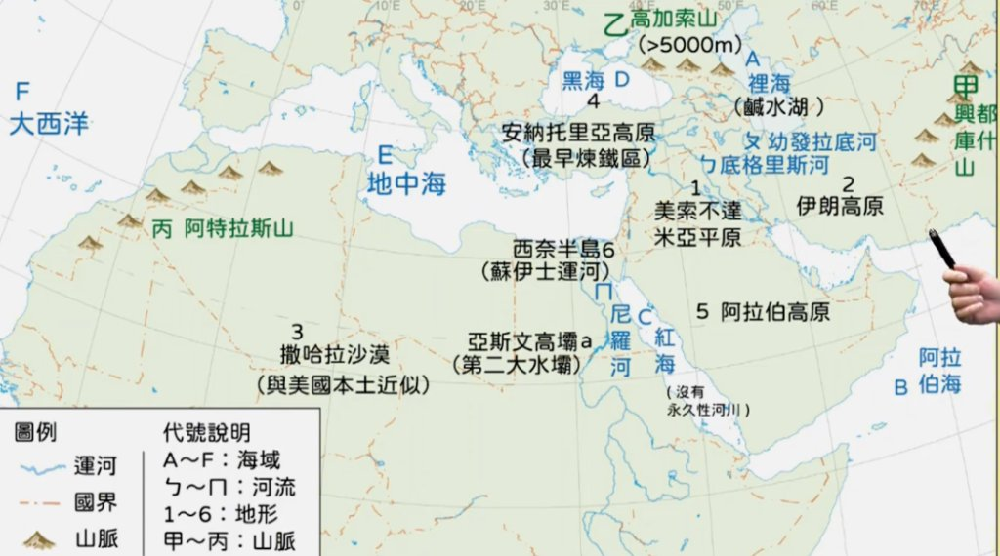
</label>

### 📊 西亞與北非地圖代號速查大表

| 代號類別 | 代號 | 地理名稱 | 核心特徵與解題秒殺密碼 |
|---|:---:|---|---|
| **海域 (A～F)** | **A** | **裏海** | 世界最大**鹹水湖**（內陸湖），周邊蘊藏豐沛石油天然氣 |
| **海域 (A～F)** | **B** | **阿拉伯海** | 阿拉伯半島南方大洋，為印度洋西北海域 |
| **海域 (A～F)** | **C** | **紅海** | 蒸發旺盛，**兩岸完全沒有永久性河流**流入；北接蘇伊士運河 |
| **海域 (A～F)** | **D** | **黑海** | 內海，經博斯普魯斯海峽、達達尼爾海峽通地中海 |
| **海域 (A～F)** | **E** | **地中海** | 歐亞非交界，夏季炎熱乾燥、冬季溫和多雨 |
| **海域 (A～F)** | **F** | **大西洋** | 非洲西側廣大海洋，經直布羅陀海峽通地中海 |
| **河流 (ㄅ～ㄇ)** | **ㄅ** | **底格里斯河** | 兩河流域東側河流，流速較快，與幼發拉底河匯流注入波斯灣 |
| **河流 (ㄅ～ㄇ)** | **ㄆ** | **幼發拉底河** | 兩河流域西側河流，孕育美索不達米亞古文明 |
| **河流 (ㄅ～ㄇ)** | **ㄇ** | **尼羅河** | 世界第一長河，孕育古埃及文明；建有 **a 亞斯文高壩**（全球第二大水壩） |
| **地形 (1～6)** | **1** | **美索不達米亞平原** | 兩河沖積平原（肥沃月彎），早期灌溉農業興盛 |
| **地形 (1～6)** | **2** | **伊朗高原** | 氣候乾旱多盆地，傳統利用「坎井」引高山雪水灌溉 |
| **地形 (1～6)** | **3** | **撒哈拉沙漠** | 世界面積最大熱帶沙漠，**面積大小與美國本土面積近似** |
| **地形 (1～6)** | **4** | **安納托利亞高原** | 土耳其所在地，為**歷史上最早發明煉鐵技術之區域**（西台帝國） |
| **地形 (1～6)** | **5** | **阿拉伯高原** | 乾燥沙漠與礫漠覆蓋，世界最大石油產區（波斯灣沿岸） |
| **地形 (1～6)** | **6** | **西奈半島** | 埃及亞洲部分，建有連接紅海與地中海之**蘇伊士運河** |
| **山脈 (甲～丙)** | **甲** | **興都庫什山** | 位於阿富汗境內高峻山脈，西亞東側天然界山 |
| **山脈 (甲～丙)** | **乙** | **高加索山** | 介於黑海與裏海之間，海拔 **>5000 公尺**，歐亞天然界山 |
| **山脈 (甲～丙)** | **丙** | **阿特拉斯山** | 非洲西北端新褶曲山脈，北坡面迎西風為地中海型氣候 |

### 🧠 記憶口訣與秒殺密碼
> 💡 **【西亞北非地圖秒殺金律】**
> - **考題必抓四大地圖密碼**：
>   1. **「沒有永久性河流流入的海」** ➜ 秒選 **紅海 (C)**！
>   2. **「世界最大鹹水湖、產石油」** ➜ 秒選 **裏海 (A)**！
>   3. **「最早煉鐵的高原」** ➜ 秒選 **安納托利亞高原 (4)**！
>   4. **「面積大小與美國本土近似的沙漠」** ➜ 秒選 **撒哈拉沙漠 (3)**！
>   5. **「全球第二大水壩」** ➜ 秒選 **亞斯文高壩 (a)**（位於尼羅河上）！
>   6. **「蘇伊士運河所在地」** ➜ 秒選 **西奈半島 (6)**！

### 🎯 隨堂觀念自我檢測
* **題目**：小麥在研讀西亞與北非地理地圖時，整理了數個重要地理特徵代號。下列關於代號與地理實體的配對，何者完全正確？
  * (A) 代號 A 為紅海，是世界最大淡水湖
  * (B) 代號 C 為紅海，其顯著地理特徵為「兩岸周圍沒有永久性河流流入」 ★（正解：紅海周圍為乾燥沙漠，無常流河注入）
  * (C) 代號 4 為伊朗高原，是世界面積最大的熱帶沙漠
  * (D) 代號 a 為三峽大壩，建於幼發拉底河上

---

## 📌 重點 17：東南亞、南亞與西亞北非四大區域產業發展與經貿組織全比較

### 🏷️ 分類資訊
* **筆記本分類**：複習筆記本（第 1～4 冊）
* **冊數進度**：第 4 冊（八年級下學期）
* **科目**：社會（地理）
* **單元章節**：亞洲地理篇（東南亞、南亞、西亞與北非之產業型態與區域整合）
* **核心知識點**：中南半島、南洋群島、南亞次大陸、西亞北非之第一級產業、製造業、經貿與區域合作組織（東協十國、RCEP、OPEC）及四大特色灌溉方式

### 💡 核心觀念精粹
1. **四大區域第一級產業與製造業特徵**：
   * **中南半島**：
     * **第一級產業**：稻作＋熱帶栽培業（出口糧食與農產原料）。
     * **製造業**：加工出口（**勞力密集**，利用豐沛廉價勞動力）。
   * **南洋群島**：
     * **第一級產業**：熱帶栽培業（如馬來西亞的橡膠、油棕）。
     * **製造業**：**新加坡的石化工業**（具備「勞力密集」與麻六甲海峽「航運樞紐優勢」）。
   * **南亞次大陸**：
     * **第一級產業**：黃麻、稻米、小麥、茶葉、棉花（依雨量梯次分佈）。
     * **製造業**：輕重工業皆具備，但因國內人口龐大、內需市場大，**缺乏外銷競爭力**（以內銷為主）。
   * **西亞北非**：
     * **第一級產業**：**灌溉農業**（小麥、棉花、椰棗）。
     * **製造業**：**石油開採＋出口**（全球石油心臟）。
2. **四大區域經貿與國際合作組織**：
   * **東南亞（中南半島＋南洋群島）**：
     * **東協十國 (ASEAN)**：區域免關稅，為全球第三大免稅區。
     * **RCEP（區域全面經濟夥伴協定）**：**東協十國 ＋ 5 國（中、韓、日、澳、紐）**，為全球最大自由貿易協定。
   * **南亞次大陸**：**未加入其他主要經貿整合組織**（經濟相對獨立且受地緣衝突牽制）。
   * **西亞北非**：**石油輸出國組織 (OPEC)**，協調石油產量與油價定價。
3. **西亞與北非四大特色灌溉型態**：
   * **河水灌溉**：依賴外流河（如尼羅河、底格里斯河、幼發拉底河沖積平原）。
   * **坎井灌溉**：伊朗高原傳統利用地下暗渠引高山雪水，防日曬蒸發。
   * **滴灌技術**：**以色列**研發之高科技節水灌溉，水分直達作物根部，省水率極高。
   * **深水井（化石水）**：**沙烏地阿拉伯**抽取地底萬年非再生深層地下水進行圓形農田灌溉。

### 📊 四大區域產業結構、經貿組織與灌溉方式速查大表

| 地理區域 | 第一級產業 (點擊翻牌揭曉) | 製造業特徵 (點擊翻牌揭曉) | 經貿與區域合作組織 (點擊翻牌揭曉) | 會考與模考解題秒殺密碼 |
|---|---|---|---|---|
| **中南半島** | **稻作 ＋ 熱帶栽培業** (出口糧食＋原料) | **加工出口** (勞力密集型) | **東協十國** (區域免關稅，第三大免稅區) ＋ **RCEP** (東協＋中、韓、日、澳、紐) | 勞力密集加工出口、東協主要成員 |
| **南洋群島** | **熱帶栽培業** (如馬來西亞橡膠、油棕) | **新加坡石化工業** (勞力密集＋航運優勢) | **東協十國** ＋ **RCEP** | 新加坡麻六甲航道樞紐發展石化 |
| **南亞次大陸** | **黃麻、稻米、小麥、茶葉、棉花** | **輕重工業都有** (但★**沒有外銷能力**，內銷為主) | ★ **沒有加入其他組織** | 工業產出多內銷人口、無加入區域自貿盟 |
| **西亞北非** | **灌溉農業** (小麥、棉花、椰棗) | **石油開採 ＋ 出口** | **石油輸出國組織 (OPEC)** | 依賴黑金石油出口、OPEC 控油價 |

#### 💧 西亞與北非四大灌溉技術速查
* **河水**：尼羅河、兩河流域古文明灌溉農業
* **坎井**：伊朗高原（地下暗渠引高山融雪，防蒸發）
* **滴灌**：**以色列**（節水精準農業先驅）
* **深水井**：**沙烏地阿拉伯**（抽取深層地底地下水）

### 🧠 記憶口訣與破題密碼
> 💡 **【亞洲經貿與產業秒殺金律】**
> - **經貿組織口訣**：
>   - 「**東南亞抱東協與 RCEP（東協＋中韓日澳紐），西亞北非靠 OPEC，南亞次大陸沒加入！**」
> - **工業外銷陷阱**：
>   - 題目問「輕重工業皆具，但缺乏外銷能力（內銷為主）」 ➜ 秒選 **南亞次大陸（印度）**！
> - **四大灌溉技術國度秒殺**：
>   - 「滴灌」 ➜ 秒選 **以色列**！
>   - 「深水井」 ➜ 秒選 **沙烏地阿拉伯**！
>   - 「坎井」 ➜ 秒選 **伊朗高原**！

### 🎯 隨堂觀念自我檢測
* **題目**：關於東南亞、南亞與西亞北非的產業發展與區域經貿組織特徵，下列敘述何者完全正確？
  * (A) 西亞與北非多數國家加入東協十國，藉此享有區域免關稅優惠
  * (B) 南亞次大陸各國積極主導 RCEP 自由貿易區，其輕重工業產品大量外銷全球
  * (C) 南亞次大陸具備輕重工業基礎，但受制於龐大國內人口需求，工業品多以內銷為主，缺乏外銷能力 ★（正解：南亞輕重工業俱全，但沒有外銷能力，以內需為主且未加入其他大型自貿組織）
  * (D) 新加坡因缺乏航運優勢，農業以種植馬來西亞橡膠與椰棗為主

## 📌 重點 18：非洲地理與歷史發展圖解全攻略（五大分區自然環境、資源與歷史脈絡）

### 📖 核心觀念筆記
非洲大陸面積廣大，依自然環境與歷史發展脈絡主要劃分為五大分區：

1. **北非（撒哈拉沙漠、地中海與伊斯蘭文明圈）**：
   * **自然環境**：**面積最大**的分區，撒哈拉沙漠橫貫，氣候炎熱乾燥。人口高度集中於**地中海沿岸與尼羅河谷綠洲**。
   * **歷史文化**：自古即與地中海希臘羅馬文明圈緊密相連（如埃及文明、迦太基），隨後受西亞伊斯蘭教文明深度同化，居民多為阿拉伯人（白人非洲）。
2. **西非（幾內亞灣、熱帶栽培業、黑奴交易起點）**：
   * **自然環境**：**面積第二大、但人口成長最快**的區域。
   * **經濟與歷史**：幾內亞灣沿岸最早發展熱帶栽培業（可可、油棕）；為大航海時代歐洲殖民者進行**「黑奴三角貿易」的起點**與早期殖民據點。
3. **中非（雨林非洲、剛果盆地、資源浩劫）**：
   * **自然環境**：赤道橫貫，為熱帶雨林氣候與剛果盆地。
   * **資源開發**：早期殖民時期遭遇殘酷掠奪，主要開採野生**天然橡膠與象牙**。
4. **東非（高原非洲、大裂谷蓄水池、鄭和下西洋）**：
   * **自然環境**：地形以高聳高原為主（海拔多高於 3000 公尺），「東非大裂谷」縱貫，形成多處深水大湖（非洲蓄水池，如維多利亞湖）。
   * **歷史交流**：明代永樂年間**鄭和七次下西洋**，船隊橫渡印度洋抵達東非麻林地（今肯亞）與索馬利亞沿岸，將長頸鹿視為祥瑞仁獸**「麒麟鹿」**帶回中國朝覲。
5. **南非（貴金屬寶庫、好望角咽喉航道）**：
   * **自然環境**：地處副熱帶與溫帶，氣候宜人。
   * **資源與歷史**：蘊藏豐富**金礦與鑽石**等貴金屬；**好望角航道**為歐亞航海要道，引發白人殖民者（荷蘭後裔波耳人與英國人）的激烈爭奪。

---

### 🗺️ 非洲地理與歷史發展全景圖解

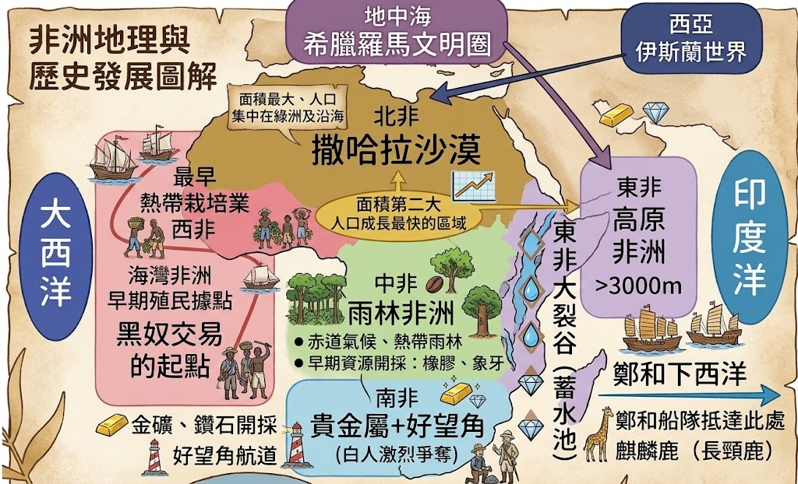

---

### 📊 非洲五大分區自然環境、資源與歷史發展速查大表

| 地理分區 | 自然環境與地形特徵 (點擊翻牌揭曉) | 核心資源與產業 (點擊翻牌揭曉) | 重要歷史交流與殖民脈絡 (點擊翻牌揭曉) | 會考與模考解題秒殺密碼 |
|---|---|---|---|---|
| **北非** | **面積最大**，撒哈拉沙漠橫貫 人口集中於地中海沿岸與綠洲 | 尼羅河灌溉農業、石油與天然氣 | 地中海希臘羅馬文明圈 ＋ 西亞伊斯蘭文明 | 面積最大、白人/阿拉伯/伊斯蘭文化、人口集中沿海與尼羅河 |
| **西非** | **面積第二大、人口成長最快** 幾內亞灣沿岸多平原丘陵 | **最早發展熱帶栽培業** (可可、油棕、花生) | 歐洲早期殖民據點 ★ **黑奴三角貿易的起點** | 人口成長最快、熱帶栽培業、黑奴交易起點 |
| **中非** | 赤道橫貫、**剛果盆地** 熱帶雨林氣候、密林廣布 | 早期採集**野生橡膠、象牙** 木材、銅礦等熱帶資源 | 早期歐洲探險與殘酷殖民掠奪 | 剛果盆地熱帶雨林、早期掠奪橡膠與象牙 |
| **東非** | **高原非洲** (海拔 > 3000m) **東非大裂谷** (蓄水池與湖泊) | 高原咖啡、茶葉、野生動物觀光 | 明代★ **鄭和下西洋船隊抵達** 朝貢長頸鹿（**麒麟鹿**） | 高原與大裂谷蓄水池、鄭和帶回麒麟鹿（長頸鹿） |
| **南非** | 副熱帶與溫帶、高原地勢 **好望角航道**樞紐地位 | 盛產★ **金礦、鑽石** 與多種貴重金屬 | 白人（荷蘭波耳人與英國人）激烈爭奪殖民權 | 好望角咽喉航道、盛產金礦與鑽石 |

---

### 🧠 記憶口訣與破題密碼
> 💡 **【非洲五大分區秒殺記憶口訣】**
> - **北非**：「**地中海伊斯蘭，撒哈拉佔最大，人口綠洲靠邊站！**」
> - **西非**：「**海灣黑奴起點，可可最早栽培，人口成長跑第一！**」
> - **中非**：「**剛果雨林赤道過，早期掠奪象牙與橡膠！**」
> - **東非**：「**三千米高裂谷池，鄭和下洋帶走麒麟鹿！**」
> - **南非**：「**金礦鑽石好望角，英荷白人爭奪寶！**」

---

### 🎯 隨堂觀念自我檢測
* **題目**：下列關於非洲各大分區之自然環境、資源開發與歷史發展脈絡的敘述，何者最為正確？
  * (A) 西非為黑奴貿易起點，是非洲面積最大且人口最集中的區域
  * (B) 北非受撒哈拉沙漠阻隔，歷史上僅與撒哈拉以南非洲交流，未曾接觸地中海文明
  * (C) 東非地勢高聳且有大裂谷貫穿，明代鄭和下西洋船隊曾抵達其沿海並帶回長頸鹿（麒麟鹿） ★（正解：東非為高原非洲且有大裂谷；鄭和下西洋曾達東非麻林地，帶回長頸鹿被明代稱為麒麟鹿）
  * (D) 南非地處赤道低壓帶，以茂密熱帶雨林與橡膠開採聞名，缺乏貴重金屬礦產

---

## 📌 重點 19：西亞與北非乾燥氣候之傳統水利奇蹟 —「坎井」構造與運作原理全解

### 🏷️ 分類資訊
* **筆記本分類**：複習筆記本（第 1～4 冊）
* **冊數進度**：第 4 冊（八年級下學期）
* **科目**：社會（地理）
* **單元章節**：西亞與北非篇（乾燥氣候區之水資源利用與傳統智慧）
* **核心知識點**：坎井（Qanat）分佈地區（伊朗高原、阿特拉斯山區）、四大構造（豎井、暗渠、明渠、蓄水池）、水源成因（高山雪水滲入地下水層）與產生人工綠洲

### 💡 核心觀念精粹
1. **坎井的分佈與功能**：
   * 主要分佈於**伊朗高原**與北非**阿特拉斯山區**（在中國新疆吐魯番窪地亦極為著名）。
   * 功能：在乾燥少雨、蒸發強烈的乾旱氣候區，利用地下暗渠輸送水源，避免強烈日照蒸發，引水至山麓沖積扇平原，**產生人工綠洲**以供灌溉與生活飲用。
2. **坎井的四大構造組件與運作流程**：
   * **高山積雪與滲入**：高山融雪滲入地下，蓄積於傾斜的「**地下水層**」中。
   * **豎井（垂直通道）**：自地面垂直向下開鑿，間隔排列。主要功能為**通風、採光、定位，以及開挖暗渠時清運泥沙出渣與日常維修通道**。
   * **暗渠（地下引水道）**：順著地勢坡度在地底挖掘的微傾斜輸水隧道，將高山深層地下水順坡自流引出。其最大優勢在於**「地下遮蔭，有效防止強烈日曬導致水分大量蒸發」**。
   * **明渠（地表水道）**：暗渠延伸出地表後的露天渠道，將水源直接導入蓄水池或農田。
   * **蓄水池與綠洲**：明渠末端匯集於「蓄水池」，儲水灌溉農作物與林木，形成生機盎然的「**人工綠洲**」。

🔍 <b>[坎井構造與運作原理圖解]（點擊可展開/收合，點擊下方圖片可原地放大）</b>

<input type="checkbox" id="zoom-social-19" class="zoom-toggle">
<label for="zoom-social-19" class="zoom-label">
  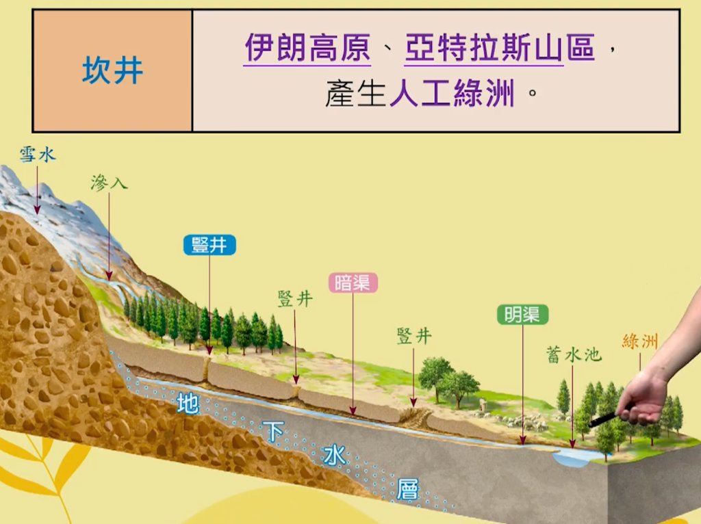
</label>

### 📊 坎井四大核心構造與功能速查大表

| 構造名稱 | 空間位置 (點擊翻牌揭曉) | 主要功能與運作原理 (點擊翻牌揭曉) | 考試關鍵解題密碼 |
|---|---|---|---|
| **水源 (雪水)** | 高山頂部與山麓 | 高山積雪融化後滲入地下，匯聚於傾斜地下水層 | 天然冷冽融雪，常年穩定補給 |
| **豎井** | 自地面垂直向下貫通至暗渠 | **通風、採光、定位**，以及挖鑿暗渠時**搬運泥土出渣與維修檢查** | 垂直圓孔、通風出土、地面成排圓環特徵 |
| **暗渠** | 隱藏於地下水層上方的地底水道 | 依微傾斜地勢**引地下水自流**；★ **地底遮陽，避免乾旱氣候強烈日曬蒸發** | 地下渠道、防蒸發、順地勢自流 |
| **明渠** | 暗渠出露地面後的露天水溝 | 將地下引出的清泉導向農田與集聚點 | 出露地表、分配水流 |
| **蓄水池 / 綠洲** | 坎井系統末端聚落農田處 | 儲存水源、調配灌溉，在乾旱沙漠中形成★ **人工綠洲** | 產生人工綠洲、沙漠農業生活重心 |

### 🧠 記憶口訣與破題密碼
> 💡 **【坎井水利秒殺金律】**
> - **三大分佈地**：
>   「**伊朗高原、阿特拉斯山、新疆吐魯番，乾旱盆地坎井連！**」
> - **四大構造口訣**：
>   「**高山融雪滲地層，排排豎井運泥沙；地下暗渠防蒸發，明渠匯水造綠洲！**」
> - **會考必抓兩大核心題眼**：
>   1. 為什麼要挖「**暗渠**」？ ➜ 答案秒選「**防止強烈日照蒸發水份**」！
>   2. 坎井在乾燥氣候中產生的地理景觀？ ➜ 答案秒選「**人工綠洲**」！

### 🎯 隨堂觀念自我檢測
* **題目**：西亞的伊朗高原與北非阿特拉斯山區氣候乾旱、蒸發劇烈，當地住民自古發展出智慧型水利設施「坎井」。關於坎井各部構造的功能與特性，下列敘述何者完全正確？
  * (A) 豎井是為了收集降雨直接灌入地下水層
  * (B) 暗渠的主要優勢在於深埋地底，能有效避免乾燥環境中強烈日曬導致水分大量蒸發 ★（正解：暗渠在地底遮蔽陽光，是防蒸發、保持水源充沛的核心構造）
  * (C) 坎井的水源主要來自地中海倒灌的鹹水海水
  * (D) 坎井引水至地表末端後，主要會使周圍土壤嚴重沙漠化

---

## 📌 重點 20：西亞與北非現代灌溉與水資源科技 —「地下水井」與「再生水滴灌」全解

### 🏷️ 分類資訊
* **筆記本分類**：複習筆記本（第 1～4 冊）
* **冊數進度**：第 4 冊（八年級下學期）
* **科目**：社會（地理）
* **單元章節**：西亞與北非篇（乾燥氣候區之現代水資源科技與農業適應）
* **核心知識點**：阿拉伯高原開發深層地下水井（形成人工綠洲）、以色列再生水回收利用與高科技滴灌技術

### 💡 核心觀念精粹
1. **阿拉伯高原 — 地下水井（深水井）**：
   * **地理區域**：沙烏地阿拉伯、阿拉伯半島（阿拉伯高原）。
   * **水資源型態**：地表無常流河，但地底深處蘊藏萬年地質年代留存的「**深層地下水（化石水）**」。
   * **農業模式**：以機械動力鑽探深水井抽取深層地下水，配合中心樞軸噴灌系統，在沙漠中開闢出巨大圓形農田，**形成人工綠洲**（主要種植小麥等糧食作物）。
   * **環境隱憂**：化石水屬於非再生資源，過度抽取將面臨水資源枯竭與地層下陷危機。
2. **以色列 — 再生水 ＋ 滴灌技術（精準節水農業典範）**：
   * **地理區域**：以色列（地中海東岸乾燥／半乾燥過渡帶）。
   * **水資源型態**：高度利用**「再生水」**（將生活廢水與都市污水經多道高科技淨化回收再利用，再生水利用率全球第一）。
   * **核心技術**：發展世界首創且獨步全球的**「滴灌技術」**（Drip Irrigation），利用電腦控制管線將微量水滴與液態肥料精準直接滴灌至作物根部。
   * **優勢**：極致省水（節水率高達 70%～80% 以上）、防止強烈日曬蒸發、避免土壤過度浸潤引起鹽鹼化，創造了「沙漠農業奇蹟」，花卉、蔬果大量外銷歐洲。

### 📊 西亞與北非現代兩大節水與水資源開發技術對照大表

| 水資源開發類型 | 代表國家 / 地區 (點擊翻牌揭曉) | 水源取得方式 (點擊翻牌揭曉) | 核心灌溉技術與地景特徵 (點擊翻牌揭曉) | 會考與模考解題秒殺密碼 |
|---|---|---|---|---|
| **地下水井 (深水井)** | **阿拉伯高原** (沙烏地阿拉伯) | 開發**深層地下水** (非再生之化石水) | 機械抽取深井水，配合旋轉噴灌在沙漠中**形成人工綠洲**（圓形麥田） | 「深層地下水」、「人工綠洲」、「阿拉伯高原」 |
| **再生水 ＋ 滴灌** | **以色列** | 高科技**回收水源** (都市生活廢水淨化) | 發展獨特的★ **滴灌技術**，管線精準滴至植物根部，極致省水防蒸發 | 「回收再生水」、「滴灌技術」、「以色列」 |

### 🧠 記憶口訣與破題密碼
> 💡 **【西亞現代水利秒殺金律】**
> - **雙雄對照口訣**：
>   「**阿拉伯高原抽深井，沙漠開拓造綠洲；以色列回收再生水，電腦滴灌省水王！**」
> - **會考秒殺連線**：
>   - 題目見「**阿拉伯高原** / **深層地下水**」 ➜ 秒選 **地下水井、人工綠洲**！
>   - 題目見「**以色列** / **回收水源** / **精準省水**」 ➜ 秒選 **再生水、滴灌技術**！

### 🎯 隨堂觀念自我檢測
* **題目**：面對乾旱氣候與極度匱乏的水資源，西亞各國積極發展適應性水利技術。下列關於阿拉伯高原與以色列在水資源利用與農業技術上的敘述，何者完全正確？
  * (A) 阿拉伯高原主要利用地中海引來的常流河水發展水田稻作
  * (B) 以色列以高科技回收生活廢水發展再生水，並結合精準的「滴灌技術」將水肥直接送至作物根部 ★（正解：以色列以再生水回收與滴灌技術聞名世，極致節水防蒸發）
  * (C) 阿拉伯高原透過雨水收集系統完全滿足國內農業需求，不需開採地下水
  * (D) 滴灌技術因水分大量噴灑於空中，容易造成劇烈蒸發與土壤鹽鹼化

---

## 📌 重點 21：西亞與北非石油經濟、OPEC 組織與地緣政治衝突全解

### 🏷️ 分類資訊
* **筆記本分類**：複習筆記本（第 1～4 冊）
* **冊數進度**：第 4 冊（八年級下學期）
* **科目**：社會（地理）
* **單元章節**：西亞與北非篇（黑金石油經濟、OPEC 國際組織與波斯灣地緣衝突）
* **核心知識點**：西亞與北非產油國分佈（西亞：波斯灣沿岸；北非：利比亞）、石油輸出國組織（OPEC）成立宗旨與全球影響力（12個會員國、掌控全球 70% 原油蘊藏量）、波斯灣戰爭爆發原因（科威特的石油利益引發伊拉克入侵）

### 💡 核心觀念精粹
1. **產油國空間分佈**：
   * **西亞**：高度集中於**波斯灣沿岸**（沙烏地阿拉伯、伊朗、伊拉克、科威特、阿拉伯聯合大公國、卡達等）。
   * **北非**：以**利比亞**、阿爾及利亞為主要產油國。
2. **石油輸出國組織 (OPEC) 核心運作**：
   * **名稱**：**OPEC**（Organization of the Petroleum Exporting Countries）。
   * **成員規模**：目前包含 **12 個會員國**（西亞、非洲、拉丁美洲等主要產油國）。
   * **全球影響力**：合計擁有全球原油**蘊藏量的 70%**，具備左右國際原油市場的強大話語權。
   * **主要目標**：**維護產油國自身經濟利益、協調控制石油產量與國際價格**，防止西方跨國石油公司壓價壟斷。
3. **地緣政治與波斯灣戰爭**：
   * **起因**：**科威特的石油利益**（科威特擁有豐富石油資源且位於波斯灣出海咽喉）。
   * **爆發**：西元 1990 年，鄰國**伊拉克**因債務與石油爭端，揮軍入侵並併吞科威特，隨後引發以美國為首之聯合國多國部隊發動「波斯灣戰爭」解放科威特。

### 📊 西亞與北非石油分佈、OPEC 組織與國際衝突速查大表

| 分析面向 | 核心重點內容 (點擊翻牌揭曉) | 代表國家 / 數據指標 (點擊翻牌揭曉) | 會考與模考解題秒殺密碼 |
|---|---|---|---|
| **產油國分佈** | • **西亞**：集中於**波斯灣沿岸** • **北非**：以**利比亞**為代表 | 波斯灣周邊國家（沙烏地、科威特、伊拉克等）＋ 北非利比亞 | 「西亞波斯灣、北非利比亞」 |
| **國際組織 (OPEC)** | • **名稱**：石油輸出國組織 (OPEC) • **目標**：維護產油國利益、**控制石油產量與價格** | • **成員**：包含 **12 個會員國** • **影響**：掌控全球 **70%** 原油蘊藏量 | 「OPEC 控產量與價格」、「掌控全球七成蘊藏量」 |
| **地緣戰爭 (波斯灣戰爭)** | 爭奪石油利益引發的區域戰爭：**科威特的石油利益，引發伊拉克的入侵** | 伊拉克入侵科威特 ➔ 美國多國聯軍波斯灣戰爭介入 | 「科威特石油利益」$\implies$ 「引發伊拉克入侵」 |

### 🧠 記憶口訣與破題密碼
> 💡 **【西亞北非石油與地緣衝突秒殺金律】**
> - **分佈口訣**：「**西亞波斯灣、北非利比亞，黑金滾滾富天下！**」
> - **OPEC 四大特徵**：
>   「**OPEC 十二國，掌控七成油；產量價格自己控，不讓歐美牽著走！**」
> - **波斯灣戰爭破題**：
>   「**科威特石油肥，伊拉克揮軍搶！**」

### 🎯 隨堂觀念自我檢測
* **題目**：西亞與北非蘊藏極為豐富的石油資源，深刻影響全球經濟與地緣政治。下列關於該區域產油國、石油輸出國組織 (OPEC) 及波斯灣戰爭的敘述，何者完全正確？
  * (A) 北非的產油國主要分佈於阿特拉斯山區高地
  * (B) 石油輸出國組織 (OPEC) 擁有全球約 70% 的原油蘊藏量，主要目標在於控制石油產量與價格以維護產油國利益 ★（正解：OPEC 目前包含 12 個會員國，掌控全球約 70% 蘊藏量，主導產量與定價）
  * (C) 波斯灣戰爭的起因是沙烏地阿拉伯入侵以色列爭奪死海資源
  * (D) OPEC 是一個以推廣環保太陽能與風力發電為主的國際綠能聯盟

---

## 📌 重點 22：非洲各大分區代表性國家與關鍵地理地緣特性全速查

### 🏷️ 分類資訊
* **筆記本分類**：進度筆記本（第 5 冊開始）
* **冊數進度**：第 5 冊（九年級上學期）
* **科目**：社會（地理）
* **單元章節**：非洲地理篇（北非、西非、中非、東非、南非之國家代表與地緣戰略）
* **核心知識點**：埃及（扼守蘇伊士運河）、摩洛哥（扼守直布羅陀海峽）、奈及利亞（石油生產大國）、剛果民主共和國（熱帶雨林氣候區）、盧安達（曾爆發種族屠殺，如今美麗繁榮）、索馬利亞（扼守紅海出海口）、南非（盛產黃金鑽石、工業發達）

### 💡 核心觀念精粹
1. **北非兩大航運海峽咽喉國**：
   * **埃及**：地處亞非陸橋，管轄並**扼守蘇伊士運河**（連接地中海與紅海、歐亞航運生命線）。
   * **摩洛哥**：地處非洲西北端，北隔海峽與西班牙相望，**扼守直布羅陀海峽**（連接大西洋與地中海的咽喉）。
2. **西非與中非資源與氣候代表國**：
   * **奈及利亞（西非）**：幾內亞灣沿岸，是非洲人口最多且產油量第一的**石油生產大國**（OPEC 會員國）。
   * **剛果民主共和國（中非）**：位於赤道剛果盆地核心，為典型的**熱帶雨林氣候區**，林木與野生動植物茂密。
3. **東非與南非地緣樞紐與歷史經濟代表國**：
   * **盧安達（東非）**：地處東非高原，1994 年**曾爆發嚴重的種族大屠殺**（胡圖族 vs. 圖西族），歷經和解重建後治安良好、經濟迅速崛起，被譽為**「如今美麗繁榮」的非洲奇蹟**。
   * **索馬利亞（東非）**：位於「非洲之角」，擁有非洲大陸最長海岸線，北臨亞丁灣，**扼守紅海出海口**（曼德海峽樞紐）。
   * **南非（南非）**：位於非洲最南端，地處好望角航道樞紐，**盛產黃金、鑽石**等貴金屬，為全非洲**工業與科技最發達、經濟規模最完整**的國家。

### 📊 非洲五大分區代表國家與核心特徵速查大表

| 地理分區 | 代表國家 (點擊翻牌揭曉) | 關鍵地理特徵與地緣戰略地位 (點擊翻牌揭曉) | 會考與模考解題秒殺密碼 |
|---|---|---|---|
| **北非** | **埃及** | ★ **扼守蘇伊士運河**（連接地中海與紅海，歐亞航運咽喉） | 「蘇伊士運河」、「亞非陸橋」 $\implies$ **埃及** |
| **北非** | **摩洛哥** | ★ **扼守直布羅陀海峽**（連接大西洋與地中海） | 「直布羅陀海峽」、「西北角」 $\implies$ **摩洛哥** |
| **西非** | **奈及利亞** | 幾內亞灣核心，非洲第一人口與★ **石油生產大國** | 「非洲最大石油國」、「幾內亞灣」 $\implies$ **奈及利亞** |
| **中非** | **剛果民主共和國** | 位於剛果盆地赤道兩側，為典型★ **熱帶雨林氣候區** | 「剛果盆地」、「熱帶雨林氣候」 $\implies$ **剛果民主共和國** |
| **東非** | **盧安達** | 位於東非高原，★ **曾爆發種族屠殺，如今美麗繁榮**（千山之國） | 「曾爆發種族屠殺如今繁榮」 $\implies$ **盧安達** |
| **東非** | **索馬利亞** | 位於非洲之角，★ **扼守紅海出海口**（曼德海峽／亞丁灣） | 「扼守紅海出海口」、「非洲之角」 $\implies$ **索馬利亞** |
| **南非** | **南非** | 位於非洲最南端好望角，★ **盛產黃金、鑽石，工業最發達** | 「盛產黃金鑽石」、「工業發達」 $\implies$ **南非** |

### 🧠 記憶口訣與破題密碼
> 💡 **【非洲代表國秒殺金律】**
> - **北非雙咽喉**：「**埃及運河蘇伊士，摩洛哥卡直布羅！**」
> - **西中東南四亮點**：
>   - 「**奈及利亞產黑金（石油）！**」
>   - 「**剛果盆地大雨林！**」
>   - 「**盧安達浴火重生變繁榮，索馬利亞卡紅海口！**」
>   - 「**南非金鑽工業強！**」

### 🎯 隨堂觀念自我檢測
* **題目**：非洲各國受地理位置、天然資源與歷史發展影響，具備鮮明國情特徵。下列關於非洲代表性國家與其核心特性的配對，何者完全正確？
  * (A) 埃及扼守直布羅陀海峽，為連接大西洋與地中海之樞紐
  * (B) 盧安達歷史上曾發生嚴重種族屠殺慘劇，如今經過重建轉型為美麗繁榮的國家 ★（正解：盧安達 1994 年發生種族屠殺，後續社會重建有成，成為東非繁榮整潔典範）
  * (C) 索馬利亞地處幾內亞灣沿岸，是非洲面積最大的熱帶雨林氣候國
  * (D) 南非因地處熱帶乾燥氣候區，國內完全缺乏黃金與鑽石等礦產

---

## 📌 重點 23：非洲地圖代號全解（海域、重要都市海角、核心地形盆地沙漠）

### 🏷️ 分類資訊
* **筆記本分類**：進度筆記本（第 5 冊開始）
* **冊數進度**：第 5 冊（九年級上學期）
* **科目**：社會（地理）
* **單元章節**：非洲地理篇（全洲地形架構、海域環繞與代表性都市海角代號）
* **核心知識點**：三大海域（(1)地中海、(2)大西洋、(3)印度洋）、兩大核心都市海角（①開羅、②好望角）、五大重要地形區（ㄅ撒哈拉沙漠、ㄆ剛果盆地、ㄇ東非大裂谷、ㄈ喀拉哈里盆地、ㄉ納米比沙漠）

### 💡 核心觀念精粹
1. **三大環繞海域（(1)～(3)）**：
   * **(1) 地中海**：非洲北側，隔海與歐洲相望；東北部經蘇伊士運河通紅海。
   * **(2) 大西洋**：非洲西側廣大海洋，幾內亞灣為其主要海灣。
   * **(3) 印度洋**：非洲東側大洋，馬達加斯加島與東非大陸間隔莫三比克海峽。
2. **兩大代表性都市與海角（①～②）**：
   * **① 開羅**：埃及首都，位居尼羅河三角洲頂點，非洲與阿拉伯世界第一大都會。
   * **② 好望角**：非洲西南端著名海角，歐亞航運傳統咽喉，周邊為夏乾冬雨的地中海型氣候。
3. **五大核心地形區（ㄅ～ㄉ）**：
   * **ㄅ 撒哈拉沙漠**：世界面積最大的熱帶沙漠，橫貫北非，面積大小與美國本土相近。
   * **ㄆ 剛果盆地**：赤道橫貫之巨大盆地，地勢低窪，為世界第二大熱帶雨林區。
   * **ㄇ 東非大裂谷**：板塊張裂形成的巨大地塹帶，串聯多座深水斷層湖泊（非洲蓄水池）。
   * **ㄈ 喀拉哈里盆地**：南非內陸半乾燥至乾燥盆地，地勢平坦，有矮灌木草原與荒漠。
   * **ㄉ 納米比沙漠**：非洲西南大西洋沿岸狹長沙漠，受**本格拉涼流（寒流）**減濕降溫影響而形成的典型**海岸沙漠**。

🔍 <b>[非洲全景地形地圖]（點擊可展開/收合，點擊下方圖片可原地放大）</b>

<input type="checkbox" id="zoom-social-23" class="zoom-toggle">
<label for="zoom-social-23" class="zoom-label">
  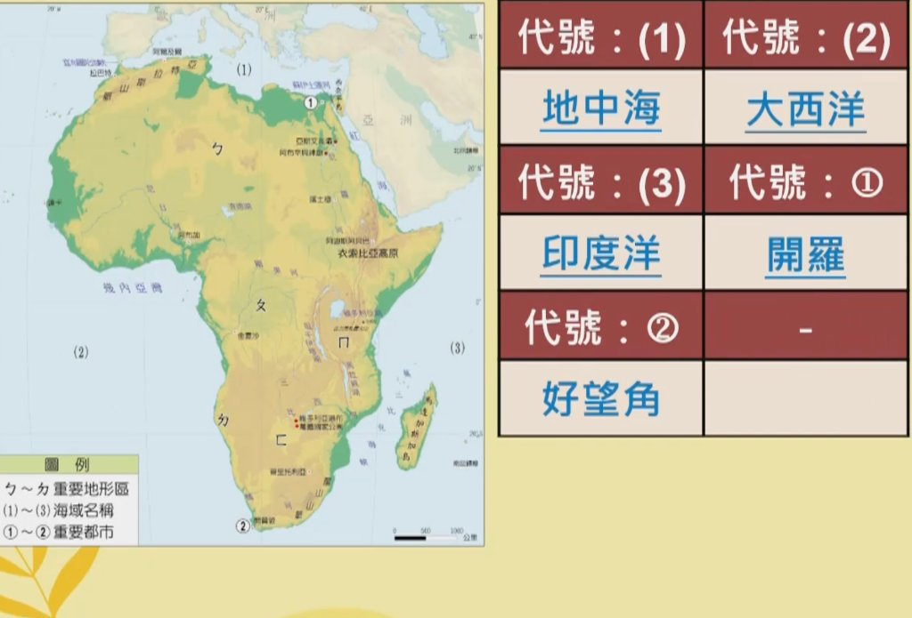
</label>

### 📊 非洲地圖核心代號速查大表

| 代號類別 | 代號 | 地理名稱 (點擊翻牌揭曉) | 核心特徵與解題秒殺密碼 |
|---|:---:|---|---|
| **海域名稱** | **(1)** | **地中海** | 位於非洲北側，夏乾冬雨地中海型氣候，北隔海與歐洲相望 |
| **海域名稱** | **(2)** | **大西洋** | 位於非洲西側，涵蓋幾內亞灣，本格拉涼流由南向北流經 |
| **海域名稱** | **(3)** | **印度洋** | 位於非洲東側，與馬達加斯加島相鄰，熱帶季風吹拂 |
| **重要都市** | **①** | **開羅** | 埃及首都，尼羅河三角洲樞紐，全非人口與文化核心大城 |
| **重要海角** | **②** | **好望角** | 非洲西南端航運地標，歐亞傳統航道咽喉，地中海型氣候 |
| **重要地形** | **ㄅ** | **撒哈拉沙漠** | 世界面積最大熱帶沙漠，北非屏障，面積近似美國本土 |
| **重要地形** | **ㄆ** | **剛果盆地** | 赤道橫貫、剛果河貫穿，世界第二大熱帶雨林氣候盆地 |
| **重要地形** | **ㄇ** | **東非大裂谷** | 板塊張裂斷層地塹帶，湖泊星羅棋布（非洲蓄水池） |
| **重要地形** | **ㄈ** | **喀拉哈里盆地** | 南非內陸乾燥內流盆地，荒漠與稀樹草原景觀 |
| **重要地形** | **ㄉ** | **納米比沙漠** | 位於大西洋沿岸，受★ **本格拉涼流**減濕形成的濱海乾燥沙漠 |

### 🧠 記憶口訣與破題密碼
> 💡 **【非洲地圖秒殺金律】**
> - **三大海域繞全非**：
>   「**北地中(1)、西大西(2)、東印度(3)！**」
> - **兩大頂底名地標**：
>   「**頂端三角洲開羅(①)，底部西南好望角(②)！**」
> - **五大核心地形順口溜**：
>   「**北非撒哈拉(ㄅ)最大，赤道剛果(ㄆ)大雨林；東非大裂谷(ㄇ)張裂，南非喀拉哈里(ㄈ)盆，西岸納米比(ㄉ)涼流沙！**」

### 🎯 隨堂觀念自我檢測
* **題目**：小麥在研習非洲地形與海域地圖時，記錄了數個關鍵代號。下列關於代號所代表之地理實體的特徵配對，何者完全正確？
  * (A) 代號 (2) 為印度洋，位於非洲大陸東側
  * (B) 代號 ㄉ 為納米比沙漠，位於大西洋沿岸，成因深受本格拉涼流減濕降溫影響 ★（正解：代號 ㄉ 為納米比沙漠，受本格拉涼流影響形成狹長海岸沙漠）
  * (C) 代號 ㄆ 為撒哈拉沙漠，為全球氣候最乾燥炎熱之熱帶沙漠
  * (D) 代號 ② 為開羅，位居尼羅河三角洲頂點

---

## 📌 重點 24：非洲四大傳統與現代維生方式（採集狩獵、畜牧、游耕、灌溉農業）全對照

### 🏷️ 分類資訊
* **筆記本分類**：進度筆記本（第 5 冊開始）
* **冊數進度**：第 5 冊（九年級上學期）
* **科目**：社會（地理）
* **單元章節**：非洲地理篇（居民傳統維生方式、族群特色與自然環境適應）
* **核心知識點**：採集狩獵（雨林沙漠；納米比亞布希曼人、雨林區匹美人；生產力低落人口稀少）、畜牧（莽原與沙漠過渡地帶；撒哈拉沙漠邊緣富拉尼人；養牛維生、牛隻即財富）、游耕（雨林與莽原；定期遷徙維持生態平衡）、灌溉農業（沿海平原與莽原；施肥與灌溉技術；種植水稻、玉米收穫量多）

### 💡 核心觀念精粹
1. **採集狩獵（最原始、順應自然）**：
   * **自然環境**：極端嚴苛環境，如**雨林與沙漠**深處。
   * **代表族群**：
     * **布希曼人**（Bushmen）：生活於西南非洲**納米比亞**與喀拉哈里荒漠，擅長尋找地下水源與毒箭狩獵。
     * **匹美人**（Pygmies）：生活於中非剛果盆地**雨林區**，身材矮小善於雨林採集獵捕。
   * **特徵**：生產力極為低落，環境承載力有限，**人口稀少**。
2. **畜牧（逐水草而居、牛為財富象徵）**：
   * **自然環境**：**莽原與沙漠過渡地帶**（沙赫爾地區 Sahel）。
   * **代表族群**：**富拉尼人**（Fulani，西非至撒哈拉沙漠邊緣遊牧民族）。
   * **特徵**：以**養牛維生**；在傳統文化中，**牛隻就是財富與社會地位的象徵**。
3. **游耕（火耕刀耕、自然休耕）**：
   * **自然環境**：**熱帶雨林與熱帶莽原**地區。
   * **核心運作**：砍伐焚燒林木以草木灰為肥料，耕作數年待地力耗竭後即棄耕遷徙，前往新林地開墾。
   * **特徵**：居民**定期遷徙**，讓原本土地休耕長達數十年以恢復地力，在人口密度低時能**維持生態的平衡**。
4. **灌溉農業（精耕細作、產量最高）**：
   * **自然環境**：**沿海平原**與水源充沛之**莽原地區**（如河流下游、湖泊周邊）。
   * **核心技術**：發展出**施肥、修築水渠灌溉**等集約農耕技術。
   * **特徵**：耕作收穫量較多，主要種植糧食作物如**水稻、玉米**等，能支撐較高的人口密度。

### 📊 非洲四大維生方式、自然環境與族群特色速查大表

| 維生方式 | 自然環境 (點擊翻牌揭曉) | 代表族群與生活特色 (點擊翻牌揭曉) | 會考與模考解題秒殺密碼 |
|---|---|---|---|
| **採集狩獵** | **雨林、沙漠** | • 納米比亞的★ **布希曼人** • 雨林區的★ **匹美人** • 當地**生產力低落，人口稀少** | 「布希曼人（納米比亞）」、「匹美人（雨林）」、「生產力低人口稀」 |
| **畜牧** | **莽原與沙漠過渡地帶** (如沙赫爾乾燥邊緣) | • 撒哈拉沙漠邊緣的★ **富拉尼人** • 居民**養牛維生，牛隻就是財富** | 「富拉尼人」、「撒哈拉邊緣」、「養牛維生牛為財富」 |
| **游耕** | **雨林、莽原** | • 砍燒林木耕作，地力耗盡後遷徙 • 居民★ **定期遷徙，維持生態的平衡** | 「定期遷徙」、「火耕休耕」、「維持生態平衡」 |
| **灌溉農業** | **沿海平原、莽原地區** | • 發展出★ **施肥、灌溉**的耕作技術 • 耕作收穫量較多的★ **水稻、玉米** | 「施肥灌溉技術」、「水稻玉米收穫量多」 |

### 🧠 記憶口訣與破題密碼
> 💡 **【非洲四大維生方式秒殺金律】**
> - **四大維生口訣**：
>   - 「**布希匹美採獵忙，納米雨林人口稀！**」
>   - 「**富拉尼人愛養牛，沙漠邊緣牛當寶！**」
>   - 「**游耕定期要遷徙，休耕自然保平衡！**」
>   - 「**平原沿海搞灌溉，施肥稻玉收成好！**」

### 🎯 隨堂觀念自我檢測
* **題目**：非洲各原住民族群因應不同的自然地理環境，發展出多元的傳統維生方式。下列關於非洲族群、維生方式與其特徵的配對，何者完全正確？
  * (A) 生活在納米比亞沙漠的匹美人，以發達的水稻灌溉農業聞名
  * (B) 生活於撒哈拉沙漠邊緣的富拉尼人，以養牛維生且視牛隻為財富象徵 ★（正解：富拉尼人生活於沙漠邊緣過渡帶，以畜牧養牛維生，牛隻數量代表財富）
  * (C) 游耕居民在同一塊農地上年年定居施肥深耕，絕不遷徙
  * (D) 布希曼人生活在剛果盆地核心，以高科技中心樞軸噴灌進行小麥耕作

---

## 📌 重點 25：我國法律制定與修正三步驟（提案、審查三讀、公布生效）全流程

### 🏷️ 分類資訊
* **筆記本分類**：複習筆記本（第 1～4 冊）
* **冊數進度**：第 4 冊（八年級下學期）
* **科目**：社會（公民）
* **單元章節**：我國中央政府篇（立法權與法律制定、修正與廢止程序）
* **核心知識點**：步驟一【提案】（立法委員提案、其他四院就主管事項向立法院提案）；步驟二【審查與三讀】（立法院委員會審查、院會完成三讀程序通過）；步驟三【公布生效】（總統公布後法律正式生效）

### 💡 核心觀念精粹
1. **步驟一：提出法律案（提案權）**：
   * **立法委員**：立法委員本於職權可以提出法律案（依《立法院職權行使法》，委員個人提案需有一定人數連署；或立法院黨團提案）。
   * **行政、司法、考試、監察四院**：基於五權分立與專業分工，**行政院、司法院、考試院、監察院「其他四院」可就其主管/管轄事項，向立法院提出法律案**（例如：司法院提訴訟法規、考試院提考銓法規、監察院提公職人員財產申報法等）。
   * ★ **常考陷阱**：人民、各級法院法官、總統均**無直接向立法院提出法律案的提案權**！
2. **步驟二：立法院審查與三讀程序（審查通過）**：
   * 法律案進入立法院後，先交付相關「**委員會進行實質審查**」，審查完竣後送交院會。
   * 進入院會必須嚴格完成**「三讀程序」**（一讀朗讀標題交付審查、二讀逐條討論修改、三讀全案表決），經立委表決三讀通過。
3. **步驟三：總統公布與生效（正式生效）**：
   * 立法院三讀通過的法律案，送交**總統**簽署並公布。
   * **經總統公布後，法律正式生效**（若法律明定施行日期者依其規定，未明定者自公布日起算至第三日起發生效力）。

### 📊 我國法律案制定三大步驟速查大表

| 程序步驟 | 執行主體與機關 (點擊翻牌揭曉) | 核心程序與法定職權 (點擊翻牌揭曉) | 會考與模考解題秒殺密碼 |
|---|---|---|---|
| **步驟一：提案** | • **立法委員** • **其他四院**（行政、司法、考試、監察） | • 立法委員依法提案 • 其他四院可就其★ **管轄事項**向立法院提出法律案 | 「立委可提案」、「其他四院就主管事項提案」 ★ 人民無直接法律提案權！ |
| **步驟二：審查與通過** | **立法院**（唯一立法機關） | 經立法院委員會審查後，於院會完成★ **三讀程序**後通過 | 「立法院委員會審查」、「完成三讀程序通過」 |
| **步驟三：公布生效** | **總統**（國家元首） | 經★ **總統公布**後，法律正式生效 | 「總統公布後正式生效」 ★ 未經總統公布不得生效！ |

### 🧠 記憶口訣與破題密碼
> 💡 **【法律制定三步秒殺金律】**
> - **三步流程口訣**：
>   「**立委四院提法案，立院三讀來過關，總統公布法生效！**」
> - **會考常見陷阱題眼**：
>   1. **誰可以向立法院提法律案？** ➜ **立法委員** ＋ **行政、司法、考試、監察四院**（就主管事項）。
>   2. **法律要經過什麼程序才通過？** ➜ 立法院**「三讀程序」**。
>   3. **法律什麼時候正式生效？** ➜ 必須經過**「總統公布」**！

### 🎯 隨堂觀念自我檢測
* **題目**：我國中央政府在制定或修正法律時，必須遵循嚴謹的法定程序。下列關於我國法律制定程序的敘述，何者完全正確？
  * (A) 司法院與監察院基於權力分立原則，完全不得向立法院提出任何法律案
  * (B) 行政院、司法院、考試院與監察院等其他四院，可就其主管管轄事項向立法院提出法律案 ★（正解：憲法保障其他四院得就其主管掌理之事項向立法院提出法律案）
  * (C) 法律案經行政院會議通過後即可直接生效，不需經立法院完成三讀程序
  * (D) 立法院三讀通過的法律，不需由總統公布即自動全面生效

---

## 📌 重點 26：行政機關「命令」的制定依據、核心意義與依法行政原則

### 🏷️ 分類資訊
* **筆記本分類**：複習筆記本（第 1～4 冊）
* **冊數進度**：第 4 冊（八年級下學期）
* **科目**：社會（公民）
* **單元章節**：我國法規位階與中央政府篇（行政權的執行依據、法規命令與依法行政）
* **核心知識點**：命令的制定（行政機關基於法律的授權制定）、命令的意義（補充並落實法律的相關規定）、依法行政原則（行政機關需要依法行政、公款法用）

### 💡 核心觀念精粹
1. **命令的制定主體與法源依據（法律保留原則）**：
   * **制定機關**：由**行政機關**（如行政院各部會、內政部、教育部、各地方政府等）負責訂定。
   * **法源依據**：行政機關**不能憑空制定命令侵害人民權利**，必須★ **「基於法律的授權」**才能訂定命令（例如：《道路交通管理處罰條例》授權交通部與內政部訂定《道路交通安全規則》）。
2. **命令的核心意義與功能**：
   * 法律通常規範原則性、框架性的大方向，無法鉅細靡遺規範所有生活技術細節。
   * 命令的意義在於：**「補充並落實法律的相關規定」**，使抽象的法律條文能在現實行政執法中具體可行。
3. **行政機關的兩大黃金準則（依法行政）**：
   * ★ **依法行政**：行政機關行使公權力、管理人民或提供給付時，必須完全依照憲法、法律與合法授權的命令辦理，不得逾越法律授權範圍。
   * ★ **公款法用**：政府機關運用人民納稅之公帑公款時，必須依照法定預算與法規程序專款專用，嚴禁違法挪用或濫用公款。

### 📊 法律 vs. 命令制定與功能深度對照表

| 規範層級 | 制定機關 (點擊翻牌揭曉) | 制定依據與程序 (點擊翻牌揭曉) | 核心規範意義與實例 (點擊翻牌揭曉) | 會考與模考解題秒殺密碼 |
|---|---|---|---|---|
| **法律** (第二位階) | **立法院** (民意代表) | 經立委或四院提案，立法院完成**三讀程序**，**總統公布**生效 | 規範人民基本權利義務之重大事項 (例：《道路交通管理處罰條例》) | 「立法院制定」、「三讀」、「總統公布」 |
| **命令** (第三位階) | **行政機關** (行政院各部會) | 行政機關★ **基於法律的授權**制定發布（送立法院備查） | ★ **補充並落實法律的相關規定**，規範執行細節 (例：《道路交通安全規則》) | 「行政機關制定」、「基於法律授權」、「補充並落實法律」 |

#### 🏛️ 行政機關核心行為鐵律速查
* **依法行政**：行政機關的一切行為必須有法律依據，不得牴觸上位階的法律與憲法。
* **公款法用**：公家預算與公款動支必須完全合乎法律規定，不可違法挪用。

### 🧠 記憶口訣與破題密碼
> 💡 **【命令與依法行政秒殺金律】**
> - **命令制定金律**：
>   「**行政機關訂命令，法律授權不可少；補充落實立法意，細節執行更周全！**」
> - **兩大行政原則**：
>   「**依法行政不逾矩，公款法用不貪挪！**」
> - **會考常見陷阱破題**：
>   1. 行政機關可以自己隨意訂命令罰人民嗎？ ➜ 絕對不行！必須**「基於法律的授權」**！
>   2. 命令的位階？ ➜ 命令不得牴觸法律與憲法（憲法 > 法律 > 命令）。

### 🎯 隨堂觀念自我檢測
* **題目**：交通部為了因應新型態電動滑板車上路行駛的安全管理，依據《道路交通管理處罰條例》的具體授權，訂定相關安全行駛規則。關於上述行政機關制定「命令」的行為，下列敘述何者完全正確？
  * (A) 行政機關可以脫離母法，自行創設限制人民權利的全新命令
  * (B) 行政機關基於法律的授權制定命令，其目的在於補充並落實法律的相關規定 ★（正解：命令由行政機關基於法律授權訂定，功能在於補充並落實法律細節規定）
  * (C) 行政機關訂定之命令，位階高於立法院通過的法律
  * (D) 命令必須由立法院召開院會完成三讀程序後，由總統親自公布才能生效

---

## 📌 重點 27：修改法律（修法）vs. 修改憲法（修憲）超級全對抗

### 🏷️ 分類資訊
* **筆記本分類**：複習筆記本（第 1～4 冊）
* **冊數進度**：第 4 冊（八年級下學期）
* **科目**：社會（公民）
* **單元章節**：我國中央政府與法規體系篇（憲法最高性、修憲超高門檻 vs. 一般修法程序）
* **核心知識點**：修改法律與修改憲法之提案機關、立院通過門檻、需不需要人民投票、最終通過門檻與公布者五大指標全對照

### 💡 核心觀念精粹
1. **修改法律（修法）— 民主常態、多軌提案**：
   * **提案機關**：行政院、司法院、考試院、監察院（就主管事項）、立法委員或政黨黨團均可提案。
   * **立院通過門檻**：三讀通過（**出席立委過半數同意**即可通過）。
   * **人民投票**：**不需要**公民投票複決。
   * **最終通過門檻**：立法院三讀通過即告成立。
   * **公布者**：由**總統**公布後生效。
2. **修改憲法（修憲）— 剛性憲法、極高門檻、雙重把關**：
   * **提案機關**：★ **僅限立法院**（需由 **1/4 立法委員提案**；其他行政、司法、考監四院或人民皆無修憲提案權）。
   * **立院通過門檻**：**3/4 立委出席，出席者 3/4 同意**（立院雙四分之三超高審查門檻）。
   * **人民投票**：★ **需要（公民複決）**，立院通過後公告半年，交由全體國民投票。
   * **最終通過門檻**：★ **有效同意票超過選舉人總額半數**（俗稱「千金門檻」，以約 1,900 多萬選舉人估計，需超過 965 萬張同意票才能過關！）。
   * **公布者**：由**總統**公布生效。

### 📊 修改法律 (修法) vs. 修改憲法 (修憲) 完整對照速查大表

| 比較項目 | 修改法律（修法） (點擊翻牌揭曉) | 修改憲法（修憲） (點擊翻牌揭曉) | 會考與模考解題秒殺密碼 |
|---|---|---|---|
| **提案機關** | • **行政院、司法院、考試院、監察院** • **立委、政黨黨團** | ★ **僅限立法院** (需 **1/4 立委提議**) | 修法「四院＋立委」，修憲「僅限立委 1/4 提議」 |
| **立院通過門檻** | **三讀通過** (一般出席立委**過半數**同意) | ★ **3/4 立委出席，出席者 3/4 同意** (雙四分之三超高門檻) | 修法「普通多數過半」，修憲「雙 3/4」 |
| **需不需要人民投票** | ★ **不需要** | ★ **需要（公民複決）** | 修法由代議民主全權搞定，修憲必經全民公投複決 |
| **最終通過門檻** | **立法院三讀通過即成立** | ★ **有效同意票 超過選舉人總額半數** (超過 965 萬超高票門檻) | 修憲最終門檻：「選舉人總額半數」（非投票人半數！） |
| **公布者** | **總統** | **總統** | 無論修法或修憲，最終皆由「總統公布」生效！ |

### 🧠 記憶口訣與破題密碼
> 💡 **【修法 vs. 修憲秒殺金律】**
> - **修憲三大絕命門檻**：
>   「**四分之一提議、四分之三出席同意、公民複決過半數！**」
> - **考題必抓四大陷阱**：
>   1. 行政院可以提修憲案嗎？ ➜ **絕對不行！修憲提案「僅限立法院 (1/4 立委)」**！
>   2. 修改法律需要人民公投嗎？ ➜ **不需要！立法院三讀通過即成立**！
>   3. 修憲公投過關標準是「投票人過半」嗎？ ➜ **大陷阱！是「全體選舉人總額過半」**（約 965 萬票）！
>   4. 誰負責公布？ ➜ 兩者皆由**「總統公布」**！

### 🎯 隨堂觀念自我檢測
* **題目**：我國憲法為保障國家根本大法之穩定性，採取「剛性憲法」體制，其修改程序與一般法律之修改有顯著差異。下列關於「修改法律」與「修改憲法」程序的比較，何者完全正確？
  * (A) 行政院基於最高行政機關地位，享有修憲案與法律案之優先提案權
  * (B) 修改憲法提案權「僅限立法院」，且最終必須交由全體國民進行公民複決，獲得選舉人總額過半數同意 ★（正解：修憲提案僅限立委 1/4 提議，立院雙 3/4 通過後交公民複決，有效同意票需超過選舉人總額半數）
  * (C) 修改法律經過立法院三讀通過後，必須交付全國人民公民投票複決才能成立
  * (D) 修改憲法經立法院出席委員過半數同意即可成立，由行政院長逕行公布生效

---

## 📌 重點 28：監察權（監察院）vs. 司法權（司法院、各級法院）核心功能與運作全對照

### 🏷️ 分類資訊
* **筆記本分類**：複習筆記本（第 1～4 冊）
* **冊數進度**：第 4 冊（八年級下學期）
* **科目**：社會（公民）
* **單元章節**：我國中央政府權力分立篇（監察權 vs. 司法權的職掌、對象與發動原則）
* **核心知識點**：監察權與司法權之主要對象、發動方式（主動出擊 vs. 被動審判不告不理）、核心職權（彈劾糾舉糾正審計 vs. 民刑事行政審判與憲法法庭）

### 💡 核心觀念精粹
1. **主要對象之差異（對官管事 vs. 對民審訟）**：
   * **監察權（監察院）**：★ **政府機關及公務人員**（包含政務官、民選首長、事務官公務員，以及法官、檢察官之違法失職行為）。監察權為「對官不對民」，**不能直接調查或處分一般平民百姓**！
   * **司法權（司法院、各級法院）**：★ **一般人民**，以及涉訟的政府機關或公務人員（平等適用於一切法律紛爭主體）。
2. **發動方式之差異（主動出擊 vs. 被動審判）**：
   * **監察權**：★ **主動出擊**。監察委員依法可主動立案調查、定期巡察中央與地方機關，亦可接受人民陳情書後展開調查。
   * **司法權**：★ **被動審判（不告不理原則）**。法官不可無端主動介入審判，必須由檢察官起訴（刑事訴訟）、自訴人自訴，或當事人提告（民事、行政訴訟），法院始得進行審理。
3. **核心職權之差異（監督整飭 vs. 裁判違憲審查）**：
   * **監察權**：
     * **彈劾**（對公務員嚴重違法失職提請懲戒法院審理）
     * **糾舉**（對違法失職公務員要求長官先停職）
     * **糾正**（對行政機關不良措施促其限期改善）
     * **審計**（審計部依法審查政府各級年度總決算）
   * **司法權**：
     * 各級法院掌理**民事、刑事、行政訴訟之審判**
     * **憲法法庭**（大法官組成）：掌理**憲法解釋與法規範/裁判憲法審查**、總統副總統彈劾案之審理、政黨違憲解散案。

### 📊 監察權 (監察院) vs. 司法權 (司法院與法院) 完整對照速查大表

| 比較項目 | 監察權（監察院） (點擊翻牌揭曉) | 司法權（司法院、各級法院） (點擊翻牌揭曉) | 會考與模考解題秒殺密碼 |
|---|---|---|---|
| **主要對象** | ★ **政府機關及公務人員** （含政務官、事務官、法官、檢察官） ※ 絕不直接針對一般平民！ | ★ **一般人民** 以及涉訟之政府機關或公務人員 | 監察權「對官對事不對民」，司法權「對民亦對官」 |
| **發動方式** | ★ **主動出擊** （監察委員可**主動調查、巡察**，或接受人民陳情） | ★ **被動審判** （遵守**不告不理原則**，需由檢察官起訴或當事人提告） | 監察「主動立案調查」，司法「被動不告不理」 |
| **核心職權** | • **彈劾**（對人：送懲戒法院） • **糾舉**（對人：長官停職） • **糾正**（對機關：促其改善） • **審計**（審查政府總決算） | • **民事、刑事、行政審判** • **憲法解釋與裁判（憲法法庭）** • 懲戒法官公務員（懲戒法院） | 監察「彈劾、糾舉、糾正、審計」，司法「審判、違憲審查」 |

### 🧠 記憶口訣與破題密碼
> 💡 **【監察權 vs. 司法權秒殺金律】**
> - **核心特徵口訣**：
>   「**監察對官主動查，彈糾糾正審決算；司法對人不告理，民刑行政憲法庭！**」
> - **考題必抓三大地雷**：
>   1. 監察院可以主動抓小偷、判民眾坐牢嗎？ ➜ **絕不行！監察權只對「公務員與政府機關」，不能審判老百姓**！
>   2. 法官可以在路上看到違法就直接抓來判刑嗎？ ➜ **不行！司法權恪守「不告不理原則（被動審理）」**！
>   3. 彈劾公務員由誰最終懲處？ ➜ 監察院提「彈劾案」，送交**司法院懲戒法院**審理判決！

### 🎯 隨堂觀念自我檢測
* **題目**：某直轄市新建公有橋梁在啟用後不久即出現嚴重結構龜裂，引起社會高度關切。下列關於政府中央機關行使權力之敘述，何者完全正確？
  * (A) 監察委員必須等待承包廠商主動向監察院自首後，始得被動進行審查
  * (B) 監察委員可本於職權主動立案調查政府機關是否有失職，並得對失職公務員提出彈劾案或對機關提出糾正案 ★（正解：監察權具主動性，對公務人員得提彈劾，對機關得提糾正）
  * (C) 司法院法官應本於職權主動派員至現場調查搜查證據，直接對失職官員定罪處刑
  * (D) 監察院可以直接開庭對違法民眾進行刑事判決並處以有期徒刑

---

## 📌 重點 29：監察院核心職權大辨析 —「糾舉權」vs.「糾正權」深度對照

### 🏷️ 分類資訊
* **筆記本分類**：複習筆記本（第 1～4 冊）
* **冊數進度**：第 4 冊（八年級下學期）
* **科目**：社會（公民）
* **單元章節**：我國中央政府篇（監察權的行使方式：糾舉權 vs. 糾正權）
* **核心知識點**：糾舉權（對「人」：違法或失職之公務人員；先予停職或急速處分）、糾正權（對「事／機關」：行政院及其所屬各機關；政策不當、行政怠惰、制度缺失促其改善）

### 💡 核心觀念精粹
1. **糾舉權（對「人」——要求長官先停職）**：
   * **針對對象**：★ **對「人」**。針對**違法或失職的公務人員**（包含政務官與事務官）。
   * **適用情況**：監察委員在調查時，認為該公務人員有違法或失職行為，且情節重大**「認為應先予停職或其他急速處分」**時，依法向其主管長官或最高長官提出「糾舉案」。
   * **關鍵作用**：及時阻斷公務人員繼續利用職權違法亂紀或掩蓋罪證。
2. **糾正權（對「事／機關」——促使行政機關檢討改善）**：
   * **針對對象**：★ **對「事／機關」**。專門針對**行政院及其所屬各機關**（各部會、署、局等行政執行機關）。
   * ★ **特別陷阱**：**不包括總統府、立法院、司法院、考試院、監察院等其他憲政機關**！糾正案**只能對行政院及其下轄機關**提出！
   * **適用情況**：監察院各委員會調查行政院及各部會的工作與設施後，發現有**違法或失職之處**（例如：施政政策不當、行政怠惰拖延、制度規章有重大缺失），經委員會審查決議後向該機關提出「糾正案」，要求於**二個月內檢討改善**並回報。

### 📊 監察院 糾舉權 vs. 糾正權 核心速查比較大表

| 比較項目 | 糾舉權 (點擊翻牌揭曉) | 糾正權 (點擊翻牌揭曉) | 會考與模考解題秒殺密碼 |
|---|---|---|---|
| **針對對象** | ★ **對「人」**： 違法或失職的**公務人員** | ★ **對「事／機關」**： **行政院及其所屬各機關** （※ **不包括總統府與其他四院等憲政機關**） | 糾舉對「公務員（人）」，糾正對「行政機關（事）」 |
| **適用情況** | 監察委員認為公務員有違法失職，且認為應★ **先予停職或其他急速處分**時 | 監察院調查行政院及各部會工作與設施後，發現有違法失職（如★ **政策不當、行政怠惰、制度缺失**） | 糾舉「先予停職急處分」，糾正「促使機關改善制度政策」 |
| **受文與處理對象** | 該公務人員之**主管長官或最高長官** | **行政院或其所屬主管部會機關**（需限期答覆改善） | 糾舉送長官停職，糾正送行政機關檢討 |

### 🧠 記憶口訣與破題密碼
> 💡 **【糾舉 vs. 糾正秒殺金律】**
> - **一字秒殺訣**：
>   「**糾舉對『人』要停職，糾正對『機關』促改善！**」
> - **考題必抓三大地雷**：
>   1. 監察院可以對「立法院」或「司法院」提出糾正案嗎？ ➜ **絕不行！糾正權只能針對「行政院及其所屬各機關」**！
>   2. 某局長貪污，監察院要求其長官立即停職，這是行使什麼權？ ➜ 對人且要停職，秒選**「糾舉權」**！
>   3. 某部會防汛工程延宕導致淹水，監察院要求該部會檢討行政疏失與制度缺失，這是什麼權？ ➜ 對機關政策失當，秒選**「糾正權」**！

### 🎯 隨堂觀念自我檢測
* **題目**：某直轄市衛生局爆發重大食品安全檢驗疏失，監察院介入調查後，若監察委員認為該承辦科長涉嫌重大違法失職，且應「先予停職以防串證」；同時亦發現衛生局在檢驗流程規範上有「長年行政怠惰與制度缺失」，應促其徹底檢討改善。請問監察院對「該科長」與「衛生局」應分別行使何種監察職權？
  * (A) 對科長行使糾正權，對衛生局行使糾舉權
  * (B) 對科長行使糾舉權，對衛生局行使糾正權 ★（正解：糾舉針對違法失職公務員個人先予停職；糾正針對行政機關之工作缺失促其改善）
  * (C) 兩者皆行使彈劾權移送懲戒法院
  * (D) 兩者皆由監察院逕行判處刑事罰金

---

## 📌 重點 30：參政權核心限制大辨析 —「受褫奪公權」vs.「受監護宣告」行使資格對照

### 🏷️ 分類資訊
* **筆記本分類**：複習筆記本（第 1～4 冊）
* **冊數進度**：第 4 冊（八年級下學期）
* **科目**：社會（公民）
* **單元章節**：人民的權利與義務篇（參政權的保障與限制：選舉、罷免、公投、被選舉）
* **核心知識點**：受褫奪公權者（可選舉、可罷免、可公投；僅「不可被選舉」）vs. 受監護宣告者（無意思能力，四項參政權「一律不可行使」）

### 💡 核心觀念精粹
1. **受褫奪公權宣告者（只剝奪「參選/公職」，仍享有「投票權」）**：
   * **法令依據與重大考點**：依現行法規與憲法裁判意旨，褫奪公權之範圍為剝奪「擔任公務員資格」與「公職候選人資格」。
   * **各項權利行使**：
     * **選舉權（投候選人）**：★ **可以**
     * **罷免權（投同意/不同意）**：★ **可以**
     * **公投權（投公投票）**：★ **可以**
     * **被選舉權（自己登記參選）**：★ **不可以**
   * **考點精華**：受褫奪公權者「**可以投票，不能被投**（不能當候選人）」。
2. **受監護宣告者（意思能力欠缺，全數不得行使）**：
   * **法定原因**：因精神障礙或其他心智缺陷，致不能為意思表示或受意思表示，經法院宣告監護者。
   * **各項權利行使**：
     * **選舉權**：★ **不可以**
     * **罷免權**：★ **不可以**
     * **公投權**：★ **不可以**
     * **被選舉權**：★ **不可以**
   * **考點精華**：受監護宣告者因缺乏完整意思能力，各項政治投票權與參選資格**「全數不得行使」**。

### 📊 受褫奪公權 vs. 受監護宣告 參政權行使對照大表

| 身分對象 | 選舉權 (投候選人) | 罷免權 (投同意/不同意) | 公投權 (投公投票) | 被選舉權 (自己參選) | 模考秒殺密碼 |
|---|---|---|---|---|---|
| **受褫奪公權宣告者** | ★ **可以** | ★ **可以** | ★ **可以** | ❌ **不可以** | 只能投人、投票，不能自己出來參選！ |
| **受監護宣告者** | ❌ **不可以** | ❌ **不可以** | ❌ **不可以** | ❌ **不可以** | 意思能力受限，全部權利皆不可行使！ |

### 🧠 記憶口訣與破題密碼
> 💡 **【參政權資格秒殺金律】**
> - **秒殺口訣**：
>   「**褫奪公權能投票（選、罷、公投都OK），唯獨不能出來選！監護宣告心智缺，通通不能碰選票！**」
> - **考題必抓三大地雷**：
>   1. 題目問：「某甲因案受褫奪公權宣告尚未期滿，請問他能去投總統票或縣長票嗎？」 ➜ **可以！選舉權未被剝奪！**
>   2. 題目問：「受褫奪公權者可以登記參選立法委員或里長嗎？」 ➜ **不可以！被選舉權已被剝奪！**
>   3. 題目問：「受監護宣告者在監護人陪同下，是否能行使公民投票權？」 ➜ **不可以！受監護宣告者依法完全無公投票與選舉罷免投票權！**

### 🎯 隨堂觀念自我檢測
* **題目**：小明的叔叔因案經法院判決有罪確定，並宣告「褫奪公權三年」尚未期滿；而小明的外公則因重度失智經法院裁定為「監護宣告」。年底即將舉行公職人員選舉與全國性公民投票，請問依我國現行法規，兩人的參政權行使情況何者完全正確？
  * (A) 叔叔與外公皆不得領取公投票與候選人選票
  * (B) 叔叔可以去投票選舉候選人，但不得登記參選公職；外公則完全不得行使投票與參選權利 ★（正解：受褫奪公權者可選舉、罷免、公投，僅不得被選舉；受監護宣告者各項參政權皆不可行使）
  * (C) 叔叔不得投票，但外公經法定代理人陪同即可代為投票
  * (D) 叔叔與外公皆享有完整的被選舉權，但不得行使罷免權

---

## 📌 重點 31：中央政府權能區分與權力制衡架構圖解 — 總統、立法院與五院互動暨「使總統下臺」雙機制

### 🏷️ 分類資訊
* **筆記本分類**：複習筆記本（第 1～4 冊）
* **冊數進度**：第 4 冊（八年級下學期）
* **科目**：社會（公民）
* **單元章節**：我國中央政府篇（中央政府體制架構、權能區分與權力分立制衡）
* **核心知識點**：人民直選（總統、立法院）、人事任命（行政院長免同意、司考監三院需立法院同意）、倒閣與解散國會、使總統下臺兩大機制（罷免：公投複決；彈劾：憲法法庭審理）

### 💡 核心觀念精粹
1. **主權在民與權能區分（雙直選體制）**：
   * **人民掌「政權」**：人民透過投票直接選舉國家元首（**總統**）與民意代表（**立法委員／立法院**）。
   * **政府掌「治權」**：由總統與行政、立法、司法、考試、監察五院各司其職，落實權力分立與相互制衡。
2. **總統與各院之互動核心權力**：
   * **任命行政院長**：由總統直接任命，★ **不需立法院同意**。
   * **提名其他三院首長與委員**：司法院（院長、副院長、大法官）、考試院（院長、副院長、考試委員）、監察院（院長、副院長、監察委員），由**總統提名**，經★ **立法院同意**後任命（立法院有同意權，亦可不同意予以否決）。
   * **被動解散立法院**：當立法院對行政院長通過「不信任案（倒閣）」後，行政院長得呈請總統★ **宣告解散立法院**，國會重新全面改選。
3. **使總統下臺之兩大機制大對決（會考超級必考題）**：
   * **總統犯錯（施政不當、失去信任／承擔政治責任）➔【罷免案】**：
     * **提案機關**：★ **立法院**（全體立委 1/4 提議、2/3 同意提出罷免案）。
     * **最終決定者**：交付全體★ **公民投票複決**（有效同意票過半數即罷免成功）。
   * **總統犯罪（涉嫌內亂罪或外患罪／承擔法律責任）➔【彈劾案】**：
     * **提案機關**：★ **立法院**（全體立委 1/2 提議、2/3 同意提出彈劾案）。
     * **最終審判機關**：移送★ **司法院憲法法庭（大法官）**審判判決，成立即解除總統職務。

---

### 📊 使總統下臺之兩大途徑徹底對照大表（必備背誦翻牌表）

| 比較項目 | 罷免案（點擊翻牌揭曉） | 彈劾案（點擊翻牌揭曉） | 會考與模考解題秒殺密碼 |
|---|---|---|---|
| **發動事由** | 總統★ **犯錯**（施政失當、民怨、政治信任危機） | 總統★ **犯罪**（犯內亂罪或外患罪） | 犯錯提罷免，犯罪提彈劾 |
| **提案機關** | ★ **立法院**（民意機關） | ★ **立法院**（民意機關） | 提議都是立法院，千萬別選監察院！ |
| **立院通過門檻** | 全體立委 1/4 提議，**2/3 同意**提出 | 全體立委 1/2 提議，**2/3 同意**提出 | 通過門檻皆為嚴格的 2/3 高門檻 |
| **最終決定機關** | ★ **全體人民（公民投票複決）** | ★ **司法院憲法法庭（大法官審判）** | 罷免交人民投票，彈劾送大法官審判 |
| **承擔責任性質** | **政治責任**（民意決定去留） | **法律與憲法責任**（司法審判定讞） | 政治看公投，法律看憲法法庭 |

---

### 📊 中央政府各大權力制衡關鍵互動速查表

| 制衡發動者 | 受制衡對象 | 行使之制衡手段 | 關鍵後續效應 |
|---|---|---|---|
| **立法院** | **行政院長** | 提出**不信任案（倒閣）** | 不信任案通過後，行政院長必須辭職，但得呈請總統解散立法院 |
| **總統** | **立法院** | 宣告**解散立法院** | 必須以「立法院先通過倒閣案」為前提，國會於 60 天內全面重選 |
| **立法院** | **司考監三院** | 行使**人事同意權** | 總統僅能提名，立法院有權審查並投票同意或否決 |
| **立法院** | **總統** | 提出**罷免案 / 彈劾案** | 犯錯送人民公投罷免；犯罪送憲法法庭審理彈劾 |

---

### 🧠 記憶口訣與破題密碼
> 💡 **【中央政府制衡與使總統下臺秒殺金律】**
> - **人事任命口訣**：「**行政院長總統挑，免經立院免同意；司考監三院院長官，總統提名立院審！**」
> - **使總統下臺口訣**：「**總統犯錯看民意，立院提案交公投（罷免）；總統犯罪看司法，立院提案交大法官（彈劾）！**」
> - **考題必抓三大地雷**：
>   1. 題目問：「監察院可否彈劾正副總統？」 ➜ **絕不行！監察院僅能彈劾公務人員，正副總統彈劾權專屬於「立法院」！**
>   2. 總統能隨時任意解散立法院嗎？ ➜ **絕不行！必須立法院先通過對行政院長的「不信任案（倒閣）」，總統方能宣告解散立法院！**
>   3. 總統罷免案由誰提出、由誰決定？ ➜ **立法院提案，全體國民公民投票決定！**

---

### 🎯 隨堂觀念自我檢測
* **題目**：某任總統在任期內因推行重大外交與經濟政策失當引發強烈民怨，朝野立委認為其已喪失人民信賴，欲啟動憲政程序使其提前去職；同時又有傳聞該總統可能涉嫌觸犯外患罪。下列關於我國憲政制度使總統去職之敘述，何者完全正確？
  * (A) 立法院得針對其政策失當提出罷免案，經立委通過後交由司法院憲法法庭審理判決
  * (B) 若欲追究其涉犯外患罪之法律責任，應由監察院提出彈劾案移送懲戒法院
  * (C) 政策失當屬政治責任，立法院得提出罷免案交由全體公民投票複決；若涉犯外患罪，則由立法院提出彈劾案由司法院憲法法庭大法官審理 ★（正解：犯錯走罷免交人民公投，犯罪走彈劾交憲法法庭大法官審判）
  * (D) 行政院長得主動宣告解散立法院，以阻止立法院對總統提出罷免或彈劾案

---

## 📌 重點 32：我國五院分權制衡體系全景圖 — 各院核心職掌、防弊機制與司法院三大審判對象

### 🏷️ 分類資訊
* **筆記本分類**：複習筆記本（第 1～4 冊）
* **冊數進度**：第 4 冊（八年級下學期）
* **科目**：社會（公民）
* **單元章節**：我國中央政府篇（五權分立制度、分權制衡、五院核心職權與司法審判體系）
* **核心知識點**：行政院（提法案與預算）、立法院（審法案與預算、質詢審查）、考試院（考選銓敘、避免行政院任用私人）、監察院（糾正、糾舉、彈劾、審計、避免立院專制）、司法院三大審判（三級法院審人民、懲戒法院審公務員、憲法法庭審總統與政黨）

### 💡 核心觀念精粹
1. **行政院 vs. 立法院（施政與監督的核心核心雙箭頭）**：
   * **行政院**：負責國家政務推動，向立法院**提出法律案、預算案與各項政策**。
   * **立法院**：代表民意，負責**審查法案與預算案**；重要官員（行政院長與各部會首長）必須到立法院院會及各委員會**施政報告並接受立委質詢與審查**。
2. **特別獨立兩院的防弊與制衡設計（五權憲法特色）**：
   * **考試院（避免行政院「任用私人」）**：
     * **掌理職權**：**考選**（舉辦公務員與專技人員考試）與**銓敘**（公務員資格銓敘、任免、考績打分數、級俸發薪水、陞遷、退撫）。
     * **制衡目的**：使人事任用超然獨立於政黨與行政機關之外，★ **避免行政院任用私人與政黨分贓**。
   * **監察院（避免立法院「國會專制」）**：
     * **歷史源流**：將傳統西方國會中的彈劾權、調查權與審計權獨立出來，成為超然的獨立監督機關。
     * **四大核心職權**：
       1. **糾正**：針對★ **整個部門（行政院及所屬機關）**，促其改善工作與設施缺失。
       2. **糾舉**：針對★ **公務員個人**，認為應先予停職或急速處分。
       3. **彈劾**：針對★ **違法失職公務員**，依法移送懲戒法院審理。
       4. **審計**：審查★ **用完的預算（政府決算報告）**，由審計長掌理審計部。
     * **制衡目的**：★ **避免立法院國會專制**，建立超黨派客觀監督機制。
3. **司法院（負責審判）三大審判體系與對象對照**：
   * **三級法院（普通法院、行政法院）**：審判對象為★ **「人民」**（處理人民之民事、刑事與行政訴訟紛爭）。
   * **懲戒法院**：審判對象為★ **「公務員」**（審理監察院彈劾或各主管機關移送之公務員懲戒案）。
   * **憲法法庭（大法官組成）**：審理對象為★ **「總統」**（立法院提出之總統副總統彈劾案）與★ **「政黨」**（內政部聲請之政黨違憲解散案），並掌理法規範與裁判憲法審查。

---

### 📊 我國五院核心職權與制衡防弊目標速查大表

| 五院名稱 | 憲政角色 | 核心工作與職掌 | 憲政制衡與防弊目標 (點擊翻牌揭曉) | 會考與模考解題秒殺密碼 |
|---|---|---|---|---|
| **行政院** | 最高行政機關 | 提出法案、預算案，推動施政 | 依法行政，受立法院監督質詢 | 政策執行、編列預算 |
| **立法院** | 最高立法機關 | 審查法案與預算案，質詢官員 | 代表民意，制衡行政機關施政 | 審查法案預算、質詢首長 |
| **考試院** | 最高考選銓敘機關 | 考選公務員、銓敘、考績與級俸 | ★ **避免行政院任用私人**與政黨分贓 | 國家考試、銓敘打分數發薪水 |
| **監察院** | 最高監察機關 | 糾正(機關)、糾舉(個人)、彈劾(違法)、審計(決算) | ★ **避免立法院國會專制**，監督官吏廉能 | 對事糾正、對人糾舉彈劾、審查決算 |
| **司法院** | 最高司法審判機關 | 掌理民事、刑事、行政訴訟及公務員懲戒與憲法審查 | 維護憲法秩序與人權，超然獨立審判 | 三大審判：三級審人民、懲戒審官員、憲法法庭審總統與政黨 |

---

### 📊 司法院三大審判法院與管轄對象精確速查表（必背翻牌表）

| 審判機關名稱 | 核心管轄審判對象 (點擊翻牌揭曉) | 處理案件類型 | 會考秒殺密碼 |
|---|---|---|---|
| **三級法院** (地方法院、高等法院、最高法院/行政法院) | ★ **人民**（一般民眾） | 民事糾紛賠償、刑事犯罪定罪、行政訴訟告政府 | 審人民看三級法院 |
| **懲戒法院** | ★ **公務人員**（違法失職公務員） | 審理公務員懲戒案（免職、撤職、降級、罰款等） | 審公務員懲戒看懲戒法院 |
| **憲法法庭** (全體大法官組成) | ★ **總統／政黨**（憲政層級） | 總統副總統彈劾案審判、政黨違憲解散案、憲法解釋審查 | 審總統彈劾與政黨解散看憲法法庭 |

---

### 🧠 記憶口訣與破題密碼
> 💡 **【五院制衡與防弊秒殺金律】**
> - **考監獨立初衷訣**：
>   「**考試院獨立：避免行政院用私人！監察院獨立：避免立法院大專制！**」
> - **司法院三大審判口訣**：
>   「**三級法院判人民，懲戒法院辦官員，憲法法庭審總統與政黨！**」
> - **監察四權口訣**：
>   「**糾正對部門，糾舉停個人，彈劾送懲戒，審計查決算！**」
> - **考題必抓三大地雷**：
>   1. 公務員公職考試與考績銓敘誰負責？ ➜ **考試院**（非行政院，超然獨立避免任用私人）！
>   2. 監察院彈劾違法失職公務員後，由誰做出懲戒判決？ ➜ 移送**司法院「懲戒法院」**審理！
>   3. 審計長掌理審計部，審核政府預算花費（決算），審計部隸屬於哪一院？ ➜ **監察院**！

---

### 🎯 隨堂觀念自我檢測
* **題目**：我國中央政府體制兼具權力分立與制衡機制。下列關於各院之設立目的、職掌與審判對象的配對，何者完全正確？
  * (A) 考試院獨立行使考選與銓敘權，主要目的在於避免立法院國會專制
  * (B) 監察院若發現行政機關工作有行政怠惰，得對機關提出彈劾案並處以罰金
  * (C) 司法院下轄三級法院主要審判一般人民，懲戒法院專責審理違法失職之公務人員，而總統彈劾案與違憲政黨解散案則由憲法法庭審判 ★（正解：三級法院審人民、懲戒法院審公務員、憲法法庭審總統與政黨）
  * (D) 行政院重要官員可拒絕出席立法院會議，立法院對行政院編列之預算案僅有諮詢權而無實質審查權

* **經典會考真題示範**〔106.會考修訂〕：
  * **題目**：大南：「當監察委員通過彈劾案件後，會交由我們審理，否則即使公務員涉及違法情事，我們也不能主動對當事人的行為進行審議。」根據大南的說法判斷，他應是任職於下列哪一個機關？
    * (A) 審計部
    * (B) 法務部
    * (C) 臺北高等行政法院
    * (D) 懲戒法院 ★（正解：監察委員彈劾違法或失職的公務人員後，移送司法院懲戒法院審理；且司法審判採不告不理原則，不能主動主觀進行審議）

---

## 📌 重點 33：中央政府決策三大核心機制全對照 —「一般立法程序」vs.「覆議制度」vs.「緊急命令」

### 🏷️ 分類資訊
* **筆記本分類**：複習筆記本（第 1～4 冊）
* **冊數進度**：第 4 冊（八年級下學期）
* **科目**：社會（公民）
* **單元章節**：我國中央政府篇（立法權與行政權的制衡：立法三讀、行政院覆議權、總統緊急命令）
* **核心知識點**：一般立法程序（提出➔三讀➔總統公布➔依法行政）、覆議制度（窒礙難行➔總統核可➔移請覆議➔1/2維持原案需照作或請辭）、緊急命令（總統發布➔院長副署➔10天內立法院追認）

### 💡 核心觀念精粹
1. **一般立法程序（標準制定運作）**：
   * **提出法案**：行政院（或其他機關、立委）向立法院提出法律草案。
   * **三讀通過**：由立法院經一讀、委員會審查、二讀、三讀程序議決通過。
   * **公布生效**：立法院送交總統與行政院，由**總統於 10 日內公布施行**，法律正式生效。
   * **依法行政**：行政機關依據公布之法律切實推動執行。
2. **覆議制度（行政權對立法權的反制煞車）**：
   * **發動要件**：立法院通過之法律案、預算案或條約案，行政院認為★ **「窒礙難行」**時。
   * **發動步驟**：
     1. 行政院經★ **「總統核可（同意）」**後。
     2. 於收到案文 10 日內，移請**立法院覆議**。
     3. 立法院於 15 日內進行重新記名表決。
   * **表決後果（超級常考）**：
     * 若經**全體立法委員 1/2 以上（過半數）維持原案**：行政院院長必須★ **「照作（接受）」**或**「辭職（總辭）」**！
     * 若未達 1/2 維持原案（或立院逾期未議決）：原案**失效**（立法院同意收回）。
3. **緊急命令制度（應對國家重大災變的超常手段）**：
   * **發布條件**：為避免國家或人民遭遇重大天然災害、重大傳染病癘疫，或國家財政經濟重大變故。
   * **運作四部曲**：
     1. **總統發布**：由總統經行政院會議決議後公布。
     2. **行政首長副署**：由**行政院院長**及相關部會首長依法副署。
     3. **依法執行**：行政機關依命令展開緊急應變處置。
     4. **立法院追認（關鍵防濫權機制）**：命令發布後★ **10 天內**必須送請**立法院追認**；若立法院不同意追認，該命令★ **立即失效**！

---

### 📊 中央政府三大決策流程關鍵速查大表（支援翻牌背誦）

| 決策制度 | 行政院角色 | 立法院角色 (點擊翻牌揭曉) | 總統角色 (點擊翻牌揭曉) | 最終後續效應 | 會考秒殺密碼 |
|---|---|---|---|---|---|
| **一般立法程序** | 提出法律案 | ★ **三讀審查通過** | 收到 10 日內**公布生效** | 行政院依法行政 | 提案➔三讀➔總統公布➔照做 |
| **覆議制度** | 認窒礙難行，經總統核可移請覆議 | ★ **重新表決**：全體立委 **1/2 以上維持原案** | 事前給予**核可** | 行政院長**照作或辭職** | 窒礙難行經總統核可，立院1/2維持原案院長照做 |
| **緊急命令** | 院長副署，執行緊急應變處置 | ★ 發布後 **10 天內進行追認** | 經行政院會議決議後**發布** | 立院若不同意追認，**立即失效** | 總統發布、院長副署、十天追認、否決失效 |

---

### 🧠 記憶口訣與破題密碼
> 💡 **【覆議與緊急命令秒殺金律】**
> - **覆議流程口訣**：
>   「**行政認難行，總統先點頭（核可）；移送立院重表決，半數維持院長照作或請辭！**」
> - **緊急命令口訣**：
>   「**重大災變總統令，院長副署依法行；十天之內送追認，國會不認立失效！**」
> - **考題必抓三大地雷**：
>   1. 行政院可以自己單獨對立法院提覆議嗎？ ➜ **不行！必須先經「總統核可」！**
>   2. 立法院覆議維持原案的門檻是多少？ ➜ **全體立委 1/2（過半數）**，絕非 2/3 或 3/4！
>   3. 緊急命令發布後若立法院不同意追認，該命令如何處理？ ➜ **立即失效**（並非自動延期或由大法官審查）！

---

### 🎯 隨堂觀念自我檢測
* **題目**：立法院三讀通過一項重大法案，行政院評估後認為該法案窒礙難行，難以貫徹實施。依我國憲法增修條文規定，行政院若欲反制該法案，其法定救濟程序與後續結果何者完全正確？
  * (A) 行政院長得逕自宣告該法案無效，並宣布解散立法院重新改選
  * (B) 行政院得經立法院院長同意後，向憲法法庭聲請強制撤銷該法案
  * (C) 行政院得經總統核可後，移請立法院覆議；若立法院全體立委 1/2 以上維持原案，行政院長應即接受該決議或請辭 ★（正解：覆議須經總統核可，立院 1/2 維持原案則行政院長須照作或請辭）
  * (D) 行政院得先由總統發布緊急命令廢止該法案，再送交立法院於 10 天內追認

---

## 📌 重點 34：我國地方自治組織體系與「九合一選舉」層級大剖析（六都、縣市、鄉鎮市、山地原住民區）

### 🏷️ 分類資訊
* **筆記本分類**：複習筆記本（第 1～4 冊）
* **冊數進度**：第 4 冊（八年級下學期）
* **科目**：社會（公民）
* **單元章節**：地方政府與地方自治篇（地方自治組織架構、行政機關與立法機關配對、九合一選舉）
* **核心知識點**：地方自治團體判定（直轄市、縣市、鄉鎮市、直轄市山地原住民區）、非自治團體（省、普通區、村里）、九合一選舉九大公職人員

### 💡 核心觀念精粹
1. **地方自治團體 vs. 非地方自治團體（會考秒殺核心）**：
   * **是地方自治團體（具公法人地位、首長民選、有代表會／議會）**：
     1. **直轄市**（6 都：臺北、新北、桃園、臺中、臺南、高雄）：市政府＋市議會。
     2. **縣**（10 本島縣＋澎金馬 3 離島縣，共 13 縣）：縣政府＋縣議會。
     3. **市（省轄市）**（基隆市、新竹市、嘉義市，共 3 市）：市政府＋市議會。
     4. **鄉、鎮、（縣轄）市**（縣下轄）：鄉／鎮／市公所＋鄉／鎮／市民代表會。
     5. ★ **直轄市山地原住民區**（共 6 區：烏來、復興、和平、那瑪夏、桃源、茂林）：區公所（區長民選）＋區民代表會。
   * **非地方自治團體（無自主權、首長官派或無代表會）**：
     1. **省**（臺灣省、福建省）：虛級化，為行政院派出機關，首長（省主席）與省諮議員由行政院長提請總統任命。
     2. **普通行政區**（直轄市與市下轄之區，如臺北市大安區、新竹市東區）：市政府派出機關，區長為★ **官派公務員**，無區民代表會。
     3. **村、里**：基層行政編組，村長與里長雖為民選，但村里★ **不是地方自治團體**（無自主財源、無法規制定權、無代表會）。
2. **地方公職人員「九合一選舉」九大選票揭密**：
   * ① **直轄市長**（直轄市行政首長）
   * ② **直轄市議員**（直轄市民意代表）
   * ③ **縣（市）長**（縣與省轄市行政首長）
   * ④ **縣（市）議員**（縣與省轄市民意代表）
   * ⑤ **鄉（鎮、市）長**（縣轄基層行政首長）
   * ⑥ **鄉（鎮、市）民代表**（縣轄基層民意代表）
   * ⑦ **村（里）長**（基層民選村里首長）
   * ⑧ **直轄市山地原住民區長**（山地原住民區行政首長）
   * ⑨ **直轄市山地原住民區民代表**（山地原住民區民意代表）

---

### 📐 地方自治團體等級與機關組織對照圖解（依《地方制度法》）
> 💡 **核心定義**：依《地方制度法》規定，**地方政府 ＝ 地方自治團體**。地方自治團體均設有「行政機關」與「立法機關（民意機關）」。

| 地方政府等級 | 地方自治團體（行政機關） | 地方自治團體（立法機關） | 等級標記 | 說明與代表範例 |
|---|---|---|:---:|---|
| **直轄市** | **政府**（市政府） | **議會**（市議會） | **Lv1** | 臺北市、新北市、桃園市、臺中市、臺南市、高雄市（六都） |
| **縣、市** | **政府**（縣政府／市政府） | **議會**（縣議會／市議會） | **Lv2** | 13 個縣（如新竹縣、嘉義縣）＋ 3 個省轄市（基隆市、新竹市、嘉義市） |
| **鄉、鎮、市** | **公所**（鄉／鎮／市公所） | **民代表會**（鄉／鎮／市民代表會） | **Lv3** | 縣下轄之鄉、鎮、縣轄市（如新竹縣竹東鎮、嘉義縣朴子市） |
| **直轄市山地原住民區** | **公所**（區公所） | **民代表會**（區民代表會） | **Lv3** | 新北烏來、桃園復興、臺中和平、高雄那瑪夏／桃源／茂林 |

🔍 <b>[地方制度法 — 地方政府等級與地方自治團體架構圖]（點擊可展開/收合，點擊下方圖片可原地放大）</b>

<input type="checkbox" id="zoom-social-34" class="zoom-toggle">
<label for="zoom-social-34" class="zoom-label">
  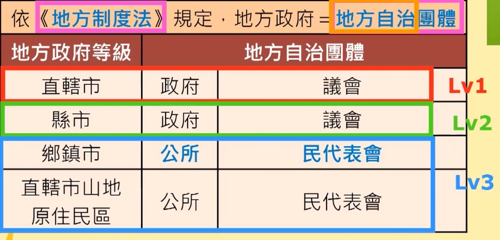
</label>

---

### 🏙️ 實戰思考：臺灣三級「市」大解密與分類速查（同名為「市」，等級大不同！）

我國行政區劃中有很多都稱為「市」，但法律位階完全不同，依《地方制度法》共分為三大層級：

1. **A. 直轄市（Lv1，院轄市，全臺共 6 個）**：
   * **地位**：由行政院直接管轄之第一級地方自治團體。
   * **代表城市**：**桃園市**、**臺南市**、**新北市**（以及臺北市、臺中市、高雄市）。
   * **組織**：市政府 ＋ 市議會（行政首長：市長；民意代表：市議員）。

2. **B. 市（Lv2，與縣同級，俗稱「省轄市」，全臺「唯三」個）**：
   * **地位**：與「縣」同級之第二級地方自治團體。
   * **秒殺口訣**：★ **「基竹嘉」**（全臺只有 3 個，背起來直接秒殺！）。
   * **代表城市**：**基隆市**、**新竹市**、**嘉義市**。
   * **組織**：市政府 ＋ 市議會（行政首長：市長；民意代表：市議員）。

3. **C. 市（Lv3，與鄉、鎮同級，俗稱「縣轄市」，縣政府下轄）**：
   * **地位**：與「鄉、鎮」同級之第三級基層地方自治團體，通常為各縣人口較多之行政中心。
   * **代表城市**：**彰化市**（彰化縣轄）、**馬公市**（澎湖縣轄）、**南投市**（南投縣轄）、**屏東市**（屏東縣轄）、**花蓮市**（花蓮縣轄）、**臺東市**（臺東縣轄）等。
   * **組織**：市公所 ＋ 市民代表會（行政首長：市長；民意代表：市民代表）。

🔍 <b>[課堂閱讀與思考 — 12大城市三級「市」分類測驗圖]（點擊可展開/收合，點擊下方圖片可原地放大）</b>

<input type="checkbox" id="zoom-social-34-cities" class="zoom-toggle">
<label for="zoom-social-34-cities" class="zoom-label">
  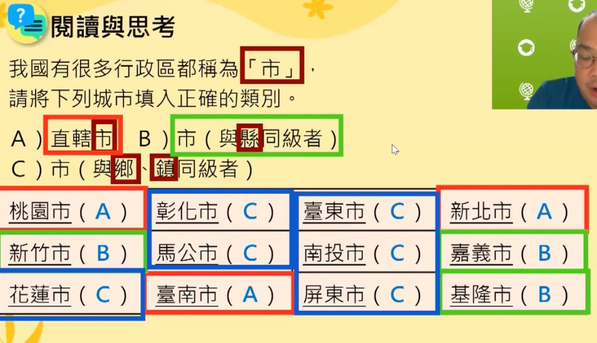
</label>

#### 📋 課堂 12 大城市分類快速對照表
| 城市名稱 | 正確類別 | 等級標記 | 所屬隸屬與判斷重點 |
|---|:---:|:---:|---|
| **桃園市** | **(A) 直轄市** | Lv1 | 六都之一，行政院直轄 |
| **臺南市** | **(A) 直轄市** | Lv1 | 六都之一，行政院直轄 |
| **新北市** | **(A) 直轄市** | Lv1 | 六都之一，行政院直轄 |
| **新竹市** | **(B) 市（與縣同級）** | Lv2 | 省轄市，口訣「基竹嘉」 |
| **嘉義市** | **(B) 市（與縣同級）** | Lv2 | 省轄市，口訣「基竹嘉」 |
| **基隆市** | **(B) 市（與縣同級）** | Lv2 | 省轄市，口訣「基竹嘉」 |
| **花蓮市** | **(C) 市（與鄉鎮同級）** | Lv3 | 花蓮縣下轄之縣轄市（花蓮縣政府所在地） |
| **彰化市** | **(C) 市（與鄉鎮同級）** | Lv3 | 彰化縣下轄之縣轄市（彰化縣政府所在地） |
| **馬公市** | **(C) 市（與鄉鎮同級）** | Lv3 | 澎湖縣下轄之縣轄市（澎湖縣政府所在地） |
| **臺東市** | **(C) 市（與鄉鎮同級）** | Lv3 | 臺東縣下轄之縣轄市（臺東縣政府所在地） |
| **南投市** | **(C) 市（與鄉鎮同級）** | Lv3 | 南投縣下轄之縣轄市（南投縣政府所在地） |
| **屏東市** | **(C) 市（與鄉鎮同級）** | Lv3 | 屏東縣下轄之縣轄市（屏東縣政府所在地） |

---

### 📊 我國各級行政區劃組織與自治地位速查大表

| 行政層級 | 行政機關（行政首長） | 立法機關（民意代表） | 是否為地方自治團體 (點擊翻牌揭曉) | 九合一公職編號 |
|---|---|---|---|---|
| **省**（2個） | 省政府（省主席由總統任命） | 省諮議會（省諮議員由總統任命） | ❌ **否**（行政院派出機關，虛級化） | 無（非民選） |
| **直轄市**（6都） | 市政府（★ **直轄市長**） | 市議會（★ **直轄市議員**） | ★ **是** | ①、② |
| **縣**（13縣） | 縣政府（★ **縣長**） | 縣議會（★ **縣議員**） | ★ **是** | ③、④ |
| **市**（基竹嘉3市） | 市政府（★ **市長**） | 市議會（★ **市議員**） | ★ **是** | ③、④ |
| **鄉、鎮、(縣轄)市** | 公所（★ **鄉／鎮／市長**） | 代表會（★ **鄉／鎮／市民代表**） | ★ **是** | ⑤、⑥ |
| **普通行政區** | 區公所（區長由市長指派公務員） | **無**民意代表會 | ❌ **否**（市政府派出機關） | 無（區長官派） |
| **山地原住民區** (直轄市) | 區公所（★ **區長**民選） | 區民代表會（★ **區民代表**民選） | ★ **是**（特殊自治區） | ⑧、⑨ |
| **村、里** | 村里辦公處（★ **村長／里長**民選） | **無**代表會（里民大會非代議） | ❌ **否**（無公法人地位與立法權） | ⑦ |

---

### 🧠 記憶口訣與破題密碼
> 💡 **【地方自治與九合一秒殺金律】**
> - **自治團體判斷口訣**：
>   「**省是派出、區是官派、村里只是編組！六都、縣市、鄉鎮市、原民區，才是自治團體！**」
> - **選票張數避坑訣**：
>   - 一般六都市民投 **3 張票**（市長、市議員、里長）。
>   - 一般縣民投 **5 張票**（縣長、縣議員、鄉鎮市長、代表、村里長）。
>   - 直轄市山地原住民區民投 **5 張票**（市長、市議員、原民區長、區代表、里長）。
> - **考題必抓三大地雷**：
>   1. 臺北市大安區區長由誰產生？ ➜ **市長指派（官派公務員）**，非民選！
>   2. 新北市烏來區區長由誰產生？ ➜ **烏來是直轄市山地原住民區，區長民選**！
>   3. 村長、里長是民選的，所以村里是地方自治團體嗎？ ➜ **絕不是！村里無立法機關與自治權限，非地方自治團體！**

---

### 🎯 隨堂觀念自我檢測
* **題目**：小明的戶籍設於新北市板橋區，小華的戶籍設於新竹縣竹東鎮，小美的戶籍設於新北市烏來區。年底舉行九合一地方公職人員選舉時，關於三人所能領取的公職人員選票種類與地方自治地位，下列敘述何者完全正確？
  * (A) 板橋區為地方自治團體，小明可領取板橋區長與區民代表之選票
  * (B) 竹東鎮為縣轄地方自治團體，小華在當地可領取縣長、縣議員、鎮長、鎮民代表、里長共 5 張選票 ★（正解：縣轄鎮為地方自治團體，具完整的鄉鎮市長與代表會選舉，加計縣長、縣議員、里長共 5 張票）
  * (C) 烏來區為市政府派出機關，區長由新北市長直接官派，小美僅能投票選舉里長
  * (D) 三人所屬之村里皆屬於我國基層地方自治團體，享有自主制定自治條例之權限

---

## 📌 重點 35：立法院 113 席次組成與「單一選區兩票制」全圖解（區域立委 vs. 不分區立委 vs. 原住民立委）

### 🏷️ 分類資訊
* **筆記本分類**：複習筆記本（第 1～4 冊）
* **冊數進度**：第 4 冊（八年級下學期）
* **科目**：社會（公民）
* **單元章節**：我國中央政府篇／選舉與政治參與篇（立法院組織、國會 113 席席次分配、單一選區兩票制）
* **核心知識點**：立法院總席次 113 席、區域立委（73 席選人）、不分區立委（34 席選黨，5% 門檻，婦女保障 1/2）、原住民立委（6 席選人）

### 💡 核心觀念精粹
1. **選制適用對象與兩大核心內涵**：
   * ★ **適用對象**：**立法委員**（國會議員）。
   * ★ **「單一選區」**：每一選區只選出**一位**區域立委（全國共劃分為 **73 個選區**，**各選區最高票者當選**，屬於相對多數決）。
   * ★ **「兩票制」**：每位選民擁有**兩張選票** ➔ **「一票選人（區域立委候選人），一票選黨（政黨票）」**。
2. **國會立法院席次總覽與三大立委選制全剖析**：
   * 我國中央立法機關為立法院，立法委員總席次為★ **113 席**，任期 **4 年**，連選得連任。
   * 席次公式：**73 席（區域）＋ 34 席（不分區）＋ 6 席（原住民）＝ 113 席**。
   * **三大類立法委員選制特性全剖析**：
     * **區域立法委員（73 席）**：
       * **選區劃分**：全國劃分為 **73 個選區**（每縣市至少 1 席）。
       * **選舉制度**：單一選區相對多數決（**各選區最高票者當選**）。
       * **投票對象**：★ **「選人」**（投給個別候選人）。
     * **不分區立法委員（34 席，全國不分區及僑居國外國民）**：
       * **選區劃分**：**全國不分區（只有一區，合併計票）**。
       * **分配方式**：**政黨比例代表制**。**得票 5% 以上的政黨**，依得票比例分配 34 席席次。
       * **性別保障**：各政黨當選名單中，★ **婦女名額不得低於 1/2（半數）**。
       * **投票對象**：★ **「選黨」**（投給政黨票）。
     * **原住民立法委員（6 席）**：
       * **席次分配**：分為**山地原住民（3 席）**與**平地原住民（3 席）**選區。
       * **選舉制度**：複數選區單記非讓渡投票制（**各選區得票在應選名額以內當選**，前 3 名當選）。
       * **投票對象**：★ **「選人」**（原住民身分選民投給原住民候選人）。
3. **中央公職選舉領票對照（會考高頻情境題）**：
   * **一般國民（非原住民）**：共領 3 張選票（總統副總統票＋區域立委票＋政黨票）。
   * **原住民選民**：共領 3 張選票（總統副總統票＋平地或山地原住民立委票＋政黨票）。

---

### 📊 立法院三大立委席次與選舉制度速查大表（支援翻牌背誦）

| 類別項目 | 席次數量 | 選區劃分 | 投票方式 (點擊翻牌揭曉) | 當選規則與特殊門檻 (點擊翻牌揭曉) | 會考秒殺密碼 |
|---|---|---|---|---|---|
| **區域立委** | **73 席** | 全國 73 個選區（各縣市至少 1 席） | ★ **選人**（投候選人） | **單一選區**（每區應選 1 名），最高票當選 | 73區選人，每區選1人 |
| **不分區立委** | **34 席** | **全國只一區**（全臺單一選區） | ★ **選黨**（投政黨票） | **比例代表制**：政黨票達 **5% 門檻**依比例分配；婦女**不得低於 1/2** | 34席選黨，5%門檻婦女過半 |
| **原住民立委** | **6 席**（平原3+山原3） | 平地/山地原住民全國選區 | ★ **選人**（投候選人） | **複數選區**：平地、山地原住民得票前 3 名當選 | 平3山3共6席，原民選人 |
| **總席次合計** | ★ **113 席** | 任期 4 年，連選得連任 | 單一選區兩票制（並立制） | 區域 73 ＋ 不分區 34 ＋ 原民 6 ＝ 113 | 73 + 34 + 6 = 113 |

---

### 🧠 記憶口訣與破題密碼
> 💡 **【立法院 113 席次秒殺金律】**
> - **席次公式口訣**：「**73 區域選人頭，34 不分看政黨；平三山三共六席，一一三席進國會！**」
> - **不分區兩大避坑考點**：
>   1. **得票門檻**：政黨票必須達 **5%** 才能分席次（未滿 5% 一席都沒有）。
>   2. **婦女保障**：當選人中女性不得低於 **1/2**（若分配 4 席，女性至少 2 席；若女性候選人名次在後，依法強制跳序優先遞補）！
> - **考題必抓三大地雷**：
>   1. 題目問：「一般非原住民選民在立委選舉中可以投幾張票？」 ➜ **2 張票（一票投人，一票投黨）**！
>   2. 區域立委是「複數選區」還是「單一選區」？ ➜ **單一選區（一區只選一人）**！
>   3. 某政黨在政黨票獲得 4.8% 得票率，可分配幾席不分區立委？ ➜ **0 席（未過 5% 門檻，無法分配）**！

---

### 🎯 隨堂觀念自我檢測
* **題目**：我國立法委員選舉採「單一選區兩票制」。某政黨在立委選舉中，於全國政黨票獲得 8% 的得票率，依比例共分配獲得 4 席全國不分區立委席次。該黨推薦之不分區名單排序前四名依序為：第 1 名（男）、第 2 名（男）、第 3 名（男）、第 4 名（女）、第 5 名（女）。請問依我國憲法增修條文之規定，該黨最終當選的 4 席不分區立委名單應為何者？
  * (A) 第 1、2、3、4 名當選（3 男 1 女）
  * (B) 第 1、2、4、5 名當選（2 男 2 女）★（正解：憲法保障不分區婦女名額不得低於 1/2，4 席中女性至少須佔 2 席，因此第 5 名女性候選人跳序遞補取代第 3 名男性候選人）
  * (C) 第 1、2、3 名當選，第 4 席因女性名額爭議宣告從缺
  * (D) 該政黨得票率未達 10%，無法分配任何不分區席次

---

## 📌 重點 36：公民投票（直接民主）核心全攻略 — 創制複決意涵、投票人資格（18歲/居住月數）與通過雙門檻

### 🏷️ 分類資訊
* **筆記本分類**：複習筆記本（第 1～4 冊）
* **冊數進度**：第 4 冊（八年級下學期）
* **科目**：社會（公民）
* **單元章節**：人民的權利與義務篇／選舉與政治參與篇（公民投票：直接民權、創制與複決）
* **核心知識點**：直接民主與主權在民、創制權（立新法）vs. 複決權（否決舊法）、投票資格（18歲、全國住滿6個月/地方住滿4個月）、通過雙門檻（同意>不同意 且 同意達1/4）

### 💡 核心觀念精粹
1. **公民投票之民主意義（直接民權的落實）**：
   * **民主型態**：屬於★ **「直接民主」**（人民親自投票決定重大政策或法律），用以補救代議民主（間接民主）立委脫離民意之缺失，展現「主權在民」之憲政精神。
   * **兩大參政權利**：
     * **創制權**：★ **「立新法」**（人民主動提出立法原則或重大政策之創制）。
     * **複決權**：★ **「否決舊法案」**（人民對現行法律、重大政策或憲法修正案予以同意或否決）。
2. **公民投票人之法定資格（條件）**：
   * **年齡限制**：★ **年滿 18 歲**（※ **大考重大對照**：公職人員選舉權為 20 歲，而公民投票權已降為 **18 歲**！）。
   * **意思能力**：未受監護宣告。
   * **居住期間（戶籍規定）**：
     * **全國性公民投票**：在中華民國自由地區繼續居住★ **6 個月以上**。
     * **地方性（地區性）公民投票**：在各該直轄市、縣（市）繼續居住★ **4 個月以上**。
3. **公民投票五大必考法定程序（中選會主管）**：
   * **程序①：向中選會提案**（由符合資格之公民或立法院等依法向中央選舉委員會提出公投提案）。
   * **程序②：連署**（徵集達到法定人數比例之公民連署書）。
   * **程序③：公告**（中選會審核連署書合規後，依法正式發布公投公告與選舉公報）。
   * **程序④：投票**（定期或定日由合格公民前往投票所投票）。
   * **程序⑤：依結果決定與後續處理**。
4. **公民投票案通過之「雙重門檻」與「後續處理方式」（會考必考大重點）**：
   * **通過門檻（兩大條件缺一不可）**：
     * ① ★ **有效同意票 ＞ 不同意票**（贊成票必須多於反對票）。
     * ② ★ **有效同意票 ＞ 1/4 投票權人總數**（達總投票權人數 25% 以上）。
   * **結果處理方式（法定效力）**：
     * ★ **通過**：**政府機關依決議執行**（法律或自治條例之創制案由主管機關研擬送立法院/議會審議；重大政策由政府進行必要處置）。
     * ★ **不通過**：**該公建議題「兩年內」不得再重新提出**（兩年閉鎖期防惡意濫用）！

---

### 📊 公民投票法定五大程序速查大表

| 程序步驟 | 執行階段 (點擊翻牌揭曉) | 權責機關 / 執行要點 | 會考秒殺密碼 |
|---|---|---|---|
| **程序①** | ★ **向中選會提案** | 人民依法向**中央選舉委員會（中選會）**提出政策或法律創制/複決提案 | 提案找中選會 |
| **程序②** | ★ **連署** | 徵集達到法定門檻之公民連署書，交中選會查核 | 達標才能公告 |
| **程序③** | ★ **公告** | 中選會查核成案後，正式公告公投案並編印公報發表意見書 | 中選會正式公告 |
| **程序④** | ★ **投票** | 具備資格之公民（年滿 18 歲、居住滿 6 個月）前往行使直接民權 | 18歲公民行使直接投票 |
| **程序⑤** | ★ **依結果決定** | • **通過**：政府依決議執行 • **不通過**：**該議題兩年內不得再提出**！ | 不過「兩年」內禁重提 |

---

### 📊 公民投票 vs. 公職人員選舉 核心條件對照大表（支援翻牌背誦）

| 比較項目 | 公民投票 (點擊翻牌揭曉) | 公職人員選舉 (點擊翻牌揭曉) | 會考與模考解題秒殺密碼 |
|---|---|---|---|
| **民主運作型態** | ★ **直接民主**（決定「事」：政策/法律） | ★ **間接民主／代議民主**（決定「人」：民意代表/首長） | 公投管「事」，選舉管「人」 |
| **投票年齡門檻** | ★ **年滿 18 歲** | ★ **年滿 20 歲** | 公投 18 歲，選舉 20 歲（必背！） |
| **戶籍居住期間** | 全國性：**6 個月**；地方性：**4 個月** | 一般公職選舉：在該選區住滿 **4 個月** | 全國公投要半年(6個月)，選舉地方4個月 |
| **通過決定規則** | 同意票 ＞ 不同意票，且**同意票達總人數 1/4** | 相對多數決（最高票者當選） | 公投需過 1/4 門檻，選舉看最高票 |

---

### 🧠 記憶口訣與破題密碼
> 💡 **【公民投票秒殺金律】**
> - **權利意義口訣**：「**創建立新法，複決否舊案！公投直接民主，主權在民最徹底！**」
> - **年齡與戶籍口訣**：「**公投十八歲（選人要二十）；全國住半年（6個月），地方四個月！**」
> - **通過門檻雙重密碼**：
>   「**同意多於不同意，還得衝過四分之一（1/4）！**」
> - **考題必抓三大地雷**：
>   1. 小美今年 19 歲，能否投總統票？能否投全國性公投票？ ➜ **不能投總統（須20歲），但可以投公投票（18歲即可）**！
>   2. 某公投案投票結果：同意票 400 萬，不同意票 300 萬，若該次公投全國投票權人共 2000 萬人，該公投案是否通過？ ➜ **否！**（2000 萬的 1/4 是 500 萬，同意票僅 400 萬未達門檻，即便同意多於不同意依然不通過！）
>   3. 某公投案同意票 600 萬，不同意票 650 萬（總人數 2000 萬），是否通過？ ➜ **否！**（不同意票多於同意票，不通過！）

---

### 🎯 隨堂觀念自我檢測
* **題目**：某年全國性公民投票舉行，全國具投票權人總數為 2,000 萬人。某項攸關能源政策的公投案開票結果為：有效同意票 480 萬票、不同意票 320 萬票、無效票 50 萬票。關於此公投案的結果判定與投票資格，下列敘述何者完全正確？
  * (A) 同意票多於不同意票，故該項公投案順利通過
  * (B) 同意票雖多於不同意票，但未達投票權人總數之 1/4 門檻（500 萬票），故該公投案不通過 ★（正解：2000 萬的 1/4 為 500 萬，同意票 480 萬未達標，不通過）
  * (C) 凡年滿 20 歲且在中華民國自由地區居住滿 4 個月之國民，始具有該案之投票權
  * (D) 公民投票為代議民主的具體展現，目的在於選出優秀政治人物代為立法

---

## 📌 重點 37：臺灣地方制度重大變革 —「省虛級化（精省）」始末與我國中央地方行政體系全圖解

### 🏷️ 分類資訊
* **筆記本分類**：複習筆記本（第 1～4 冊）
* **冊數進度**：第 4 冊（八年級下學期）
* **科目**：社會（公民）
* **單元章節**：地方政府與地方自治篇（「省虛級化」體制變革、行政機關 vs. 立法機關 vs. 派出單位全層級圖解）
* **核心知識點**：省虛級化（精省）、省政府（行政院派出機關）、省主席與省諮議員（行政院長提請總統任命）、地方行政體系分類（行政機關、立法機關、派出單位）

### 💡 核心觀念精粹
1. **「省虛級化（精省）」的核心歷史與體制變更**：
   * **修憲前（曾經民選）**：臺灣省原為最高層級之地方自治團體，曾舉辦「省長」公民直選（宋楚瑜當選首任省長），並設有民選之「臺灣省議會（省議員）」。
   * **精省背景**：臺灣省轄區面積占全臺八成以上、人口占全臺多數，造成「省」與「中央」行政資源與組織高度重疊。
   * **虛級化（精省）後三大關鍵改變**：
     1. **省政府地位改變**：喪失地方自治團體地位，★ **成為「行政院的派出機關」**（非自治法人）。
     2. **省長改為「省主席」**：不再由公民選舉，改由★ **行政院院長提請總統任命**。
     3. **省議員改為「省諮議員」**：原省議會改為「**省諮議會**」，省諮議員由★ **行政院院長提請總統任命**（僅具諮詢性質，無立法與質詢權）。
2. **我國中央與地方政府體系三大角色精確分類**：
   * **行政機關（首長依法行政）**：
     * 直轄市：直轄市政府（市長）
     * 縣、市：縣政府（縣長）、市政府（市長）
     * 鄉、鎮、(縣轄)市：鄉公所、鎮公所、市公所（鄉/鎮/市長）
     * 山地原住民區：山地原住民區公所（區長民選）
   * **立法機關（民意機關，審查預算與法規、監督質詢）**：
     * 直轄市：直轄市議會（市議員）
     * 縣、市：縣議會（縣議員）、市議會（市議員）
     * 鄉、鎮、(縣轄)市：市民代表會、鎮民代表會、鄉民代表會（民意代表）
     * 山地原住民區：山地原住民區民代表會（區民代表）
   * **地方行政機關之「派出單位」（非自治團體、首長官派、無代表會）**：
     * **省政府**（行政院之派出機關）
     * **普通區公所**（直轄市及省轄市之派出單位，區長為市長派任公務員）

---

### 📊 臺灣省「虛級化（精省）」前後核心對照大表（支援翻牌背誦）

| 比較項目 | 修憲精省前（曾經民選） | 修憲精省後（虛級化現狀）(點擊翻牌揭曉) | 會考與模考解題秒殺密碼 |
|---|---|---|---|
| **法律地位** | 最高層級**地方自治團體**（公法人） | ★ **行政院的派出機關**（非自治團體） | 省政府不是自治團體，是行政院派出機關！ |
| **行政首長** | **省長**（公民直接選舉產生） | ★ **省主席**（行政院長提請總統任命） | 省長民選已成歷史，省主席由總統任命 |
| **議會組織** | **臺灣省議會**（省議員民選，有立法權） | ★ **臺灣省諮議會**（省諮議員由總統任命） | 省議會變省諮議會，無監督立法權 |
| **自治權限** | 享有完整自主財政與自治立法權 | **無**自治立法權與自主財源（去任務化） | 虛級化代表架空層級，不再具自治機能 |

---

### 📊 中央地方行政體系三大機構屬性速查表

| 機構名稱 | 組織屬性類別 | 首長產生方式 | 監督機關（立法機關） |
|---|---|---|---|
| **直轄市政府 / 縣政府 / 市政府** | 地方行政機關（地方自治團體） | 公民直接選舉 | 各級議會（直轄市議會、縣議會、市議會） |
| **鄉、鎮、縣轄市公所** | 地方行政機關（地方自治團體） | 公民直接選舉 | 鄉／鎮／市民代表會 |
| **直轄市山地原住民區公所** | 地方行政機關（特殊自治團體） | 公民直接選舉 | 山地原住民區民代表會 |
| **省政府** | ★ **行政院之派出機關** | 行政院長提請總統任命 | 無（省諮議會僅具諮詢功能） |
| **普通區公所**（如大安區、東區） | ★ **地方行政機關之派出單位** | 市長直接指派公務員 | 無代表會（由市議員監督市政府） |

---

### 🧠 記憶口訣與破題密碼
> 💡 **【省虛級化秒殺金律】**
> - **虛級化三大變革口訣**：
>   「**省府變派出（行政院派出機關），省長變主席（總統任命），省議會變諮議會（省諮議員官派）！**」
> - **派出機關雙地雷**：
>   1. **省政府**是「行政院的派出機關」！
>   2. **普通區公所**是「直轄市與省轄市政府的派出單位」！
> - **考題必抓三大地雷**：
>   1. 臺灣省省長現在由誰選舉產生？ ➜ **已無省長！改為省主席，由行政院院長提請總統任命！**
>   2. 臺灣省政府屬於地方自治團體嗎？ ➜ **絕不是！它只是行政院的派出機關，無公法人地位！**
>   3. 新竹市北區、臺北市大安區設有區長與區民代表會嗎？ ➜ **區長由市長指派，絕無區民代表會（普通行政區非自治團體）！**

---

### 🎯 隨堂觀念自我檢測
* **題目**：關於我國地方制度重大變革「省虛級化」之背景、現行體制定位與組織架構，下列敘述何者完全正確？
  * (A) 臺灣省政府目前為我國最高層級的地方自治團體，省長仍由公民直選產生
  * (B) 省虛級化後，省政府成為行政院的派出機關，省主席與省諮議員皆改由行政院院長提請總統任命 ★（正解：省政府為行政院派出機關，首長與委員均由總統任命，非地方自治團體）
  * (C) 直轄市下轄之所有區公所皆設有民選區長與區民代表會
  * (D) 縣政府下轄之鄉、鎮、市公所為縣政府之派出機關，其首長由縣長指派

---

## 📌 重點 38：臺灣現行 22 行政區劃與「縣市改制（直轄市升格）」核心全圖解

### 🏷️ 分類資訊
* **筆記本分類**：複習筆記本（第 1～4 冊）
* **冊數進度**：第 4 冊（八年級下學期）
* **科目**：社會（公民）
* **單元章節**：地方政府與地方自治篇（我國現行 22 個行政區、6 個直轄市、3 個市、13 個縣分布與改制升格歷程）
* **核心知識點**：22 個行政區劃（6直轄市＋3市＋13縣）、六都地域分布（北中南）、三市（基隆、新竹、嘉義）、縣市升格直轄市條件與基層改制影響

### 💡 核心觀念精粹
1. **我國現行 22 個行政區劃架構總覽（6＋3＋13）**：
   * **6 個直轄市（六都）**：
     * **北部**：臺北市、新北市、桃園市（北北桃）
     * **中部**：臺中市
     * **南部**：臺南市、高雄市（南高）
     * （註：東部目前無直轄市）
   * **3 個市（省轄市／市）**：
     * **北部**：基隆市、新竹市
     * **南部**：嘉義市
     * （速記口訣「**基竹嘉**」，注意：中部與東部目前無省轄市！）
   * **13 個縣**：
     * **臺灣本島（10 縣）**：宜蘭縣、花蓮縣、臺東縣、屏東縣、苗栗縣、彰化縣、南投縣、雲林縣、嘉義縣、新竹縣
     * **離島地區（3 縣）**：澎湖縣、金門縣、連江縣（馬祖）
   * **合計**：6（直轄市）＋ 3（市）＋ 13（縣）＝ **22 個行政區**。
2. **「縣市改制（升格為直轄市）」的法規門檻與影響**：
   * **法規門檻依據（地方制度法）**：人口聚居達 **125 萬人以上**，且在政治、經濟、文化及都會區域發展上，有特殊需要之地區得設直轄市。
   * **縣市合併與升格實例**：
     * 單獨升格：臺北縣 ➔ 新北市、桃園縣 ➔ 桃園市。
     * 合併升格：臺中縣市合併 ➔ 臺中市、臺南縣市合併 ➔ 臺南市、高雄縣市合併 ➔ 高雄市。
   * **升格改制後的重要體制變化（會考必考地雷）**：
     * **原鄉、鎮、縣轄市全部改為「普通區」**：
       - 例如：原板橋市改為板橋區、原豐原市改為豐原區。
       - **失去地方自治團體地位**：區公所成為市政府的「派出機關」，區長改由**市長直接派任**公務員擔任，且**不再設有代表會**（原代表會廢除）。
     * **特殊例外（直轄市山地原住民區）**：
       - 如新北烏來區、桃園復興區、臺中和平區、高雄那瑪夏區/桃源區/茂林區，為保障原住民族參政權，法律特別明定為**地方自治團體**，享有民選區長與民選區民代表會！

---

### 📊 臺灣現行地方行政區劃核心層級大表（支援翻牌背誦）

| 行政區劃類別 | 數量 | 涵蓋地區與分布 | 基層行政單位性質(點擊翻牌揭曉) | 會考與模考解題秒殺密碼 |
|---|---|---|---|---|
| **直轄市（六都）** | **6 個** | • 北部：臺北市、新北市、桃園市 • 中部：臺中市 • 南部：臺南市、高雄市 | 下轄★ **普通區（派出單位，非自治）**；僅山地原住民區為自治團體 | 東部無直轄市；鄉鎮市改制為區後喪失自治權 |
| **市（省轄市）** | **3 個** | • 北部：基隆市、新竹市 • 南部：嘉義市（基竹嘉） | 下轄★ **普通區（派出單位，非自治）**，區長由市長指派 | 中部與東部無省轄市；與縣同層級（非直轄市） |
| **縣** | **13 個** | • 本島（10 縣）：宜花東、苗彰投、雲嘉屏、竹 • 離島（3 縣）：澎湖、金門、連江 | 下轄★ **鄉、鎮、縣轄市（法定地方自治團體，首長民代皆民選）** | 離島共 3 縣；縣轄下的鄉鎮市才是真正地方自治團體 |

---

### 🧠 記憶口訣與破題密碼
> 💡 **【縣市改制與 22 行政區秒殺金律】**
> - **總數與六都口訣**：
>   「**六都、三市、十三縣，全國共有二十二！**」
>   「**六都分布：北北桃、臺中、南高！**」
> - **三市（省轄市）口訣**：
>   「**基竹嘉（基隆、新竹、嘉義）！中部東部都沒有！**」
> - **升格地雷秒殺法**：
>   縣升格為直轄市後，原「鄉鎮市」變成「區」＝ **自治權被沒收！首長變官派、代表會被取消！**（只有山地原住民區例外）

---

### 🎯 隨堂觀念自我檢測
* **題目**：關於我國現行地方行政區域劃分與「縣市改制」之敘述，下列何者完全正確？
  * (A) 目前全國共有 22 個行政區，包含 6 個直轄市、3 個市與 13 個縣 ★（正解：六都、基竹嘉三市、本島10縣+離島3縣共22個行政區）
  * (B) 我國三個市（省轄市）分別位於北部、中部與南部地區
  * (C) 某縣升格改制為直轄市後，其下轄原本的所有鄉、鎮、市皆改制為區，區長仍由居民投票選舉產生
  * (D) 離島地區的金門、馬祖（連江）、澎湖在地方制度法上均屬於直轄市層級

---

## 📌 重點 39：臺灣三級「市」大解密 —「直轄市」vs.「市（省轄市）」vs.「市（縣轄市）」12 大城市位階實戰速查

### 🏷️ 分類資訊
* **筆記本分類**：複習筆記本（第 1～4 冊）
* **冊數進度**：第 4 冊（八年級下學期）
* **科目**：社會（公民）
* **單元章節**：地方政府與地方自治篇（臺灣同名為「市」之三大法定層級、12 大城市等級實戰分類與自治地位）
* **核心知識點**：直轄市 (Lv1/六都)、市（省轄市/Lv2/基竹嘉）、市（縣轄市/Lv3/等同鄉鎮）、12 大城市實戰配對

### 💡 核心觀念精粹
1. **我國同名為「市」之三大法定法律位階（依《地方制度法》）**：
   * **(A) 直轄市（第一級地方自治團體，全臺共 6 個）**：
     * **地位**：由行政院直接管轄，享有最高自治權限與統籌分配稅款比例。
     * **行政組織**：直轄市政府（市長）＋ 直轄市議會（市議員），首長與議員皆公民直選。
     * **代表城市**：**桃園市**、**臺南市**、**新北市**（以及臺北市、臺中市、高雄市）。
   * **(B) 市（第二級地方自治團體，俗稱「省轄市」，全臺僅 3 個）**：
     * **地位**：法律位階與「縣」完全同級，直屬中央監督。
     * **秒殺口訣**：★ **「基竹嘉」**（全臺只有 3 個，背起來秒殺所有題目！）。
     * **行政組織**：市政府（市長）＋ 市議會（市議員），首長與議員皆公民直選。
     * **代表城市**：**基隆市**、**新竹市**、**嘉義市**（注意：中部與東部目前無省轄市！）。
   * **(C) 市（第三級地方自治團體，俗稱「縣轄市」，由縣政府管轄）**：
     * **地位**：法律位階與「鄉、鎮」完全同級，為基層自治團體，通常為各縣人口集中之政經首善行政中心。
     * **行政組織**：市公所（市長）＋ 市民代表會（市民代表），首長與民意代表皆公民直選。
     * **代表城市**：**花蓮市**（花蓮縣轄）、**彰化市**（彰化縣轄）、**馬公市**（澎湖縣轄）、**臺東市**（臺東縣轄）、**南投市**（南投縣轄）、**屏東市**（屏東縣轄）等。

---

### 📊 課堂 12 大城市三級「市」分類實戰速查大表（支援翻牌背誦）

| 城市名稱 | 正確分類類別(點擊翻牌揭曉) | 法律位階等級 | 所屬行政體系與解題關鍵 |
|---|:---:|:---:|---|
| **桃園市** | ★ **(A) 直轄市** | 第一級 (Lv1) | 六都之一，行政院直轄 |
| **新竹市** | ★ **(B) 市（與縣同級）** | 第二級 (Lv2) | 省轄市，秒殺口訣「基竹嘉」 |
| **花蓮市** | ★ **(C) 市（與鄉鎮同級）** | 第三級 (Lv3) | 花蓮縣轄市（花蓮縣政府所在地） |
| **彰化市** | ★ **(C) 市（與鄉鎮同級）** | 第三級 (Lv3) | 彰化縣轄市（彰化縣政府所在地） |
| **馬公市** | ★ **(C) 市（與鄉鎮同級）** | 第三級 (Lv3) | 澎湖縣轄市（澎湖縣政府所在地，離島唯一縣轄市） |
| **臺南市** | ★ **(A) 直轄市** | 第一級 (Lv1) | 六都之一，行政院直轄 |
| **臺東市** | ★ **(C) 市（與鄉鎮同級）** | 第三級 (Lv3) | 臺東縣轄市（臺東縣政府所在地） |
| **南投市** | ★ **(C) 市（與鄉鎮同級）** | 第三級 (Lv3) | 南投縣轄市（南投縣政府所在地） |
| **屏東市** | ★ **(C) 市（與鄉鎮同級）** | 第三級 (Lv3) | 屏東縣轄市（屏東縣政府所在地） |
| **新北市** | ★ **(A) 直轄市** | 第一級 (Lv1) | 六都之一，行政院直轄 |
| **嘉義市** | ★ **(B) 市（與縣同級）** | 第二級 (Lv2) | 省轄市，秒殺口訣「基竹嘉」 |
| **基隆市** | ★ **(B) 市（與縣同級）** | 第二級 (Lv2) | 省轄市，秒殺口訣「基竹嘉」 |

---

### 🧠 記憶口訣與破題密碼
> 💡 **【三級「市」秒殺金律】**
> - **三級定位口訣**：
>   1. **(A) 直轄市（六都）**：「直轄中央，六都獨尊！」
>   2. **(B) 省轄市（基竹嘉）**：「平起平坐等同縣，基竹嘉全臺唯三！」
>   3. **(C) 縣轄市（彰化花蓮馬公等）**：「等同鄉鎮聽縣命，縣府所在人口多！」
> - **離島唯一縣轄市**：
>   澎湖縣政府所在地為「**馬公市**」，等級等同於鄉、鎮，屬於 **(C) 類縣轄市**！

---

### 🎯 隨堂觀念自我檢測
* **題目**：我國行政區域中許多地方皆稱為「市」，但法律地位大不相同。下列四個城市的法律位階分類，何者完全正確？
  * (A) 新北市屬於直轄市，基隆市屬於與縣同級之市，彰化市屬於與鄉鎮同級之縣轄市 ★（正解：新北市為直轄市 A，基隆市為省轄市 B，彰化市為縣轄市 C）
  * (B) 新竹市與花蓮市皆屬於與縣同級之省轄市
  * (C) 嘉義市與屏東市皆屬於與鄉、鎮同級之縣轄市
  * (D) 澎湖縣的馬公市屬於直轄市層級

---

## 📌 重點 40：地方政府的權責與四大核心自治事務大剖析（安全衛生、教育文化、社會福利、經濟發展）

### 🏷️ 分類資訊
* **筆記本分類**：複習筆記本（第 1～4 冊）
* **冊數進度**：第 4 冊（八年級下學期）
* **科目**：社會（公民）
* **單元章節**：地方政府與地方自治篇（地方政府兩大權責、自治事項 vs. 委辦事項、四大核心業務範疇）
* **核心知識點**：地方政府權責（自治事務、上級委辦）、四大業務範疇（安全衛生、教育文化、社會福利、經濟發展）

### 💡 核心觀念精粹
1. **地方政府的兩大核心權責**：
   * **推動「地方自治」的工作（自治事項）**：
     * 由地方政府依其權限與地方實際需求，自行規劃並推動的事務（如興建地方公園、舉辦藝文節慶、推動地方觀光行銷）。
   * **執行「上級政府委辦」的事項（委辦事項）**：
     * 由中央或上級政府委託或交代地方政府代為辦理的事項（例如：代辦全國性公職人員選務、代發中央急難救助金、執行全國性公費疫苗施打）。
   * **核心意義**：地方政府為第一線服務機關，所處理的事務直接影響民眾日常食衣住行育樂，**與人民的生活最為密切相關**。
2. **地方政府四大核心自治業務範疇與常見實務**：
   * 🛡️ **安全衛生**：**消防安全**（如消防演練、老舊建築消防安檢）、**預防保健**（如傳染病防治、公費疫苗接種、餐飲衛生與食安稽查）。
   * 🎓 **教育文化**：**科技教育**（如中小學數位遠距教室推廣、創客教育）、**文化活動**（如舉辦地方藝文活動、文化節慶、市立圖書館與文化中心營運）。
   * 🤝 **社會福利**：**兒少托育**（如增設公立幼兒園、公托中心、育兒津貼）、**社會救助**（如中低收入戶生活津貼、發放重陽敬老禮金、長照據點與獨居老人照護）。
   * 🚆 **經濟發展**：**交通建設**（如市區公車路線營運規劃、引進公共自行車 YouBike、開闢地方道路）、**產業發展**（如推廣在地特色農特產品「一鄉鎮一特產」、商圈行銷推廣）。

---

### 📊 地方政府四大核心業務領域與常見實例速查大表（支援翻牌背誦）

| 業務領域項目 | 核心目標 | 常見具體業務實例(點擊翻牌揭曉) | 會考與模考情境題秒殺配對 |
|---|---|---|---|
| **安全衛生** | 維護民眾生命財產與健康生活 | ★ **消防安全**（消防救災演練、安檢） ★ **預防保健**（疫苗接種、傳染病防治、食安） | 「衛生局稽查餐廳食安」、「消防隊進行防震演練」 |
| **教育文化** | 提升公民素質與傳承在地歷史 | ★ **科技教育**（中小學智慧教室推廣） ★ **文化活動**（藝文展演、文化節、圖書館） | 「教育局推動一人一平板」、「文化局舉辦國際童玩節」 |
| **社會福利** | 照顧弱勢群體與提升家庭支持 | ★ **兒少托育**（公托中心、育兒津貼） ★ **社會救助**（低收補助、長照樂齡照護） | 「社會局發放生活補助」、「設置社區關懷據點」 |
| **經濟發展** | 改善基礎設施與活絡地方經濟 | ★ **交通建設**（市區公車、YouBike、修築道路） ★ **產業發展**（地方特色農特產、商圈觀光行銷） | 「交通局規劃捷運公車轉乘」、「農業處推銷在地黑豆」 |

---

### 🧠 記憶口訣與破題密碼
> 💡 **【地方政府四大業務領域秒殺口訣】**
> - **四大業務領域速記**：
>   「**安（安全衛生）、教（教育文化）、社（社會福利）、經（經濟發展）！**」
> - **業務關鍵字秒配對**：
>   1. 看到「消防、防災演練、疫苗、登革熱、食安」 ➔ 選【**安全衛生**】！
>   2. 看到「學校設備、圖書館、童玩節、數位學習」 ➔ 選【**教育文化**】！
>   3. 看到「公托、幼兒補助、獨居老人長照、救助金」 ➔ 選【**社會福利**】！
>   4. 看到「公車、YouBike、農產特銷、商圈市集」 ➔ 選【**經濟發展**】！

---

### 🎯 隨堂觀念自我檢測
* **題目**：新北市政府為提升市民生活品質，規劃了以下四項施政措施：甲、辦理長者公費流感疫苗接種；乙、設立公共托嬰中心減輕年輕家庭負擔；丙、引進公共自行車租賃系統以利大眾運輸轉乘；丁、舉辦平溪天燈節與在地特色文化推廣。請問上述四項施政措施依序所屬之業務範疇，下列配對何者完全正確？
  * (A) 甲：安全衛生；乙：社會福利；丙：經濟發展；丁：教育文化 ★（正解：甲為預防保健安全衛生、乙為兒少托育社會福利、丙為交通建設經濟發展、丁為文化活動教育文化）
  * (B) 甲：社會福利；乙：教育文化；丙：經濟發展；丁：安全衛生
  * (C) 甲：安全衛生；乙：經濟發展；丙：教育文化；丁：社會福利
  * (D) 甲：教育文化；乙：社會福利；丙：安全衛生；丁：經濟發展

---

## 📌 重點 41：民法的行為能力核心全攻略 — 無行為能力 vs. 限制行為能力 vs. 完全行為能力（年齡劃分、精神宣告、契約效力與三大例外）

### 🏷️ 分類資訊
* **筆記本分類**：複習筆記本（第 1～4 冊）
* **冊數進度**：第 4 冊（八年級下學期）
* **科目**：社會（公民）
* **單元章節**：民事法律行為篇（民法行為能力之分類、年齡界線、精神狀況宣告、契約效力判定）
* **核心知識點**：無行為能力人（未滿7歲、受監護宣告、契約一律無效由法代代理）、限制行為能力人（7~18歲、受輔助宣告、原則需法代同意、三大例外有效）、完全行為能力人（18歲以上成年、無精神限制、獨立有效自負其責）

---

### 💡 核心觀念精粹
1. **民法「行為能力」的法理精神**：
   * 指個人能否基於自身的自由意思表示，**獨立從事有效法律行為（簽訂契約、承擔義務）**的法律資格。
   * 立法宗旨：主要在於**保護心智尚未完全成熟的未成年人**及心智缺陷者免受不當侵害，同時**兼顧交易安全**。
2. **民法行為能力三大類型深入剖析**：
   * 🚼 **無行為能力人**：
     * **年齡規定**：**0～7 歲（未滿 7 歲）**。
     * **精神狀況**：受法院**監護宣告**之人（因精神障礙致不能為意思表示，法院選任監護人為法定代理人）。
     * **行為能力與契約效力**：所為之意思表示與簽訂之契約★ **通通無效**！
     * **法律代理機制**：其生活所需之一切法律行為，必須由★ **法定代理人（父母或監護人）「代代理為意思表示，並代受意思表示」**。
   * 🎒 **限制行為能力人**：
     * **年齡規定**：**7～18 歲（滿 7 歲以上，未滿 18 歲）**（配合我國最新法規，18 歲即成年並具完全行為能力）。
     * **精神狀況**：受法院**輔助宣告**之人（心智能力有不足者）。
     * **行為能力與契約效力**：原則上所訂立之契約為★ **「效力未定」**，須經法定代理人事先允許或事後承認，方具法律效力；若法定代理人拒絕承認則為無效。
     * ★ **三大例外（不需父母同意，本人單獨為之即直接有效）**：
       1. **單純收益（純獲法律上利益）**：例如純受贈與、過年收壓歲錢、無條件獲贈禮品（只享權利不負義務）。
       2. **生活必需（依其年齡及身分日常生活所必需）**：例如買便當、搭捷運搭公車、購買學校文具、剪頭髮等小額日常開銷。
       3. **法定代理人事先允許處分之財產（零用金條款）或允許獨立營業**：例如父母給予零用錢自由花費範圍內的消費。
   * 🧑 **完全行為能力人**：
     * **年齡規定**：**18 歲以上（成年）**。
     * **精神狀況**：**心智健全、無特殊限制**（未受監護宣告或輔助宣告）。
     * **行為能力與契約效力**：所為之任何法律行為★ **一切有效、法律責任自負**（可獨立買賣不動產汽機車、租屋簽約、辦理信用卡、結婚登記等）。

---

### 📊 民法三大行為能力類型全方位對照大表（支援翻牌背誦）

| 項目類型 | 年齡規定 (點擊翻牌) | 精神狀況與法院宣告 | 契約效力原則 | 例外情況與法律責任 |
|---|---|---|---|---|
| **無行為能力人** | ★ **0～7 歲**（未滿 7 歲） | **受監護宣告**（法院裁定，派任監護人） | ★ **所有契約通通無效** | 無例外；由法定代理人（父母/監護人）全權代理 |
| **限制行為能力人** | ★ **7～18 歲**（滿 7 歲未滿 18 歲） | **受輔助宣告**（法院裁定） | ★ **原則需法定代理人允許或事後同意**（否則無效） | ★ **三大例外有效**： 1. **單純收益**（純受贈與） 2. **生活必需**（買便當搭公車） 3. **零用錢自由處分** |
| **完全行為能力人** | ★ **18 歲以上**（成年） | **無特殊限制**（心智正常） | ★ **一切有效** | 獨立自負一切民事法律責任，契約自由 |

---

### 🧠 記憶口訣與破題密碼
> 💡 **【民法行為能力秒殺金律】**
> - **黃金年齡與宣告口訣**：
>   「**未滿七歲無能力，監護宣告全無效，爸媽代簽才算數！七到十八受限制，輔助宣告需同意，純獲利益日常需，零用自由三例外！十八成年頂天立，完全有效責任負！**」
> - **考題必抓三大地雷與會考常考題型**：
>   1. **壓歲錢能不能收？** ➔ 國中生（14歲）收長輩一萬元紅包，屬於「**純獲法律上利益（單純收益）**」，不需父母同意直接有效！
>   2. **買手機或機車算不算日常生活必需？** ➔ 國中生瞞著父母買高價智慧型手機或電競電腦，**不屬於**日常日常生活必需，未經父母事前允許或事後同意，契約效力未定（父母拒絕則契約無效退費）！
>   3. **成年年齡已改為 18 歲！** ➔ 現行民法成年年齡為 **18 歲**，滿 18 歲即為完全行為能力人，可獨立辦理租屋、買賣、訂定契約與登記結婚！

---

### 🎯 隨堂觀念自我檢測
* **題目一**：今年 15 歲的國中生小華，在未經父母事前同意的情況下，私下進行了下列四種行為：甲、在便利商店購買 80 元的排骨便當；乙、收下叔叔無條件贈送的一萬元生日壓歲錢；丙、在通訊行簽約購買價值三萬元的最新款旗艦手機；丁、將自己心愛的腳踏車以一千元賣給同學。請問上述小華的各項行為中，依我國民法規定「依法直接完全有效」的共有哪幾項？
  * (A) 僅甲
  * (B) 僅甲、乙 ★（正解：小華為限制行為能力人，甲為日常生活所必需、乙為純獲法律上利益，兩者皆為例外單獨有效；丙買高額手機與丁賣車非生活必需，須經父母同意承認始生效力）
  * (C) 僅甲、乙、丁
  * (D) 甲、乙、丙、丁皆有效
* **題目二**：關於我國民法上「行為能力」之規定，下列敘述何者完全正確？
  * (A) 6 歲的幼童自己去超商買 20 元的麵包，因屬於日常生活所必需，該買賣契約依法完全有效
  * (B) 受監護宣告之人，其心智狀況與限制行為能力人相同，只要法定代理人事後承認契約即可生效
  * (C) 滿 18 歲之成年人若無特殊受宣告限制，得獨立簽訂租賃契約、辦理信用卡，並自負完全法律責任 ★（正解：現行民法以 18 歲為成年界線，心智正常者為完全行為能力人，一切法律行為完全有效）
  * (D) 受輔助宣告之人所有簽訂之契約通通絕對無效，必須由監護人代理

---

## 📌 重點 42：民法侵權行為的損害賠償責任全攻略 — 完全行為人 vs. 限制與無行為能力人（自負其責 vs. 法定代理人連帶賠償、回復原狀原則）

### 🏷️ 分類資訊
* **筆記本分類**：複習筆記本（第 1～4 冊）
* **冊數進度**：第 4 冊（八年級下學期）
* **科目**：社會（公民）
* **單元章節**：民事權利與責任篇（民法侵權行為之成立要件、損害賠償責任之歸屬、法定代理人連帶責任）
* **核心知識點**：侵權行為成立（故意過失不法侵害）、賠償方法（回復原狀為主、金錢賠償為輔）、完全行為能力人（18歲以上成年自行負責）、限制與無行為能力人（法定代理人負相關連帶賠償責任）。

---

### 💡 核心觀念精粹
1. **民法「侵權行為」的定義與賠償原則**：
   * **定義**：因**故意或過失**，不法侵害他人的權利或利益（例如：不慎開車撞傷路人、故意砸毀店家招牌、誹謗他人名譽），行為人必須負擔民事上的**「損害賠償責任」**。
   * **損害賠償的兩大原則**：
     * ① **回復原狀（原則）**：以恢復損害發生前的原狀為首要原則（例如：修復被撞壞的車門、登報道歉恢復名譽）。
     * ② **金錢賠償（例外）**：若不能回復原狀、回復顯有重大困難，或受害人請求者，則以**支付賠償金**填補損害（例如：支付醫藥費、看護費或精神慰撫金）。
2. **依「行為能力」判定侵權損害賠償責任（會考必考關鍵）**：
   * 🧑 **完全行為能力人（18 歲以上成年人）**：
     * **責任歸屬**：★ **自行負擔責任**！
     * 行為人在法律上已是心智完全成熟的獨立個體，自己闖禍必須自己承擔全部民事損害賠償責任。
     * 法定代理人（父母）在法律上★ **無須負連帶賠償責任**，受害人不得強迫父母代為償還。
   * 🎒 **限制行為能力人（7～18 歲）**：
     * **責任歸屬**：若行為時具備識別能力（能明辨是非黑白），與其★ **法定代理人（父母／監護人）「連帶負損害賠償責任」**！
     * 受害人可同時向該未成年人及其父母請求全部或一部之損害賠償。
   * 🚼 **無行為能力人（未滿 7 歲或受監護宣告）**：
     * **責任歸屬**：因行為時無識別能力，免除其個人責任，改由其★ **法定代理人（父母／監護人）負損害賠償責任**。
3. **法定代理人的免責抗辯（實務但書）**：
   * 民法規定：法定代理人若能舉證證明自己對未成年子女的「監督並未疏懈」，或「縱加以相當之監督仍不免發生損害」時，得免除賠償責任。
   * ⚠️ **重要考點注意**：在司法實務中，法院對父母之監督責任認定極其嚴格，若父母無法充分證明，原則上均須連帶負責！

---

### 📊 侵權行為之損害賠償責任依行為能力分類對照大表（支援翻牌背誦）

| 行為能力類型 | 年齡與資格 (點擊翻牌) | 侵權損害之民事責任歸屬 | 父母（法定代理人）是否需負責？ | 會考與模考解題秒殺密碼 |
|---|---|---|---|---|
| **完全行為能力人** | ★ **18 歲以上**（成年） | ★ **自行負擔責任** | ★ **完全不需負責**（獨立自負責任） | 滿 18 歲成年闖禍，受害人只能告本人，不能向父母求償 |
| **限制行為能力人** | ★ **7～18 歲**（滿 7 歲未滿 18 歲） | 具識別能力時，個人與法代**連帶負責** | ★ **法定代理人負連帶賠償責任** | 國中生打架砸車，父母必須連帶掏腰包賠償受害人 |
| **無行為能力人** | ★ **0～7 歲**（未滿 7 歲）或受監護宣告 | 個人無識別能力不罰 | ★ **由法定代理人負賠償責任** | 幼童在賣場摔壞商品，由家長負全額損害賠償責任 |

---

### 🧠 記憶口訣與破題密碼
> 💡 **【侵權行為責任秒殺金律】**
> - **責任歸屬秒記口訣**：
>   「**侵權損害要賠償，回復原狀是首選！成年十八自己扛，爸媽不必連帶賠！未滿十八惹禍端，法定代理連帶攤！**」
> - **考題必抓三大地雷**：
>   1. **成年（18歲）後惹禍父母管不管？** ➔ 大一學生（19歲）開車撞壞超跑，父母在法律上**「無須連帶負賠償責任」**，受害人不能向父母名下財產扣押！
>   2. **國中生（14歲）惹禍父母能不能推卸？** ➔ 國中生屬於限制行為能力人，砸破店家窗戶，父母不能以「小孩自己弄的」為由拒賠，**必須負連帶損害賠償責任**！
>   3. **損害賠償的方法順序**：民法以**「回復原狀」為原則**，金錢賠償為例外！

---

### 🎯 隨堂觀念自我檢測
* **題目一**：15 歲的國中生阿奇在學校走廊上奔跑嬉戲，不慎撞倒同學小欣，導致小欣昂貴的矯正眼鏡摔碎且手臂骨折，共花費醫療及眼鏡修復費一萬五千元。關於本案民事侵權行為之損害賠償責任，下列法律分析何者完全正確？
  * (A) 阿奇尚未成年，在法律上屬於限制行為能力人，故無須負任何損害賠償責任
  * (B) 阿奇的父母在法律上負有監督義務，應與阿奇連帶負損害賠償責任 ★（正解：阿奇15歲具識別能力，侵害他人權利，應由阿奇及其法定代理人連帶負損害賠償責任）
  * (C) 損害賠償在民法上應以金錢賠償為第一順位之法定原則
  * (D) 學校老師為民法上阿奇的法定代理人，應由老師獨立負責全額賠償
* **題目二**：剛滿 19 歲的大學生大壯騎機車出門上學時，因滑手機分心追撞前方停等紅燈的高級進口轎車，導致對方車尾嚴重凹損，修車費用高達二十萬元。受害車主向大壯的父母要求連帶賠償修車費。依我國民法相關規定，下列敘述何者完全符合科學事實？
  * (A) 大壯已經年滿 18 歲為成年人，具有完全行為能力，該民事賠償責任應由大壯自行負擔，父母在法律上無須連帶賠償 ★（正解：現行民法以 18 歲為成年，成年人具有完全行為能力，侵權責任自負，父母依法無連帶責任）
  * (B) 只要大壯尚未經濟獨立大學畢業，父母在法律上一律必須負連帶賠償責任
  * (C) 車主有權直接向法院聲請查封扣押大壯父母名下的房屋以扣抵修車款項
  * (D) 車主要求賠償只能直接換算為現金賠償，大壯無權提出先以修復車門原狀之方式賠償

---

## 📌 重點 43：刑法原理架構全攻略 — 罪刑法定與無罪推定、三大法益、告訴乃論 vs. 非告訴乃論、主刑與從刑沒收全剖析

### 🏷️ 分類資訊
* **筆記本分類**：複習筆記本（第 1～4 冊）
* **冊數進度**：第 4 冊（八年級下學期）
* **科目**：社會（公民）
* **單元章節**：刑事法律篇（刑法基本原理、犯罪客體三大法益、追訴機制告訴乃論與非告訴乃論、刑罰種類與沒收）
* **核心知識點**：罪刑法定原則（法無明文不為罪）、無罪推定原則（未判確定前推定無罪）、三大法益（國家、社會、個人）、告訴乃論 vs. 非告訴乃論、主刑（死刑、無期徒刑、有期徒刑、拘役、罰金）、從刑（褫奪公權）、沒收專章。

---

### 💡 核心觀念精粹
1. **刑法兩大憲政基石原則**：
   * ⚖️ **罪刑法定原則**：
     * **核心精神**：國家以公權力事先在法律中明文規定**「禁止之行為（罪）」**與**「處罰之方式（刑）」**。
     * **口訣精華**：★ **「刑法怎麼寫，罪犯就怎麼罰！」** 行為時若法律無明文規定，一律不得定罪科刑；嚴禁事後溯及既往與類推適用處罰。
   * 🛡️ **無罪推定原則**：
     * **核心精神**：被告在未經法院審判證明有罪確定之前，法律上一律★ **推定其為無罪**。
     * 檢察官與法官必須依嚴格證據認定犯罪事實，嚴禁「未審先判」或要求被告自證無罪。
2. **（犯）罪：侵害客體的「三大法益」劃分**：
   * ① **侵害國家法益**：危害國家存續、安全與公權力運作（例如：叛國罪、外患罪、內亂罪、公務員貪污受賄）。
   * ② **侵害社會法益**：危害不特定多數人的公共生活安全與社會公共信用（例如：**酒後駕車公共危險罪**、放火燒毀建築物、偽造貨幣與文書、販售毒品）。
   * ③ **侵害個人法益**：侵害個別自然人之專屬權利（例如：剝奪生命之殺人罪、傷害身體罪、妨害自由罪、公然侮辱名譽罪、侵害財產之竊盜詐欺罪）。
3. **刑事責任追訴程序分流：告訴乃論 vs. 非告訴乃論**：
   * 🗣️ **告訴乃論（尊重被害人意願）**：
     * **適用範圍**：通常為侵害★ **「個人法益」且情節較輕微**之罪（例如：公然侮辱、誹謗、普通傷害、毀損器物、親屬間竊盜）。
     * **追訴特性**：必須由被害人主動向警局或地檢署**提起告訴**，國家司法機關才能起訴審判；**可以私下和解、調解，且被害人可於一審判決前隨時撤回告訴**（撤告即終止追訴判決公訴不受理）。
   * 🚨 **非告訴乃論（俗稱「公訴罪」，國家公益優先）**：
     * **適用範圍**：侵害★ **「國家法益」（①）**、★ **「社會法益」（②）**，以及侵害★ **「個人法益且情節重大者」（③）**（例如：殺人、強盜、擄人勒贖、縱火、酒後駕車）。
     * **追訴特性**：不論被害人是否同意或是否提告，檢察官一旦知悉犯罪嫌疑，**依法必須主動偵辦並提起公訴**；**雙方即使私下和解賠償，亦不能撤回告訴**（和解僅得作為法官量刑從輕審酌之參考）。
4. **刑（刑罰種類）：主刑、從刑與沒收全剖析**：
   * 👑 **主刑（可以單獨判處宣告之刑罰）**：
     * ① **剝奪生命**：**死刑**。
     * ② **剝奪自由**：**無期徒刑**、**有期徒刑**（2 個月以上 15 年以下，加重得至 20 年）、**拘役**（1 日以上未滿 60 日，加重得至 120 日）。
     * ③ **剝奪財產**：**罰金**（繳交國庫之刑罰）。
     * ⚠️ **【會考超級必考地雷】**：
       - ★ **罰金** ➔ 是**「刑法（刑罰）」**所規定的財產刑，由**法院**判處，會留下刑事前科！
       - ★ **罰鍰** ➔ 是**「行政法（行政罰）」**所規定的處罰（如違規停車、闖紅燈、室內吸菸、亂丟垃圾），由**行政機關**裁處，不屬刑法！
   * 👥 **從刑（不能單獨判處，必須附隨主刑同時宣告）**：
     * ★ **褫奪公權**：剝奪犯罪人「為公務員之資格」以及「為公職人員候選人之資格」（注意：並不剝奪投票選舉權！）。
   * 💼 **沒收（獨立法律效果，專章規定）**：
     * 現行刑法將「沒收」獨立於主刑與從刑之外（不屬刑罰），專章規定。
     * 核心目的在於徹底剝奪犯罪誘因，**犯罪工具（如犯案兇刀、偽造印章）與犯罪不法所得（黑錢、洗錢資產）**，甚至可以在判決確定前就由法院裁定單獨扣押沒收！

---

### 📊 刑法四大核心體系全景速查大表（支援翻牌背誦）

| 體系分類維度 | 核心類別 / 項目 (點擊翻牌) | 關鍵內涵與法理意涵 | 代表性生活實例 | 會考秒殺密碼 |
|---|---|---|---|---|
| **刑法兩大原則** | ★ **罪刑法定** ★ **無罪推定** | 法律明文規定才罰；審判確定前推定無罪 | 「法無明文不為罪」、「嚴禁未審先判」 | 刑法怎麼寫就怎麼罰；無罪推定保護人權 |
| **犯罪三大法益** | ★ **國家法益** ★ **社會法益** ★ **個人法益** | ① 保障國家政權與體制 ② 保障公共安全與信用 ③ 保障個別人民生命財產 | ① 叛國、公務員貪污 ② **酒駕公共危險**、縱火、偽鈔 ③ 殺人、傷害、偷竊、罵人 | 酒駕、放火是「社會法益」；貪污叛國是「國家法益」 |
| **追訴程序分流** | ★ **告訴乃論** ★ **非告訴乃論** | 告訴乃論：被害人告才辦，可和解撤告 非告訴乃論：檢察官主動辦到底，和解不可撤告 | 乃論：公然侮辱、輕微打架 非乃論：殺人、強盜、放火、酒駕 | 輕微罵人可和解撤告；酒駕殺人檢察官主動辦到底 |
| **主刑（可單獨判）** | ★ **死刑、徒刑、拘役、罰金** | 剝奪生命（死刑）、剝奪自由（徒刑拘役）、剝奪財產（罰金） | 徒刑拘役關監獄；罰金繳國庫 | ★ **罰金是刑法，罰鍰是行政法** |
| **從刑與專章沒收** | ★ **褫奪公權**（從刑） ★ **沒收**（專章獨立） | 褫奪公權不能單獨判（剝奪當官與參選資格）；沒收剝奪犯罪工具與黑金 | 褫奪公權兩年；沒收詐騙洗錢贓款 | 褫奪公權不能單獨判；沒收不屬主刑從刑 |

---

### 🧠 記憶口訣與破題密碼
> 💡 **【刑法原理與刑罰體系秒殺金律】**
> - **刑法憲法精神與法益口訣**：
>   「**罪刑法定不白罰，無罪推定不冤枉！三大法益國社人，輕微乃論重大非！**」
> - **刑罰體系與主從刑口訣**：
>   「**主刑死徒拘罰金，從刑褫奪公務選，沒收黑錢走專章！金罰刑法鍰行政！**」
> - **考題必抓三大秒殺陷阱**：
>   1. **「罰金」vs.「罰鍰」**：
>      - 看到「酒駕移送法辦判處幾萬元」➔ 【**罰金**】（刑法主刑）！
>      - 看到「闖紅燈被警察開紅單兩千元」➔ 【**罰鍰**】（行政罰）！
>   2. **酒後駕車是什麼法益？** ➔ 酒駕危及路上所有不特定駕駛與行人之安全，侵害的是**「社會法益（公共危險罪）」**，屬於**「非告訴乃論」**，就算沒撞到人也必須依法偵辦！
>   3. **褫奪公權剝奪什麼權利？** ➔ 剝奪「為公務員之資格」與「為公職候選人之資格」！★ **不剝奪投下選票的「選舉權」**！

---

### 🎯 隨堂觀念自我檢測
* **題目一**：阿誠與朋友聚餐飲酒後，心存僥倖自行騎機車返家，途中遭到巡邏警察攔檢，經酒測器檢驗酒測值嚴重超標，警方立即將阿誠依刑法公共危險罪移送法辦。下列關於阿誠此一違法行為的法律分析，何者完全正確？
  * (A) 阿誠酒駕侵害的主要是「個人法益」，若沒有撞傷其他路人，被害人未提告警察就不能移送
  * (B) 酒駕屬於刑法上的犯罪行為，侵害的是不特定大眾安全的「社會法益」，依法屬於「非告訴乃論」之罪 ★（正解：酒駕侵害公共危險社會法益，為非告訴乃論，檢警知悉後必須主動偵辦起訴）
  * (C) 法院判決阿誠繳交五萬元給國庫，此項處罰在法律性質上屬於行政法上的「罰鍰」
  * (D) 阿誠若事後與攔檢警察達成和解，該公共危險罪即可撤回告訴並終止刑事追訴程序
* **題目二**：關於我國刑法之基本原理原則與刑罰制度，下列敘述何者完全符合現代法治國家之規範？
  * (A) 行為人雖違反社會道德規範，但若行為時刑法無明文規定處罰，法院即不得將其定罪科刑，此為「罪刑法定原則」之體現 ★（正解：刑法怎麼寫就怎麼罰，法無明文不為罪、法無明文不處罰）
  * (B) 「褫奪公權」在刑罰分類上屬於主刑之一種，法官得單獨判處被告褫奪公權三年而無須附加其他主刑
  * (C) 刑事被告在檢察官提起公訴後，依法即視為有罪，除非被告能提出不在場證明自證無罪
  * (D) 犯罪工具與犯罪不法所得依法屬於從刑，必須在全案三審定讞判決確定後，法院始得進行沒收

---

## 📌 重點 44：犯罪的追訴與審判程序全圖解 — 告訴、告發與自首、公訴 vs. 自訴、法官與檢察官角色、被告訴訟權保障

### 🏷️ 分類資訊
* **筆記本分類**：複習筆記本（第 1～4 冊）
* **冊數進度**：第 4 冊（八年級下學期）
* **科目**：社會（公民）
* **單元章節**：刑事訴訟程序篇（偵查發動三途徑、公訴與自訴之區別、法庭兩造角色與審判、判決執行）
* **核心知識點**：偵查發動三途徑（告訴、告發、自首之身分與要件差異）、檢察官偵查決定（起訴 vs. 不起訴）、公訴（檢察官為原告）vs. 自訴（委任律師為原告）、法庭三角關係（法官指揮中立審判、被告無罪推定與不自證己罪）、檢察官指揮執行判決。

---

### 💡 核心觀念精粹
1. **犯罪偵查發動的三大途徑（向檢警報案）**：
   * 👤 **告訴**：由★ **「被害人」**（或其法定代理人、配偶）向警察或檢察官提出，請求追訴處罰加害人。
   * 👀 **告發**：由犯罪被害人以外的★ **「第三人」**（路人、鄰居、目擊證人，負有證人義務）向檢警檢舉犯罪行為。
   * 🏃 **自首**：由★ **「加害人（犯罪嫌疑人）」**在犯罪事實或犯罪人**尚未被檢警機關發覺前**，主動向警察或檢察官坦承犯行並接受裁判。
     * ★ **法律效果**：刑法規定**「得減輕其刑」**（可以減刑）。
2. **檢察官的偵查結果處分（偵查主體）**：
   * **偵查職掌**：檢察官代表國家追訴犯罪，指揮司法警察（警員、調查官）進行蒐證與偵查。
   * **偵查後的兩大核心走向**：
     * ① **提起公訴**：若偵查後犯罪嫌疑重大、證據確鑿，檢察官向法院提起訴訟，請求法官審判處罰。
     * ② **不起訴處分**：若發生特定法定事由，檢察官決定不起訴，例如：
       - **被告死亡**（人已過世，刑罰權消滅）。
       - **罪證不足**（犯罪嫌疑不足，查無實證）。
       - 追訴時效完成、告訴乃論之罪撤回告訴等。
3. **刑事訴訟兩大管道：公訴 vs. 自訴（會考超級大考點）**：
   * 🏛️ **公訴（原則，檢察官代表國家）**：
     * 檢察官偵查完畢後，向法院提起訴訟。
     * ★ **法庭上的「原告」是：檢察官**（代表國家公益）！被害人只是案情關係人（告訴人），在法庭上不是原告！
   * ⚖️ **自訴（例外，被害人繞過檢察官）**：
     * 被害人**不經過檢察官偵查**，直接向法院對被告提起刑事審判。
     * ★ **強制律師代理原則**：我國法律規定，提出自訴**「必須委任律師向法院提出」**，由律師代為撰寫訴狀與出庭。
     * ★ **法庭上的「原告」是：被害人（由委任律師代理）**！
4. **法庭審判結構與被告訴訟權保障**：
   * 👨‍⚖️ **法官（居於上位中立仲裁）**：
     * **指揮訴訟的進行**，維持法庭秩序，依嚴格證據與法律獨立審判，做出**「判決」**。
   * 👥 **原告與被告的法庭對壘**：
     * **原告**：檢察官（公訴時）或 被害人委任之律師（自訴時）。
     * **被告**：被指控涉嫌犯罪之人，享有憲法與訴訟法嚴格保障之兩大權益：
       - ① **無罪推定原則**：判決確定前，法律上一律推定其為無罪。
       - ② **不自證己罪原則**：被告享有**「保持緘默權」**，不必強迫自己證明自己犯罪，檢察官需自負完全舉證責任。
   * ⛓️ **判決確定後之執行**：
     * 當法院判決確定後，由★ **「檢察官」負責指揮執行判決**（例如：將受刑人發監執行服刑、監督死刑執行、追繳罰金）。

---

### 📊 刑事偵查發動與訴訟管道全方位速查大表（支援翻牌背誦）

| 比較維度 | 核心項目 (點擊翻牌) | 發動主體與法理條件 | 法律效果與考點解析 | 會考解題秒殺密碼 |
|---|---|---|---|---|
| **報案發動途徑** | ★ **告訴** ★ **告發** ★ **自首** | 告訴：被害人提出 告發：第三人（路人/證人）提出 自首：犯人在未被發覺前主動投案 | 告訴乃論撤告即結案；告發為義務；自首★ **得減輕其刑**（可以減刑） | 誰提的看身分：受害者告訴、路人告發、犯人自首（可減刑） |
| **訴訟管道類型** | ★ **公訴**（多數） ★ **自訴**（少數） | 公訴：檢察官主動偵查起訴 自訴：被害人不經檢察官直接告法院 | 公訴原告為★ **檢察官**；自訴★ **必須委託律師**代理為原告 | 公訴原告是檢察官；自訴一定要找律師直接送法院 |
| **法庭角色職掌** | ★ **法官** ★ **檢察官** | 法官：中立指揮審判，下判決 檢察官：公訴代表國家當原告，指揮執行判決 | 審判歸法官；偵查起訴與判決執行歸檢察官 | 法官判決不執行；檢察官偵查兼執行判決 |
| **被告訴訟人權** | ★ **無罪推定** ★ **不自證己罪** | 未判決前推定無罪；被告得保持緘默，檢察官負舉證責任 | 避免冤獄與刑求逼供，保障司法公正人權 | 被告有緘默權，不必自證無罪 |

---

### 🧠 記憶口訣與破題密碼
> 💡 **【刑事追訴與審判程序秒殺金律】**
> - **發動途徑口訣**：
>   「**被害提告訴，路人來告發，犯人先自首，減刑得依法！**」
> - **訴訟兩大管道口訣**：
>   「**公訴檢座當原告，自訴委律進法院！法官中立坐台上，檢察起訴兼執行！**」
> - **考題必抓三大陷阱**：
>   1. **公訴程序中，原告是被害人嗎？** ➔ ★ **絕對不是！** 公訴案件的原告是「**檢察官**」，被害人只是「告訴人」或證人！
>   2. **自訴能不能自己寫狀子去告？** ➔ ★ **不行！** 現代刑事訴訟採「律師強制代理自訴」，自訴人必須委任律師代為提出與出庭！
>   3. **判決之後由誰抓人執行？** ➔ ★ **由「檢察官」指揮執行判決**（如開立入監執行指揮書），法官只負責審判下判決！

---

### 🎯 隨堂觀念自我檢測
* **題目一**：某珠寶店深夜遭竊賊潛入搜刮貴重鑽石，隔天店長發現後立即報警。警方調閱監視器過濾畫面鎖定嫌犯小偷。在警方尚未查出嫌犯身分前，嫌犯小偷因良心不安主動前往警察局投案並交出所有贓物。關於本案刑事訴訟程序之敘述，下列何者完全正確？
  * (A) 店長發現珠寶遭竊後向警察機關報案，該行為在法律程序上稱為「告發」
  * (B) 嫌犯小偷在犯罪尚未被發覺前主動投案交出贓物，符合刑法「自首」要件，依法得減輕其刑 ★（正解：未被發覺前主動坦承犯行符合自首，刑法規定得減輕其刑）
  * (C) 嫌犯自首後，檢察官依法必須對其作成不起訴處分
  * (D) 本案若檢察官提起公訴，在法院審判時，珠寶店店長即自動成為法庭上的原告
* **題目二**：關於我國刑事審判制度中「公訴」與「自訴」的比較，下列敘述何者完全符合法律規範？
  * (A) 無論是提起公訴或提起自訴，在法庭上代表國家擔任原告者皆為檢察官
  * (B) 被害人若不服檢察官的不起訴處分，得不經律師代理，親自直接向法院提起自訴
  * (C) 刑事訴訟為保護人權，明定被害人若欲提起自訴，必須強制委任律師向法院提出 ★（正解：我國刑事自訴採律師強制代理制度，被害人提起自訴必須委任律師）
  * (D) 法官做出有期徒刑判決確定後，依法由原審判法官親自指揮法警將受刑人送監服刑

---

## 📌 重點 45：法庭角色與法袍顏色全攻略 — 法官（藍）、檢察官（紫）、律師（白）、公設辯護人（綠）、書記官（黑）職掌與象徵意涵

### 🏷️ 分類資訊
* **筆記本分類**：複習筆記本（第 1～4 冊）
* **冊數進度**：第 4 冊（八年級下學期）
* **科目**：社會（公民）
* **單元章節**：司法審判與法庭角色篇（法庭各類人員職掌、法袍底色與鑲邊顏色象徵、訴訟兩造配置）
* **核心知識點**：法袍全體黑底代表莊嚴肅穆、法官（黑底藍邊代表青天公正審判）、檢察官（黑底紫邊代表明辨是非打擊犯罪）、律師（黑底白邊代表清白維護當事人權益）、公設辯護人（黑底綠邊代表和平希望關懷弱勢）、書記官（黑底黑邊代表忠實筆錄）。

---

### 💡 核心觀念精粹
1. **司法人員「法袍制度」的立法意涵**：
   * 為了彰顯司法審判的神聖性、莊嚴性、客觀性與公平性，法庭內出庭之專業司法人員皆須穿著統一規格的法袍。
   * **全體底色均為「黑色」**：黑色象徵法律的**嚴肅無私、客觀沈著與威嚴**。
   * **以領口與袖口的「鑲邊顏色」**區別不同法律職責與身分。
2. **五大司法人員法袍顏色、象徵意涵與核心職責詳解**：
   * 🟦 **法官（黑底藍邊）**：
     * **顏色象徵**：如★ **「青天」**般公正無私、明察秋毫、秉公裁判。
     * **職責**：主持審判、指揮訴訟進行、獨立做出具拘束力之「判決」。
   * 🟪 **檢察官（黑底紫邊）**：
     * **顏色象徵**：取自「紅得發紫」，代表★ **「明辨是非」**，象徵深思熟慮與打擊犯罪之正義精神。
     * **職責**：代表國家偵查犯罪、提起公訴、於公訴審判中擔任原告、指揮執行法院判決。
   * ⬜ **律師（黑底白邊）**：
     * **顏色象徵**：象徵★ **「皎潔清白」**，代表追求洗刷冤屈、維護當事人合法權益。
     * **職責**：受當事人委任，於法庭上為被告辯護或為原告/自訴人代理訴訟。
   * 🟩 **公設辯護人（黑底綠邊）**：
     * **顏色象徵**：象徵★ **「和平、生機、希望與關懷」**，體現司法對弱勢人權的溫暖照顧。
     * **職責**：由國家聘任指派，專為貧困無資力（如中低收入戶）、身心障礙或所犯重罪而未聘請律師之弱勢被告進行辯護，落實憲法訴訟權之平等保障。
   * ⬛ **書記官（黑底全黑 / 黑邊）**：
     * **顏色象徵**：全黑無彩，象徵★ **「黑白分明、客觀記錄」**。
     * **職責**：在法庭上忠實記錄開庭筆錄、整理卷宗、製作並送達裁判書。

🔍 <b>[法庭人員法袍鑲邊顏色可愛插畫對照圖]（點擊可展開/收合）</b>

  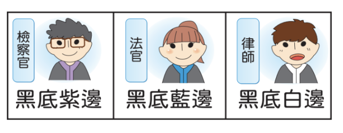

---

### 📊 法庭五大司法人員法袍顏色與核心職掌速查大表（支援翻牌背誦）

| 司法人員職稱 | 法袍鑲邊顏色 (點擊翻牌) | 顏色象徵意義 | 法庭上的核心職責 | 會考秒殺密碼 |
|---|---|---|---|---|
| **法官** | ★ **黑底藍邊** | 如**青天**般公正無私、明察秋毫 | 指揮訴訟進行、獨立做出判決 | 青天大老爺 ➔ 藍邊法官 |
| **檢察官** | ★ **黑底紫邊** | **明辨是非**、打擊犯罪、追求正義 | 偵查犯罪、公訴原告、指揮執行判決 | 紅紫明辨 ➔ 紫邊檢察官 |
| **律師** | ★ **黑底白邊** | **清白**無瑕、為民伸冤、爭取權益 | 受委任為被告辯護或原告代理訴訟 | 洗刷冤屈 ➔ 白邊律師 |
| **公設辯護人** | ★ **黑底綠邊** | **和平、生機、希望**、關懷弱勢 | 國家指派免費為無力請律師之弱勢辯護 | 關懷弱勢 ➔ 綠邊公設辯護人 |
| **書記官** | ★ **黑底黑邊**（全黑） | **黑白分明**、嚴正無私 | 忠實記錄開庭過程、製作開庭筆錄 | 忠實筆錄 ➔ 全黑書記官 |

---

### 🧠 記憶口訣與破題密碼
> 💡 **【法袍顏色秒殺金律】**
> - **五彩法袍黃金口訣**：
>   「**法官青天一片藍，檢察明辨大紅紫，律師清白一身白，公設救弱一抹綠，書記筆錄一片黑！**」
> - **考題必抓三大地雷**：
>   1. **法袍底色全都是「黑色」**：不論法官、檢察官或律師，底色通通都是黑色，只有領口與袖口的**「鑲邊」顏色不同**！
>   2. **公設辯護人是綠邊不是白邊**：自己花錢請的律師是「白邊」；國家免費派給弱勢族群辯護的公設辯護人是「綠邊」！
>   3. **檢察官是紫邊不是紅邊**：取自大紅大紫「明辨是非」之意，法袍邊緣為「紫色」！

---

### 🎯 隨堂觀念自我檢測
* **題目一**：小婷參觀地方法院刑事法庭審判過程，發現法庭上有多位身穿黑色法袍的專業司法人員，其法袍領口與袖口邊緣鑲有不同的色彩。下列關於各司法人員與法袍鑲邊顏色的配對，何者完全正確？
  * (A) 法官：黑底紫邊；象徵大紅大紫威嚴執法
  * (B) 檢察官：黑底藍邊；象徵代表國家如青天般主持正義
  * (C) 律師：黑底白邊；象徵潔白無瑕、為當事人爭取合法權益與洗刷清白 ★（正解：律師為黑底白邊；法官為藍邊、檢察官為紫邊）
  * (D) 公設辯護人：黑底黑邊；象徵黑白分明、冷靜辯護
* **題目二**：被告阿強因涉嫌犯下重大刑事案件遭檢察官起訴，但因阿強家境極為貧寒為低收入戶，無法自行花錢聘請律師。為保障其訴訟權，法院依法為阿強指派一名專業司法人員為其進行辯護。請問該司法人員的法袍鑲邊顏色與象徵意義應為下列何者？
  * (A) 黑底白邊，象徵追求正義
  * (B) 黑底綠邊，象徵和平生機與關懷弱勢人權 ★（正解：國家指派之公設辯護人法袍為黑底綠邊，象徵關懷弱勢）
  * (C) 黑底藍邊，象徵青天公正無私
  * (D) 黑底紫邊，象徵明辨是非打擊犯罪

---

## 📌 重點 46：行政法原理架構全攻略 — 依法行政、行政管制 vs. 行政處分、行政責任（罰鍰）、責任能力四大年齡階層全解密

### 🏷️ 分類資訊
* **筆記本分類**：複習筆記本（第 1～4 冊）
* **冊數進度**：第 4 冊（八年級下學期）
* **科目**：社會（公民）
* **單元章節**：行政法律與行政管制篇（行政法基本原理、行政管制 vs. 行政處分、行政責任之追究、責任能力四階年齡劃分）
* **核心知識點**：依法行政與人權保障（憲法最高性）、行政管制（針對不特定多數大眾限制禁止）、行政處分（針對特定人給予利益或不利益）、行政責任（罰鍰 vs. 罰金）、行政罰責任能力四大年齡劃分（未滿14無責任不罰、14~18得減罰、18~80完全負責、80以上得減罰）。

---

### 💡 核心觀念精粹
1. **行政法的核心理念與憲政價值**：
   * **定義**：國家以公權力明文規定，★ **「政府與人民」雙方都必須嚴格遵守的公法規則**。
   * **依法行政原則**：行政機關行使一切公權力，必須受法律拘束且有法律授權（法律保留原則），且各項命令不得牴觸憲法與法律（法律優位原則），以貫徹**「保障人民基本人權」**之憲法最高宗旨。
2. **行政作為的兩大核心手段：行政管制 vs. 行政處分**：
   * 🚦 **行政管制（對不特定多數社會大眾）**：
     * **對象**：**不特定多數人**（全體社會大眾）。
     * **性質**：制定具有普遍約束力的抽象法規或命令，對民眾的自由與權利進行**「合理的限制或禁止」**。
     * **生活實例**：
       - **交通規則**：騎機車強制佩戴安全帽、紅燈停綠燈行、市區限速 50 公里。
       - **環境衛生**：室內公共場所全面禁菸、垃圾分類不可落地、登革熱防治條例。
   * 📜 **行政處分（對特定人）**：
     * **對象**：**特定人**（具體之個人、法人或特定團體）。
     * **性質**：行政機關就具體事件所為單方的、直接發生法律效果的公法決定。
     * **兩大類型**：
       - ① **給予利益（授益處分）**：核發汽車駕駛執照、發放中低收入戶育兒津貼、核發建築執照、核准發明專利。
       - ② **不利益裁決（負擔處分）**：針對違規者開立交通罰單、勒令違章建築限期拆除、命不合格餐廳勒令停業。
3. **行政責任與行政罰（罰鍰 vs. 罰金終極辨析）**：
   * **行政責任**：人民違反行政法上的義務（如闖紅燈、違章建築、未做環評），必須承擔之公法責任。
   * **制裁手段（行政罰）**：包括★ **「罰鍰」**、沒入違法物品、勒令停業、吊銷駕駛執照等。
   * ⚠️ **【會考萬年必考陷阱：罰鍰 vs. 罰金】**：
     - ★ **罰鍰（行政法）**：由**「行政機關」**（如警察局、環保局、國稅局）依行政法裁處，繳交國庫，**不會留下刑事前科**！
     - ★ **罰金（刑法）**：由**「法院法官」**依刑法判決之財產刑（主刑之一），繳交國庫，**會留下刑事犯罪前科紀錄**！
4. **行政罰之「責任能力」四大年齡階層（行政罰法第 9 條，超級考點）**：
   * 指行為人因年齡與心智成熟度，能否承擔行政法上受處罰制裁的法律資格：
     * ① **0～14 歲（未滿 14 歲）**：★ **無責任能力** ➔ **不予處罰**！（例：國小學童闖紅燈不開罰單，改通知家長加強管教）。
     * ② **14～18 歲（滿 14 歲未滿 18 歲）**：★ **限制責任能力** ➔ **得減輕處罰**！（例：國高中生無照騎車，主管機關得減輕罰鍰金額）。
     * ③ **18～80 歲（滿 18 歲未滿 80 歲）**：★ **完全責任能力** ➔ **完全依法處罰**，自負完全行政法律責任。
     * ④ **80 歲以上（滿 80 歲高齡長者）**：★ **限制責任能力** ➔ **得減輕處罰**！（考量高齡者生理機能退化與人道精神，法律規定得減輕處罰）。

---

### 📊 行政法四大核心維度速查大表（支援翻牌背誦）

| 比較維度 | 核心類別 / 年齡階層 (點擊翻牌) | 規範對象與法律特徵 | 生活具體案例 | 會考解題秒殺密碼 |
|---|---|---|---|---|
| **行政作為手段** | ★ **行政管制** ★ **行政處分** | 管制：對**不特定多數大眾**普遍限制禁止 處分：對**特定人**給予利益或不利益裁決 | 管制：交通號誌規則、禁菸法 處分：核發駕照、寄發交通罰單 | 管制對大眾；處分對特定個人 |
| **處罰性質辨析** | ★ **罰鍰**（行政罰） ★ **罰金**（刑法刑罰） | 罰鍰：行政機關開單，無刑事前科 罰金：法官法院判刑，有刑事前科 | 罰鍰：違停罰 900 元 罰金：酒駕法院判罰 5 萬元 | 警察開單是「罰鍰」；法官判決是「罰金」 |
| **責任能力 0~14** | ★ **無責任能力**（未滿 14 歲） | 心智發育未成熟，法律明確保護 | 12 歲國小生亂丟垃圾不開罰 | ★ **未滿 14 歲：通通不罰！** |
| **責任能力 14~18** | ★ **限制責任能力**（14～18 歲） | 心智漸具成熟，違規減輕處罰 | 16 歲高中生騎車違規得減輕罰鍰 | ★ **14~18歲：得減輕處罰！** |
| **責任能力 18~80** | ★ **完全責任能力**（18～80 歲） | 成年心智成熟健全，負完全處罰 | 25 歲上班族紅燈右轉全額處罰 | 18~80 歲完全責任自行全額承擔 |
| **責任能力 80歲+** | ★ **限制責任能力**（80 歲以上） | 高齡反應退化，基於人道給予減免 | 85 歲老爺爺違規過馬路得減罰 | ★ **滿 80 歲高齡長者：得減輕處罰！** |

---

### 🧠 記憶口訣與破題密碼
> 💡 **【行政法原理與責任能力秒殺金律】**
> - **行政管制與處罰口訣**：
>   「**行政依法保人權，管制大眾處分單！罰鍰行政無前科，罰金刑法關監庫！**」
> - **行政責任能力四階口訣**：
>   「**十四不罰最幼齒，十四十八可減輕，十八八十完全當，八十以上又減罰！**」
> - **考題必抓三大秒殺陷阱**：
>   1. **國中生（13歲）違規騎腳踏車闖紅燈罰不罰？** ➔ ★ **不罰！** 未滿 14 歲為行政法上的無責任能力人，依法不予處罰！
>   2. **80歲以上是完全責任嗎？** ➔ ★ **不是！** 行政罰法特別規定「滿 80 歲人之行為，得減輕處罰」，屬於限制責任能力！
>   3. **核發駕照是管制還是處分？** ➔ 是對特定申請人給予利益的「**授益行政處分**」！

---

### 🎯 隨堂觀念自我檢測
* **題目一**：今年 13 歲就讀國中一年級的阿凱，放學騎自行車返家時因趕時間連續闖紅燈，遭到巡邏員警攔下。依我國《行政罰法》關於責任能力之規定，員警對阿凱的違規行為應採取下列何種處置最為合法合規？
  * (A) 依法開立闖紅燈罰單，對阿凱處以全額罰鍰
  * (B) 阿凱未滿 14 歲屬於無責任能力人，依法不予處罰，但得通知其法定代理人加強輔導管教 ★（正解：未滿 14 歲無責任能力，依法不予處罰）
  * (C) 將阿凱移送地檢署，由檢察官向法院聲請判處罰金
  * (D) 認定阿凱為限制責任能力人，由警察當場逕行減輕其罰鍰至半數
* **題目二**：關於我國《行政罰法》中各項行政管制作為、處罰制度與責任能力之敘述，下列何者完全符合科學法律規範？
  * (A) 政府公布在公共場所全面禁止吸菸之規定，在法律性質上屬於針對特定人的行政處分
  * (B) 滿 80 歲以上的高齡長者，法律推定其人生經驗豐富，其違反行政法上義務時一律負完全責任能力且不得減免
  * (C) 交通違規收到監理機關寄發的違規紅單，繳交之款項屬於「罰鍰」，與刑法法院判決之「罰金」性質不同，不會留下犯罪前科 ★（正解：行政機關裁罰為罰鍰無前科，法院判刑為罰金有前科）
  * (D) 限制責任能力人僅適用於 14 歲以上未滿 18 歲之少年，年滿 18 歲以上者法律上終生皆為完全責任能力

---

## 📌 重點 47：四大法律責任與六大權利救濟程序大對照 — 和解、調解、請願、訴願、訴訟與行政訴訟全攻略

### 🏷️ 分類資訊
* **筆記本分類**：複習筆記本（第 1～4 冊）
* **冊數進度**：第 4 冊（八年級下學期）
* **科目**：社會（公民）
* **單元章節**：權利救濟與法律責任篇（民事、刑事告訴乃論/非告訴乃論、行政責任救濟途徑大對照）
* **核心知識點**：六大救濟途徑本質（和解、調解、請願、訴願、普通訴訟、行政訴訟）、四大法律責任救濟適用判準（民事、刑事乃論、刑事非乃論、行政責任）、訴願先行原則（行政爭訟前置必經程序）。

---

### 💡 核心觀念精粹
1. **六大權利救濟途徑的核心本質**：
   * 🤝 **和解**：由紛爭雙方當事人本於自由意思，互相讓步達成協議（可私下和解，亦可在法庭上做成和解筆錄，與確定判決具同一效力）。
   * ⚖️ **調解**：由公正的第三人（如各鄉鎮市區公所設置之「調解委員會」）居中協調斡旋，協助雙方化解爭端（經法院核定之調解書與確定判決有同一效力）。
   * 📝 **請願**：★ **「事前向行政機關或民意代表提出要求與建議」**（例如：建議增設路燈、陳情修法）。憲法保障之人民權利，但**無法律上拘束力，絕非針對違法處分的事後爭端救濟機制**！
   * 🏢 **訴願**：★ **行政爭訟的「必經前置步驟（優先程序）」**。人民不服違法或不當之行政處分時，必須先向「原處分機關的上級機關」提起審查。
   * 🏛️ **訴訟（普通法院）**：向地方法院提出，由專業法官依據民事訴訟法或刑事訴訟法，審理民事糾紛或刑事犯罪。
   * ⚖️ **行政訴訟（行政法院）**：★ **「民告官」的司法審判機制**。人民對訴願決定仍不服時，依法向高等行政法院提起訴訟，請求法官撤銷違法處分。
2. **四大法律責任救濟適用大解密（會考終極辨析）**：
   * 📘 **民事責任（如借錢不還、租賃糾紛、車禍賠償）**：
     * **可適用**：★ **和解（是）**、★ **調解（是）**、★ **訴訟（是，民事訴訟）**。
     * **不適用**：請願（否）、訴願（否）、行政訴訟（否，非公法爭議）。
   * 📕 **刑事責任 — 告訴乃論（如公然侮辱、普通傷害、毀損器物）**：
     * **可適用**：★ **和解（是）**（與被害當事人和解，非與檢察官；撤回告訴即終結追訴）、★ **調解（是）**、★ **訴訟（是，刑事訴訟）**。
     * **不適用**：請願（否）、訴願（否）、行政訴訟（否）。
   * 🚨 **刑事責任 — 非告訴乃論（如殺人、強盜、放火、酒駕公共危險）**：
     * **可適用**：★ **訴訟（是，由檢察官主動起訴審判）**。
     * **絕對不適用**：★ **和解（否）**、★ **調解（否）**（私下和解賠錢只能供法官量刑從輕參考，國家公訴追訴權絕不可因和解而撤銷！）、請願（否）、訴願（否）、行政訴訟（否）。
   * 🏛️ **行政責任（如交通違規罰鍰、勒令停業、違建強制拆除）**：
     * **救濟黃金二部曲**：★ **訴願（是，先行前置程序） ➔ 行政訴訟（是，司法終審救濟）**。
     * **絕對不適用**：★ **和解（否）**（公權力法定義務不得討價還價私了）、★ **調解（否）**、請願（否）、普通訴訟（否，普通法院不受理告官）。

---

### 📊 權利救濟程序與四大法律責任終極判定矩陣大表（支援翻牌背誦）

| 法律責任項目 | 和解 (點擊翻牌) | 調解 (點擊翻牌) | 請願（事前向機關要求） | 訴願（行政前置程序） | 訴訟（普通地方法院） | 行政訴訟（行政法院） |
|---|---|---|---|---|---|---|
| **民事責任** | ★ **是** | ★ **是** | 否 | 否 | ★ **是** | 否 |
| **刑事・告訴乃論** | ★ **是**（與當事人和解） | ★ **是** | 否 | 否 | ★ **是** | 否 |
| **刑事・非告訴乃論** | ★ **否**（和解不免罪） | ★ **否** | 否 | 否 | ★ **是**（檢警必辦到底） | 否 |
| **行政責任** | ★ **否** | ★ **否** | 否 | ★ **是（必經優先程序）** | 否 | ★ **是（訴願不服後提告）** |

---

### 🧠 記憶口訣與破題密碼
> 💡 **【權利救濟程序秒殺金律】**
> - **責任與程序對應口訣**：
>   「**民事私權可和調，乃論和解撤告銷！非乃公訴辦到底，行政先訴願再打官！請願事前提建議，六大救濟分明白！**」
> - **考題必抓三大地雷**：
>   1. **不服交通罰單直接告上法院行不行？** ➔ ★ **不行！** 行政責任救濟採「**訴願先行原則**」，必須先向訴願機關提起訴願，不服訴願決定後才能向行政法院提起行政訴訟！
>   2. **非告訴乃論（酒駕、強盜）私下賠錢和解算不算結案？** ➔ ★ **不算！** 非告訴乃論之罪關乎公共利益，檢警知悉後必須依法起訴審判到底，私下和解不能撤銷刑事訴訟！
>   3. **請願到底是什麼？** ➔ 請願是憲法保障之人民權益，是「**事前**」向行政機關或立委議員陳情建議，絕不是人民權益受損後的事後救濟！

---

### 🎯 隨堂觀念自我檢測
* **題目一**：阿明因在自家騎樓違規搭建鐵皮屋，遭工務局認定為違章建築並開立限期強制拆除之處分書。阿明認為該鐵皮屋已存在數十年，處分顯有違法不當。關於阿明後續合法正當的權利救濟途徑，下列敘述何者完全正確？
  * (A) 阿明可先向鄉鎮市區調解委員會聲請調解，要求調解委員命工務局撤銷拆除處分
  * (B) 阿明應直接跳過行政機關，聘請律師直接向普通地方法院提起民事損害賠償訴訟
  * (C) 阿明必須先向工務局的上級機關提起「訴願」，若對訴願決定仍不服，始得向行政法院提起「行政訴訟」 ★（正解：行政處分之救濟採訴願先行原則，先經訴願審查再提行政訴訟）
  * (D) 阿明可直接與查報人員私下達成和解協議，約定只要繳納違建罰鍰即可永久免除拆除
* **題目二**：關於我國四大法律責任與各項爭議救濟程序的配對，下列敘述何者完全符合法律規範？
  * (A) 發生非告訴乃論之刑事犯罪（如持刀強盜），只要被害人與加害人達成民事和解賠償，加害人即免除刑事訴訟追訴
  * (B) 租賃房屋所生之租金拖欠與押金返還爭議屬於民事責任，當事人得選擇透過私下和解、聲請調解，或向地方法院提起民事訴訟 ★（正解：民事責任為私權爭端，和解、調解與民事訴訟皆可合法適用）
  * (C) 「請願」屬於事後針對行政機關違法開罰單之正式救濟管道，受理機關具有法律強制拘束力
  * (D) 受到公然侮辱名譽受損之告訴乃論案件，因涉及刑法處罰，依法不得於鄉鎮市區公所調解委員會進行調解

---

## 📌 重點 48：青少年的法律常識全圖解 — 兒童（0~12）只有保障不處罰、少年（12~18）保護事件 vs. 刑事事件、勞基法童工與保護處分全攻略

### 🏷️ 分類資訊
* **筆記本分類**：複習筆記本（第 1～4 冊）
* **冊數進度**：第 4 冊（八年級下學期）
* **科目**：社會（公民）
* **單元章節**：少年事件處理與青少年法律保障篇（兒童 vs. 少年年齡界線、兒少福利保障、勞基法童工規定、少年保護事件 vs. 少年刑事案件、保護處分五種形式、刑罰豁免）
* **核心知識點**：兒童（0~12歲只有保障不處罰）、少年（12~18歲可以保障可以處罰）、勞基法童工（15~16歲保護）、少年保護事件（5年以下徒刑➔五大保護處分）、少年刑事事件（5年以上徒刑➔徒刑/拘役/罰金，絕對不處死刑或無期徒刑）。

---

### 💡 核心觀念精粹
1. **青少年的年齡二分法與基本法律精神**：
   * 🚼 **兒童（0～12 歲，未滿 12 歲）**：
     * **核心原則**：★ **「只有保障，沒有處罰」**！
     * **《兒童及少年福利與權益保障法》**：要求政府、學校、家庭與成年人提供全面保護，成年人若侵害兒童權益或疏於照顧，會產生嚴重行政與刑事責任。
     * **不處罰原則**：兒童心智尚未成熟，無刑事責任能力，★ **不受任何刑罰處罰**！兒童若有觸法行為，全面除罪化，回歸教育體系（教育部）與社會福利體系（社政單位）輔導，完全不移送司法機關受刑。
   * 🎒 **少年（12～18 歲，滿 12 歲未滿 18 歲）**：
     * **核心原則**：★ **「可以保障，可以處罰」**！
     * 兼顧少年健全自我成長之保障，與矯治不良偏差行為之處罰。
2. **《勞動基準法》之「童工」特別保障規範**：
   * **年齡定義**：★ **滿 15 歲以上、未滿 16 歲**受僱從事工作者，在法律上稱為**「童工」**。
   * **特別保障限制**：
     * 每日工作時間不得超過 8 小時，每週工作時間不得超過 40 小時。
     * 例假日不得工作，★ **不得於午後 8 時（晚上8點）至翌晨 6 時（清晨6點）之夜間工作**。
     * 雇主嚴禁指派童工從事繁重及危險性之工作。
3. **《少年事件處理法》少年觸法之雙軌處理機制（會考超級大考點）**：
   * 🛡️ **少年保護事件（情節輕微，5 年以下徒刑）**：
     * **適用範圍**：所犯最輕本刑為★ **「5 年以下有期徒刑」**之罪（例如：普通竊盜、微量吸毒、普通傷害、毀損）。
     * **管轄機關**：由**少年法院（或地方法院少年法庭）**審理，貫徹「保護教育優先」精神。
     * **處分形式**：不科處任何刑罰，而是裁定執行★ **「五大保護處分」**：
       1. **訓誡**（得並予假日生活輔導）：由少年法官當庭嚴正訓勉，並於假日由輔導人員輔導。
       2. **保護管束**（得並命勞動服務）：由少年保護官定期晤談輔導，得要求從事公益勞動服務。
       3. **安置輔導**：轉介交付適當之福利機構、教養機構教導生活。
       4. **感化教育**：送入**少年矯正學校**實施封閉式矯治教育（最長不得逾三年）。
       5. **禁戒或治療處分**：針對毒癮戒除或精神障礙疾病施以治療。
   * 🚨 **少年刑事案件（情節重大，5 年以上徒刑）**：
     * **適用範圍**：所犯最輕本刑為★ **「5 年以上有期徒刑」**之重大重罪（例如：殺人、強盜、重傷、擄人勒贖）。
     * **管轄程序**：由少年法院裁定移送普通地檢署檢察官偵查起訴，交由地方法院刑事庭法官審理。
     * **處分形式**：依法判處刑事刑罰，刑罰種類僅限於★ **「徒刑、拘役、罰金」**三種！
     * ★ **【會考萬年必考豁免條款】**：
       - 刑法明文規定：**對於未滿 18 歲之少年犯，「不得處死刑或無期徒刑」**！
       - 本刑為死刑或無期徒刑者，依法**必須減輕其刑**（改判有期徒刑）！

---

### 📊 青少年法律地位與少年事件雙軌機制速查大表（支援翻牌背誦）

| 法律年齡階層 | 年齡界線 (點擊翻牌) | 核心法理精神 | 違法或偏差行為之法律後果 | 會考解題秒殺密碼 |
|---|---|---|---|---|
| **兒童** | ★ **0～12 歲**（未滿 12 歲） | ★ **只有保障，沒有處罰** | 不受任何刑罰處罰，除罪化回歸學校與社福體系輔導 | 11 歲犯法不進法院，社福教育拉一把 |
| **勞基法童工** | ★ **15～16 歲**（滿 15 未滿 16 歲） | 嚴格保障勞動權益 | 每日工時上限 8 小時，夜間（20~06時）絕對禁止工作 | 15~16 歲童工，夜間八點後禁加班 |
| **少年保護事件** | ★ **12～18 歲**（犯 5 年以下輕罪） | 保護輔導教育重於懲罰 | 少年法院裁定★ **五大保護處分**（訓誡、管束、安置、感化、禁戒） | 5 年以下輕罪 ➔ 少年法官判保護處分 |
| **少年刑事案件** | ★ **12～18 歲**（犯 5 年以上重罪） | 重大惡性追究刑事責任 | 移送檢察官起訴，判處★ **徒刑、拘役、罰金**；★ **絕對不判死刑無期** | 5 年以上殺人強盜 ➔ 刑事判刑，免死免無期 |

---

### 🧠 記憶口訣與破題密碼
> 💡 **【青少年法律常識秒殺金律】**
> - **年齡與處置口訣**：
>   「**十二歲前是兒童，只有保障不處罰！十二十八算少年，勞基童工十五六！**」
> - **少年雙軌與刑罰口訣**：
>   「**輕罪保護五處分，訓誡管束安置感！重罪刑事移檢座，免除死刑無期徒！**」
> - **考題必抓三大地雷**：
>   1. **少年犯下殺人強盜重罪能不能判死刑？** ➔ ★ **絕對不行！** 刑法明定對未滿 18 歲少年犯「不得處死刑或無期徒刑」，一律減輕改判有期徒刑！
>   2. **11 歲國小生偷竊或打人要不要送感化教育？** ➔ ★ **不要！** 12 歲以下兒童全面除罪化，不進司法少年法院，回歸學校輔導！
>   3. **15 歲童工能不能在夜市打工到晚上 10 點？** ➔ ★ **不行！** 勞基法規定童工晚上 8 點至隔天早上 6 點絕對禁止工作！

---

### 🎯 隨堂觀念自我檢測
* **題目一**：今年 16 歲的高一學生阿豪，因缺錢花用竟夥同成年不良分子持刀搶劫超商收銀機現金，被警方依強盜罪（最輕本刑五年以上有期徒刑之重罪）移送法辦。下列關於阿豪本案法律責任之分析，何者完全正確？
  * (A) 阿豪尚未成年，依法由少年法院直接宣告五大保護處分，不負任何刑事責任
  * (B) 阿豪所犯為最輕本刑五年以上之重罪，屬於「少年刑事案件」，由檢察官偵查起訴，但依法不得判處死刑或無期徒刑 ★（正解：犯五年以上重罪屬於少年刑事案件，且未滿18歲少年絕對不處死刑或無期徒刑）
  * (C) 阿豪犯罪情節重大惡性嚴重，法官得打破年齡限制，破例判處阿豪死刑以儆效尤
  * (D) 阿豪在法律上屬於勞基法規定的童工，故其所犯一切罪刑皆可享有刑事豁免權
* **題目二**：關於我國現行法律對「兒童」與「少年」之保護與處分規範，下列敘述何者完全符合法律事實？
  * (A) 11 歲的國小學童若有縱火燒車之觸法行為，應由少年法院裁定送入少年矯正學校施以感化教育
  * (B) 滿 15 歲以上未滿 16 歲受僱工作的青少年在法律上屬於「童工」，雇主不得要求其於晚上 8 點至翌晨 6 點從事夜間勞動 ★（正解：勞基法規定15~16歲為童工，嚴禁夜間20:00~06:00工作）
  * (C) 兒童犯法只要父母事前毫不知情，在少年法院審判時即可完全免除所有保護處分
  * (D) 少年保護事件所執行的保護處分中，以判處罰金並繳納國庫為最常見之首要處分
